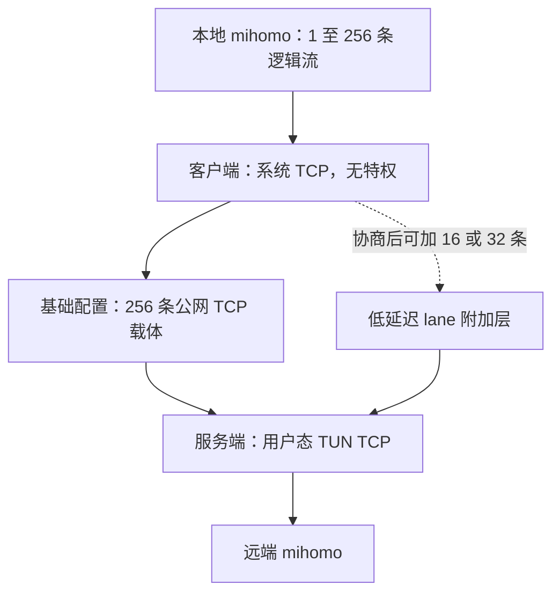
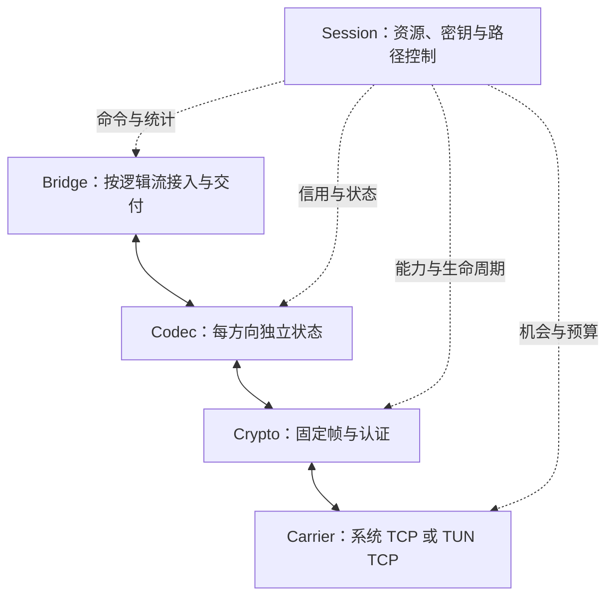
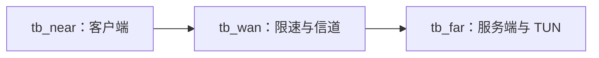

# TBTun 主文档 v2.2

> 精修版，2026-11-12。以用户提供的 v2.1 资料包为唯一编辑基线。
> 保留按 MSS 协商帧长、16 源 TBT-SC2、256 基础载体、借壳、吞洞、BOOSTER、URGENT、晚绑定、可选 lane、256 逻辑流、平台档位和密码套件路线；原始验收门槛不下调。
> 本版修正协议边界、状态生命周期、资源预算和证据归属。未实现或未通过的项目继续标为 OPEN；本轮局部检查不替代 .NET 构建、真实网络或完整联合验收。
> 当前文件由 `build_doc.py` 组装；`parts/` 是编辑源。版本变更见第十七章，历史文件在 `history/`，验证记录在 `verification/`。

## 目录

- [一、目标与读法](#section-001)
  - [1.1 TBTun 是什么](#section-002)
  - [1.2 物理约束（不变）](#section-003)
  - [1.3 需求总表](#section-004)
  - [1.4 这份文档怎么读](#section-005)
  - [1.5 与 v1.1 的主要差别（摘要）](#section-006)
- [二、设计原则](#section-007)
  - [2.1 先算数，再画结构（第一性原理）](#section-008)
  - [2.2 从能工作的简单系统长出来（Gall 定律）](#section-009)
  - [2.3 Actor 模型：不共享可变状态](#section-010)
  - [2.4 防呆（poka-yoke）：让错误写不出来](#section-011)
  - [2.5 古德哈特定律：指标一旦变成目标，就会被做坏](#section-012)
  - [2.6 减法优先（via negativa）](#section-013)
  - [2.7 随证据更新结论](#section-014)
  - [2.8 写作规则（ASD-STE100 的精神）](#section-015)
- [三、第一性原理参数与总体架构](#section-016)
  - [3.0 v1 与 v1.1 数值复核](#section-017)
  - [3.1 协商 Cell 长度（按路径 MSS，留 SACK 余量，符号按 64 B 对齐）](#section-018)
  - [3.2 丢段率 → Cell 擦除率（分方向）](#section-019)
  - [3.3 码率：理想二项界 与 实际码(TBT-SC2)仿真](#section-020)
  - [3.4 原吞吐目标与条件容量对照](#section-021)
  - [3.5 子流、BDP 与窗口](#section-022)
  - [3.6 客户端 Socket 内存：rmem_max 钳制下的两种方案](#section-023)
  - [3.7 内存预算（单客户端，每端 ≤1024 MiB）](#section-024)
  - [3.8 时延与 BOOSTER](#section-025)
  - [3.9 Nonce 与序号](#section-026)
  - [3.10 编解码 CPU（A 档 p<16 度 = 16 稠密 + 6 档×8 稀疏 = 64；B 档 p≥16 度 = 16 + 6×4 = 40；下表保守按 64 计）](#section-027)
  - [3.11 总体架构：四层加一个 Session](#section-028)
  - [3.12 Actor、线程与核](#section-029)
  - [3.13 平台门控](#section-030)
  - [3.14 两遍选择与写门控（客户端上行）](#section-031)
  - [3.15 三种完成与释放（概要）](#section-032)
  - [3.16 能力位与可拆卸件](#section-033)
  - [3.17 工程结构](#section-034)
- [四、载体：非对称的两端](#section-035)
  - [4.1 两端为什么不对称](#section-036)
  - [4.2 每条子流上的字节](#section-037)
  - [4.3 Pacer 与重传时钟（v1 特色，保留并补规则）](#section-038)
  - [4.4 64 位序号与帧定位](#section-039)
  - [4.5 下行借壳（概要）](#section-040)
  - [4.6 上行吞洞（概要）](#section-041)
  - [4.7 字节分三种，只限第三种（CAP-1）](#section-042)
  - [4.8 lane：附加的第五种子流用途](#section-043)
  - [4.9 载体的统计计数器（供第十二章使用）](#section-044)
- [五、因果流式编解码层：TBT-SC2 码的完整定义](#section-045)
  - [5.1 先说清楚这个码要干什么](#section-046)
  - [5.2 名词](#section-047)
  - [5.3 源符号与源信封（被纠错保护的 16 字节）](#section-048)
  - [5.4 运算：GF(16) 与 GF(2)](#section-049)
  - [5.5 伪随机：SplitMix64 与种子派生](#section-050)
  - [5.6 校验符号的定义](#section-051)
  - [5.7 嵌套打孔：码率怎么调](#section-052)
  - [5.8 BOOSTER：卡住时的点名修复](#section-053)
  - [5.9 解码：规范只规定结果，不规定算法](#section-054)
  - [5.10 为什么改掉 v1 / v1.1 的几处设计](#section-055)
  - [5.11 仿真：这个码离理论上限有多近](#section-056)
  - [5.12 码率控制：两个回路分开，显式协调](#section-057)
  - [5.13 测试向量](#section-058)
- [六、线上格式、握手、密钥、Nonce 与三套状态机](#section-059)
  - [6.1 一条子流上的字节长什么样](#section-060)
  - [6.2 元信息（meta，40 字节，加密）](#section-061)
  - [6.3 头部遮蔽（可拆卸装饰器，默认开）](#section-062)
  - [6.4 加密套件、AAD 与 Nonce](#section-063)
  - [6.5 握手](#section-064)
  - [6.6 接收流水线：一帧进来，依次做什么](#section-065)
  - [6.7 下行借壳重传（服务端 → 客户端）](#section-066)
  - [6.8 上行吞洞确认（客户端 → 服务端）](#section-067)
  - [6.9 释放、背压与三种"完成"](#section-068)
  - [6.10 WIN_ACK 的载荷](#section-069)
  - [6.10a 可靠控制（CTRL，type 8；取自另稿第 07 章并精简）](#section-070)
  - [6.10b 每流状态（FLOW_STATE，type 9；v2.1 新增）](#section-071)
  - [6.11 三套状态机](#section-072)
  - [6.12 与 v1 / v1.1 的对照](#section-073)
  - [6.13 本章的不确定性](#section-074)
  - [6.14 里程碑 4 的线格式修订汇总](#section-075)
  - [6.15 v2.2解析与实现边界](#section-076)
- [七、截止期感知的符号调度](#section-077)
  - [7.1 两头都会出错](#section-078)
  - [7.2 每条子流的预计送达时间](#section-079)
  - [7.3 下行的特殊情况：洞会堵住整条子流](#section-080)
  - [7.4 截止期](#section-081)
  - [7.5 每步每子流的份额上限](#section-082)
  - [7.6 选择算法：提交时晚绑定](#section-083)
  - [7.7 降级与低延迟通道](#section-084)
  - [7.8 和新编码的关系](#section-085)
  - [7.9 和客户端两遍选择的关系](#section-086)
  - [7.10 仿真：三种调度的对比](#section-087)
  - [7.11 仿真的局限](#section-088)
  - [7.12 当前有效组合](#section-089)
  - [7.13 里程碑 4 修订汇总](#section-090)
- [八、延迟预算与“队头阻塞”的正面攻坚](#section-091)
  - [8.1 先把“Echo 延迟”说清楚：两个不同的测试](#section-092)
  - [8.2 队头阻塞从哪里来：一张时间线](#section-093)
  - [8.2a 三种等待，不要都叫“队头阻塞”](#section-094)
  - [8.2b 指标口径](#section-095)
  - [8.3 服务端能动用的 9 个杠杆](#section-096)
  - [8.4 三个仿真器，以及为什么相信它们](#section-097)
  - [8.5 结果一：独立 Echo 连接（T-ECHO-A），逐项措施](#section-098)
  - [8.6 结果二：同一字节流（T-ECHO-B），以及物理界](#section-099)
  - [8.7 需求与结果：门槛不改，诚实报告是否满足](#section-100)
  - [8.8 代价清单](#section-101)
  - [8.9 不确定项（需要实验）](#section-102)
  - [8.10 规范性规则（本章新增）](#section-103)
  - [8.11 Echo 的逐项延迟预算（T-ECHO-A，30%，H32）](#section-104)
  - [8.12 本章小结](#section-105)
  - [8.13 规范化的验证程序](#section-106)
  - [8.14 洞口填充与全解码器：为什么 hhf_sim 的结果可以迁移，以及保留的代价（里程碑 5）](#section-107)
  - [8.15 同一字节流的 Echo（REQ-ECHO-B，410/460）：改变前提的路线与量化（里程碑 5）](#section-108)
  - [8.16 lane 是 256 条之上的附加件，可拆卸（里程碑 5）](#section-109)
  - [8.17 用户评审 t7u 之后的措辞与范围修订](#section-110)
- [九、内存与缓冲区](#section-111)
  - [9.1 一条总原则：缓冲区 = 速率 × 扣住时间](#section-112)
  - [9.2 每子流窗口为什么取 3×BDP](#section-113)
  - [9.3 客户端预算](#section-114)
  - [9.4 服务端预算](#section-115)
  - [9.5 与 v1 / v1.1 对比](#section-116)
  - [9.6 MemoryGovernor：超出预算时怎么办](#section-117)
  - [9.7 内存池与固定尺寸 Cell](#section-118)
  - [9.8 历史计算输出的地位](#section-119)
  - [9.9 内存对账（用户评审 t7u）](#section-120)
  - [9.10 加入引导日志的明确预留（v2.2）](#section-121)
- [十、F# 契约](#section-122)
  - [10.1 v1 / v1.1 契约的问题](#section-123)
  - [10.2 规则（R1–R7）](#section-124)
  - [10.3 依赖图（扁平）](#section-125)
  - [10.4 契约源码](#section-126)
  - [10.5 所有权与生命周期（测试覆盖状态须分别报告）](#section-127)
  - [10.6 Actor 与消息](#section-128)
  - [10.7 GC 门槛与实测](#section-129)
  - [10.8 装饰器清单（都可拆卸）](#section-130)
  - [10.9 用户评审 t7u 的措辞修订](#section-131)
  - [10.10 v2.2 Arena变更与证据范围](#section-132)
- [十一、可观察特征与安全](#section-133)
  - [11.1 威胁模型](#section-134)
  - [11.2 密码学性质](#section-135)
  - [11.3 拒绝服务](#section-136)
  - [11.4 TCP 层的攻击](#section-137)
  - [11.5 可观察特征（不隐藏的东西）](#section-138)
  - [11.6 中间盒风险](#section-139)
  - [11.7 日志与隐私](#section-140)
  - [11.8 运维可观察性](#section-141)
  - [11.9 本章的不确定项](#section-142)
  - [11.10 v2.2 的安全一致性门槛](#section-143)
- [十二、测试床与验收矩阵](#section-144)
  - [12.1 拓扑与参数](#section-145)
  - [12.2 脚本清单](#section-146)
  - [12.3 三个指标：段丢失、Cell 擦除、最终恢复失败](#section-147)
  - [12.4 验收矩阵](#section-148)
  - [12.5 样本量与判定规则](#section-149)
  - [12.6 什么已经被计算验证，什么只能靠实验](#section-150)
  - [12.7 本机初步实测记录（2026-11-12）](#section-151)
  - [12.8 v2.2 补充的正确性检查](#section-152)
- [十三、阶段计划与追溯表](#section-153)
  - [13.1 原则：先让简单的东西工作](#section-154)
  - [13.2 阶段](#section-155)
  - [13.3 阻断项与非阻断项](#section-156)
  - [13.4 追溯表的读法](#section-157)
  - [13.5 原始审查 t0u（对 v1）](#section-158)
  - [13.6 v1.1（用户修订 t3u）](#section-159)
  - [13.7 用户评审 t4u（对里程碑 1）](#section-160)
  - [13.8 t5u（里程碑 3 的调度指令）](#section-161)
  - [13.9 用户评审 t6u（下行延迟）](#section-162)
  - [13.10 采用自用户另稿（user-doc-455k.md）](#section-163)
  - [13.11 里程碑 5 本身的三项要求](#section-164)
  - [13.12 用户评审 t7u（下一轮工程：同一资源下同时达标）](#section-165)
  - [13.13 用户指示 t8u（文档优先）](#section-166)
  - [13.14 用户评审 t9u（v2.1：在已达成的基础上继续压）](#section-167)
  - [13.15 v2.2 精修追溯](#section-168)
- [十四、Android 客户端](#section-169)
  - [14.1 总体结构](#section-170)
  - [14.2 套接字层的约束与对策](#section-171)
  - [14.3 NativeAOT 现状](#section-172)
  - [14.4 电量、休眠与进程存活](#section-173)
  - [14.5 Android 上的内存与吞吐档位](#section-174)
  - [14.6 AndroidSpike：入口与出口标准](#section-175)
  - [14.7 不确定项](#section-176)
  - [14.8 用户评审 t7u 的补充](#section-177)
  - [14.9 v2.2核验来源与交付边界](#section-178)
- [十五、联合验收规格：同一套资源下同时达标（t7u 六项）](#section-179)
  - [15.0 通用规则（六项共用）](#section-180)
  - [15.1 第 1 项：配置与预算清单](#section-181)
  - [15.2 第 2 项：原约束下的联合结果](#section-182)
  - [15.3 第 3 项：可部署的调度器与仿真](#section-183)
  - [15.4 第 4 项：最小真实 TCP 闭环](#section-184)
  - [15.5 第 5 项：相关丢失与超时样本](#section-185)
  - [15.6 第 6 项：平台、内存对账与证明的范围](#section-186)
  - [15.7 六项的状态汇总](#section-187)
- [十六、v2.2 精修：有界保留、提交契约与证据边界](#section-188)
  - [16.0 本章的范围、主线与通用判定](#section-189)
  - [16.1 第一组 (a)：按完整解码影响挑选保留洞](#section-190)
  - [16.2 第二组 (b)：借壳机会与内容分开，提交时晚绑定](#section-191)
  - [16.3 第三组 (c)：浅队列、有界批次、就绪集、会话级交互信用](#section-192)
  - [16.4 第四组 (d)：修复预算先给能推进前沿的信息](#section-193)
  - [16.5 第五组 (e)：256 个逻辑流只增加很小的状态](#section-194)
  - [16.6 第六组 (f)：分流要分到真正阻塞的边界](#section-195)
  - [16.7 第七组 (g)：路径偏斜，用理想到达回放分清原因](#section-196)
  - [16.8 结果记录模板（规则 REC-1）](#section-197)
  - [16.9 三组改动的顺序与状态](#section-198)
  - [16.10 本章的不确定性](#section-199)
- [十七、v2.2 精修与交付边界](#section-200)
  - [17.1 本版的基线与保留项](#section-201)
  - [17.2 关键修订](#section-202)
  - [17.3 格式与兼容边界](#section-203)
  - [17.4 预算结论怎样变化](#section-204)
  - [17.5 本轮证据与未执行项](#section-205)
  - [17.6 仍开放的目标](#section-206)
  - [17.7 复核入口与交付约定](#section-207)
- [附录](#section-208)
  - [附录 A 脚本与参考文件索引](#section-209)
  - [附录 B 历史统一发送预算（`calc_budget.out`）](#section-210)
  - [附录 C 规范系数秩检查（`ref/check_rank16.out`）](#section-211)
  - [附录 D 历史条件物理界（`ref/calc_floor.out`）](#section-212)
  - [附录 E 独立复制数学（`ref/calc_dup.out`）](#section-213)
  - [附录 F 历史 lane 代价（`ref/calc_lane.out`）](#section-214)
  - [附录 G 基线线上格式数字（`ref/calc_wire.out`）](#section-215)
  - [附录 H 历史判定规则与样本量（`testbed/calc_accept.out`）](#section-216)
  - [附录 I TBT-SC2 测试向量（`ref/vectors.md`）](#section-217)
  - [附录 J t9u 探索算术，适用限制见第五与十六章（`calc_t9u.out`）](#section-218)
  - [附录 K 历史参数计算原始输出（`calc_results.md`）](#section-219)
  - [附录 L 历史内存预算原始输出（`ref/calc_mem.out`）](#section-220)
  - [附录 M JOINACK2 完整确定性向量（`ref/join_ack_v22_vectors.md`）](#section-221)

---

<a id="section-001"></a>

# 一、目标与读法

> **v2.2 的交付边界。** 本版是可交给工程团队实现、复核的设计规格和参考资料包，不是已经完成联合验收的 TBTun 产品。正文直接修正 v2.1 的矛盾；原始实验、计算输出和旧版本另行保留。第十七章列出本轮真正执行的检查、尚未执行的构建和仍开放的性能目标。保留某项功能，表示保留其需求、协议位置和实现路线，不等于把尚未实现的功能标成已完成。

<a id="section-002"></a>

## 1.1 TBTun 是什么

TBTun 放在 mihomo 的客户端与服务端之间。它把一个客户端的 1–4 条（v2 允许最多 256 条）本地 mihomo TCP 流，分摊到 256 条公网 TCP 子流上，在服务端还原成原来的字节流。它要解决的问题只有一个：**在“每条 TCP 连接被限速到 4 Mbps、往返 400 ms、丢包 5%–65%”的公网上，让一个客户端的双向吞吐接近 1 Gbps，同时让交互流量的往返延迟接近物理下限 400 ms。**



两端采用 F#，目标构建方式为 NativeAOT。服务端需要配置 TUN 的权限，不需要内核模块；客户端各平台的宿主、套接字与 NativeAOT 能力必须分别验证（第十四章）。图中的逻辑流数、载体数和每步源数是三个独立维度，不能互相替换。

这张图与 v1 一致。v2 不改拓扑，不改技术栈，不删任何特色功能（第十三章 13.6 节逐项列出 v1.1 的每个决定在 v2 中的去向）。

<a id="section-003"></a>

## 1.2 物理约束（不变）

1. **链路**：总口 1 Gbps；RTT 400 ms（单程 200 ms）；运营商对每个 TCP 5 元组独立做 4 Mbps（500 kB/s）令牌桶限速；丢包在 5%–50% 之间波动，有时更高。
2. **客户端**：纯用户态，无特权；Android 只能用 `VpnService.protect(fd)` 放行普通 `SOCK_STREAM`；不能改内核参数，不能用原始套接字（第八章 8.15 的路线 R3 是需要特权的**可选**模式，不改变这一条默认前提）。
3. **服务端**：Linux x64，有 root（可建 TUN、配 nftables），但单核偏弱；同时服务多个客户端，每个 256 条子流。
4. **技术栈**：两端都用 F# NativeAOT 编译成原生代码。

<a id="section-004"></a>

## 1.3 需求总表

**原始门槛全部保留，低于它们的预测不能成为替代验收线。** v2.1 曾把一组较低数字叫作“承诺 / 冲刺”；v2.2 将其统一解释为历史的阶段参考值，供定位差距使用。是否通过原始需求，仍按原始需求逐项判定。模型中的上界只在列出的假设内成立，主观的工程成功概率不参与 PASS 判定。

### 1.3.1 吞吐（Mbps，应用层净吞吐，按 IP 字节口径的 1000 Mbps 瓶颈，以太网 IPv4 帧 1415 B）

| 丢包 | v1 门槛 | v1.1 门槛 | 仅扣帧头与码率的模型值 下 / 上（f = 0.25） | 历史阶段参考值（下行） | 历史阶段参考值（上行） | v1 门槛的状态 |
|---|---|---|---|---|---|---|
| 5% | ≥ 820（双向同时） | ≥ 730 | 823.0 / 819.9 | 790 / 810 | 780 / 800 | **未满足，开放**。统一发送预算下 GF(2) 下行 813.4；GF(16) 下行 820.9 尚未扣反向 ACK，双向预算约 811.8；上行 f = 0.25 时 808.5 也尚非完整双向达标证据 |
| 20% | ≥ 680 | ≥ 570 | 696.3 / 661.3 | 660 / 680 | 630 / 650 | **开放**。f = 0.25 的上行模型值低于 680；其他配置须用同一运行的双向总账判定 |
| 50% | 总表 ≥ 400；专门存活用例下 ≥ 400、上 ≥ 380 | ≥ 330 | 431.1 / 377.5 | 410 / 420 | 360 / 370 | **开放**。总目标与专门存活用例分别保留；达到上行 380 不等于达到总表的 400。下行模型有余量，也不等于实测通过 |
| 65% | ≥ 220（不断流） | ≥ 170 | 296.8 / 245.0 | 280 / 290 | 230 / 240 | **模型有余量，联合验收未完成** |

表中模型值 = 1000 × IP 效率 × R_sim。R_sim 来自归档仿真，必须注明使用的是规范参考码 `ref/tbt_code.py` 还是仿真专用码 `ref/tbt_code_sim.py`；二者的结果不能自动互换（第五章）。上行模型引入跨两段的 Cell 比例 f；在所用独立丢段模型里，跨段 Cell 任一组成段未按时恢复，就可能成为截止期擦除。真实的 f、相关性、队首等待和恢复时机由探针测量，不能仅凭一次空队列写入推定。f 是重要变量，但不是原门槛能否达到的唯一变量。

原始文件 `v1-original.txt` 同时包含 50% 总表的 400 和专门验收项的上行 380。v2.2 保留两条来源：总目标按 400 判定，专门存活用例按 380 判定；不以较低数字覆盖较高需求。`v1.1` 的较低门槛同样另列，不取代 v1。

表中“上界”只扣码率与帧头。真正的判定要在同一个 1000 Mbps 预算里同时容纳交互与修补，见第十五章 15.1 的统一预算表；双向同时满载时还要扣反方向 ACK（下行 GF(16) 约 811.8 Mbps）。

v1 的 0.915 效率口径是错的（审查 t0u；第三章 3.0 节复核），按它算出的 813.3/665.5/430.6 Mbps 不能当作上界使用。

### 1.3.2 延迟

| 编号 | 来源 | 需求 | v2 结果（初步仿真；判定配置 C256 = 256 条之内，扩展 C288 = 加 32 条 lane，第十五章 15.0.1） | 状态 |
|---|---|---|---|---|
| REQ-ECHO-A | v1 验收项五；另稿 REQ-024 | 30%、满载、同一隧道 50 Hz 64 B Echo：P50 ≤ 408、P99 ≤ 450 ms，超时计入 | C256（只用洞口填充，Q25R）：P50 405、P99 631–635 ms，P(≤408) 0.67–0.70，P(≤450) 0.77–0.79。扩展 C288（QL）：403/407/409，P(≤450) ≈ 1.0 | **C256 未满足，开放**（判定列）；C288 满足（计算，对照列，不能代替判定）；相关丢失下 P99 约 487 ms。改进与验收程序见第十五章 15.2–15.5 |
| REQ-ECHO-A5 / A50 | v2 新增 | 同上，5% / 50% | 5%：C256（Q25）403/407/409，P(≤450) = 1.0000；50%：只有扩展配置的结果 403/424/439 | 5%：C256 满足（计算，初步）；50%：C256 未仿真，开放 |
| REQ-ECHO-B | v1.1 | 与满载同一字节流：P50 ≤ 410、P99 ≤ 460 ms | 原配置的前缀容量分析与仿真未通过；R2 拆流 403/407/409 改变了有序流边界；R3 406/424/431 属归档模型结果，不是完整 TBTun 真实测试床结果 | **原条件未满足，开放**。R2 作为不同业务组织条件另列；R3 另列特权、平台、偏斜条件，不能顶替原条件 |
| REQ-PROC | v1 | 一次恢复成功时，单向处理附加延迟 P50 ≤ 1.5 ms、P99 ≤ 5 ms | 第八章 8.11 的逐项处理预算 | 预算待实测，不计 PASS |
| REQ-FLUSH | v1 | 不足一整步的小包 0 等待立即冲刷 | k < 16 的部分步立即发出（第五章 5.6a） | 设计满足 |
| REQ-FIRST | v1.1 | > 99.2% 的步不需要修复 | 码率回路目标；判定规则见第十二章 12.5.2 | 待实验 |
| REQ-STALL | v1.1 | 停顿 P99.9 ≤ 1200 ms | BOOSTER 一轮路径内；在 L-24H 判定 | 待实验 |

### 1.3.3 内存、并发、启动

| 编号 | 来源 | 需求 | v2 结果 | 状态 |
|---|---|---|---|---|
| REQ-MEM | v1、v1.1 | 每端 ≤ 1024 MiB（单客户端满载） | 旧模型客户端约 700 典型 / 828 压力预算 MiB（5%，含 lane）；服务端 319 MiB | 算术可复算；不是实测 RSS 或全状态最坏上界。v2.2 新状态、池元数据和未决责任须计入第九章总账 |
| REQ-MC | v1 验收项七、v1.1 | 4 客户端（1024 条子流），`taskset -c 0,1`，数据一致，服务端不超内存池 | 旧模型服务端 389 MiB（4 客户端）、670 MiB（16 客户端） | 共享池预算待联合压力验证，不计实测 PASS |
| REQ-START | v1 验收项二 | 3 秒内 `carriers_up = 256/256`，客户端无特权启动 | TCP 连接 1 RTT + 引导帧 1 RTT + JOIN 并行 ≈ 3 RTT = 1.2 s | 估计满足，待实验 |
| REQ-RETX | v1 验收项四 | 50% 时客户端内核重传率 `tcpi_total_retrans / segments_out < 8%`；`downlink_borrow_retx > 0`、`uplink_virtual_ack > 0` | 上行吞洞使被解码器补齐的洞不触发客户端重传；计数器名在 v2 中保留 | 待实验 |
| REQ-PRIV | v1 | 客户端零特权；服务端无内核模块 | 设计满足（R3 例外，可选） | — |

<a id="section-005"></a>

## 1.4 这份文档怎么读

**章节**：

| 章 | 内容 | 谁要读 |
|---|---|---|
| 一 | 目标、需求总表、读法、与 v1.1 的主要差别 | 所有人 |
| 二 | 设计原则 | 所有人 |
| 三 | 第一性原理参数（帧长、擦除、码率、吞吐、窗口、BOOSTER、Nonce、CPU）与总体架构 | 所有人 |
| 四 | 载体：非对称载体、写门控、借壳、吞洞、Pacer | 载体、TUN TCP 开发者 |
| 五 | TBT-SC2 编码的完整定义与测试向量 | 编解码开发者 |
| 六 | 线格式、握手、密钥、Nonce、状态机、借壳与吞洞细则 | 所有实现者 |
| 七 | 截止期感知调度 | 调度开发者 |
| 八 | 延迟预算与队头阻塞：仿真、物理界、规则 | 所有人 |
| 九 | 内存与缓冲区 | 所有实现者 |
| 十 | F# 契约源码、旧构建证据与本版待构建项 | 所有实现者 |
| 十一 | 可观察特征与安全 | 安全评审、部署 |
| 十二 | 测试床与验收矩阵（含本机的初步实测） | 测试 |
| 十三 | 阶段计划与追溯表 | 负责人 |
| 十四 | Android 客户端 | Android 开发者 |
| 十五 | 联合验收规格：同一套资源下同时达标（t7u 六项的设计、验收标准与实验程序） | 测试、调度开发者、负责人 |
| 十六 | v2.1 修订：t9u 的设计与验收规格（按影响挑洞、晚绑定、浅队列与就绪集、修复预算、256 流小状态、分流边界、路径偏斜；"只会更好"判定） | 调度、载体、Session 开发者，测试，负责人 |
| 十七 | v2.2 精修：变更追溯、证据边界、交付物和复核入口 | 所有人 |
| 附录 | 脚本与仿真清单、测试向量摘要 | 复核者 |

**证据要说明对象、版本和条件。** 本文使用五种标注：算术复算、模型结果、历史原型记录、当前静态或局部检查、待完整实现验证。确定性只保证同一模型可以复现，不保证模型包含真实网络的全部约束。第十二章的 Linux 最小闭环证明过部分 TCP 行为，不包含完整 TBT-SC2、AEAD、调度和双向满载链路。

旧包记录过 .NET SDK 10.0.401 的 JIT / NativeAOT 契约运行。v2.2 改过契约，旧成功记录不能沿用为新源码的构建证明；本轮环境没有 .NET SDK，当前构建状态见第十七章。文中留存的 `P(工程通过)` 是当时作者的主观规划估计；它不是置信区间、统计检验结果或产品保证。经验频率 `P(≤450 ms)` 也必须连同样本量与配置阅读。

**用词**。本文按 ASD-STE100 的精神写：一个词一个意思，一句一件事，主动语态，先结论后理由。几个容易混的词固定如下：

| 词 | 只表示 |
|---|---|
| 段（segment） | 一个 TCP 段 |
| 帧 / Cell | 一个 L 字节的 TBTun 单元（分块头 + cell_seq + meta + 符号 + 标签 + 分块尾） |
| 符号 | Cell 里被编码保护的 S 字节 |
| 步 | 最多 16 个源符号及其校验组成的编码单位；立即冲刷可形成 k < 16 的部分步 |
| 子流 | 一条承载 TCP 连接；大流量子流 path_id 0..255，lane 子流 256..287 |
| 擦除 | 截止期前没有读到并认证通过的 Cell |
| 可读 | 接收程序能从套接字读出该 Cell（对下行客户端内核 TCP，意味着它前面没有未补的洞） |
| 完成 | 三种：解出、认证后接管责任（custody）、按流交付；保管确认不自动解除所有编码历史与重造责任（第六章 6.9.1） |

<a id="section-006"></a>

## 1.5 与 v1.1 的主要差别（摘要）

完整列表在第十三章追溯表。这里只列改变了设计形状的几条：

| 方面 | v1.1 | v2 | 为什么 |
|---|---|---|---|
| 帧长 | 固定 1087 B | 按 MSS 协商：L = S + 71（以太网 IPv4 1415 B） | 固定帧在 SACK 使 MSS 收缩、蜂窝 MTU 时会被切开，擦除翻倍（t4u） |
| 编码 | 跨度 {0,1,4,16,64}，部分校验带累加结构 | TBT-SC2：本步稠密 + 跨度 {1,2,4,16,64,256} 稀疏，无隐藏状态，分数 ρ | 任意打孔安全；单步失败从 39%–69% 降到 0.06%–0.35%（第五章） |
| 源信封 | real_len、flow_slot、flags、flow_gen | 加 stream_offset，共 16 B，进编码保护 | 恢复整 Cell 后仍知道字节属于哪条流、哪个位置 |
| 写门控 | SIOCOUTQNSD < 16 KiB | 各平台映射（Android 用 tcpi_notsent_bytes）+ 两遍选择 + 截止期调度 | SELinux 禁止 Android 应用调用 SIOCOUTQNSD |
| 接收窗口 | SO_RCVBUF 512 KiB | 自动调优 + TCP_WINDOW_CLAMP 600 000 B（3×BDP） | 非特权进程被 rmem_max 钳制；一个洞要扣住 3·OWD 的数据 |
| 借壳 | 半帧洞按位置补语法字节和 0 | 整帧洞装新货（新 Nonce）；半帧洞凭 64 B 描述符原样重造 | 补 0 造成混合帧认证失败 |
| 吞洞 | 看解码前沿 W_c | 安全性来自源保留租约（取自另稿） | 更直接、可证明 |
| Nonce | 每路径 cell_seq | 每方向全局计数器，头部遮蔽 | 换钥只需一个切点；不暴露单调计数器 |
| BOOSTER | 0.6 SRTT 定时触发 | 结构触发（越过跨度 64 仍缺秩） | 检测从约 240 ms 缩到约 14–20 ms |
| 延迟 | 未区分三种等待 | 三种等待分开；URGENT 自带校验；立即补洞；洞口填充；lane 附加件 | 下行队头阻塞是延迟的主因（第八章） |
| 验收 | 三个指标的思想 | 三个指标定义到计数器；判定规则与样本量；测试床在本机实跑（初步）；联合验收：原 256 配置、统一预算、同一次运行同时判定（第十五章） | 可归因、不送分；扩展配置不能顶替原配置 |
| 预算 | 各机制各算各的 | 每方向一个 1000 Mbps 总预算，逐类记账；副本顶替而不叠加（BUD-1）；多份修补只给关键洞（BUD-2）；820 档要求下行 GF(16)（BUD-3） | 同时满足吞吐与延迟必须在同一个预算里证明（t7u） |
| v2.1 增量（t9u） | — | 按完整解码影响挑洞、8/12/25 ms 条件保留、借壳机会与内容晚绑定、浅待发送队列与就绪集、会话级交互信用、每流状态 FLOW_STATE、修复成本指标、分批副本、OPEN 流水、交互三态、理想到达回放；"只会更好"的配对判定 | 收回洞口保留给大流量的代价，减少无效修复与控制流量，256 流调度成本 ∝ 就绪流数（第十六章；修订清单 13.14） |

---

<a id="section-007"></a>

# 二、设计原则

这一章写“为什么这样设计”的规矩。后面每一章的取舍都能回到这里的某一条。原则不是口号：每一条后面都列出它在 v2 里落成的具体规则或具体删除，以及违反它时会出什么问题。

<a id="section-008"></a>

## 2.1 先算数，再画结构（第一性原理）

每个参数应注明来源：物理约束、可复算的模型、实验测量，或尚待验证的工程选择。新版本不能仅因重新设计就丢掉旧系统成立的约束；先解释原值保护什么，再说明改值后的边界。脚本可复算是必要条件，还须检查脚本用的模型是否就是要实现的协议。

| 参数 | 推导 | 在哪里 |
|---|---|---|
| 子流数 256 | 1000 Mbps ÷ 4 Mbps = 250，取 2 的幂 | 3.5 |
| 帧长 L = S + 71 | S = 64·⌊(MSS − 32 − 71)/64⌋：MSS 减去 SACK 选项最多 32 B，减去固定开销 71 B，按 SIMD 64 B 对齐 | 3.1 |
| 接收窗口参考值 600 000 B | 500 000 B/s × 0.4 s × 3 = 600 000 B，即 3 倍 RTT 带宽时延积；它包含余量。仅按 3·OWD = 0.6 s 积压推算是 300 000 B，不能混为同一推导 | 9.2 |
| 码率 ρ | 针对指定规范码、擦除模型、截止期与种子的首轮恢复扫描；仿真专用码不得冒充规范码 | 3.3、5.11 |
| lane 份数 N、重复 R | εⁿ 只适用于相应独立失败假设；生产放置使用按时可读的条件联合失败率，并计入共享瓶颈 | 8.10 |
| 重放窗 2²⁰ 位 | 覆盖“最早到达与最晚到达的帧之间发出的帧数”：每秒约 9 万个号码 × 最坏乱序跨度 | 6.6 |
| netem 队列 100 000 包 | > 1 Gbps × 400 ms ÷ 1500 B = 33 334 包 | 12.1.2 |

**反例（v1 的教训）**：v1 的写门控“未发字节 < 1079 才写”，看上去是防粘包的好规则，但算一下：每条子流每个 RTT 只能写入 1 帧，256 × 1079 × 8 / 0.4 s = 5.52 Mbps（审查 t0u）。这个数字一算出来，规则就必须改。v2 的原则是：**任何门控、上限、阈值，写下之前先算它对吞吐和延迟的上界**。

<a id="section-009"></a>

## 2.2 从能工作的简单系统长出来（Gall 定律）

能工作的复杂系统，都是从能工作的简单系统演化来的。由此得到三条做法：

1. **性能增强可独立组合，正确性约束始终生效。** lane、机会排序、额外副本可以分别关闭做对照；关闭后仍须满足基础字节流正确性。认证、Nonce 唯一、重放防护、资源所有权和整帧边界检查属于安全边界，不能当作生产环境任意拔掉的装饰器。禁用某个性能增强后达不到原门槛，就报告该配置未通过。
2. **按阶段加功能**，每加一项做一次 A/B（第十三章）。一个阶段的退出条件是测试床上的数字。
3. **先校准测试床，再解释产品成绩。** 旧环境有第十二章 12.7 的原型记录；换机器、脚本或后端后必须重新校准。既有记录不等于目标机已验证。

<a id="section-010"></a>

## 2.3 Actor 模型：不共享可变状态

每个 actor（Session、MemoryGovernor、每方向一个 Codec、Carrier）是一个单线程循环，只处理自己邮箱里的消息，不和别的 actor 共享可变数据（第十章 10.6）。好处：

- **单一修改者**：actor 的内部状态无需多方同时加锁；跨线程邮箱、共享池和关闭协议仍须明确同步、背压与所有权，不能据此宣称系统没有死锁；
- **确定性**：时间和随机数只从注入的 `IClock`、`IEntropy` 来，仿真器按（时间，actor 编号，序号）全序投递消息，同一种子产生逐字节相同的结果；
- **故障隔离**：一个子流出错只影响 Carrier 里的一条路径状态，不会把 Codec 的状态弄脏。

代价是消息传递、同步和有界队列容量。消息采用值类型，热路径使用预分配邮箱；大块 Cell 用带代际及独立租约身份的句柄传递。句柄的实际大小与池元数据按第十章 v2.2 契约计入预算，不再沿用旧版“8 字节”数字。零分配只在被测线程和被测调用范围内成立。

<a id="section-011"></a>

## 2.4 防呆（poka-yoke）：让错误写不出来

能用类型、号段、校验和让错误变成“写不出来”或“立刻报错”的，就不要靠文档提醒。v2 的防呆清单：

| 可能的错误 | 防呆 | 在哪里 |
|---|---|---|
| 补洞段装进新的源数据（违反借壳规则） | 补洞走单独的 `TryPullFill`，返回类型 `FillCell` 里没有源数据字段 | 10.1 |
| 把 StepId 当 CellSeq 传 | 单例结构体包装 `PathId`、`StepId`、`CellSeq`、`MonoNs`，混用是编译错误 | 10.2 R5 |
| 释放后再用旧句柄 | `CellHandle` 带代次，旧句柄被拒绝 | 10.4 |
| lane 与大流量号段混用 | JOIN 的 role 字节：role = 1 时 path_id ∈ [256, 288)，否则 < 256；不符即拒绝 | 6.5.7 |
| 32 位序号回绕后帧位置算错 | 一律 64 位展开；测试用 ISN 0xFFFE_0000 | 6.1、12.4.4 |
| 旧连接的迟到数据流进新连接 | flow_gen：flow_slot 复用时加 1，旧代数据丢弃 | 5.3 |
| 换钥窗口内试解两代密钥（CPU 放大） | 计数器切点 CutCounter 查表选钥，每帧只解一次 | 6.5.6 |
| 伪造大计数器挤掉正常帧 | 重放窗只在认证通过后才移动 | 6.6 |
| 半帧洞被新内容填上（混合帧） | HHF-4：只填整 Cell 洞；`HoleFillGuard` 装饰器检查 | 8.10 |
| 用“已送达”当“已解出”释放源 | 三种完成分开；认证保管确认只解除对应恢复责任，仍被编码历史、密文重造或其他租约引用的源不得归还 | 6.9 |

<a id="section-012"></a>

## 2.5 古德哈特定律：指标一旦变成目标，就会被做坏

“当一个度量变成目标，它就不再是好的度量。”v2 在定义指标时预先堵住几种常见的做坏方式：

- **超时样本计入**：Echo 探测没回来的记 5000 ms，留在样本里（另稿 REQ-024）。否则丢得越多、删得越多，分位数反而越好看。
- **单程分位数不能相加或翻倍**：完整 Echo 的分位数必须逐个探测相加后再取（t6u）。
- **三个指标分开**：段丢失、Cell 擦除、最终恢复失败分开设门槛，不能用“最终 SHA 一致”掩盖中间层的问题（v1.1）。
- **零失败要写样本单位与区间**：独立 Bernoulli 假设下，n 次试验零失败的单侧 95% 频率学上界是 1 − 0.05^(1/n)，约为 3/n。若使用贝叶斯后验，必须写先验。相关步和相关丢包不能直接按独立次数相乘（12.5.3）。
- **门槛不改**：一个配置达不到原始门槛时，写“未满足，开放”，并继续改进；不把门槛改小（t6u）。

<a id="section-013"></a>

## 2.6 减法优先（via negativa）

很多改进来自删掉东西。v2 删掉的：

| 删掉的 | 为什么 |
|---|---|
| 固定帧长（1079 / 1087 B） | 被 MSS 收缩、蜂窝 MTU 切开后擦除翻倍；改为协商 |
| 双对角累加器校验 | 有隐藏状态，打孔不安全；TBT-SC2 无隐藏状态 |
| 半帧洞补 0 | 造成混合帧认证失败；改为原样重造 |
| 全局解码屏障 | 一个流的洞挡住所有流；改为按 flow_slot 交付（URG-2） |
| 换钥时试解两代 | CPU 放大；改为计数器切点 |
| 0.6 SRTT 的 BOOSTER 定时器 | 检测太慢（约 240 ms）；改为结构触发（约 14–20 ms） |
| 编码段边界事务（另稿 PREPARE/COMMIT） | TBT-SC2 没有隐藏状态，码率切换没有边界，不需要 |
| 每路径 cell_seq | 换钥要 256 个切点；改为每方向全局计数 |

<a id="section-014"></a>

## 2.7 随证据更新结论

没有实验支撑的参数可以先提出，但应写清依赖条件、代价和推翻它的观测。保留的工程成功概率是历史规划判断，不是验收证据；不要求为了显得精确而给每件事编一个概率。以下是旧版判断的变化记录：

- 阶段 1 的实验 A1 若通过，只能增强对其受测条件的信心，不能直接把生产可靠性改写为 0.99。若未通过，保留问题和日志；lane 可作为另列的扩展配置继续开发，不能替代基础 C256 的未通过结论。
- 本机测试床跑通以后，第十二章“脚本一次跑通”的估计（0.6）被实际结果否定：第一次运行发现并修正了 8 处问题（12.7.4 节），其中一处（内核没有 netem）需要写一个新的仿真器。这比“要改一两处”严重得多。教训是：凡是依赖外部环境（内核模块、发行版、工具版本）的估计，先验要更悲观；我把同类估计下调到约 0.2。

把不确定的事写成确定的，会让后来的人按错误的前提工作。把确定的事写成不确定的，会浪费验证资源。两种错误都要避免，所以每个数字都标出它属于哪一类（1.4 节）。

<a id="section-015"></a>

## 2.8 写作规则（ASD-STE100 的精神）

- 一个词只表示一个意思（1.4 节词表）；
- 一句话说一件事；先给结论，再给理由；
- 用主动语态，写清楚“谁做什么”：“服务端在同一个事件循环轮次内重传洞的第一个段”，而不是“洞会被及时修补”；
- 规则写成可检查的形式：有编号（HOLE-1、LANE-0、URG-2……），有触发条件、动作和例外；
- 数字带单位和来源；
- 不用“显著”“大幅”“几乎”这类没有数字的词，除非后面跟着数字。

---

<a id="section-016"></a>

# 三、第一性原理参数与总体架构

本章分两部分。3.0–3.10 先算数：帧长、擦除、码率、吞吐、窗口、内存、BOOSTER、Nonce、CPU，保留 `calc_params.py` 的历史算术输入与表格，并由本版正文明确哪些只是条件模型；v2.2的勘误与联合预算检查见`ref/check_budget_v22.py`。3.11–3.17 再画结构：四层加一个 Session、actor 与消息、平台门控、共同中断。顺序是有意的：结构服从数字（第二章 2.1）。

> 历史复现：`python3 calc_params.py`。该脚本与原始输出保留；正文已修正旧推断，不能再用脚本中的“承诺/冲刺”“最坏”标签覆盖本版原目标。算术相同不等于性能达标。

<a id="section-017"></a>

## 3.0 v1 与 v1.1 数值复核

先复核 v1 与 v1.1 的数字，确认审查意见 t0u 指出的问题是真实的。下面的每一行都由 `calc_params.py` 重算。

- v1 写门控: 256*1079*8/0.4 = 5.52 Mbps
- v1 m=1: 1000*0.915*R = 813.3 Mbps
- v1 20% m=3: 1000*0.915*R = 665.5 Mbps
- v1 50% m=9: 1000*0.915*R = 430.6 Mbps
- v1 50% m=10: 1000*0.915*R = 406.7 Mbps
- v1 R=0.42: 1000*0.915*R = 384.3 Mbps
- v1 1448+710 切分, 段丢失 20%: Cell 擦除 28.0000%
- v1 1448+710 切分, 段丢失 50%: Cell 擦除 62.5000%
- v1 1448+710 切分, 段丢失 65%: Cell 擦除 76.3750%
- v1 Socket 记账: 256*(2*1MiB+2*256KiB) = 640 MiB；+304 = 944 MiB
- v1 BOOSTER 理想路径 1.1*400+200+200 = 840 ms；两帧全丢 0.65^2 = 42.2500%
- v1 四步耦合时间覆盖 @820 Mbps = 0.320 ms

v1.1 复核：
- v1.1 帧效率口径: 1016/1153 = 0.8812（每帧独占一个以太网帧：14+20+32 头）
- v1.1 5% (16,2): R=0.8889, Gmax=1000*0.8812*R = 783.3 Mbps
- v1.1 20% (16,6): R=0.7273, Gmax=1000*0.8812*R = 640.9 Mbps
- v1.1 50% (16,20): R=0.4444, Gmax=1000*0.8812*R = 391.6 Mbps
- v1.1 65% (16,40): R=0.2857, Gmax=1000*0.8812*R = 251.8 Mbps
- v1.1 1087 B 帧在 1448 B 段里的跨段比例 = 1086/1448 = 0.7500；客户端内核合并发送时
  - 段丢失 5% → Cell 擦除 0.0856（v1.1 码率按 5% 选）
  - 段丢失 20% → Cell 擦除 0.3200（v1.1 码率按 20% 选）
  - 段丢失 50% → Cell 擦除 0.6875（v1.1 码率按 50% 选）
  - 段丢失 65% → Cell 擦除 0.8206（v1.1 码率按 65% 选）
- v1.1 单步(不靠耦合)解码失败概率 = P(18 个里丢 >2 个) 等：
  - 5%, (16,2): P(擦除>2) = 0.0581
  - 20%, (16,6): P(擦除>6) = 0.1330
  - 50%, (16,20): P(擦除>20) = 0.2025
  - 65%, (16,40): P(擦除>40) = 0.1242
  说明 v1.1 的码率表只在‘多步耦合补齐统计起伏’时成立；耦合效果必须仿真，见第 3 节。
- v1.1 BOOSTER 路径: 单向 200 + 检测 0.6*400=240 + 往返 400 = 840 ms（单向交付时延）

<a id="section-018"></a>

## 3.1 协商 Cell 长度（按路径 MSS，留 SACK 余量，符号按 64 B 对齐）

帧长决定了三件事：每字节的头开销、帧会不会被 TCP 切开、32 位序号回绕后帧位置怎么算。v2 不写死帧长，而在握手时按路径 MSS 协商（用户评审 t4u 第 1 条）。

- 帧固定开销 O = 分块头 5 + 尾 2 + cell_seq 8 + 元信息 40 + 标签 16 = 71 B
- SACK 余量 32 B（时间戳在场时最多 3 个 SACK 块 = 26 B，再取整）
- 符号候选S=64*floor((MSS−32−71)/64)，帧长L=S+71、载荷S−16；线上合法S集合及小MSS的STRADDLE协商按6.1.2（当前1024…1344的64倍数）。候选超界不得静默截断并仍声称一段一帧。

| 路径 | MSS(含时间戳) | 符号 S | 帧长 L | 载荷 | 帧/载荷效率 | 下行 IP 效率(1 帧 1 段) | 上行 IP 效率(满 MSS 合并) | 2^32 mod L |
|---|---|---|---|---|---|---|---|---|
| 以太网 IPv4 | 1448 | 1344 | 1415 | 1328 | 0.9385 | 0.9052 | 0.9060 | 816 |
| PPPoE IPv4 | 1440 | 1280 | 1351 | 1264 | 0.9356 | 0.9009 | 0.9030 | 494 |
| 以太网 IPv6 | 1428 | 1280 | 1351 | 1264 | 0.9356 | 0.8883 | 0.8907 | 494 |
| PPPoE IPv6 | 1420 | 1280 | 1351 | 1264 | 0.9356 | 0.8883 | 0.8905 | 494 |
| 蜂窝/464XLAT | 1320 | 1216 | 1287 | 1200 | 0.9324 | 0.8830 | 0.8842 | 1192 |

- 参考取模值（核对用户笔记）：2^32 mod 1420 = 1216，2^32 mod 1392 = 16，2^32 mod 1400 = 1096，2^32 mod 1360 = 256，2^32 mod 1280 = 256，2^32 mod 1087 = 939
- 结论：2^32 对任何非 2 的幂帧长取模都不为 0，32 位序号回绕后直接取模必错；一律用 64 位展开序号。
- 对照 v1.1 1087 B：载荷 1016，效率(以太网 L2 口径) 0.8812；v2 以太网 IPv4 档 L2 口径 = 0.8967
- SACK 例子：1420 B 帧遇 1392 B 有效 MSS 切成 1392+28，段丢失 50% 时帧擦除 = 1-0.5^2 = 75.00%

<a id="section-019"></a>

## 3.2 丢段率 → Cell 擦除率（分方向）

网络丢的是 TCP 段，编码看到的是 Cell。两者之间的换算关系决定了码率要按什么擦除率选。下行服务端每段只装一帧，换算是恒等的；上行客户端内核会合并发送，一部分帧跨两段。

- 下行：服务端用户态 TCP 每段只装 1 帧，擦除 = p（中间设备重新分段时另计）。
- 上行：客户端内核会把积压帧合并成满 MSS 段。设跨段比例 f（两轮选路后实测估计；f=0 全对齐，固定满MSS合并且均匀遍历对齐周期时f=(L−gcd(L,MSS))/MSS；L/MSS只是近似）。
- 帧跨两段 → 擦除 1-(1-p)^2；本表 f 取 0、0.25、0.5、0.93。v2模型值f=0.25，验收必须实测。此换算假定每Cell至多跨两段、分段擦除独立且按首轮完整可见性计；相关丢失、重分段、TCP前缀和截止期需另外建模。

| 段丢失 p | f=0 | f=0.25 | f=0.5 | f=0.93 |
|---|---|---|---|---|
| 1% | 0.0100 | 0.0125 | 0.0150 | 0.0192 |
| 5% | 0.0500 | 0.0619 | 0.0737 | 0.0942 |
| 10% | 0.1000 | 0.1225 | 0.1450 | 0.1837 |
| 20% | 0.2000 | 0.2400 | 0.2800 | 0.3488 |
| 30% | 0.3000 | 0.3525 | 0.4050 | 0.4953 |
| 50% | 0.5000 | 0.5625 | 0.6250 | 0.7325 |
| 65% | 0.6500 | 0.7069 | 0.7638 | 0.8616 |

<a id="section-020"></a>

## 3.3 码率：理想二项界 与 实际码(TBT-SC2)仿真

码率不能只看理想界。下面先给有限窗口的理想界，再给 TBT-SC2 在多种子仿真下的已有扫描选定冗余ρ。样本首轮恢复率不能证明所有轨迹下的最小冗余，也不直接提供应用Echo分位数。2–3个百分点差距只在相应样本模型下成立。

- 下列乘积只适用于独立均匀含零系数矩阵；本规范非零系数与系统源行须真实消元。GF(16)参考满秩概率：8 未知收 8/9/10 条 = 0.933595/0.995834/0.99973959；16 未知收 16/17 条 = 0.933595/0.995834
- GF(2) 随机方程满秩：16 未知收 16/17/18/20 条 = 0.2888/0.5776/0.7701/0.9388

理想界（窗口 n 源，每窗失败 ≤1e-3）：

| 擦除 ε | 1-ε | n=256 R | n=1024 R | n=4096 R |
|---|---|---|---|---|
| 5% | 0.9500 | 0.9014 | 0.9275 | 0.9392 |
| 10% | 0.9000 | 0.8393 | 0.8715 | 0.8860 |
| 20% | 0.8000 | 0.7293 | 0.7647 | 0.7826 |
| 30% | 0.7000 | 0.6259 | 0.6632 | 0.6815 |
| 50% | 0.5000 | 0.4354 | 0.4667 | 0.4831 |
| 65% | 0.3500 | 0.2994 | 0.3237 | 0.3366 |

规范码样本（必须通过ref/robust.py绑定ref/tbt_code.py；直接运行sim_decode.py使用另一探索图，见5.5）：满16源、独立Cell擦除、无限精确ML消元，评价64步内是否整步恢复，不包含TCP可读性、部分步、CPU或真实时钟。

| 擦除 ε | GF(16) 选定 ρ | GF(16) R | GF(2) 选定 ρ | GF(2) R | 理想 1-ε | GF(16) 相对 1-ε 的差 |
|---|---|---|---|---|---|---|
| 5.00% | 0.090 | 0.9174 | 0.100 | 0.9091 | 0.9500 | 0.0326 |
| 6.19% | 0.105 | 0.9050 | - | - | 0.9381 | 0.0331 |
| 20.00% | 0.300 | 0.7692 | 0.300 | 0.7692 | 0.8000 | 0.0308 |
| 24.00% | 0.370 | 0.7299 | - | - | 0.7600 | 0.0301 |
| 50.00% | 1.100 | 0.4762 | 1.100 | 0.4762 | 0.5000 | 0.0238 |
| 56.25% | 1.400 | 0.4167 | - | - | 0.4375 | 0.0208 |
| 65.00% | 2.050 | 0.3279 | 2.050 | 0.3279 | 0.3500 | 0.0221 |
| 70.70% | 2.700 | 0.2703 | - | - | 0.2930 | 0.0227 |

<a id="section-021"></a>

## 3.4 原吞吐目标与条件容量对照

原总目标保留：每方向5%≥820、20%≥680、50%≥400、65%≥220 Mbps应用净吞吐。原文另有50%存活专门用例下行≥400、上行≥380；两行分别判定，380通过不等于总目标400通过。原先790/780等“承诺”和“冲刺”值仅是历史规划折扣，不作为v2.2替代门槛。

每方向1000Mbps按IP字节计，源、校验、BOOSTER、交互填充/复制、额外修补、控制、握手、保活和反方向ACK均占预算。256×4Mbps=1024Mbps并不把全局瓶颈提高为1024Mbps；3.92Mbps定速也必须在全局账本下截断。

以下保留旧表中**尚未扣上述额外开销和反向ACK**的码率容量基线；只能用于排除某个固定参数方案，不是整个设计的算法无关上界，更不是达标结果。下行GF(2)，上行GF(16)、f=0.25；单位Mbps。

| 路径 | 段丢失 | 下行基线 | 上行基线 | 原总目标下/上 |
|---|---|---:|---:|---:|
| 以太网IPv4，L=1415 | 5% | 823.0 | 819.9 | 820/820 |
| 同上 | 20% | 696.3 | 661.3 | 680/680 |
| 同上 | 50% | 431.1 | 377.5 | 400/400；存活400/380 |
| 同上 | 65% | 296.8 | 245.0 | 220/220 |
| 以太网IPv6，L=1351 | 5% | 807.5 | 806.1 | 820/820 |
| 同上 | 20% | 683.3 | 650.1 | 680/680 |
| 同上 | 50% | 423.0 | 371.1 | 400/400；存活400/380 |
| 同上 | 65% | 291.2 | 240.8 | 220/220 |
| 蜂窝/464XLAT，L=1287 | 5% | 802.7 | 800.2 | 820/820 |
| 同上 | 20% | 679.2 | 645.4 | 680/680 |
| 同上 | 50% | 420.5 | 368.4 | 400/400；存活400/380 |
| 同上 | 65% | 289.5 | 239.1 | 220/220 |

以太网IPv4的满步效率η=1328/1467。DL16在5%样本码率R=1/1.09时、未扣任何额外类别的基线约830.50Mbps；GF(2)的R=1/1.10时约822.96Mbps。所有真实开销必须从线上预算扣完再乘ηR；改善码率、分段和调度需要验证，不能用低门槛宣称通过。

双向ACK要联立计算：令X_d/X_u为含各类数据帧但不含纯ACK的双向IP速率，a_u为接收下行所生成的上行ACK/数据比，a_d相反，则`X_d+a_d X_u≤1000`、`X_u+a_u X_d≤1000`。参考64B ACK、1467B数据段、上下分别每2/4段一个ACK时，a_u=64/(2×1467)、a_d=64/(4×1467)。这是待实测ACK频率下的条件模型；ACK丢失、SACK、重复ACK、捎带和实际段长都要按账本替换。单方向实验可以定位瓶颈，但双向联合目标不能免扣ACK或仅另行报告。

<a id="section-022"></a>

## 3.5 子流、BDP 与窗口

子流数和每子流窗口。注意：本节的“2×BDP = 400 kB”是里程碑 1 的值；里程碑 3 的以可能多一轮修补加余量的模型，将第九章窗口选为600000B（4Mbps/400ms下3×RTT BDP；3·OWD=600ms单独只对应300000B）（`TCP_WINDOW_CLAMP`）。本节保留原始计算，以便追溯。

- 256 路 × 4 Mbps = 1024 Mbps；每路 BDP = 4e6*0.4/8 = 200 kB；总 BDP = 51.2 MB
- 下行接收窗口 = BDP + 补洞 1 RTT = 400 kB/路
- 修正写门控后 256 路在途能力 = 1024 Mbps（v1 门控 5.52 Mbps）
- 未发积压上限 16 KiB = 11.6 帧(1415 B)；两轮选路：先选未发=0 的子流，再选 ≤16 KiB 的

<a id="section-023"></a>

## 3.6 客户端 Socket 内存：rmem_max 钳制下的两种方案

客户端非特权，`SO_RCVBUF` 会被 `net.core.rmem_max` 钳制，而且设置后关闭自动调优（用户评审 t4u 第 5 条的复核）。所以 v2 用自动调优 + `TCP_WINDOW_CLAMP`。窗口取值以第九章为准。

- 非特权进程 SO_RCVBUF/SO_SNDBUF 请求值被 net.core.rmem_max/wmem_max 钳制（默认 212992），内核再翻倍记账：425984 B；设置后关闭该方向自动调优
- 可用窗口 ≈ 记账值 / truesize 比（场景1.5和2.0，后者非硬上界）
- 方案 A（用户提案 SO_RCVBUF=393216）：实际 212992→记账 425984，可用窗口 ≈ 284 kB = 1.42×BDP
  → 每路吞吐上限 ≈ 窗口/RTT = 5.68 Mbps（无洞时）；出现一个洞要等 1 RTT，期间窗口被占满，吞吐掉到约 2.84 Mbps
- 方案 B（v2 采用）：不设 SO_RCVBUF，自动调优上限 tcp_rmem[2]（默认 6 MiB），用 TCP_WINDOW_CLAMP=400000 B 封顶
  → 每路窗口 = 2×BDP，内核接收规划场景256×400kB×1.5=146.5MiB、×2.0=195.3MiB；窗口clamp不提供这个物理上界
- 发送：不设 SO_SNDBUF；在途受cwnd等状态影响（约2×BDP仅为场景），未发目标16KiB；估算记账为 256×(400k+16 KiB)×1.5 = 152.5 MiB（2.0场景203.3MiB）
- Windows/macOS/iOS 没有 TCP_WINDOW_CLAMP：Windows 设 SO_RCVBUF=2×BDP（无 rmem_max 钳制）；macOS/iOS 受 kern.ipc.maxsockbuf（默认 8 MiB）限制，可设 2×BDP。

<a id="section-024"></a>

## 3.7 内存预算（单客户端，每端 ≤1024 MiB）

本节是里程碑 1 的内存预算，按 2×BDP 窗口算。**定稿预算以第九章为准**（3×BDP 窗口、lane 128 KiB 窗口：C288客户端700/828MiB两个规划场景、单客户端服务端319MiB，均非实测上界）。保留本节是为了说明发送端源窗口按“2.2 RTT × 速率”估算的方法，第九章沿用了这个方法。

- 发送端源窗口：保留到认证custody前沿越过且256步历史与其他引用释放，典型 1 RTT，有修复轮时 2 RTT；按 2.2 RTT × 900 Mbps = 94.4 MiB
- 接收端解码窗口：源 1.25 RTT（含 256 步耦合跨度 ≈ 54 ms 与一轮修复等待之外的余量）= 53.6 MiB；方程/索引另加 15% = 61.7 MiB
- 区间与残片：每路 ≤16 个 SACK 区间 × 32 B + ≤8 个残片槽 × 2 帧 = 5.65 MiB
- 用户态合计（子流状态 16 + 桥接/运行时 48）= 226 MiB
- 客户端总计 = 用户态 226 + 内核(方案 B 典型) 299 = 525 MiB；内核2.0场景399 → 624 MiB
- 服务端（单客户端）= 用户态 226 + TUN TCP 环 12 MiB（不缓存已发帧字节，乱序段即抽即放）= 238 MiB
- 4 个客户端满载：951 MiB → 由 MemoryGovernor 按未来额度收缩（只停读 mihomo、缩通告窗口，不丢在途责任）

<a id="section-025"></a>

## 3.8 时延与 BOOSTER

BOOSTER 是“原生校验不够时的点名修复”。本节给出结构触发的检测时间、一轮成功率和 P99.9 预算。**Echo 的 P50/P99 以第八章为准**（本节末尾的 405/425 ms 是里程碑 1 的粗估，第八章QL给出的403/407ms是对应扩展配置的初步仿真样本，不是原C256联合实测）。

- 一步(16 源)在 800 Mbps 下 = 212.5 µs；跨度 1/4/16/64/256 步 = 0.21/0.85/3.40/13.60/54.39 ms
- v2 BOOSTER 触发：t_lo 仍缺秩且已收到 step ≥ t_lo+64+1 的帧（原生耦合只剩跨度 256 一档）→ 立即 WIN_ACK(NACK)
- 检测时间 ≈ 13.8 ms（800 Mbps）；低负载再设缺秩持续20ms的触发上限；步数和计时条件任一满足即触发，不能写成max
- 修复后单向交付 = 200 + 20 + 400 = 620 ms；对应 Echo 往返 ≈ 820 ms（v1.1: 840 单向）
- BOOSTER 发送数 n = ceil((deficit+2)/(1-ε̂))，下面保留均匀独立GF(16)行的旧近似一轮成功表；规范非零伪随机行、systematic行与可读前缀不符合该假设，须真实消元验证：

| ε | deficit=1 n / 成功 | deficit=2 n / 成功 | deficit=4 n / 成功 | deficit=8 n / 成功 |
|---|---|---|---|---|
| 5% | 4 / 0.9999 | 5 / 0.9997 | 7 / 0.9993 | 11 / 0.9971 |
| 20% | 4 / 0.9961 | 5 / 0.9889 | 8 / 0.9859 | 13 / 0.9647 |
| 50% | 6 / 0.9775 | 8 / 0.9566 | 12 / 0.9181 | 20 / 0.8597 |
| 65% | 9 / 0.9721 | 12 / 0.9495 | 18 / 0.9137 | 29 / 0.8411 |

- 原“q2≥0.9”推断撤销：同表50%且deficit=8给出0.8597。即便取q1=0.992且条件q2=0.8597，乘积0.008×(1−0.8597)=0.0011224，已高于0.1%；而步事件也不能直接替代双向Echo事件。
- 620ms单向/820ms Echo只是一次反馈修复、检测20ms、无排队且另一方向无需修复的路径算例，不是所有策略的物理下限或P99.9保证。原Echo P50≤408ms、P99≤450ms目标保留，按原配置、截止期可读信息与逐流前缀实测判定。

### 3.8a 共同中断：跨度不等于抗突发

跨度 256 步在 800 Mbps 下覆盖约 54 ms，但这不等于能扛 54 ms 的中断。中断期间所有子流的 Cell 一起丢，丢多少只取决于中断时长 × 速率：

| 中断时长 | 800 Mbps 时丢的 Cell 数（1415 B） | 可得出的结论 |
|---|---|---|
| 1 ms | 71 | 仅是丢失数量；需验证截止前相关列的创新秩 |
| 10 ms | 707 | 不能只按总数断言；记录原生秩及BOOSTER路径 |
| 100 ms | 7067 | 测试BOOSTER及背压；不可静默丢源 |

（800e6 / 8 / 1415 × 时长，计算已验证。第五章 5.10 引用的“1 ms 约丢 75 个”按每 Cell 1344 B 符号计：800e6 / 8 / 1344 / 1000 = 74.4；两种口径不同；若800Mbps指应用净速率，还要计编码与封装，不能混用。）所以验收把“独立随机丢包”和“连续中断”分成不同信道（第十二章 12.1.4、12.4.2 的 T-OUT）。

<a id="section-026"></a>

## 3.9 Nonce 与序号

Nonce 唯一性和序号回绕。本节的“每条子流独立计数”是里程碑 1 的方案；里程碑 3 改为每方向全局计数器（取自另稿，第六章 6.4.2），Nonce 唯一性论证不变（计数器只增不减，永不重置）。

- Nonce 96 位 = dir(8) | path_id(16) | pad(8) | cell_seq(64)；每条子流独立计数，不需要跨子流协调
- 满速每路 Cell 速率 = 4e6/8/1415 = 353/s；64 位计数仍有限；接近上限时停止发号并按第六章建立新会话，不允许回绕
- 换钥：每方向累计 2^32 帧或 24 h 先到者；满速全会话 88339 帧/s → 13.5 h
- 每路 4 Mbps 下 32 位 TCP 序号回绕 = 2.39 h；测试用 ISN 0xFFFE0000 在 0.26 s 内回绕

<a id="section-027"></a>

## 3.10 编解码 CPU（A 档 p<16 度 = 16 稠密 + 6 档×8 稀疏 = 64；B 档 p≥16 度 = 16 + 6×4 = 40；下表保守按 64 计）

服务端单核偏弱（v1 约束）。下面按度数保守估算编解码的乘加带宽，作为阶段4微基准的操作量输入，不是已达到的CPU吞吐；完整GF16乘加、行消元、缓存和套接字开销须合并测量。

- 上行 5%: 源 73419/s，校验 7707/s；客户端编码 GF(16) 乘加 = 0.66 GB/s；服务端消去已知项 ≈ 0.63 GB/s + 补洞 0.32 GB/s
- 上行 20%: 源 59300/s，校验 21941/s；客户端编码 GF(16) 乘加 = 1.89 GB/s；服务端消去已知项 ≈ 1.51 GB/s + 补洞 1.02 GB/s
- 上行 50%: 源 33886/s，校验 47440/s；客户端编码 GF(16) 乘加 = 4.08 GB/s；服务端消去已知项 ≈ 2.04 GB/s + 补洞 1.46 GB/s

---

<a id="section-028"></a>

## 3.11 总体架构：四层加一个 Session

v1 把系统分成四层：接入桥接、因果流式编解码、AEAD 分帧、载体传输。v2 保留这四层，另外把“会话级的决定”（握手、密钥、换钥、路径管理、内存治理）集中到一个 Session actor 里。原因是：v1 里这些决定散在各层，例如码率控制同时出现在编解码层和载体层，没有一个地方能看到全局，也就无法让两个回路协调（第五章 5.12）。



**一个 Cell 从客户端到服务端（上行）**：本地字节进入 Bridge → Codec 切成 S − 16 字节的源，加 16 B 源信封，凑满一步（或 0 等待刷出部分步）→ 生成 m 个校验 → Crypto 封成 L 字节的帧 → Carrier 按截止期调度挑子流写入内核 → 公网 → 服务端 TUN TCP 收段，乱序即抽帧（64 位序号取模定位帧边界）→ 认证 → Codec 解码 → Bridge 交给远端 mihomo。服务端只对符合第六章恢复责任与租约规则的洞推进累计 ACK（吞洞）；TCP 已确认不能代替编码层的保管确认。

**下行**反过来，区别只在载体：服务端用户态 TCP 每段只装一帧；洞被 SACK 指出后进入修复队列；符合条件的交互机会可做有限保留，其余按 HOLE-1 修复。整帧补洞可借壳，交互 Cell 可竞争符合可读性条件的队首洞；客户端是内核 TCP，只能按序读，所以下行延迟由“洞多久补上”决定（第八章）。

<a id="section-029"></a>

## 3.12 Actor、线程与核

| 端 | 线程 | 上面跑什么 | 为什么这样分 |
|---|---|---|---|
| 客户端 | Carrier 线程 1 个 | 基础 256 个套接字；扩展配置最多 288 个；平台事件接口、写门控、截止期调度 | 系统调用集中在一个线程，缓存友好 |
| 客户端 | Codec 线程每方向 1 个 | 编码 / 解码 | 编解码是 CPU 主项（3.10），与 I/O 分开 |
| 客户端 | Session + Governor 1 个 | 低频控制 | 不在热路径上 |
| 服务端 | 每核 1 个“会话分片”线程 | 该核负责的客户端的 TUN TCP + Codec + Session | 单核偏弱时一个客户端占一核；多客户端按核分片，无跨核共享 |
| 服务端 | TUN 读写线程 1 个 | 从 TUN 读包、按 5 元组哈希分发到分片 | 由宿主的 TUN 队列能力和分片策略决定，先实现一个可验证的读写入口 |

actor 之间传结构体消息和带代际、独立租约身份的 `CellHandle`；可变状态由单一责任方修改（第二章 2.3，第十章 10.6）。

**服务端单核够不够**：3.10 节估算，上行 50% 时服务端消去已知项 ≈ 2.04 GB/s + 补洞 1.46 GB/s 的 GF(16) 乘加；用 `pshufb` 查表每条指令处理 16 字节，弱核（约 2 GHz、每周期 1 条 128 位查表）的理想指令吞吐上限约 32 GB/s。它没有计入加载、存储、依赖链、缓存和其他任务，不能证明弱核足够。还必须计入逐包开销（每秒约 9 万帧的 TUN 读写、认证、TCP 状态更新），这一项只能实测，放在阶段 4（第十三章），旧版 P(单核够用) ≈ 0.7 只是规划估计；不够时可按客户端分片，但必须另列核心数，不能拿双核成绩替代单核目标。

<a id="section-030"></a>

## 3.13 平台门控

客户端运行在五种平台上，套接字层能力不同。v2 的规则是：**算法相同，只有输入的来源按平台换**。启动时探测，探测结果写进统计（`notsent_source` 等），不靠编译期假设。

| 能力 | Linux | Android | Windows | macOS | iOS |
|---|---|---|---|---|---|
| 未发字节数（写门控、两遍选择） | `ioctl(SIOCOUTQNSD)` | `TCP_INFO.tcpi_notsent_bytes`（按实际返回长度读取；不可用则明确回退） | `SIO_TCP_INFO` 按返回版本探测；没有等价计数时用有界写入 | 不假设有同语义计数；探测 `TCP_NOTSENT_LOWAT` 后结合可写事件 | 同 macOS |
| 限制未发积压 | `TCP_NOTSENT_LOWAT = 16 KiB` | 同 Linux | 非阻塞写 + 有限 `SO_SNDBUF` | `TCP_NOTSENT_LOWAT` | 同 macOS |
| 接收窗口 3×BDP | 自动调优 + `TCP_WINDOW_CLAMP = 600 000` | 探测设置与读回结果；不依赖应用能读取厂商 sysctl | `SO_RCVBUF` 按平台设置并读回，实际窗口另测 | `SO_RCVBUF`，受系统上限约束；不假设固定默认值 | 同 macOS |
| 拥塞控制 | BBR（可设时），否则 CUBIC | 多数只有 CUBIC | 系统默认 | 系统默认 | 系统默认 |
| 绕过自己的 VPN | 策略路由 / SO_MARK | `VpnService.protect(fd)` | 绑定物理接口 | 绑定接口 | Network Extension |
| 内存档位 | 1024 MiB | 1024 或 384 MiB（caps mem_tier） | 1024 | 1024 | 384 |
| lane | 支持 | 支持 | 支持 | 支持 | 支持 |
| 路线 R3（客户端用户态 TCP，可选） | 有 CAP_NET_ADMIN 时可用 | 不可用 | 管理员 + 驱动 | 实际不可用 | 不可用 |

拥塞控制一行说明：v2 的速率控制在用户态（第五章预算回路、第七章 ETA 用认证过的送达统计），内核拥塞控制只是一个上限；所以不能由此推导吞吐与内核拥塞控制无关：客户端的 cwnd、发送许可和实际分段仍会约束可用容量。每种平台都记录算法、窗口、认证送达率和实际吞吐。本机测试床的内核也没有 BBR（第十二章 12.7），测试床脚本自动退回 CUBIC。

<a id="section-031"></a>

## 3.14 两遍选择与写门控（客户端上行）

v1.1 的两遍选择保留：第一遍选“未发字节 = 0”的子流，第一遍没有，第二遍选“未发字节 ≤ 16 KiB”的子流。第七章的截止期调度是它的推广：两遍选择给出候选集，截止期调度在候选集内按预计送达时间排序并施加每步每子流的份额上限。

两遍选择减少未发积压，并尝试降低跨段比例 f，但不建立 TCP 消息边界。`notsent = 0` 是一次采样；后续写入、内核合并、卸载、重分段和路径 MSS 都可能改变最终段布局。因此不能承诺一次 write 对应一个段，也不能仅凭 f > 0.25 判定门控失效。f 必须按接收侧真实段边界测量，并与采样滞后、队列深度、MSS、GSO/GRO 配置一起报告。正确性始终依赖完整重组与认证，帧对齐只是性能优化。第十六章的浅队列是额外限制未发积压，不是把正常在途窗口缩到一两个 Cell。

<a id="section-032"></a>

## 3.15 三种完成与释放（概要）

“完成”有三种，不能混用（详细规则见第六章 6.9）：

1. **解出**：编码器已恢复源符号，尚需完成信封、流代次与边界验证；
2. **保管（custody）**：接收端已完整恢复、验证，并为尚未交付的字节接管有界存储和交付责任；
3. **交付**：字节已按对应业务流的顺序交给 Bridge 下游。

发送端收到认证保管确认后，可解除该步的远端恢复责任；它仍须保留被跨度 256 的编码历史、半帧重造描述符或其他租约引用的材料。池归还条件是所有责任都解除，而不是某一个 ACK 到达。TCP ACK/SACK 只改变载体字节状态，不直接释放源。任一方向信用只按第六章单调、带代次的协议规则消耗和更新。

<a id="section-033"></a>

## 3.16 能力位与可拆卸件

握手的 `caps` 字段决定哪些可拆卸件生效（第六章 6.5.2）：

| 位 | 名字 | 作用 | 默认 |
|---|---|---|---|
| bit0 | HP_MASK | 头部遮蔽（cell_seq 不以明文出现） | 开 |
| bit1 | X25519 | 前向保密装饰器 | 阶段 4 起开 |
| bit2 | STRADDLE_OK | 允许 MSS 更小的后加入子流跨段发送 | 开 |
| bit3 | LANE | lane 子流（path_id 256..287），双方协商后才建立 | C256 关；C272/C288 明示开 |
| bit4..5 | mem_tier | 0 = 1024 MiB 档，1 = 384 MiB 档 | 按平台 |
| bit6 | USRX | 客户端用户态接收下行（路线 R3） | 关 |
| bit7 | DL16 | 下行大流量步也用 GF(16)（默认 GF(2)）。旧单向预算接近 820；双向满载还要扣反向 ACK，不能据此宣布过线（第十五章 15.1） | 关；820 档验收配置开 |
| bit8 | FLOWSTATE | v2.1 每流状态能力；旧 format1 的兼容边界见 6.10b | 双方协商 |
| bit9 | FLOWSTATE2 | v2.2 有代次、有序号、分片快照的 format2；须同时协商 bit8 | 新实现优先协商；未协商不得发送新格式 |
| bit10 | JOINACK2 | v2.2 补全的 JOIN_ACK 载荷与认证转录；第六章给出精确格式及向量 | v2.2 完整加入路径要求双方协商；未知旧格式不得猜测 |

<a id="section-034"></a>

## 3.17 工程结构

工程结构沿用 v1.1（第十章 10.3）：`Tbt.Contracts`（只有接口、值类型、CellArena）在最底层，`Tbt.Crypto`、`Tbt.Codec`、`Tbt.TunTcp`、`Tbt.ClientCarrier`、`Tbt.Session` 只依赖它，互不引用，在 `Tbt.Cli` / `Tbt.AndroidHost` 里组装。`Tbt.SimTest` 注入仿真时钟和种子随机数做确定性测试；`Tbt.AndroidSpike` 是第十四章的探针。每个模块可以单独换掉、单独测试。

---

<a id="section-035"></a>

# 四、载体：非对称的两端

> 本章是第六章（线格式与细则）和第七、八章（调度与延迟）的总览。这里讲“载体为什么是这个形状”，细则写在后面各章，本章只给出处。

<a id="section-036"></a>

## 4.1 两端为什么不对称

| | 客户端 | 服务端 |
|---|---|---|
| 权限 | 无特权（Android 只能 `protect(fd)`） | root |
| TCP 实现 | 操作系统内核 TCP（基础 256 个 `SOCK_STREAM`；扩展最多 288 个） | 用户态 TCP，挂在 TUN 上（不写内核模块） |
| 能控制什么 | 什么时候写、写进哪条子流（写门控、调度）；读多快 | 每一个段：发什么、什么时候发、重传装什么、确认推进到哪里 |
| 收方向的限制 | **只能按序读**：一个洞后面的字节在补上前读不到 | 乱序即抽：段一到就按 64 位序号定位帧，解密、送解码器 |

这一不对称决定了两个方向完全不同的行为：

- **上行**（客户端 → 服务端）：接收方是服务端用户态 TCP，乱序到达的帧立即可用；丢掉的帧由编码补，已由独立恢复责任覆盖的字节无需再等待 TCP 重传，所以服务端按租约规则“吞洞”：对被编码补齐（或被源保留租约覆盖）的洞直接推进累计确认，客户端内核不再重传（4.6）。上行延迟 ≈ 单程 + 解码时间，前沿 P50 约 210 ms（第八章）。
- **下行**（服务端 → 客户端）：接收方是客户端内核，必须按序。一个洞会挡住它后面所有字节，若从原丢段首次发送起计时、只靠随后接收反馈发现洞且此前没有冗余，常规修补约走 3·OWD = 600 ms（原段路径、反馈路径、修补路径）。这是该反应式路径的条件时序，不是所有数据或 Echo 的全局下限；已知可用洞、主动冗余和无洞子流可有不同起点。下行延迟由“洞多久补上”决定，这是第八章全部工作的起点。服务端能做的是：立即补洞（HOLE-1）、补洞发 2 份（HOLE-2）、补洞时装最有用的新内容（借壳，4.5）、把交互 Cell 写进已知队首洞（洞口填充）、在 lane 子流上发交互 Cell（lane）。

**为什么不让服务端也用内核 TCP**：内核 TCP 不允许控制“重传装什么”（借壳不可能）、不允许推进确认越过没收到的字节（吞洞不可能）、RTO 指数退避在 30% 丢包下会让子流停顿数秒。v1 选择用户态 TUN TCP，v2 保留。

**为什么不让客户端也用用户态 TCP**：默认前提是客户端无特权，用户态 TCP 需要 TUN 或原始套接字。在有特权的 Linux 桌面上，这是一个可选模式（第八章 8.15 路线 R3，caps bit6 USRX），它在归档仿真的特定同延迟条件下接近该目标，真实完整实现仍待验证；默认关。

<a id="section-037"></a>

## 4.2 每条子流上的字节

每条子流先交换一次 HTTP/1.1 `POST` 与 `200 OK`，之后全是等长的 chunk：`"XXX\r\n" + cell_seq(8, 遮蔽) + meta(40, 加密) + 符号(S, 加密) + tag(16) + "\r\n"`，总长 L = S + 71（以太网 IPv4 1415 B，分块头 `580\r\n`）。帧长在握手时按 MSS 协商，一个会话只有一个 S（第六章 6.1）。

v1 的“恒定帧长”这一特色保留：会话内所有帧等长，包括 PAD、HEARTBEAT、WIN_ACK。变化的只是“恒定为多少”：从写死的 1079 B 改为按路径协商。

<a id="section-038"></a>

## 4.3 Pacer 与重传时钟（v1 特色，保留并补规则）

**每子流 Pacer**（服务端）：每条子流一个令牌桶，速率跟踪“该子流实测无阶跃丢包的最大速率”，在 4 Mbps 限速下收敛到约 3.92 Mbps（v1 原值，第五章 5.12 的预算回路沿用）。这用于降低触发令牌桶丢包的概率，不是无丢包保证；计费字节、桶深、其他流量和突发都可能改变结果。总口与各子流同时计费。v2.1 补充：令牌桶深度上限 4 帧（规则 PAC-1，第十六章 16.1.4），防止洞口保留结束时积累的令牌造成突发。

**恒定重传时钟**（服务端，规则 CAR-1）：v1 规定“废除内核的指数 RTO 退避，未确认空洞的重传定时器恒定为 1.15 × SRTT”。v2 保留这一条，并补两点：

1. 有 SACK 信息时不等定时器：HOLE-1 在第一个指出洞的 SACK 块到达时登记修复；不满足有限保留条件时，在发送预算允许的最早机会修复（第八章 8.10）。定时器只处理“没有任何 SACK 能暴露”的情形（尾部丢失、整窗丢失）。
2. lane 子流用更短的 TLP：段发出 2·OWD + 10 ms 后未被确认即再发 R 份（LANE-6）。

恒定修复时钟只适用于已经验证的链路模型，不能推出随机丢失和拥塞永远可区分。RTT 膨胀、持续发送预算不足及认证送达率下降都进入预算回路；修补也消耗总口和路径令牌。无可靠反馈时限流并停止增加未决责任，不能用无限重传维持名义速率。共享拥塞下的公平性单独验收；本设计不把压过其他业务当作吞吐达标。

<a id="section-039"></a>

## 4.4 64 位序号与帧定位

服务端收到一个段，要知道段里的帧边界在哪里。规则（v1.1 保留）：

```
seg64 = rcv_nxt64 + int64(int32(seg32 − uint32(rcv_nxt64)))   # 32 位序号展开到 64 位
帧号  = (seg64 − seq_data0_64) div L
帧内偏移 = (seg64 − seq_data0_64) mod L
```

必须用 64 位：2³² 不是 L 的整数倍（2³² mod 1415 = 816，mod 1351 = 494，mod 1287 = 1192，第三章 3.1），32 位回绕后直接取模会把帧边界算错。验收用 ISN = 0xFFFE_0000 让每条子流在 0.26 s 内回绕（第十二章 W-ISN）。

<a id="section-040"></a>

## 4.5 下行借壳（概要）

洞被 SACK 指出后，服务端要补这段序号范围。v2 规则（第六章 6.7.2）：

- **整帧都在洞里**：装**新货**：BOOSTER > 最老未确认步的下一个未发校验 > PAD，新取 cell_seq（新 Nonce），flags.FILL 置位。**普通修复入口不装首次发送的 DATA**（v1.1 核心规则 2）：新源的可靠首次发送与修补责任分开。HHF 使用可独立恢复的紧急编码候选，须遵守第六、八章的完整性、版本竞争和保留规则，不能把某个源唯一的保管责任押在不确定的旧序号位置上。
- **帧只有一部分在洞里**（半帧洞）：另一部分已经在客户端缓冲里，补进去的字节必须和原来逐字节相同。服务端不存密文，存每帧 64 B 的描述符，凭它重算明文、用原 cell_seq 重新加密，按第六章保留的不可变材料重造。标签前 8 字节只能作工程一致性检查，不能证明输入逐字节相同；缺少原密钥、AAD、精确源材料或描述符时，禁止用原 Nonce 生成不同内容。v1.1 的“按位置补分块语法字节、其余补 0”被删除：它会让客户端读到一个新旧字节混合的帧，认证失败。
- **洞口填充**（第八章 HHF-1..4）：交互 Cell 不追加在未补的洞后面，但可以写进已知的队首整帧洞；保留时长按完整解码依赖损失选择 0/8/12/25 ms，并受交互状态、内存压力和首见时刻的硬截止约束（第十六章）。重复 SACK、重复候选和一次未成功绑定均不重置截止。

<a id="section-041"></a>

## 4.6 上行吞洞（概要）

服务端看到上行字节流里有洞 [a, b)，而 b 之后的字节已经收到。v2 规则（第六章 6.8，取自另稿的源保留租约论证）：

- 吞洞的**安全性**不来自“洞里内容已解出”，而来自“洞里任何内容的丢失都有独立于 TCP 的恢复责任方”：源在被认证确认前一直保留，可以用新校验或 BOOSTER 补；WIN_ACK、HEARTBEAT 是状态，下一个会覆盖；CTRL 有自己的重发。
- 所以租约内一律吞：15 ms 宽限内若洞后第一个认证 Cell 的 carrier_wm 已被解码前沿越过就立即吞（快速通道），宽限满后做 5 项退休检查（第 0 帧之后、不碰头部区、不超过已观察到的最右字节、不碰 FIN、租约有效）后吞。
- 吞洞的副作用：客户端内核看不到这些丢包，拥塞控制不会降窗。因此客户端拥塞控制不再完整反映物理丢失；不能由此假定链路没有拥塞。它也意味着客户端内核的 `tcpi_delivery_rate` 会高估，调度器改用认证过的送达统计（第七章）。

<a id="section-042"></a>

## 4.7 字节分三种，只限第三种（CAP-1）

每条下行子流上的字节分三种：未发积压（历史 bulk 上限 16 KiB，交互浅队列按第十六章）、正常在途（受 cwnd 和接收窗口限制，3.92 Mbps × 400 ms / 8 = 196 000 B）、已知未补洞后面的字节。用户评审 t6u 指出：CAP-1 针对第三种的额外限制只在 MemoryGovernor 水位达到规则阈值时启用。它不取消对第一种未发积压的独立门控。用一个很小的阈值限制全部在途字节会让吞吐崩塌：每子流每 RTT 只放 1 帧时总吞吐 256 × 1415 × 8 / 0.4 s ≈ 7.2 Mbps（这和 v1 写门控的 5.52 Mbps 是同一个错误）。

<a id="section-043"></a>

## 4.8 lane：附加的第五种子流用途

lane 子流（path_id 256..287）是 256 条之外另开的，只承载 LATENCY 类 Cell 与它们的 TLP；256 条大流量子流的一切参数按“lane 不存在”设计（LANE-0，第八章 8.16）。lane 由 `LanePathSet` 与 `LaneDuplicator` 两个装饰器实现，caps bit3 关闭时整套不存在。

<a id="section-044"></a>

## 4.9 载体的统计计数器（供第十二章使用）

| 计数器 | 端 | 含义 |
|---|---|---|
| `tun_seg_sent` / `tun_seg_lost` | 服务端 | 下行发出的段 / 发送端根据 SACK 推定丢失的段；后者可能含重排误判，不等于注入器的真实丢失计数 |
| `downlink_borrow_retx` | 服务端 | 借壳补洞次数（v1 名称保留） |
| `uplink_virtual_ack` | 服务端 | 吞洞推进累计确认的次数（v1 名称保留） |
| `up_hole_segs` | 服务端 | 上行看到的洞的段数 |
| `cell_spanning` / `cell_rx_total` | 服务端 | 上行跨段帧 / 收到的帧（f 的分子分母） |
| `hhf_used` / `hhf_hold_ms` | 服务端 | 洞口填充次数 / 保留时长 |
| `lane_overflow_cells` | 两端 | 超过 lane 准入上限被降级的交互 Cell |
| `notsent_source` | 客户端 | ioctl / tcp_info / none（平台门控的探测结果） |
| `tcpi_total_retrans` / `segments_out` | 客户端 | 在同一观测区间取计数器增量后计算的重传率；注明分母是 segments_out 还是数据段，不能混用累计值 |
| `mixed_flow_slots` | 两端 | 混合流个数（SF-1） |

---

<a id="section-045"></a>

# 五、因果流式编解码层：TBT-SC2 码的完整定义

这一章回答一个朴素的问题：发送端手里有一串字节，网络会随机吃掉其中一部分 Cell，接收端怎样只凭收到的东西，把原来的字节一个不差、按顺序拼回来；拼不回来的时候，又怎样尽快知道、尽快要到补救。

v1 和 v1.1 的方向是对的：按"微步"推进的半无限流式码，不攒整块；一张母图，码率靠"发多少校验"来调；下行用便宜的异或，上行用 GF(16)；实在卡住时用 BOOSTER 破局。问题在于细节没写死，有几处写死的地方经不起计算。本章把它写到"两个互不交流的开发者照着做，生成的每一个字节都相同"的程度，并保留已有离线样本作为选码依据。可复算的系数、有限样本的恢复率、真实平台的联合达标是三项不同证据；本章不把其中一项代替另一项。

所有数字出自 `ref/` 目录下的脚本：`tbt_code.py`（规范参考实现）、`sim_decode.py`（最大似然消元仿真）、`robust.py`（规范码多种子复核）、`make_vectors.py`（测试向量）、`roundtrip.py`（字节级往返验证）、`sim_v11.py`（v1.1 码形对照）。

<a id="section-046"></a>

## 5.1 先说清楚这个码要干什么

可以把它想成记账。发送端每发出 16 张"原始单据"（源符号），就附带若干张"汇总单"（校验符号）。每张汇总单上写的是：本步 16 张单据按某组系数加起来的和，再加上过去若干步里抽出来的一些单据的和。网络丢掉一些单据和汇总单之后，接收端把收到的汇总单当成方程，把丢掉的单据当成未知数，解方程组。

这里有三件事要同时做好：

1. **方程要够用**：收到的方程数要多于未知数，而且方程彼此不能"说同一件事"（线性相关）。
2. **方程要来得早**：方程最好就在丢失发生的那一步附近，这样恢复延迟小。
3. **方程要算得起**：每张汇总单涉及的单据数（度）决定 CPU 开销，服务端的 CPU 很弱。

v1 的单步 8 源、四步耦合，v1.1 的单步 16 源、每档跨度只连一个源，都在第 3 条上做得很省，但在第 1 条上吃了大亏（5.10 节有仿真数字）。v2 的取舍是：**本步稠密、过去稀疏、跨度成倍拉长**。GF(16) 的本步项包含所有已用源；GF(2) 的 p>0 用非空掩码选择本步源。过去 6 档跨度在 A 档各抽 8 个源、B 档各抽 4 个源。这样提供本步与历史的恢复机会；是否当场可解仍取决于已到行对未知量的秩，256 步（满步、800 Mbps 下约 54 ms）并非恢复时限保证。

<a id="section-047"></a>

## 5.2 名词

| 名词 | 含义 | 取值 |
|---|---|---|
| 步 step，记作 t | 编码推进的单位，从会话开始计 0、1、2…，64 位无符号 | 0 … 2^64−1 |
| 源槽 slot，记作 s | 一步内源符号的位置 | 0 … 15（NS = 16） |
| step_used，记作 k_t | 第 t 步实际用了几个源槽 | 1 … 16 |
| 源符号 D[t,s] | 一个源槽装的 S 字节：16 B 源信封 + S−16 B 用户字节 | S 由会话协商，见 5.3 |
| 校验序号 p | 第 t 步的第几个校验 | 0 … 47（M_MAX = 48） |
| 校验符号 P[t,p] | 按 5.6 节定义算出的 S 字节 | |
| A 档校验 | p = 0 … 15 | GF(16) 满步且历史齐全时度 64；其他情况不超过 64 |
| B 档校验 | p = 16 … 47，只在高丢包时发 | GF(16) 满步且历史齐全时度 40；其他情况不超过 40 |
| 跨度 stride，记作 r | 校验向过去连接的步距 | 0（本步）与 1, 2, 4, 16, 64, 256 |
| BOOSTER | 接收端点名索要的额外修复方程，GF(16) 稠密组合 | 见 5.8 |
| graph_seed | 本会话的 64 位图种子，由密钥派生（第六章） | |
| t_lo | 接收端"解码前沿"：小于 t_lo 的所有步都已完整恢复 | |

**未用源槽一律视为全零字节，不上线。** 这条规则让"0 微秒立即冲刷"（v1 的特色）不需要任何特殊编码：一步只装了 5 个源就收尾，那么第 5…15 槽是零，零乘任何系数还是零，校验公式不需要改。

<a id="section-048"></a>

## 5.3 源符号与源信封（被纠错保护的 16 字节）

审查意见第二条指出：v1 只把 `body[1024]` 放进编码，`real_len`、`flow_slot`、`step_used` 都在编码对象之外。整个 DATA Cell 丢了、用校验恢复出 body 之后，不知道哪些字节是原文、哪些是填充，也不知道这段字节属于哪条本地流。

v2 把这些信息放进符号本身，与用户字节一起被编码保护。符号前 16 字节叫**源信封**（SourceEnvelope），小端序：

```
偏移  长度  字段            说明
+0    2     real_len        本符号里用户字节的个数，0 … S-16
+2    1     flow_slot       本地 mihomo 流槽位，0 … 255（里程碑 5 由 0 … 7 扩大，字段宽度不变，见 8.15.3）
+3    1     stream_flags    bit0 OPEN  本代流的第一个符号
                            bit1 FIN   本代流的最后一个符号（real_len 可为 0）
                            bit2 RST   本代流异常终止
                            bit3 PAD   本符号只为填满步而存在，无用户字节
                            bit4..7    保留，必须为 0
+4    4     flow_gen        流代际。flow_slot 复用时加 1，旧代迟到数据按代际丢弃
+8    8     stream_offset   本符号第一个用户字节在"该流该代"字节流中的偏移
+16   S-16  app_bytes       用户字节，real_len 之后补零
```

为什么是这 16 字节，而不是 v1.1 的 8 字节：

- `real_len` 解决"末尾的零到底是原文还是填充"（审查例子：`41` 与 `41 00`）。
- `flow_slot + flow_gen` 解决"恢复出来的字节交给谁"，并挡住"旧连接的迟到数据流进新连接"。
- `stream_offset` 是 v2 新加的（用户在里程碑 1 评审中完全接受）。它带来两个好处。第一，**防错位**：接收端拼流时检查 `stream_offset == 该流已交付字节数`，偏移更大时暂存并等待该流前缀；偏移更小时按已交付区间去重；只有重叠内容冲突、代际或长度不合法才按协议错误处理。普通乱序不是错误。第二，**减轻跨流队头阻塞**：同一编码链里可混着最多 256 条本地流。没有偏移时，A 流不知道前面丢的那个符号是不是自己的，只能等；有偏移时，A 流看到下一个属于自己的符号偏移正好接上，就可以立刻交付，不用等 B 流的洞补上。（同一条流内部的队头阻塞仍然存在，这是有序字节流的本性，见第八章。）
- `FIN + stream_offset + real_len` 精确界定流的终点：终点 = stream_offset + real_len。
- 16 字节正好是一个 SSE 寄存器宽，符号总长保持 64 字节对齐。

代价是每个符号多 8 字节，S = 1344 时占 0.6%。

**符号长度 S** 不再写死，按路径协商（第三章）：S = 64 × floor((MSS − 32 − 71) / 64)。以太网 IPv4 得 1344，以太网/PPPoE IPv6 得 1280，蜂窝 464XLAT 约 1216。代数定义可用于64字节倍数的S；线上必须使用第六章已协商的合法S（本配置1024…1344的64倍数），槽容量与分段能力仍受握手约束。

<a id="section-049"></a>

## 5.4 运算：GF(16) 与 GF(2)

**上行与 BOOSTER 用 GF(16)。** 域多项式 x⁴ + x + 1（十六进制 0x13，与 v1.1 一致），本原元 α = 2，阶 15（脚本已验证）。每个字节装两个 GF(16) 元素：低 4 位一个，高 4 位一个，同一个系数分别乘两半：

```
gf_mul_byte(c, x) = MUL[c][x & 15] | (MUL[c][x >> 4] << 4)
```

这正好对应 v1 的 `pshufb` / `vtbl` 做法：一个 16 字节寄存器放乘法表的一行，低半字节查一次，高半字节右移 4 位再查一次，两次结果合并。一次查表指令覆盖 16（SSE）或 32（AVX2，按 128 位 lane 各放一份表）个字节位置；完整乘法仍需高低半字节分离、两次查表、合并和乘加。查表宽度不能当成完整编解码吞吐。

乘法表第 3 行（供核对）：`MUL[3] = [0, 3, 6, 5, 12, 15, 10, 9, 11, 8, 13, 14, 7, 4, 1, 2]`。

**下行用 GF(2)。** 系数只有 0 和 1，组合就是异或。服务端 CPU 弱，下行编码在服务端做，异或最便宜（v1 的"二进制条带异或"）。实现上把符号切成 64 字节一组做 AVX2/SSE2/NEON 异或；"条带"在 v2 里只是实现层的内存块划分，不再进入编码定义（原因见 5.10）。

上行为什么不也用 GF(2)？因为上行解码在服务端，GF(16) 的秩性质更好，在同样冗余下首轮恢复率更高（5.11 的表里 5% 档 GF(16) 比 GF(2) 少需要约 1 个百分点冗余）；而上行编码在客户端，客户端 CPU 相对宽裕。这保留了 v1 的不对称安排。

<a id="section-050"></a>

## 5.5 伪随机：SplitMix64 与种子派生

所有"随机"选择都由确定性的伪随机流产生，两端同算。用 SplitMix64，因为它短、快、没有平台差异：

```
GOLDEN = 0x9E3779B97F4A7C15
mix(z):
    z = (z XOR (z >> 30)) * 0xBF58476D1CE4E5B9   (mod 2^64)
    z = (z XOR (z >> 27)) * 0x94D049BB133111EB   (mod 2^64)
    return z XOR (z >> 31)
Rng(state).next():
    state = state + GOLDEN (mod 2^64)
    return mix(state)
seed_of(g, f1, f2, ...):
    h = g
    for each f:  h = mix((h + GOLDEN) XOR f)
    return h
```

核对值：`Rng(0)` 的前三个输出是 `0xe220a8397b1dcdaf, 0x6e789e6aa1b965f4, 0x06c45d188009454f`。

域标签把不同用途隔开，避免两个用途意外用到同一串随机数：`DOM_PARITY = 0x5041`，`DOM_BOOST = 0x424F`。

**非零系数** `coef16(v) = (v mod 15) + 1`，v 取一个字节（0…255）。因为 256 = 17×15 + 1，系数 1 的概率是 18/256，其余 14 个值各 17/256。这点偏差对秩的影响在仿真中看不出来；为了实现简单、无分支，接受它，并在这里写明，免得有人"顺手修正"导致两端不一致。

**没有“标量倍数行”的结构缺陷（t7u 第 4.2 条的检查）。** 有一种常见写法把一行系数定义成 a·[1, x, x², …]，其中 x = seed mod 16、a = 1 + ⌊seed/16⌋：两个种子只要 x 相同，两行就互为标量倍数，第二行不带任何新信息。TBT-SC2 不是这样定义的：每个系数都从 SplitMix64 输出里**单独取一个字节**再映射到非零值（`coef16`），规范没有按相同 x 构造标量倍数的那种限制；SplitMix64 产生的是确定性系数序列，不是已经证明独立的随机变量。`ref/check_rank16.py` 用真实 GF(16) 运算做了精确秩检查（输出 `ref/check_rank16.out`，确定性）：

| 检查 | 结果 | 独立均匀非零系数的理论值 |
|---|---|---|
| 对照：缺陷写法 a·[1,x,x²,x³]，64 个种子两两比较 | 96/2016 对互为标量倍数（同 x 必然） | — |
| URGENT 步 k = 2，8 份校验两两 | 558/8400 = 6.6% | 1/15 = 6.7% |
| URGENT 步 k = 3 | 42/8400 = 0.50% | 1/225 = 0.44% |
| URGENT 步 k = 4 | 4/8400 = 0.05% | 1/3375 = 0.03% |
| URGENT 步：恰好 k 份即满秩（k = 2/3/4） | 289/281/277 次（共 300） | ≈ 280/282/282 |
| BOOSTER：n 个未知数恰好 n 份即满秩（n = 2/3/4/8/16） | 276/284/272/282/284（共 300） | 同一脚本的独立随机参照 287/283/278/276/285 |

这些有限样本没有观察到上述“相同 x 必为倍数”的构造缺陷，但不能证明不存在其他坏种子或秩亏损。k = 1 时全部非零行互为倍数，一行即可解；k ≥ 2 必须对删去已知列后的真实行做消元，不能按收到的份数宣告成功。即使两行原本不同，限制到当前未知列后也可能相同或成倍数。第八章把 64 B Echo 作为 k = 1、URGENT、无历史依赖的单未知量模型时，“任一有效非零行到达即可恢复”是准确的代数条件；它不涵盖 k = 2…4、前缀仍不可读、认证失败或更大的交互消息。

`ref/sim_decode.py` 默认导入的是 `tbt_code_sim.py`：该探索版本的跨度为 (1,4,16,64,256)，默认每档只抽 2 个源，没有规范的小步/URGENT 接口，**与 `tbt_code.py` 并不相同**。`ref/robust.py` 才显式把 `sd.parity_terms` 替换为规范函数。引用恢复率时必须标明实际入口、系数实现的哈希、graph_seed、信道种子、T、去边界方法；不能把直接运行 sim_decode 的输出标为规范码结果。现有向量与系数参考代码不改。
<a id="section-051"></a>

## 5.6 校验符号的定义

第 t 步第 p 个校验，按下面的固定顺序抽随机数、列出"项"（哪一步、哪个槽、什么系数），然后把这些项加起来：

```
rng = Rng(seed_of(graph_seed, DOM_PARITY, field, t, p))     # field = 16 或 2
terms = []

# 第一部分：本步稠密项
if p == 0:
    对 s = 0..15:  terms += (t, s, 1)                        # 纯异或校验
elif field == 2:
    v = rng.next()
    if k == 16:                                              # k = 本步 step_used
        mask = v & 0xFFFF
        if mask == 0:  mask = 1 << ((v >> 16) & 15)          # 永不为空
    else:
        mask = v mod (2^k − 1) + 1                           # 只在用到的 k 个槽上取，且永不为空
    对 s = 0..15:  若 mask 第 s 位为 1, terms += (t, s, 1)
else:  # field == 16
    对 s = 0..15:
        若 s 是 8 的倍数:  v = rng.next()
        terms += (t, s, coef16((v >> (8*(s mod 8))) & 0xFF))

若 k < 16:  删去 terms 里本步槽号 ≥ k 的项                    # 这些槽没有源，已知为 0
若 URGENT:  到此结束，返回 terms                               # 自带校验：不含历史项（8.10 节 URG-1）

# 第二部分：过去各档跨度的稀疏项（因果耦合）
npk = 8 if p < 16 else 4                                     # A 档 8 个，B 档 4 个
对 r in (1, 2, 4, 16, 64, 256):
    pool = [0, 1, ..., 15]
    对 j = 0..npk-1:                                         # 部分 Fisher-Yates 洗牌
        v = rng.next()
        i = v mod (16 - j)
        s = pool[i];  交换 pool[i] 与 pool[15 - j]
        若 t - r < 0:  跳过（会话开始之前的步视为全零）
        c = 1 if field == 2 else coef16((v >> 32) & 0xFF)
        terms += (t - r, s, c)

P[t,p] = Σ  c · D[step, slot]      （GF(2) 时是异或；未用槽为零）
```

几个关键约定，都是为了防错（poka-yoke）：

1. **随机数的消耗量与数据无关。** 即使 t − r < 0 要跳过，也照样抽随机数；即使某些槽没用，系数也照样生成。随机流由 (graph_seed, field, t, p) 确定；最终项表还取决于本步 k 和 URGENT：k 决定 GF(2) 非空掩码及本步空槽过滤，URGENT 决定是否含历史。历史步 k 只决定对应项的值是否为已知零，不改变抽样。丢包和发送顺序不改变项表。任何一端漏抽一次随机数，所有后续项都会错位——所以必须"无条件抽"。
2. **校验之间没有隐藏状态。** v1 的"双对角累加器"让后一个校验依赖前一个校验的内部值，打孔后若没有保留相应隐藏变量及累加关系，就不能把未发校验简单删除。累加码与打孔本身可以相容；问题是原草稿未给完整的隐藏状态消元规则。v2 每个校验都是源符号的直接组合，任何子集都可以单独发送或不发送，接收端只需要知道"收到了哪几个 (t, p)"。
3. **p = 0 的本步项是纯异或。** 普通 GF(16) 校验仍含非零 GF(16) 系数的历史项，整个校验并非纯 XOR。只有历史贡献已知且本步仅余一个未知源，或 URGENT 的 k = 1 时，这一行才足以恢复。这保留了 v1"基础累加校验"的低成本意图，但没有累加器的状态依赖。
4. **跨度 0 稠密、过去稀疏。** 仿真表明，v1.1"每档只连 1 个源"的形状，在 5% 擦除、12.5% 冗余下仍有约 39% 的步恢复不了，原因是大量源根本没有被任何收到的方程覆盖（5.10）。

**度（每个校验涉及的源数）：** A 档 = 16 + 6 × 8 = 64；B 档 = 16 + 6 × 4 = 40。GF(2) 的稠密部分平均只有 8 项，所以下行 A 档平均度约 56。

**跨度表为什么是 {0, 1, 2, 4, 16, 64, 256}。** v1 是 {0,1,2,3,4}（四步），v1.1 是 {0,1,4,16,64}（多尺度）。v2 保留 v1.1 的多尺度思想，在两头各加一档：加 2 是让相邻几步的小起伏更快被吸收（降低恢复延迟）；加 256 是把统计窗口从约 1024 个源拉长到约 4096 个源，码率可以更贴近 1−ε（见第三章 3.3 节的理想界表：窗口 1024 时 5% 档 R ≤ 0.9275，窗口 4096 时 R ≤ 0.9392）。代价是解码窗口要保留 256 步的源，在 800 Mbps 下约 54 ms 的数据，约 5.5 MB，远小于内存预算。

### 5.6a 小步与 URGENT 步（里程碑 4 新增）

**为什么要改。** v1.1 的 GF(2) 掩码总在 16 个槽上抽取。一个只有 k = 1 个源的小步（典型：一个 64 B 的 Echo 包），掩码有 50% 的概率不含 0 号槽，这个校验对这一步毫无用处——等于白发。k = 3 时，掩码与 3 个用到的槽不相交的概率是 2¹³/2¹⁶ = 1/8。里程碑 4 的仿真（L5 第一批结果）正是被这个问题拖慢的。

**怎么改。** k < 16 时，掩码改为在 k 个用到的槽上均匀抽取一个非空子集：`mask = v mod (2^k − 1) + 1`。偏差：2⁶⁴ 不是 2^k − 1 的整数倍，取模带来的不均匀 ≤ (2^k − 1)/2⁶⁴ < 10⁻¹⁴，可以忽略。本步槽号 ≥ k 的项（在 GF(16) 的稠密部分和 p = 0 的纯异或里都会出现）一律删去：这些槽没有源，值已知为 0，留着只会让实现者对“项表”产生分歧。k = 16 时本次小步规则不改变原 TBT-SC2 满步向量；这不是与 v1.1 的整套码定义相同。

**URGENT 步。** 带URGENT标志的步（LATENCY类，k≤k_cap；第十六章保留k_cap∈{1,2,4,8}的候选配置，均在16源格式内）的校验只含本步项，不含历史项：校验不再依赖过去 256 步；若当前只缺一个源，一行即可恢复；缺 d 个源时，要看已收到的行在这 d 列上的秩是否达到 d。规则 URG-1：URGENT 步在**两个方向都用 GF(16)**。理由：GF(2) 的 k = 3 小步，一个校验只是 3 个源的某个非空子集的异或，N 份校验里可能有重复或互相线性相关的；GF(16) 增加了可能的系数组合；均匀取遍含零元素的独立随机 3×3 矩阵满秩概率约为 0.93，但本规范的非零系数、固定 p=0 和系统源行不符合该分布，不能直接套用。N = 8 增加恢复机会，仍须以真实行秩验证。GF(2) 对应的数字是 (1 − 1/2)(1 − 1/4)(1 − 1/8) ≈ 0.33。下行bulk默认GF(2)，协商DL16时可用GF(16)；URGENT两方向GF(16)不变，其CPU与整帧复制成本都按真实负载计入。

**历史项引用到过去步的空槽怎么办？** 过去步 t − r 的 step_used 可能 < 16，稀疏项可能抽到它的空槽。规则：空槽的值为 0，解码器根据过去步的 step_used 直接丢掉这些项；项表本身不变（不依赖过去步的 k，这样编码端不必记住每个过去步的 k，项表也不会因为丢包后的信息差异而分叉）。

**检查（`ref/make_vectors.py` 之外的穷举检查，已运行通过）：** 对 field ∈ {2, 16}、k = 1..15、p = 0..47、t ∈ {10, 300, 7777}、URGENT ∈ {否, 是}：本步项非空且槽号全部 < k；URGENT 时没有任何历史项。

<a id="section-052"></a>

## 5.7 嵌套打孔：码率怎么调

这里保留 v1 的"单母图、零分配切换码率"：每一步的 48 个校验早已由 5.6 节定义好，码率控制器只决定"发前 m_t 个"。因为校验之间没有状态依赖，任何前缀都是合法的码，切换码率不需要重建任何结构。

v1 / v1.1 的 m_t 是整数，最小 1，码率只能取 16/17、16/18… 这样的台阶，而且"每步至少一个校验"在低丢包时白白浪费约 6%。v2 改为**分数冗余**：控制器给出冗余比 ρ（校验数 / 源数），每步用一个累加器决定发几个：

```
acc = acc + k_t * ρ
m_t = min(48, floor(acc))
acc = acc - m_t
```

于是 ρ = 0.09 时（16 源满步），每步平均 1.44 个校验：大约每 25 步里有 14 步各发 1 个、11 步各发 2 个。m_t 可以是 0：这一步的源仍然会被后面各档跨度的校验覆盖。

**小步与突发结束时例外。** 当本地输入暂停（mihomo 套接字读不到新字节）、本步收尾时（0 微秒冲刷产生的"小步"），后面可能很久没有新步，过去跨度的保护来不及到，本步必须自带足够保护：

```
m_t = max( ceil(k_t × ρ),  m_small(k_t, ε̂) )
m_small(k, ε) = 最小的 m，使  P( Bin(k+m, 1−ε) < need(k) ) ≤ 10^-3
need(k) = k + 1 （k ≥ 4）；k （k < 4，仅作接收行数的初始预算，不能忽略秩亏损）
```

例如 k = 1（一个 64 字节的 Echo 或 DNS 包）：ε = 5% 时 m_small = 2，30% 时 5，50% 时 9。该例只适用于 k=1、每份独立按时可见的擦除模型；每份仍发 L 字节整帧，64 B Echo 不会使帧缩短。k≥2 的二项计数只是必要条件，必须再检查规范行的秩。小步复制、填充与追加保护全部进入双向 1000 Mbps 账本，不能沿用满步 R 直接估算混合业务效率。元信息置 END_OF_BURST。调度这些小步的规则在第七章（截止期感知调度）。

**接收端怎么知道某步发了几个校验？** 不需要知道。接收端只把实际收到的 (t, p) 当方程；没收到的，不论是没发还是丢了，结果一样。这一点比 v1 的 `m_emit` 字段更简单，也去掉了"m_emit 字段本身丢失"的问题。保留 `hdr_aux` 填 m_t，仅用于统计擦除率（区分"丢了"和"没发"），不参与解码。

**每步的 k_t 怎么知道？** 第 t 步任何一个 Cell 的元信息都带 step_used。如果第t步的Cell全丢了，接收端就从后续 Cell 元信息里的 `k_hist` 字段得到（第六章：每个 Cell 带它 1/2/4/16/64/256 档历史步的 step_used，每个 4 位）。在 k_t 未知期间，第 t 步按 16 个潜在未知数保留；认证的本步元信息或相应 k_hist 一到才可定空槽为零。普通后续帧只覆盖六个历史位置，最后几步或全部承载元信息丢失时不能指望历史快照必达；发送端须保持该步元信息可重发，尾部恢复必须取得每个待恢复步的 k，不能仅凭高水位猜 k=16 或 k=1。

<a id="section-053"></a>

## 5.8 BOOSTER：卡住时的点名修复

已有满步独立擦除样本中，多数丢失在64步内恢复；800Mbps满步时约14ms，该结果不覆盖TCP可读时钟与部分步。剩下的少数情况，接收端发现"前沿 t_lo 补不上了"，就向发送端点名要额外方程，这就是 v1 的"破波帧"。v2 保留它，修正三件事：触发太晚、数量公式不保证成功、没有重复与停止规则。

**定义。** BOOSTER 是对连续 span 步（1 ≤ span ≤ 4）全部源槽的 GF(16) 稠密组合：

```
rng = Rng(seed_of(graph_seed, DOM_BOOST, t_lo, span, booster_seq))
对 j = 0..span-1:
    对 s = 0..15:
        若 s 是 8 的倍数:  v = rng.next()
        terms += (t_lo + j, s, coef16((v >> (8*(s mod 8))) & 0xFF))
B = Σ c · D[step, slot]
```

booster_seq 是 0…255 的计数，同一 (t_lo, span) 的每个 BOOSTER 用不同的 seq，这只保证种子输入不重复，不保证系数行不同或创新。下行也用 GF(16) 的 BOOSTER（客户端解码 GF(16) 的开销只在罕见的修复路径上）。

**为什么允许 span > 1。** 一次突发丢包往往连着伤几步。v1 只对 t_lo 一步做 8×8 消元，补完 t_lo 后下一步又卡住，又要等一个 RTT。span 最多 4，一次覆盖最多 64 个源槽；一轮是否恢复还取决于剩余未知量、有效行秩和这些行能否按时可见，并不保证一个 RTT 解完。

**什么时候触发（比 v1 早得多）。** v1 等 1.1 RTT = 440 ms，v1.1 等 0.6 SRTT = 240 ms。这是一条提前修复启发式，不是“原生校验已经不可能到达”的证明：第 t_lo 步的源，只会出现在第 t_lo、t_lo+1、+2、+4、+16、+64、+256 步的校验里。当接收端已经收到第 t_lo + 65 步或更晚步的 Cell、而 t_lo 仍然缺秩时，除 +256 档外，较早步骤的发送机会已出现，但跨子流乱序、打孔、调度等待使“见到更晚步”不等于“所有较早校验已发完或已到”。此时立刻发 WIN_ACK（带 NACK 信息）。在 800 Mbps 下这是约 14 ms；低速时这个"步数条件"可能要等很久，所以再加一个时间上限：缺秩持续 20 ms 也触发。

**发多少。** 发送端收到 (t_lo, span, deficit, ε̂) 后发 n = ceil((deficit + 2) / (1 − ε̂)) 个 BOOSTER。deficit 是接收端算出的"还差几个秩"，ε̂ 是接收端报告的近期擦除率。第三章3.8表仅为独立擦除、均匀随机GF16行的参考近似，未替代规范真实秩：50% 擦除、差 2 个秩时 n = 8，一轮成功 95.66%；差 8 个秩时 n = 20，一轮成功 85.97%。所以 **"deficit + 1"不是保证，v2 也不把任何一轮当保证**。

**没成功怎么办（重复规则）。**

1. 接收端只要仍缺秩，每 10 ms 在 WIN_ACK 里重报一次最新的 (t_lo, span, deficit)。WIN_ACK 本身会丢，所以它是"状态"，不是"事件"：发送端随便收到哪一次都行。
2. 发送端对同一 (t_lo, span) 的两轮之间至少间隔 1.05 SRTT（v1.1 的规则，保留），避免在第一轮还在路上时重复发送。若新报告的 deficit 比上次小，按新 deficit 算；若 t_lo 已越过，停止。
3. 同一 (t_lo, span) 的新行只使用尚未使用的 booster_seq，范围 0…255，禁止回绕后宣称获得新方程。256 个种子用尽仍缺秩时，继续依据认证反馈修复：可重复发送已有行以克服擦除，也可发送该范围缺失的系统 DATA 或尚未发送的合法 PARITY；不增加新字段。重复行不增加秩，直接 DATA 的单位行可补足缺列。发送次数由反馈驱动，不因尝试次数用尽而静默成功。
4. 发送端的源数据在 ack_step_lo 越过之前一直保留（第六章释放规则）。源仍受第六章 6.9.2 的 256 步历史及引用保留规则约束；内存告急时只停止新增许可与输入，不丢弃旧责任。有限缓存不支持无限新增输入。

**最后一批数据全丢怎么办（尾部规则，v1.1 保留并补全）。** 如果最后几步的 Cell 全丢了，接收端根本不知道还有数据。发送端在本地输入暂停后，每 50 ms 发一个 HEARTBEAT（元信息里 step_id = tx_head_step，也就是已发出的最新一步），直到 ack_step_lo = tx_head_step + 1。接收端看到 HEARTBEAT 的 step_id 比自己见过的大，就知道有尾部未到，立即按缺秩处理并请求 BOOSTER。

<a id="section-054"></a>

## 5.9 解码：规范只规定结果，不规定算法

两个解码器只要遵守同一个规则，就能对同一组收到的 Cell 给出同一个结果：

> **规范结果：** 在当前解码窗口内，把所有收到的源符号当已知量、所有收到的校验与 BOOSTER 当线性方程，凡是在这个方程组下"唯一确定"的源符号，都必须被恢复；不能唯一确定的，一个也不能输出。

这就是"最大似然擦除解码"。它和用什么算法无关——剥离、高斯消元、失活解码，只要结论一样都行。这样写的好处是：第一，测试可以直接拿仿真器的结果对拍；第二，以后换更快的算法，不会改变线上行为。

**推荐实现（v1 剥离 + v1 的小型高斯消元，合成"失活解码"）：**

1. **剥离（peeling）。** 每收到一个校验，先把已知源的贡献减掉（GF(2) 异或，GF(16) 查表乘加）。剩下只含一个未知数的方程直接解出，解出的值再代回其他方程，像拆毛线一样一路拆下去。这就是 v1 的"标量度数数组 + 度 1 节点"思路。
2. **失活（inactivation）。** 剥离卡住时，挑一个出现次数最多的未知数，"暂时当它已知"（失活），继续剥离。最后剩下的少量失活变量组成一个小的稠密方程组，用高斯消元解。v1 的"8×8 微型消元"是它的特例。
3. **窗口。** 未知数只来自 [t_lo, t_hi]，t_hi 是见过的最大步号。256 步是历史跨度，64 步是仿真评估截止，并不构成“活动窗口最长 320 步”的协议证明。许可窗口必须同时受源槽、步记录、行缓存和交付缓冲限制；前沿卡住时禁止覆盖旧责任以接收更晚步。t < custody_frontier−256 的源只有在历史引用、已排队方程及异步 I/O 引用均归零后才可回收。

**规模。** 5% 擦除时窗口内约 320 × 16 × 0.05 ≈ 256 个未知数，50% 时约 2560 个。稠密消元只作用于失活后的残余变量（通常远小于未知数总数）。50% 档的消元规模和耗时，是阶段 3 必须实测的项目（第十二章），本文档不做承诺。

**解码前沿与确认。** t_lo 定义为"所有 t < t_lo 的步都已完整恢复"的最大值。接收端通过认证的 WIN_ACK 和每个 Cell 元信息里的 `ack_step_lo` 把它告诉对方。解码前沿只表示代数可恢复；线上 ack_step_lo 必须采用第六章 6.9.1 的保管确认条件，源信封验证、流偏移检查、交付或已预留的交付队列责任全部成立后才推进。发送端还须遵守 6.9.2 的历史保留与引用归零；TCP ACK、decoded_bitmap、超时和路径租约结束均不单独授权释放源。

<a id="section-055"></a>

## 5.10 为什么改掉 v1 / v1.1 的几处设计

**（1）v1.1 的"每档跨度只连一个源"。** 用 `ref/sim_v11.py` 按 v1.1 的形状（跨度 0/1/4/16/64，每档 1 个源，p ≥ 16 时跨度 0 连 2 个）做最大似然仿真——这是任何解码器能达到的最好结果，比剥离解码只会更好：

| 场景 | 冗余 ρ | 未在 64 步内恢复的步 | 仿真观察结束仍未恢复的步 | 未恢复源符号比例 |
|---|---|---|---|---|
| 5% 擦除，GF(16)，ρ = 2/16 | 0.125 | 39.2% | 39.0% | 3.00% |
| 5% 擦除，GF(2)，ρ = 2/16 | 0.125 | 38.7% | 38.4% | 2.95% |
| 20% 擦除，GF(16)，ρ = 6/16 | 0.375 | 69.2% | 63.9% | 6.24% |
| 50% 擦除，GF(16)，ρ = 20/16 | 1.25 | 55.0% | 39.5% | 3.02% |

冗余远多于擦除，该有限仿真在观察结束仍有约3%的源未恢复。原因很直接：每个源平均只被约 (m × 5 / 16) 个方程提到，5% 档 m = 2 时不到 1 个，被丢的源有相当一部分根本不在任何收到的方程里。对确实未被任何已收到方程覆盖的源，提高当前消元速度不会产生缺少的信息；可改变码结构或追加有效修复。有限T观察未恢复不直接证明无限等待下不可能恢复。

**（2）v1.1 的条带置换 π。** v1.1 让校验的第 b 个 128 字节条带取各源不同位置的条带。从代数上看，把一个符号的 Q 个条带做循环移位，相当于在环 GF(2)[z]/(z^Q − 1) 上乘 z 的幂。取z=1始终给出到GF(2)的映射；重因子存在时不能简单称该环分解为多个域。在z=1映射中移位消失，得到必要的二进制秩条件，因而条带置换不能仅靠移位消除该分量的秩限制，却让剥离解码多了跨条带的依赖，实现变复杂。按 via negativa 去掉它。条带作为 SIMD 内存块的实现概念保留。

**（3）v1 的累加器校验。** 上文 5.6 第 2 点已说明：原草稿没有把累加器的隐藏变量与打孔关系完整规范化；二者并非数学上不相容。v2 的 p=0的本步纯异或项保留了"最便宜的第一道保护"。

**（4）v1 的 m_s = 4 四步耦合。** 审查意见算过：820 Mbps 下四步只覆盖 0.32 ms。v2 的最长跨度 256 步，16 源/步，在 800 Mbps 下覆盖约 54 ms。但要说清楚：**跨度不等于抗突发能力**。在共同中断期间，所有子流的 Cell 一起丢，丢多少取决于中断时长乘以速率。第三章 3.8a 只按发送速率估算共同中断丢失量；即使窗口总冗余多于丢失数，也可能未覆盖这些源或在截止期后才可见，不能据总数保证 1 ms 可恢复或给所有码率一个固定 10 ms 分界。所以验收把"独立随机丢包"和"连续中断"分成不同信道（第十二章 12.4 节）。

<a id="section-056"></a>

## 5.11 仿真：这个码离理论上限有多近

**方法。** 规范结果必须由 `ref/robust.py` 绑定 `tbt_code.py` 后生成；单独运行 `ref/sim_decode.py` 使用另一探索图，见 5.5。该仿真器每个 Cell 独立以概率 ε 丢失，用位平面整数做在线最大似然消元，记录每个丢失源在第几步被唯一确定。统计"首轮恢复失败的步"：该步有任何源在 64 步内没被恢复。判据：失败步 ≤ 0.8%（即首轮恢复 ≥ 99.2%，与 v1.1 的指标一致）。每个点 1000～3000 步、2～6 个随机种子；去掉开头和结尾各 300 步的边界效应。`ref/robust.py` 对规范实现做多种子复核（结果在 `ref/runs/R*.txt`）。

**已有扫描中的选定冗余 ρ（并非全部种子与全部参数上的最小值），码率 R = 1/(1+ρ)：**

| 擦除 ε | GF(16) ρ | GF(16) R | GF(2) ρ | GF(2) R | 上限 1−ε | GF(16) 与上限差 |
|---|---|---|---|---|---|---|
| 5% | 0.090 | 0.9174 | 0.100 | 0.9091 | 0.9500 | 0.0326 |
| 6.19% | 0.105 | 0.9050 | — | — | 0.9381 | 0.0331 |
| 20% | 0.300 | 0.7692 | 0.300 | 0.7692 | 0.8000 | 0.0308 |
| 24% | 0.370 | 0.7299 | — | — | 0.7600 | 0.0301 |
| 50% | 1.100 | 0.4762 | 1.100 | 0.4762 | 0.5000 | 0.0238 |
| 56.25% | 1.400 | 0.4167 | — | — | 0.4375 | 0.0208 |
| 65% | 2.050 | 0.3279 | 2.050 | 0.3279 | 0.3500 | 0.0221 |
| 70.69% | 2.700 | 0.2703 | — | — | 0.2930 | 0.0227 |

多种子复核的原始数据（`ref/runs/R*.txt`，规范实现，每格是各种子的首轮失败步比例）：

| 场景 | 选定 ρ | 各种子失败率 | 均值 | 比门槛低一档的 ρ | 该档均值 |
|---|---|---|---|---|---|
| GF(16) 5% | 0.09 | 0.08%, 0.04%, 0.13%, 0.04%, 0.08%, 0% | 0.06% | 0.08 | 0.65%（单种子最高 1.21%） |
| GF(16) 20% | 0.30 | 0%, 0.5%, 0%, 0% | 0.13% | 0.29 | 0.71%（单种子最高 2.21%） |
| GF(16) 50% | 1.10 | 0%, 0%, 0.75%, 0% | 0.19% | 1.07 | 1.75%（单种子最高 5.12%） |
| GF(16) 65% | 2.05 | 0%, 0% | 0% | — | — |
| GF(2) 5% | 0.10 | 0.37%, 0.17%, 0.17%, 0.29%, 0.50%, 0.63% | 0.35% | 0.09 | 0.80%（单种子最高 1.12%） |
| GF(2) 20% | 0.30 | 0%, 0.36%, 0%, 0% | 0.09% | — | — |
| GF(2) 50% | 1.10 | 0%, 0%, 0.88% | 0.29% | — | — |

选值规则：多种子均值 ≤ 0.8%，且没有一个种子超过 1%。第一次只用 2～3 个种子时，5% 档曾选出 ρ = 0.08；多种子复核发现个别种子超过 1%，所以上调到 0.09。这说明门槛附近的统计起伏不小，控制器必须用分位数而不是均值（5.12）。

（6.19%、24%、56.25%、70.69% 是上行在跨段比例 f = 0.25 时，5%、20%、50%、65% 段丢失对应的 Cell 擦除率。）

和理想界对比：码率离 1−ε 差 2.1～3.3 个百分点，大致相当于"统计窗口 1000～4000 个源"的理想界。这些样本支持继续验证长窗口收益，尚不能排除坏种子、长突发、尾步或稀疏交互引起的退化。

**B档减度的有限样本。** p ≥ 16 时每档从 8 个源减到 4 个（度 64 → 40）。在 65% 擦除、ρ = 2.05 时，两种做法都是 0 失败；在 50% 档两者结果逐位相同（因为 50% 时每步只发约 17～18 个校验，几乎用不到 B 档）。这只说明这些有限样本未显示额外失败，不构成所有丢失轨迹下效率相同的保证；50% 档也已使用 p=16、17 的 B 档行。

**这些结果的边界——哪些已验证，哪些没有。**

- 已有离线证据：指定种子、满步、独立擦除、无限精确行消元模型下的恢复率样本；指定向量的可解性；字节级往返正确（`roundtrip.py`：GF(16) 和 GF(2) 各丢 124 个源，恢复的每一个字节都与原文相同，0 个错误；未恢复的 17～18 个都在序列末尾，没有后续校验，符合预期）。
- 统计精度：相邻步共享方程，1000～5000 个有效步不是同等数量的独立伯努利样本，不能直接宣称 ±0.3 个百分点置信精度。报告每个种子的有效步数、失败数和序列相关性。阶段 3 要在 F# 实现上跑 10^6 步级的回放。
- 低冗余区是"阈值区"：ρ 只比门槛低一点，失败率就会跳升（例如 GF(16) 50% 档 ρ = 1.00 时 87%，1.05 时 6%，1.07 时多种子均值 1.75%，1.10 时 0.19%）。所以控制器必须用分位数而不是均值来选 ρ（5.12）。
- 未验证（需要实验）：相关丢包（跨子流同时丢、突发）、上行实际跨段比例 f、失活解码在 50% 档的实际耗时、BOOSTER 在真实反馈丢失下的轮次分布。

<a id="section-057"></a>

## 5.12 码率控制：两个回路分开，显式协调

审查意见指出：RTT 膨胀比 η 不能单独判定丢包原因；提高冗余会增加负载，负载增加又可能引发更多丢包。v2 把两件事分给两个回路，并写明它们怎么协调。

**冗余回路（编码器管）。** 输入只有一个：接收端报告的**截止期内完整 Cell 擦除率**（cell_erasure_ppm，迟到也算擦除，见第七章），不是 TCP 丢段率。接收端每 10 ms 统计一个窗口（最近 4096 个应到 Cell），报告均值和 95% 分位。发送端取

```
ε_ctl = max(均值 × 1.1, 95% 分位)
ρ = 查表(ε_ctl)        # 表 = 5.11 的 GF(2)/GF(16) 列，按 ε/(1−ε) 线性插值
```

查表是已有样本下的控制起点，不是“首轮 ≥99.2%”保证；插值点、突发和部分步必须重新评价。

**预算回路（载体管）。** 决定每条子流每秒发多少线上字节（B_wire）。服务端是用户态 TCP，每路 Pacer 收敛到实测无阶跃丢包速率（v1 的规则保留，约 3.92 Mbps）；客户端是内核 TCP，由 BBR 和写门控决定。

**协调规则。** 满步源符号速率按扣除控制、ACK、交互、额外修补、BOOSTER 后的编码线上预算乘封装效率和 1/(1+ρ) 计算；应用净速率还须扣除源信封与填充。冗余回路只能改 ρ，不能改 B_wire；预算回路只能改 B_wire，不能改 ρ。两个回路都看同一个擦除率报告，但用途不同：冗余回路问"按这个擦除率要多少校验"，预算回路问"擦除率上升是不是因为我发多了"。后者的判据是：**擦除率与发送速率同步上升**（1 秒窗口内相关系数 > 0.5）且 RTT 膨胀 η ≥ 1.25，才判为拥塞，此时预算回路降速 10%，冗余回路冻结 ρ 一个 RTT（不追涨）。η 只作为佐证，不单独决定。

这样做的结果是：限速器或无线随机丢包时，B_wire 不变、ρ 上调，源速率按码率下降（这是物理上必须付的代价）；拥塞时，B_wire 下调、ρ 不追涨，避免"冗余越多越堵"的正反馈。

<a id="section-058"></a>

## 5.13 测试向量

以下数值由 `ref/make_vectors.py` 计算。参数：graph_seed = 0x0123456789ABCDEF，S = 1344。测试源符号：D[t,s] 的源信封为 real_len = 1328（第 5 步最后一个源为 100），flow_slot = s mod 4，stream_flags = OPEN 仅在 (0,0)，flow_gen = 7，stream_offset = (16t + s) × 1328；用户字节取 `Rng(seed_of(0xA5A5A5A5A5A5A5A5, t, s))` 的输出按小端字节串接；第 5 步是部分步，step_used = 5。项表写成"步:槽:系数"。

- `splitmix64(state=0) first 3` = `['0xe220a8397b1dcdaf', '0x6e789e6aa1b965f4', '0x6c45d188009454f']`
- `seed_of(GSEED, DOM_PARITY, 16, 300, 1)` = `0x10d5e7851d2029e6`
- `GF16 2*9, 7*7, 0xF*0xF, inv(7)` = `[1, 6, 10, 6]`
- `GF16 row MUL[3]` = `[0, 3, 6, 5, 12, 15, 10, 9, 11, 8, 13, 14, 7, 4, 1, 2]`
- `gf_mul_bytes(7, 00 01 10 ff a5)` = `000770bb38`
- `envelope(1328,2,0x01,7,0)` = `30050201070000000000000000000000`
- `parity_terms(t=300,p=0,field=16)` = `300:0:1 300:1:1 300:2:1 300:3:1 300:4:1 300:5:1 300:6:1 300:7:1 300:8:1 300:9:1 300:10:1 300:11:1 300:12:1 300:13:1 300:14:1 300:15:1 299:12:14 299:14:9 299:10:15 299:3:3 299:13:3 299:4:2 299:0:8 299:15:4 298:13:7 298:8:5 298:2:5 298:10:15 298:11:4 298:6:5 298:4:15 298:12:5 296:3:14 296:9:4 296:1:14 296:8:3 296:2:14 296:6:9 296:7:3 296:5:4 284:13:14 284:0:3 284:7:4 284:4:14 284:15:10 284:3:4 284:12:14 284:14:1 236:8:8 236:5:2 236:11:15 236:14:8 236:0:11 236:1:15 236:9:3 236:3:6 44:10:5 44:9:5 44:14:14 44:0:5 44:13:1 44:2:10 44:11:8 44:8:12`
- `parity_terms(t=300,p=1,field=16)` = `300:0:1 300:1:1 300:2:14 300:3:10 300:4:9 300:5:15 300:6:15 300:7:6 300:8:6 300:9:3 300:10:5 300:11:14 300:12:2 300:13:9 300:14:13 300:15:12 299:8:11 299:10:4 299:3:1 299:15:5 299:9:8 299:14:13 299:6:13 299:12:7 298:15:8 298:7:11 298:14:11 298:12:8 298:1:8 298:6:1 298:3:11 298:11:8 296:3:5 296:4:6 296:7:11 296:6:2 296:1:14 296:2:15 296:8:14 296:5:5 284:14:11 284:13:15 284:3:12 284:11:10 284:4:2 284:8:7 284:12:10 284:10:12 236:6:14 236:11:1 236:3:11 236:7:10 236:0:13 236:4:9 236:1:3 236:5:13 44:4:7 44:3:2 44:5:6 44:14:13 44:7:12 44:13:14 44:8:1 44:15:4`
- `parity_terms(t=300,p=1,field=2)` = `300:0:1 300:1:1 300:2:1 300:3:1 300:4:1 300:5:1 300:7:1 300:9:1 300:10:1 299:0:1 299:6:1 299:10:1 299:13:1 299:8:1 299:7:1 299:2:1 299:11:1 298:14:1 298:11:1 298:8:1 298:7:1 298:4:1 298:0:1 298:15:1 298:12:1 296:0:1 296:14:1 296:5:1 296:7:1 296:12:1 296:6:1 296:8:1 296:15:1 284:10:1 284:14:1 284:11:1 284:3:1 284:4:1 284:6:1 284:15:1 284:8:1 236:5:1 236:11:1 236:3:1 236:8:1 236:15:1 236:14:1 236:9:1 236:13:1 44:2:1 44:1:1 44:5:1 44:9:1 44:10:1 44:7:1 44:14:1 44:6:1`
- `parity_terms(t=300,p=47,field=16)` = `300:0:4 300:1:8 300:2:6 300:3:4 300:4:6 300:5:2 300:6:2 300:7:8 300:8:14 300:9:10 300:10:1 300:11:2 300:12:1 300:13:15 300:14:2 300:15:1 299:11:8 299:8:6 299:13:7 299:5:3 298:3:7 298:14:7 298:13:11 298:11:13 296:13:7 296:4:13 296:10:15 296:6:4 284:3:1 284:1:13 284:15:6 284:7:8 236:6:3 236:3:8 236:1:7 236:0:2 44:0:14 44:4:11 44:5:14 44:15:1`
- `parity_terms(t=0,p=3,field=16)` = `0:0:10 0:1:11 0:2:1 0:3:7 0:4:15 0:5:1 0:6:1 0:7:11 0:8:1 0:9:10 0:10:12 0:11:4 0:12:13 0:13:14 0:14:2 0:15:2`
- `parity_terms(t=3,p=2,field=2)` = `3:0:1 3:5:1 3:7:1 3:8:1 3:10:1 3:13:1 3:14:1 3:15:1 2:5:1 2:7:1 2:0:1 2:3:1 2:8:1 2:11:1 2:1:1 2:6:1 1:0:1 1:4:1 1:7:1 1:2:1 1:5:1 1:6:1 1:1:1 1:3:1`
- `parity(t=0,p=0,field=16) first16 / sha256` = `00000001000000000043000000000000 / 45aefc6f23c01c08b3b02e701b52c85fc0da823106e5ce0b774c1caefb535978`
- `parity(t=0,p=1,field=16) first16 / sha256` = `b00e0b010d000000b040000000000000 / c7e89da1be7c617031096059c45525f1ae092a9b1feed07f24cc8855ac0663ac`
- `parity(t=0,p=1,field=2) first16 / sha256` = `00000301000000009024000000000000 / 1917fd7dbe3298319a4825af8e19cb56a16466957b15bf113aedadaefbdb85eb`
- `parity(t=5,p=0,field=2) first16 / sha256` = `6400030007000000d0e9010000000000 / 09b7d0a1ac166099766f60b9d17be00290652a6ec39a24b50a7f253a53adb154`
- `parity(t=5,p=2,field=16) first16 / sha256` = `9a0a0d000a00000010c5030000000000 / 9f5b7e83f22107a189cc7a60b2fa73ccf3f2f458967b6142b93d63639fd4a28f`
- `parity(t=6,p=1,field=16) first16 / sha256` = `a00d0100010000000082020000000000 / ec9bf72e003838cc4f734b794f6a5e5167c1692397eea0f64799987a38ed32dd`
- `parity(t=300,p=0,field=2) first16 / sha256` = `0000000000000000001f3e0000000000 / ef882e5d3e7e56ba474d41bcedd3caa7214d6419bd183eac6697c8d71a43847b`
- `parity(t=300,p=1,field=2) first16 / sha256` = `3005010007000000f0145e0000000000 / 32ce1a55c940b1cc561674b5714ce836f3efbbcf2eb7ff051f20750536a5fce3`
- `parity(t=300,p=1,field=16) first16 / sha256` = `400c020005000000a03e100000000000 / d1ac4ad3be5ced5a39f8c731c6ed0820badd3956dec1dfd2e44b697d903a0d5d`
- `parity(t=300,p=47,field=16) first16 / sha256` = `30050e000700000010b1690000000000 / 5c52ccab0ee242cb1a7e679d6f0881aca79902e7e18e123d2a640f03941936a4`
- `parity(t=300,p=47,field=2) first16 / sha256` = `000003000000000010ca3e0000000000 / 0fd4742fdf513d36a4091b7e796cfd4ef73fd8e8e96110290127ae30d7946e0c`
- `booster(t_lo=300,span=1,seq=0) first16 / sha256` = `7009060002000000a0e5ec0000000000 / ad6ec983ceaef98ec930a191414b2eda397984b255ff72ab6ab2972bfdc76aba`
- `booster(t_lo=300,span=1,seq=1) first16 / sha256` = `c00701000f00000060f5b40000000000 / 0ad6a5f27cca11ac20c76ddccb94841b169b2a0c1ea18b7fd2af6999f6a9fb71`
- `booster(t_lo=298,span=4,seq=0) first16 / sha256` = `200602000b000000805a4f0000000000 / 199cc04c63f87268ec91eaef4feb0287fc537f3955edb408bc887161c0dd339b`
- `booster(t_lo=5,span=1,seq=0) first16 / sha256` = `bf0d0d00070000002053010000000000 / 556b83e837fa4fc134ef01ea6db919425ce72d8fa6a664bdadf414c1b1eb1117`
- `parity_terms(t=300,p=1,field=2,k=1,urgent=0)` = `300:0:1 299:0:1 299:6:1 299:10:1 299:13:1 299:8:1 299:7:1 299:2:1 299:11:1 298:14:1 298:11:1 298:8:1 298:7:1 298:4:1 298:0:1 298:15:1 298:12:1 296:0:1 296:14:1 296:5:1 296:7:1 296:12:1 296:6:1 296:8:1 296:15:1 284:10:1 284:14:1 284:11:1 284:3:1 284:4:1 284:6:1 284:15:1 284:8:1 236:5:1 236:11:1 236:3:1 236:8:1 236:15:1 236:14:1 236:9:1 236:13:1 44:2:1 44:1:1 44:5:1 44:9:1 44:10:1 44:7:1 44:14:1 44:6:1`
- `parity_terms(t=300,p=2,field=2,k=3,urgent=0)` = `300:2:1 299:2:1 299:0:1 299:7:1 299:5:1 299:14:1 299:6:1 299:12:1 299:4:1 298:4:1 298:11:1 298:15:1 298:9:1 298:0:1 298:3:1 298:13:1 298:8:1 296:2:1 296:12:1 296:14:1 296:0:1 296:13:1 296:11:1 296:7:1 296:10:1 284:4:1 284:7:1 284:15:1 284:0:1 284:8:1 284:2:1 284:13:1 284:12:1 236:10:1 236:2:1 236:9:1 236:1:1 236:13:1 236:4:1 236:15:1 236:14:1 44:9:1 44:3:1 44:4:1 44:0:1 44:5:1 44:12:1 44:6:1 44:8:1`
- `parity_terms(t=300,p=5,field=2,k=1,urgent=1)` = `300:0:1`
- `parity_terms(t=300,p=3,field=2,k=3,urgent=1)` = `300:2:1`
- `parity_terms(t=300,p=3,field=16,k=3,urgent=1)` = `300:0:6 300:1:6 300:2:10`
- `parity_terms(t=300,p=1,field=16,k=1,urgent=1)` = `300:0:1`
- `parity_terms(t=300,p=2,field=16,k=3,urgent=0)` = `300:0:4 300:1:7 300:2:2 299:8:11 299:4:5 299:6:11 299:5:5 299:9:5 299:12:10 299:15:7 299:14:2 298:7:7 298:4:5 298:12:5 298:6:1 298:10:6 298:9:6 298:3:12 298:11:6 296:12:3 296:0:13 296:9:7 296:3:14 296:11:5 296:5:12 296:6:15 296:2:15 284:0:9 284:12:10 284:4:6 284:6:3 284:2:3 284:9:13 284:13:10 284:11:12 236:1:6 236:7:13 236:4:15 236:10:3 236:9:13 236:14:12 236:8:4 236:5:15 44:13:14 44:11:5 44:12:6 44:2:12 44:5:13 44:10:14 44:7:13 44:4:1`
- `parity(t=5,p=1,field=2,k=5) first16 / sha256` = `0000000000000000804c000000000000 / 06fabd6d437e199f01a55d792fcba5f7e92f3a6d802358d52a2fe8c8442f01a7`
- `source(5,4) envelope` = `6400000007000000c0b3010000000000`
- `source(0,0) first32` = `30050001070000000000000000000000bc1232370e43df01cc3fa58649709cbf`

里程碑 4 新增的 8 条向量（`k=`、`urgent=` 两项，以及部分步 `parity(t=5,p=1,field=2,k=5)`）覆盖 5.6a 节的小步与 URGENT 规则；其余向量与里程碑 2 逐字节相同。

实现者应先对 SplitMix64、seed_of、GF(16) 乘法表三项，再对项表，最后对校验字节的 SHA-256。三层对上，码就一致了。

---

<a id="section-059"></a>

# 六、线上格式、握手、密钥、Nonce 与三套状态机

第五章讲的是"方程怎么列、怎么解"。这一章讲方程写在什么纸上、纸怎么封口、怎么寄、寄丢了怎么办、什么时候可以把底稿扔掉。

本章所有算术出自 `ref/calc_wire.py`（输出存于 `ref/calc_wire.out`）。凡是标"实验"的地方，脚本只算了上界或代价，真实效果要等第十二章的测试床。

**关于另一份《主文档 v2》。** 用户在本里程碑期间附上了另一份独立写成的主文档（`user-doc-455k.md`，465 KB）。本章对照了它在第三里程碑相关主题上的做法，凡是明显更好的，直接采用并注明出处（标“取自另稿”），理由写在对应小节：源保管确认（custody）的成立条件（6.9.1）、选择确认位图（6.10）、可靠控制协议（6.10a）、“吞洞的安全性来自源保留租约，而不是来自解码前沿”这一论证（6.8）、按计数器区间选钥的换钥事务（6.5.6）、握手转录哈希入密钥（6.5.5）、每方向全局 Nonce 计数器（6.4.2）、四类信用分开预留（6.9.3）。另稿的固定 1079 字节帧和 8 轮 ChaCha 两项**没有采用**，理由分别见 6.1.2 和 6.4.1。另稿的“编码段边界事务”（PREPARE/COMMIT）是为它的 24 层嵌套校验设计的；TBT-SC2 没有隐藏状态，码率切换没有边界（第五章 5.7），所以不需要这套事务，这是码设计带来的简化，不是遗漏。

先把三句话放在最前面，后面所有规则都是从这三句话推出来的：

1. **一个 Nonce 只配一份明文。** 同一把钥匙、同一个 Nonce，永远只加密完全相同的字节。借壳重传要么"一字不差地重造"（同 Nonce、同明文），要么"换新 Nonce 写新内容"，没有第三种。
2. **只有对方认证过的确认，才能让我扔掉底稿。** TCP 的 ACK、DSACK、本地计时器，都只是提示。对方经过 AEAD 认证的 `ack_step_lo` 是释放的必要依据；还须满足 6.9.2 的 256 步编码历史和渲染/借用责任条件。
3. **洞是载体的事，擦除是编码的事。** 载体层（TCP 子流）负责"把字节位置补齐"，不负责"内容一定是原来那份"；编码层只关心"在截止期前收到了哪些完整、认证通过的 Cell"。两层之间只交换 Cell，不交换"哪个字节丢了"。

<a id="section-060"></a>

## 6.1 一条子流上的字节长什么样

每条子流是一条普通的 TCP 连接，外面看起来是一次 HTTP/1.1 分块传输（chunked）。这一点继承 v1 / v1.1：中间设备看到的是"一个很长的 POST 请求"和"一个很长的 200 响应"。

```
客户端 → 服务端：
  [HTTP 请求头，只发一次]
  [引导帧 1087 B] × n_boot          ← 握手或加入子流
  [数据帧 L B] [数据帧 L B] …        ← 之后永远等长

服务端 → 客户端：
  [HTTP 响应头，只发一次]
  [引导帧 1087 B] × n_boot
  [数据帧 L B] [数据帧 L B] …
```

**HTTP 头只出现一次**，在 TCP 连接建立后的最前面。它的内容由部署配置决定（请求行、Host、若干常见头、`Transfer-Encoding: chunked`），协议不规定具体字符串，只规定两件事：以 `\r\n\r\n` 结尾；长度不超过 1024 字节。接收端解析到第一个 `\r\n\r\n` 为止，记下这一点的 TCP 序号，记为 `seq0`。

**seq0 之后全是等长帧。** 先是 n_boot 个 1087 字节的引导帧（握手用；主子流 n_boot = 1，加入子流 n_boot = 1，服务端被迫进入无状态 Cookie 模式时客户端会多发一个，见 6.5），然后是长度为 L 的数据帧。于是：

```
seq_data0 = seq0 + 1087 × n_boot
帧号 i     = (seg64 − seq_data0) div L
帧内位置   = (seg64 − seq_data0) mod L
```

`seg64` 是 64 位扩展后的 TCP 序号（第四章 4.4 节：`seg64 = rcv_nxt64 + int64(int32(seg32 − uint32(rcv_nxt64)))`）。必须用 64 位，因为 2^32 不是 L 的整数倍：以太网 IPv4 的 L = 1415，2^32 mod 1415 = 816；IPv6/PPPoE 的 L = 1351，余 494；蜂窝 L = 1287，余 1192。32 位序号回绕一次，帧边界就错开几百字节。用户在里程碑 1 评审中纠正过 v1.1 的余数（896、64 是错的），这里的三个余数由脚本算出。

**为什么帧长等长，而且每帧尽量正好装进一个 TCP 段。** 等长让"字节位置 → 帧号"是一次除法，丢了任何字节都能立刻知道哪几个帧受伤。正好一段一帧，是服务端用户态 TCP 的发送规范（服务端 TUN 栈每次发一个段就发一个整帧），这样一个段丢失只伤一个 Cell。客户端是内核 TCP，内核会合并、切分，帧会跨段（straddle）；所以 **v1 / v1.1 的跨段重组逻辑全部保留**，"一段一帧"只是服务端的性能规范，不是协议假设。

### 6.1.1 数据帧的字节布局

以以太网 IPv4（S = 1344，L = 1415）为例。偏移从帧首算起：

| 偏移 | 长度 | 字段 | 加密？ | 说明 |
|---|---|---|---|---|
| 0 | 5 | chunk_hdr | 明文 | 分块长度的十六进制加 `\r\n`。S = 1344 时是 `580\r\n`（0x580 = 1408 = L − 7） |
| 5 | 8 | cell_seq | 遮蔽 | 本会话本方向全局分配的 Cell 序号，大端 u64，再与头部遮蔽异或（6.3） |
| 13 | 40 | meta | 密文 | 元信息，见 6.2 |
| 53 | S | symbol | 密文 | 源符号、校验符号、BOOSTER 符号，或控制载荷 |
| 53 + S | 16 | tag | — | AEAD 认证标签 |
| 69 + S | 2 | crlf | 明文 | `\r\n`，分块结束 |

所以 L = S + 71。71 = 5 + 8 + 40 + 16 + 2，这和第三章 3.1 节的 O = 71 一致。

**chunk_hdr 永远是 3 位十六进制。** 3 位十六进制能表示 256 … 4095，对应 S 在 192 … 4031 之间（脚本验证）。协商允许 S ∈ {1024, 1088, 1152, 1216, 1280, 1344}；下表三种常见值为 S = 1344、1280、1216（以太网 IPv4、IPv6/PPPoE、蜂窝），帧头分别是 `580\r\n`、`540\r\n`、`500\r\n`。固定 3 位让帧头长度永远是 5，算术不用分情况。

五种典型路径的结果（`calc_wire.out`）：

| 路径 | MSS | S | L | 分块头 | 段内余量 L 之外 | 2^32 mod L |
|---|---|---|---|---|---|---|
| 以太网 IPv4 | 1448 | 1344 | 1415 | `580` | 33 | 816 |
| PPPoE IPv4 | 1440 | 1280 | 1351 | `540` | 89 | 494 |
| 以太网 IPv6 | 1428 | 1280 | 1351 | `540` | 77 | 494 |
| PPPoE IPv6 | 1420 | 1280 | 1351 | `540` | 69 | 494 |
| 蜂窝（464XLAT） | 1320 | 1216 | 1287 | `500` | 33 | 1192 |

"段内余量"至少 33 字节，大于 SACK 选项最多吃掉的 32 字节（第三章 3.1 节：内核在接收端回 SACK 时 `mss_now` 会缩小）。这是用户在里程碑 1 评审里要求的："S = MSS 减去 32 字节 SACK 余量，再按 64 字节对齐向下取整"。

### 6.1.2 会话只有一个 S

编码符号必须等长（第五章：校验是源符号逐字节的线性组合），所以 **S 是会话级常数**，在主子流握手时定下来，之后所有子流都用它：

```
MSS_eff = min(客户端 TCP_MAXSEG 读数, 服务端从 SYN 学到的对端 MSS, 服务端本端 MSS)
S       = 64 × floor((MSS_eff − 32 − 71) / 64)
S       = clamp(S, 1024, 1344)
```

下限 1024 防止异常小的 MSS 把整个会话拖慢（效率会跌到 0.88 以下）；上限 1344 是以太网 IPv4 的值，更大 MSS 不在本配置的性能模型内；即使路径支持，也不增大会话 S。下限截断不会凭空增大实际 MSS：若有效 MSS 装不下 L 加预留，必须走已协商的 STRADDLE，不能声明一段一帧。

**为什么不用另稿的固定 1079 字节。** 先说清楚它的好处：固定帧长不用协商，在有效 TCP 载荷至少为该帧长时能一段装下；极小 MSS 路径仍可能 STRADDLE，算术也最简单。再算代价（`calc_wire.out`，按每段一帧、IPv4 TCP 头加时间戳 52 字节）：

| 帧 | 每帧载荷 | IP 口径字节效率 | 每 GB 载荷要多少个 Cell |
|---|---|---|---|
| 固定 1079（v1 / 另稿，载荷 1024） | 1024 | 0.9054 | 976562 |
| 固定 1087（v1.1，载荷 1016） | 1016 | 0.8920 | 984252 |
| 协商 L = 1415（v2 以太网 IPv4，载荷 1328） | 1328 | 0.9052 | 753012 |

**字节效率几乎一样**（0.9054 对 0.9052），这一点要老实承认：草稿里曾以为固定帧长会损失四分之一吞吐，那是把"一段一帧但段没装满"和"字节效率"混在了一起，算错了。真正的差别在**个数**：同样多的用户字节，1079 字节帧要多 29.7% 的 Cell。每个 Cell 都要一次 AEAD 调用、一次头部遮蔽、一次调度决策、一个 TCP 段（服务端用户态栈的每段开销）、解码器里一个符号。服务端 CPU 是 v1 起就明确的瓶颈（第十章），每字节少 23% 的逐包工作量，是实打实的余量。另外，用户在里程碑 1 评审中明确要求协商帧长。所以 v2 保持协商帧长，并把固定帧长的好处吸收进来：S 有上下限（1024～1344），MSS 异常小的路径走 STRADDLE 而不是拖垮整个会话；1087 字节保留为引导帧长；引导解析也必须支持跨段，不以一次 read 或一个 TCP 段为边界。

**后加入的子流 MSS 更小怎么办？** 比如主子流走 IPv4（S = 1344），后来一条子流走 IPv6（MSS 1428，装不下 1415 + 32）。v2 不重新协商 S（那会让所有在途符号作废），而是把这条子流标记为 **STRADDLE**：帧照常等长发送，可能跨两个或更多段。一个段丢失可能影响多个 Cell；特定示例中擦除率约为段丢失率的 1.75 倍（第三章 3.2 节跨段表）。调度器对 STRADDLE 子流按它自己测出的擦除率分配，不需要特殊规则（第七章）。如果多数子流都是 STRADDLE，客户端可以在下次会话用较小的 S（本地记住上次的 MSS_eff）。这正是用户要求保留跨段重组逻辑的原因：它不是"历史包袱"，而是 S 一会话一个、路径却各不相同时的必需品。

<a id="section-061"></a>

## 6.2 元信息（meta，40 字节，加密）

每个 Cell 都带 40 字节元信息，在 AEAD 密文里。小端序。

| 偏移 | 长度 | 字段 | 含义 |
|---|---|---|---|
| 0 | 1 | type | Cell 类型，见下表 |
| 1 | 1 | flags | 位标志，见下表 |
| 2 | 1 | slot | DATA：源槽 s（0…15）；PARITY：校验序号 p（0…47）；BOOSTER：booster_seq（0…255）；其他：0 |
| 3 | 1 | step_used | DATA/PARITY：k_t（1…16）；BOOSTER：span（1…4）；其他：0 |
| 4 | 2 | hdr_aux | DATA/PARITY：m_t（本步计划发的校验数，0…48，只用于统计）；BOOSTER：本轮总数 n；WIN_ACK：0 |
| 6 | 2 | rx_win_grant | 反向许可：对方新步号须 < ack_step_lo + rx_win_grant（检查加法溢出）（6.9） |
| 8 | 8 | step_id | DATA/PARITY：t；BOOSTER：t_lo；HEARTBEAT：tx_head_step；其他：0 |
| 16 | 8 | ack_step_lo | 反向确认：本端解码前沿，所有 t < ack_step_lo 的步已完整恢复并满足 6.9.1 保管条件，不要求应用已读完 |
| 24 | 8 | carrier_wm | 本子流在本 Cell 之前发出过的 DATA/PARITY 最大步号（"载体水位"，6.8） |
| 32 | 3 | k_hist | 第 t−1、t−2、t−4、t−16、t−64、t−256 步的 step_used，各 4 位（值 = k − 1） |
| 35 | 2 | erasure_q16 | 反向报告：本端测得的截止期内擦除率 × 65536，封顶 65535 |
| 37 | 3 | reserved | 必须为 0；接收端遇非 0 丢弃该 Cell 并计数 |

两处与 v1.1 摘要不同，都是算术修正：

- **erasure 不能用 u16 存 ppm。** u16 最大 65535 ppm = 6.55%，50% 擦除装不下。改为"乘以 65536 的定点小数"：5% → 3277，30% → 19661，65% → 42598。
- **k_hist 6 档 × 4 位 = 24 位 = 3 字节。** 4 位存 k − 1（0…15 表示 1…16），全 16 时是 0xF。v1.1 只有 5 档跨度（0, 1, 4, 16, 64），v2 有 6 档（1, 2, 4, 16, 64, 256），刚好 3 字节。

**Cell 类型：**

| type | 名称 | symbol 区装什么 | 谁发 | 是否进入编码 |
|---|---|---|---|---|
| 1 | DATA | 源符号 D[t,s]（源信封 + 用户字节） | 双向 | 是，未知数 |
| 2 | PARITY | 校验符号 P[t,p] | 双向 | 是，方程 |
| 3 | BOOSTER | BOOSTER 符号 B[t_lo, span, seq] | 双向 | 是，方程 |
| 4 | WIN_ACK | 确认与 NACK 状态、路径统计（6.10） | 双向 | 否 |
| 5 | HEARTBEAT | 全零（长度 S） | 双向 | 否 |
| 6 | PAD | 全零 | 双向 | 否 |
| 7 | — | 保留，接收端丢弃并计数 | — | — |
| 8 | CTRL | 可靠控制操作（换钥、路径关闭、容量变化、会话关闭等，6.10a） | 双向 | 否（但有自己的可靠重发） |
| 9 | FLOW_STATE | 每流交付前沿与每流信用（增量 + 分页全量，6.10b；v2.1 新增，caps.bit8） | 双向 | 否（累计值，丢了由下一份覆盖） |

**flags：**

| 位 | 名称 | 含义 |
|---|---|---|
| 0 | END_OF_BURST | 本步是一次输入暂停前的最后一步（小步、0 等待冲刷产生） |
| 1 | CONGESTION_WARN | 反向提示：本端判定对方发得过多（第五章预算回路的判据成立） |
| 2 | FILL | 本 Cell 是借壳重传写进 TCP 洞里的新内容（6.7） |
| 3 | — | 保留（草稿曾用作 KEY_PHASE；改用计数器区间选钥后不再需要，见 6.5.6） |
| 4 | URGENT | 本步走低延迟通道（第七章） |
| 5…7 | — | 保留，必须为 0 |

**接收端怎么知道用哪一代密钥？** 不靠 meta 里的标志（它在密文里，解密前看不见），也不靠“先试当前代、失败再试下一代”。v2 采用另稿的办法：换钥时双方通过一次可靠控制事务约定一个计数器切点 CutCounter，计数器 < CutCounter 的 Cell 用旧钥，≥ CutCounter 的用新钥（6.5.6）。接收端解遮蔽得到计数器后查表就知道用哪把钥，每个 Cell 只解密一次。试解方案的问题是：攻击者送来的垃圾帧会让接收端在换钥窗口内每帧解密两次，等于给了一个两倍的 CPU 放大；查表方案没有这个问题。

<a id="section-062"></a>

## 6.3 头部遮蔽（可拆卸装饰器，默认开）

cell_seq 必须在解密之前就知道（它是 Nonce 的一部分）。但如果它明文出现，观察者会看到"每条连接上一个单调加一的 8 字节计数器"，这是一个很强的协议特征。v2 借用 QUIC 的头部保护办法遮住它：

```
sample   = 帧[13 .. 29)                         # 密文的前 16 字节（即加密后的 meta 前 16 字节）
mask     = HP(K_hp_dir, sample)[0 .. 8)
帧[5..13) = BE64(cell_seq) XOR mask
```

HP 函数随加密套件走：

- AEGIS-128L 套件：`HP = AES-128-ECB(K_hp, sample)`，取前 8 字节。有 AES 指令的平台每帧一次分组加密，约几十纳秒。
- ChaCha20-Poly1305 套件：`HP = ChaCha20(K_hp, counter = LE32(sample[0..4]), nonce = sample[4..16])` 的前 8 字节密钥流。

接收端：先取 sample，算 mask，异或得到 cell_seq，再做重放检查（6.6）和 AEAD 解密。

**为什么它是"可拆卸"的。** 它不影响任何其他规则：拆掉以后 cell_seq 明文出现，其余逻辑一字不改。握手时客户端在能力位里声明 `HP_MASK`，服务端同意才开。调试和抓包分析时可以关掉。这是设计原则里"装饰器可以单独移除"的一个直接例子。

**它能防什么，不能防什么。** 能防的是被动观察者直接读出计数器。不能防的是流量分析（帧长恒定、时序规律），那是第十一章"可观察特征"要讨论的事。不要把它说成"抗审查"，它只是不主动送出一个特征。

<a id="section-063"></a>

## 6.4 加密套件、AAD 与 Nonce

### 6.4.1 套件

| 套件编号 | AEAD | 头部遮蔽 | 选择条件 |
|---|---|---|---|
| 0x01 | AEGIS-128L（128 位钥，128 位 Nonce，128 位标签） | AES-128-ECB | 两端都有 AES 硬件指令（x86 AES-NI、ARMv8 Crypto Extension） |
| 0x02 | ChaCha20-Poly1305（IETF，20 轮，96 位 Nonce） | ChaCha20 | 任何一端没有 AES 硬件 |

**套件能力与交付状态。** 0x03 保留为 TBT-ChaCha8-Poly1305 实验套件编号；本归档没有该套件的可运行实现、规范化派生/测试向量与跨平台互操作证据，因此它目前是**登记但未实现的功能缺口**。不能将“预留编号”写成“全部特色已保留”，也不能把用户要求的 ChaCha8 悄悄替换为 ChaCha20。0x02 是独立追加选择。若后续交付 0x03，必须先单独完成精确算法规范、实现、已知答案与互操作测试，再扩充受认证的套件协商；本次不自行发明或修改密码算法。

客户端只公告本构建已实现并通过自检的套件；服务端所选套件必须属于该集合与本地可用集合的交集。suite=0、未知号、仅登记的 0x03，均不得进入数据态。硬件 AES 可用只是性能条件，不能替代实现存在和自检。AEGIS/ChaCha20 的源码与生产验证同样不能由本章套件表或 XOR 契约测试推定。

### 6.4.2 Nonce

AEAD 的 Nonce 由 96 位构成，大端：

```
字节 0      dir        0x01 = 上行（客户端→服务端），0x02 = 下行
字节 1..2   path_id    u16 大端，0 … 287（0..255 大流量子流，256..287 lane 子流；里程碑 4 由 u8 扩为 u16）
字节 3      0x00
字节 4..11  cell_seq   u64，每方向一个全局计数器（不是每路径一个）
```

AEGIS-128L 要 128 位 Nonce：上面 96 位后面补 32 个零位。ChaCha20-Poly1305 直接用 96 位。

**cell_seq 由每方向一个“计数器分配器”发放（取自另稿 06.3）。** 草稿里 cell_seq 是每条路径各自计数。改为每方向全局计数，有两个好处：第一，换钥只需要约定**一个**切点（6.5.6），而不是 256 个；第二，子流重连、新化身接续时，不用在 JOIN 里携带“本路径下一个值”，发送端只要继续从全局分配器取号就不会重复。为了不让 256 条子流争抢一个计数器，分配器按批发号：每条子流一次领 64 个连续号码，用完再领。领了没用完的号码（子流关闭、候选取消）直接作废，永不回收。所以计数器有缺口是正常的，**不能用计数器缺口当丢包率的分母**（丢包统计用发送端的发送记录）。

**唯一性论证（每一条都必须成立）：**

1. 上行与下行用不同的钥（K_up ≠ K_down，6.4.4），而且 dir 字节不同。两重保障。
2. 同一方向内，所有路径共用一个分配器，号码只发一次。path_id 仍放在 Nonce 里，作为“多一层，不花钱”的保障。
3. 计数器**整个会话期间只增不减，永不重置**：换代密钥时不重置，子流重连时不重置。u64 在每秒一百万 Cell 时约 58 万年才用完，但实现仍必须检查耗尽；接近上限时建立新会话（新 session_id、新密钥），不能清零继续。
4. 借壳重传写同一份字节时，用原来的 cell_seq，并且**重造出的明文必须与原来逐字节相同**，必须先按6.15取得完整不可变重造输入的身份与借用，再用标签前缀检查重建差错（6.7.2）。身份/借用缺失或检查失败就不发这份重造，按6.7.2使用允许的兜底；第0可靠帧与引导帧不适用补零。
5. 借壳重传写新内容时，从分配器取新号。
6. 一个帧一旦开始加密（“已渲染”），它的 meta（包括 ack_step_lo 这类随时间变化的快照）就冻结，异步写完成之前不得修改缓冲（取自另稿 06.3）。否则“同一号码、同一内容”的前提会在实现层被悄悄打破。

第 4 条是 v1.1 借壳设计里最危险的地方：同一密钥/Nonce 被用于不同输入会破坏套件所要求的唯一性，具体后果依算法而异，不能把 ChaCha 的关系直接套用到 AEGIS。重传必须先证明输入对象与冻结描述符仍是原来的对象；标签前缀比对只检查重建差错，不能代替这个前提。

### 6.4.3 AAD

```
AAD = chunk_hdr(5 B) || BE64(cell_seq) || BE16(path_id) || dir(1 B) || BE16(L)
```

共 18 字节（里程碑 4：path_id 扩为 2 字节）。为什么带这些：

- chunk_hdr 和 L：防止攻击者把一个帧截短或拼接后仍通过认证。
- cell_seq（未遮蔽的值）、path_id、dir：防止把一条路径上的 Cell 搬到另一条路径或另一个方向重放。虽然它们已经在 Nonce 里，放进 AAD 是"多一层，不花钱"。

### 6.4.4 握手之后的密钥

见 6.5.5。这里先列出会话里存在的密钥和它们的用途，方便查表：

| 名称 | 长度 | 用途 | 换代？ |
|---|---|---|---|
| K_up_g、K_down_g | 16 B（AEGIS）/ 32 B（ChaCha） | 第 g 代 Cell 加密 | 是 |
| K_hp_up、K_hp_down | 16 B / 32 B | 头部遮蔽 | 否（会话内固定） |
| graph_seed_up、graph_seed_down | 8 B | 编码图种子（第五章 seed_of 的 G） | 否 |
| K_path | 32 B | 加入子流的认证 | 否 |
| PRK_g | 32 B | 第 g 代的根，派生下一代 | 是 |

<a id="section-064"></a>

## 6.5 握手

### 6.5.1 要满足的条件

1. **1 个往返就能开始传数据**（默认路径），不比 v1 慢。
2. **服务端在受到洪泛时不为陌生人分配状态**（v1.1 的 Cookie 思路保留）。
3. **握手字节看起来是随机的**：观察者看不到明文客户端编号、版本号或固定魔数。
4. **重放一个旧的握手包得不到任何东西**。
5. **预共享密钥（PSK）的风险说清楚**：没有前向保密时，PSK 泄露会让录下来的历史流量全部可解。

### 6.5.2 引导帧

握手用固定长度的引导帧，长 1087 字节（保留 v1.1 的帧长，作为固定引导尺寸；示例蜂窝 MSS 1320 可容纳，但更小 MSS 必须重组）：

```
偏移 0     5 B      "438\r\n"        （0x438 = 1080）
偏移 5     1080 B   引导内容（CLIENT_INIT/SERVER_INIT见下，JOIN/JOIN_ACK见6.5.7；每种均为1080字节）
偏移 1085  2 B      "\r\n"
```

引导内容的布局按类型：

**CLIENT_INIT（客户端 → 服务端，主子流第一帧）：**

| 偏移 | 长度 | 字段 | 明文/密文 |
|---|---|---|---|
| 0 | 32 | client_nonce | 明文（本身就是 32 字节随机数） |
| 32 | 8 | key_hint = HMAC-SHA256(PSK, "hint" ‖ client_nonce)[0..8] | 明文（看起来随机） |
| 40 | 16 | cookie（无 Cookie 时全零） | 明文 |
| 56 | 1008 | 加密体（见下） | ChaCha20-Poly1305，钥 K_init_c，Nonce 全零 |
| 1064 | 16 | 加密体的标签 | — |

加密体（1008 字节）：

```
version        u8     = 2
suites         u8     位图：bit0 AEGIS-128L，bit1 ChaCha20-Poly1305
caps           u16    bit0 HP_MASK，bit1 X25519（前向保密装饰器），bit2 STRADDLE_OK，bit3 LANE（支持 lane 子流），bit4..5 mem_tier（0 = 1024 MiB 档，1 = 384 MiB 档，第九章 9.6），bit6 USRX（客户端用户态接收下行，第八章 8.15 路线 R3，可选；里程碑 5 新增），bit7 DL16（下行大流量步用 GF(16) 而不是 GF(2)；两端都置位才生效；第十五章 15.1），bit8 FLOWSTATE（每流状态反馈与每流信用，6.10b；v2.1 新增；两端都置位才生效），bit9 FLOWSTATE2（6.10b 的 epoch/快照语义，只有 bit8 同时启用时有效；v2.2），bit10 JOINACK2（6.5.7完整JOIN_ACK；v2.2），bit11..15 保留为 0
client_id      16 B   客户端身份（只在密文里出现）
unix_time_ms   u64    客户端时钟，服务端接受 ±120 s
mss_client     u16    客户端在本子流上读到的 TCP_MAXSEG
max_paths      u16    客户端最多开几条子流（≤ 256 条大流量 + ≤ 32 条 lane = 288）
x25519_pub     32 B   caps.bit1 时有效，否则全零
padding        其余    随机字节
```

`K_init_c = HKDF-SHA256(salt = client_nonce, IKM = PSK, info = "tbtun v2 init c")`，32 字节。

**引导 AEAD 输入补完（v2.2）。** CLIENT_INIT 与 SERVER_INIT 均用 ChaCha20-Poly1305，nonce 为12个零字节，AAD为空字节串；这里不使用6.4.3的数据帧AAD。表内HKDF指HKDF-SHA256的Extract后Expand，输出32B，info为所示ASCII字节、不含隐式末尾零。不同方向使用表内不同info与salt。明文区域的cookie由6.5.4的独立HMAC检查，最终双方接受的引导内容又进入TH；不能由实现者自行把变化的cookie加入同钥同nonce的AAD。

CLIENT_INIT第一次渲染后，1008B明文（含padding、时间、能力）及其1008B密文和16B标签全部冻结。Cookie重试只能替换明文cookie字段；复用原密文和标签，不重新填充或重新加密成不同内容。SERVER_INIT每个新决定使用新server_nonce并冻结整份回复，原TCP重传使用同一份字节。6.5.5的TH在成功路径只使用最终被接受的CLIENT_INIT和对应status=OK的SERVER_INIT；RETRY不是最终SERVER_INIT。双方不得混用首次无cookie请求与最后带cookie请求的转录。

**key_hint 的作用。** 服务端不知道是哪个客户端（client_id 在密文里）。它对每个已配置的 PSK 算一次 `HMAC(PSK, "hint" ‖ client_nonce)[0..8]`，找出匹配的那个。客户端数量少（设计目标 4 个，上限 64 个），每次握手最多 64 次 HMAC，约几十微秒。这样线上没有任何明文身份。8 字节 hint 偶然撞上别人 PSK 的概率是 2^−64 每对，撞了也只是多试一次解密。

**SERVER_INIT（服务端 → 客户端）：**

| 偏移 | 长度 | 字段 |
|---|---|---|
| 0 | 32 | server_nonce（明文随机） |
| 32 | 1032 | 加密体，钥 K_init_s = HKDF(salt = client_nonce ‖ server_nonce, IKM = PSK, info = "tbtun v2 init s")，Nonce 全零 |
| 1064 | 16 | 标签 |

加密体：

```
status         u8     0 = OK，1 = RETRY（无状态 Cookie 模式，见 6.5.4），2 = REJECT
suite          u8     选中的套件
caps           u16    双方都支持的能力
session_id     16 B   服务端随机分配
S              u16    会话符号长度（6.1.2）
path_id        u16    本子流的路径号（主子流 = 0）；比 v2 草稿多 1 字节，从 padding 扣除
max_paths      u16    服务端允许的子流数
rx_win_grant0  u16    初始许可（步数）
echo_time_ms   u64    回显客户端的 unix_time_ms（客户端用来测首个 RTT）
x25519_pub     32 B   caps.bit1 时有效
cookie         16 B   status = RETRY 时有效
padding        其余随机
```

### 6.5.3 默认路径：1 个往返的有状态握手

```
客户端                                         服务端
  TCP 三次握手
  HTTP 请求头
  CLIENT_INIT  ─────────────────────────────▶   1. 用 key_hint 找 PSK
                                                2. 解密体；失败 → 静默处理（6.5.9）
                                                3. 检查 unix_time_ms 在 ±120 s 内
                                                4. 查 client_nonce 重放缓存（每个客户端 4096 条）
                                                5. 分配会话，派生密钥（6.5.5）
              ◀─────────────────────────────    HTTP 响应头 + SERVER_INIT
                                                （此后服务端可立即发下行数据帧）
  6. 解密 SERVER_INIT，派生密钥
  7. 立即发上行数据帧；同时并行打开其余子流（6.5.7）
```

**1 个往返**：客户端发出 CLIENT_INIT 后一个 RTT 就开始发数据；服务端在收到 CLIENT_INIT 后立即可以发数据（它已经认证了客户端）。和 v1 一样快。

**重放缓存**：每个 client_id 记最近 4096 个 client_nonce（16 字节截断即可，每客户端 64 KiB），再加 ±120 秒的时间窗：窗外的直接拒绝，窗内的查缓存。接受窗覆盖过去与未来各 120 秒，同一 nonce 的重放拒绝记录至少保留到其时间戳不再可能被接受（最坏约 240 秒，加时钟容差）；8 次/s 对应至多 1920 项。按失效时刻清理，不能为接纳新握手逐出仍有效的 nonce。满表时拒绝新会话或要求重试，不放宽重放检查。nonce、有效截止时间与索引元数据都计入预算，64 KiB 仅是截断值数组。

### 6.5.4 受压路径：无状态 Cookie

服务端在以下任一条件成立时进入 Cookie 模式：全局每秒 CLIENT_INIT 超过 64 个；或某个 key_hint 每秒超过 8 个；或会话表已满。

Cookie 模式下，服务端对通过 key_hint 和解密检查的 CLIENT_INIT 不分配会话，只回一个 status = RETRY 的 SERVER_INIT，里面带

```
cookie = HMAC-SHA256(K_cookie_e, client_ip ‖ client_port ‖ client_nonce)[0..16]
```

K_cookie_e 每 60 秒轮换一次，服务端同时接受当前和上一个（所以 Cookie 有效期 60～120 秒）。客户端在同一条 TCP 连接上再发一个 CLIENT_INIT，带上这个 cookie（加密体相同，client_nonce 相同）。服务端重新算 cookie，相等才分配状态。代价是多一个 RTT。

**为什么受压时还要先解密 CLIENT_INIT。** 因为不解密就不知道它是不是合法客户端，RETRY 就会回给任何人，等于给扫描器一个"这里有服务"的信号。旧版给出的微秒与每秒握手数仅是未经当前实现确认的估算，不能据此认为网卡先成为瓶颈。按PSK身份、来源与全局预算限制已完成TCP握手后的解析和认证工作；限额不能只按每次随机变化的key_hint划分。Cookie降低会话分配开销，不消除TCP、解析缓存及HMAC的成本。

### 6.5.5 密钥派生

```
IKM   = PSK                                  （默认）
IKM   = PSK ‖ X25519(a, B)                   （前向保密装饰器开启时）
PRK_0 = HKDF-Extract(salt = client_nonce ‖ server_nonce, IKM)

TH    = SHA256(CLIENT_INIT 引导内容 1080 B ‖ SERVER_INIT 引导内容 1080 B)      # 握手转录哈希（取自另稿 06.1）
ctx   = "tbtun v2" ‖ session_id ‖ SHA256(client_id)[0..8] ‖ suite ‖ BE16(L) ‖ TH

K_up_g        = HKDF-Expand(PRK_g, ctx ‖ "up key"   ‖ BE32(g), klen)
K_down_g      = HKDF-Expand(PRK_g, ctx ‖ "down key" ‖ BE32(g), klen)
K_hp_up       = HKDF-Expand(PRK_0, ctx ‖ "up hp",    klen)
K_hp_down     = HKDF-Expand(PRK_0, ctx ‖ "down hp",  klen)
graph_seed_up = LE64(HKDF-Expand(PRK_0, ctx ‖ "up graph", 8))
graph_seed_dn = LE64(HKDF-Expand(PRK_0, ctx ‖ "down graph", 8))
K_path        = HKDF-Expand(PRK_0, ctx ‖ "path", 32)
PRK_{g+1}     = HKDF-Expand(PRK_g, ctx ‖ "next" ‖ BE32(g+1), 32)
```

klen = 16（AEGIS-128L）或 32（ChaCha20-Poly1305）。

几点说明：

- **L 进入 ctx**：如果两端对 S 理解不同（实现错误），密钥就不同，第一帧就认证失败，而不是悄悄地按错误帧长解析。这是"防呆"（poka-yoke）。
- **TH 进入 ctx（取自另稿）**：两端派生的密钥绑定了双方实际看到的全部握手字节。中间人改动握手中任何一位（包括明文的 nonce、hint、cookie、填充），双方算出的密钥就不同，第一个数据帧就认证失败。草稿只绑定了两个 nonce，cookie 和填充的篡改不会被察觉；虽然想不出直接的攻击，但“多一层，不花钱”。
- **graph_seed 不换代**：编码图跨越换钥边界是连续的（第 t 步的校验引用第 t − 256 步的源），种子一变，旧步就没法参与新方程。种子不是保密要求的一部分（知道图也解不开密文），所以固定在会话内。
- **K_hp 不换代**：与 QUIC 相同。头部遮蔽的强度不依赖于换钥。
- **ChaCha20 的钥 32 字节**，AEGIS-128L 的钥 16 字节。HKDF 按套件取长度。

### 6.5.6 换钥（rekey）：按计数器区间选钥的事务

满足任一条件，发送方发起换钥：本方向本代已加密 2^32 个 Cell；或本代已用 24 小时（单调时钟）。

2^32 个 Cell 是本配置的换钥触发值：以 1024 Mbps 发 L = 1415 的帧，每秒约 90459 个 Cell，2^32 个要 13.19 小时（L = 1351 时 12.59 小时，L = 1287 时 12.00 小时）。这里的速率算术不是密码安全界；生产密码审查须分别核对每密钥处理字节量、失败验证次数与实现使用限制。

**过程（取自另稿 06.4～06.5、06.10，按 v2 的密钥链改写）：**

```
发送方                                          接收方
  选 CutCounter = 分配器当前值 + R_cut
  KEY_PREPARE{next_gen, CutCounter}  ─────▶     检查 next_gen = g+1、CutCounter 大于已见的最大计数
  （可靠控制，6.10a）                            派生 K_{g+1}，安装区间表：
                                                [起点_g, CutCounter) → K_g；[CutCounter, ∞) → K_{g+1}
                                  ◀─────        KEY_READY{next_gen}（可靠控制）
  收到认证的 KEY_READY 之后，
  才允许分配 ≥ CutCounter 的号码
  ……旧区间的迟到帧仍按 K_g 验证……
  旧区间所有发送借用已结束，剩余迟到帧允许作为擦除；完成下述退休条件
  KEY_RETIRE{g}                      ─────▶     删除 K_g
```

几条硬规则：

1. **预留量 R_cut = 4096。** 发出 KEY_PREPARE 后、收到 KEY_READY 前，发送方继续用旧钥发帧，号码必须 < CutCounter。4096 个号码在 1024 Mbps 下只约 45 ms，**不能覆盖 400 ms RTT**。CutCounter 必须大于所有已批发区间的末端；冻结新的跨界批发。距切点仅余 256 个号码时停止 DATA、PARITY、BOOSTER/PAD，最后 256 个号码专供该事务控制重发。READY 前绝不分配越界号码；控制预算耗尽仍无 READY 时明确失败并另建新会话，不能复用号码。批量分配器不得跨越 CutCounter 发号。
2. **最多两代并存。** 前一代没有 RETIRE 之前，不得发起下一次换钥。
3. **事务丢了就重发，不单方面切换。** KEY_PREPARE 和 KEY_READY 都是可靠控制操作，丢了按 6.10a 重发，同一事务内容不变。
4. **未知区间直接丢弃。** 计数器落在区间表之外的帧，不试任何密钥，计入 auth_fail。只有认证通过后才移动重放窗口（6.6），这样伪造一个很大的计数器也挤不掉正常帧。
5. **换钥不改变源责任。** 旧钥下没恢复的源，在新钥下照样可以用新号码生成新的 Cell（校验、BOOSTER）。

**为什么不用草稿的“试解两代”。** 6.2 说过：试解给攻击者一个两倍的 CPU 放大，而且要在密文里放一个 KEY_PHASE 位。区间表方案每帧只解密一次，不需要任何额外的位，代价是一次往返的控制事务，而换钥十几个小时才一次。

**退休与方向边界（v2.2）。** 每方向独立维护代次和切点表；重放窗口与 cell_seq 不随代次清零。3×SRTT 只是等待策略，不是旧帧绝不会到达的证明。发送 KEY_RETIRE 前须禁止再生成旧区间 attempt、结束相关异步写借用，将仍待确认的 CTRL 操作用新计数器重发，并将不能再重建的旧描述符标为仅可擦除填补。源保管责任继续保留。KEY_RETIRE 用已确认就绪的新代发送，接收者原子删除旧解密区间后将迟到旧帧丢弃；不得因此移动源确认或回收流。共享 PRK 派生缓存须等两个方向都不再引用才清除。next_gen u32 到上限前另建会话，不回绕。

### 6.5.7 加入子流（path join，v2.2 补全 JOIN_ACK）

本节补齐原归档仅命名、未定义字节的 JOIN_ACK。沿用1087B引导外壳和现有密码原语，不改变DATA帧或编码协议。新增`caps.bit10=JOINACK2`；两端在主握手中均公告且服务端确认后，才使用本节规格。v2.2完整多路径配置要求该位成功协商；对端没有该位则拒绝该配置，不能猜测旧ACK结构或悄悄降成单路径。原bit8/9意义不变，bit11…15保留。此能力边界不保证未知v2.1实现互通。

主握手完成后，客户端并行打开子流：`HTTP请求头 || JOIN引导帧`；服务端回复`HTTP响应头 || JOIN_ACK引导帧`。HTTP头不进入以下转录，1087B引导帧的全部字节进入转录。记`H=ASCII("438\r\n")`（5B）、`T=ASCII("\r\n")`（2B）；`||`表示无分隔字节拼接。本文字符串均ASCII，不附加终止符；只有明确写出的`00`才是一个零字节。HKDF采用RFC5869的SHA-256 Extract后Expand，输出32B。

#### 6.5.7.1 JOIN 请求的确定布局

JOIN引导内容仍为：

| 内容偏移 | 字节 | 字段 |
|---|---:|---|
| 0 | 16 | join_nonce：每次新请求的CSPRNG随机数 |
| 16 | 8 | join_tag = HMAC-SHA256(K_path, ASCII("join") || join_nonce)[0:8] |
| 24 | 1040 | ChaCha20-Poly1305密文 |
| 1064 | 16 | 完整认证标签 |

`K_join=HKDF-SHA256(salt=join_nonce, IKM=K_path, info=ASCII("tbtun v2 join"), L=32)`，AEAD nonce为12个零字节、AAD为空字节串。此处明确原文遗漏的AAD规则，不复用数据帧AAD。1040B明文的偏移0为path_id:u16LE，2为incarnation:u32LE，6为mss_client:u16LE，8为role:u8，9…1039为1031B随机padding。JOIN一旦加密即冻结全部字节，不能更新MSS、填充或任何字段后复用join_nonce。

`JOIN_WIRE = H || join_nonce || join_tag || ciphertext_1040 || tag_16 || T`，总1087B；`JTH=SHA256(JOIN_WIRE)`，32B。客户端保存实际发出的这一份转录；服务端对实际通过认证的这一份计算，不能由已解析字段重新序列化代替。服务端用join_tag筛选K_path后必须验证完整标签，hint匹配不表示认证通过。

#### 6.5.7.2 JOIN_ACK 的密钥、AAD 与外壳

ACK总长也是1087B，内容布局与JOIN同形：

| 内容偏移 | 字节 | 字段 |
|---|---:|---|
| 0 | 16 | ack_nonce：逐字节回显join_nonce，不另生成随机数 |
| 16 | 8 | ack_hint，按下式计算 |
| 24 | 1040 | ACK明文经ChaCha20-Poly1305得到的密文 |
| 1064 | 16 | 完整认证标签 |

以下每个字节都属规范：

```text
INFO_ACK = ASCII("tbtun v2 join ack s2c") || 00 || JTH
PRK_ACK  = HMAC-SHA256(key=join_nonce, data=K_path)
K_ACK    = HKDF-Expand-SHA256(PRK_ACK, INFO_ACK, 32)
ack_hint = HMAC-SHA256(K_path,
             ASCII("tbtun v2 join ack hint s2c") || 00 || join_nonce || JTH)[0:8]
N_ACK    = 000000000000000000000000                       # 12B，全零
AAD_ACK  = ASCII("tbtun v2 join ack aad s2c") || 00 || 02
           || H || BE16(1087) || join_nonce || ack_hint || JTH || T
ACK_WIRE = H || join_nonce || ack_hint
           || ChaCha20Poly1305.Encrypt(K_ACK, N_ACK, ACK_PLAIN, AAD_ACK) || T
```

Encrypt的结果为1040B密文随后紧接16B标签。`INFO_ACK`为54B，`AAD_ACK`为92B；`02`是服务端到客户端方向字节，`BE16(1087)=04 3f`。独立s2c标签、请求转录与K_path共同完成方向/会话/请求绑定；ACK不用K_join、K_down或数据cell_seq。零nonce只在这个请求专属K_ACK下使用一次：不得为同一请求产生第二份不同明文。回显join_nonce的目的为定位当前请求，它不是数据帧nonce。

#### 6.5.7.3 ACK 的1040B明文

除表中注明外，整数均小端：

| 明文偏移 | 字节 | 字段 | 要求 |
|---|---:|---|---|
| 0 | 1 | format_version | 2 |
| 1 | 1 | status | 0 ACCEPT；1 INVALID_REQUEST；2 CAPACITY；3 MSS_UNSUPPORTED；4 SESSION_CLOSING；5 RESOURCE_BUSY |
| 2 | 1 | role | 回显请求；ACCEPT时只能0大流量或1 lane |
| 3 | 1 | suite | 主握手已选套件，不重新选择 |
| 4 | 16 | session_id | 主握手会话标识 |
| 20 | 2 | path_id | 回显请求 |
| 22 | 4 | incarnation | 回显请求 |
| 26 | 2 | S | 主握手固定S，L仍为S+71 |
| 28 | 2 | max_paths | 主握手已协商的并发总上限 |
| 30 | 2 | caps | 主握手已确认能力，必须含JOINACK2 |
| 32 | 2 | mss_client | 回显请求 |
| 34 | 2 | mss_server | 本路径服务端发送方向有效MSS；无法取得时0且不得ACCEPT |
| 36 | 32 | join_transcript_hash | JTH |
| 68 | 4 | reserved | 全零 |
| 72 | 968 | padding | CSPRNG随机，首次生成后冻结 |

ACK不能改S、套件、能力或并发上限；变化须另建主会话。客户端校验外壳、回显nonce、hint与完整标签，再逐项比较session/path/incarnation/role/S/max_paths/caps/suite/mss_client/JTH；未知status、保留位非零、字段冲突均失败关闭该新载体，不能只凭status=0激活。mss_server是该新路径的报告，不要求等于主路径MSS。

#### 6.5.7.4 接纳、拒绝与冻结重传

1. 每个path_id保留`highest_seen_incarnation`和`active_incarnation`至会话结束；前者记录已经作出认证决定的请求，后者标识仍服务的载体，两者不能合并。新请求incarnation从1开始并严格大于highest_seen；u32耗尽换会话，不回绕。path0主连接初值0。路径号只能0…287；role0要求path_id<256，role1要求256…287且LANE已协商。
2. 服务端先验证JOIN完整标签、精确长度和可索引的path范围；未认证、未知会话、非法path范围静默关闭，不生成ACK。已处理的相同请求只可引用已有冻结ACK；同path/incarnation不同转录或旧incarnation一律关闭，不生成新的“拒绝ACK”。这样旧拒绝在资源恢复后也不会被改写为同钥同nonce下的ACCEPT。
3. 作出新决定前先预留一个冻结ACK缓冲及日志记录。无法预留则关闭，不渲染ACK、不更新接纳状态。预留成功后，原子记录该path的highest_seen、JTH、绑定的TCP连接身份和唯一status，再生成一次完整ACK。无论接纳还是认证拒绝，均消费该incarnation。拒绝不关闭原来的active_incarnation；客户端下次必须用更高incarnation与新join_nonce。
4. 检查max_paths是并发数量上限，不能拿它直接限制稀疏path_id值。替换同path的旧化身占一个并发名额。角色不合法用INVALID_REQUEST，数量不足用CAPACITY，正在关会话用SESSION_CLOSING；除ACK缓冲以外的接纳资源不足用RESOURCE_BUSY。每次只能冻结一个结果。
5. 路径两方向有效MSS若不能承载L，仅在STRADDLE_OK已协商且重组预算已预留时接纳；否则MSS_UNSUPPORTED。S保持会话值，不能以最小S钳位冒充新路径能单段承载。mss_client=0或无法取得服务端MSS也不能ACCEPT。
6. ACCEPT须先完成资源与新载体注册，再替换旧active_incarnation并关闭旧连接；此后才允许向新路径排队下行。拒绝时不接纳JOIN后跟随的早发数据，ACK发送后有界关闭新连接。客户端收到认证拒绝不能假装该路径存在。
7. 正常TCP重传在原字节位置重发原JOIN/ACK密文；不得重新取padding或重新渲染。应用层不在已进入数据阶段的同一TCP流中再次插入JOIN。连接失败后重试必须新连接、新join_nonce、更高incarnation；不得把旧JOIN搬到新TCP连接，服务端也不得凭其缓存ACK把新连接激活。
8. 冻结ACK至少保留到其1087B全部获得载体TCP累计确认或该连接明确关闭且异步写结束；之后允许只留决定摘要，旧请求再到则关闭，绝不重新生成ACK。JOIN/ACK和各方向第0个数据帧不参加吞洞、借壳或补零。ACK本身不再要求另一份应用层ACK，避免引导递归。

服务端保留最近1024项join_nonce/JTH查重记录，但任何活跃/未完成ACK记录不得被逐出；最终防旧请求复活依赖每path持久到会话结束的highest_seen，不只依赖近期nonce缓存。同nonce不同转录若在缓存中被发现立即拒绝。缓存满可阻止新加入，不削弱旧请求规则。每端会话为本节在既有控制池内计入最多512KiB：最多288份未完成1087B引导字节、1024项64B查重摘要及有界路径/分配元数据；不另加不入账的池。客户端缓存待发送JOIN，服务端缓存待发送ACK；跨线程借用仍算在此上限内。需要同时保留旧新两份同path引导时必须等待旧借用结束，不能越界临时扩容。

**0额外往返仍保留。** JOIN后客户端可立即跟数据，服务端认证接纳后处理；拒绝时这些源仍由会话可靠性机制补发。服务端按TCP字节序先发ACK，再可立即发下行数据。客户端必须先验证ACK再接纳该新路径下行。每方向全局cell_seq继续接续，不因ACK或incarnation重置。

**向量与证据。** `ref/check_wire_state_v22.py --join-vector`输出完整确定性JOIN/ACK明文、派生输入、K_ACK、AAD、标签与1087B wire hex；同一向量在`docs/wire-platform-v22-review.md`中保存。检查调用已安装cryptography的ChaCha20-Poly1305，验证双向加解密与HKDF一致；这证明给定字节规格可被该库复现，不证明F#产品握手已实现。HKDF与AEAD分别采用[RFC5869](https://www.rfc-editor.org/rfc/rfc5869.html)与[RFC8439](https://www.rfc-editor.org/rfc/rfc8439.html)，没有新增密码算法。ChaCha8产品实现开放项保持不变。

### 6.5.8 前向保密：现在不做，留好位置

默认握手只靠 PSK。**风险要说清楚：** 如果某天 PSK 泄露，攻击者若录下了过去的握手和流量，就能离线派生出全部密钥、解开全部历史流量。

v2 把 X25519 做成一个**可拆卸装饰器**：caps.bit1 两端都置位时，CLIENT_INIT 和 SERVER_INIT 各带一个临时公钥，IKM 变成 `PSK ‖ X25519 共享秘密`。PSK 仍负责认证（防中间人），X25519 负责前向保密。它不改变帧格式、不改变任何状态机，只改变 IKM。阶段计划里它排在阶段 4（第十三章），因为它不影响吞吐和恢复这些核心指标，但对长期部署是必要的。

**概率判断**：在"PSK 存在配置文件里、客户端是个人设备"的场景下，PSK 在设备生命周期内泄露的概率不可忽略（设备丢失、备份泄露）。所以这不是"锦上添花"，而是"上线前必须有"。本文档把它列为阶段 4 的出口条件之一。

### 6.5.9 服务端怎么区分引导帧，失败了怎么办

服务端收到 seq0 之后的第一个引导帧时，并不知道它是 CLIENT_INIT 还是 JOIN（线上没有类型字节，类型字节本身就是特征）。它按顺序试：

1. 把偏移 32 的 8 字节当 key_hint，对所有 PSK 比对。命中 → 按 CLIENT_INIT 解密。
2. 否则把偏移 16 的 8 字节当 join_tag，对所有活动会话比对。命中 → 按 JOIN 解密。
3. 都不命中，或解密失败，或时间窗/重放/化身检查失败 → **静默处理**：不回任何字节，继续读满 30 秒或对端关闭为止，然后关闭连接。

为什么不立即关闭、不回错误：任何"收到垃圾就立刻 RST"或"回一个错误码"的行为，都会让扫描器用一两个包就确认这里跑着 TBTun。拖着不回，与一个"等待更多请求体"的普通 HTTP 服务器看起来没有区别。具体的假装行为（比如超时后回一个普通的 HTTP 错误页）由部署配置决定，属于第十一章的话题。

客户端一侧：主握手超过3秒没有SERVER_INIT，换新TCP连接、新client_nonce重试，指数退避至30秒封顶。加入握手超过3秒没有有效JOIN_ACK则关闭该新载体，按6.5.7使用新TCP连接、新join_nonce与更高incarnation重试，沿用该退避上限；原会话及其他已接纳路径不因此重置。认证后可返回的JOIN拒绝状态按6.5.7处理，不与未认证输入的静默策略混用。

<a id="section-065"></a>

## 6.6 接收流水线：一帧进来，依次做什么

不论上行下行，接收端对每个完整到达的帧做同样的七步。每一步失败都有确定的去向，**没有"先交付再说"的捷径**：

```
步骤  动作                                          失败去向
 1    按位置切帧：帧号 i、帧内位置（6.1）              越界/无合法基点时拒绝，不对负偏移做无符号除法
 2    检查 chunk_hdr 与 crlf 两处明文                 计入 framing_error，Cell 记为擦除
 3    取 sample，解遮蔽得到 cell_seq                   —
 4    重放检查（只查不改）：计数器已在窗口内出现或太旧   丢弃，计入 replay_drop
 5    按计数器区间表选钥，AEAD 解密与认证；通过后才置位   计入 auth_fail，Cell 记为擦除
      重放位图、移动窗口右端
 6    reserved 字段非 0、type 未知                     丢弃，计入 proto_error
 7    交给编码层（DATA/PARITY/BOOSTER）或控制层          —
```

**重放窗口**：每个方向一个 2^20 位的环形位图（128 KiB），以见过的最大计数器为右端（取自另稿 06.6）。比右端还新的接受并右移窗口；在窗口内且位为 0 的接受并置位；窗口内位为 1 的、或比左端还旧的丢弃。**只有认证通过之后才置位、才移动右端**，所以伪造的大计数器挤不掉正常帧。两个方向共 256 KiB。

**为什么要 2^20 这么大。** 计数器是全方向共享的，256 条子流的单向延迟、排队各不相同；再加上借壳重传会把一个**新取的、更大的**计数器写进字节流里**更靠前**的洞，而下行的洞要约 600 ms 才补上（第七章）。窗口必须覆盖“最早到达的帧与最晚到达的帧之间发出的帧数”。1024 Mbps、L = 1415 时每秒约 9 万个号码，2^20 个号码约 11.6 秒，这是配置覆盖量，不是对任意暂停或网络延迟的保证。超出窗口的合法迟到帧按擦除处理，由独立源/控制保留责任恢复；计数器批发空洞也会消耗窗口跨度。草稿里每路径 1024 位的窗口只适用于每路径计数，全局计数后不够用。

**擦除的定义（给统计和码率控制用）**：一个"应到"的 Cell（发送端发了的），在截止期之前没有以"完整、认证通过"的状态交给编码层，就是一个擦除。它包括：TCP 段丢失后被借壳填入了别的内容（原 Cell 再也不会来了）、TCP 层恢复了但已经过了截止期、认证失败、帧头校验失败。这一定义把"网络丢包"与"Cell 擦除"严格分开，第十二章的验收矩阵分别度量两者。

<a id="section-066"></a>

## 6.7 下行借壳重传（服务端 → 客户端）

### 6.7.1 问题从哪里来

下行的接收方是客户端的**内核 TCP**。内核 TCP 不知道我们的编码，它的规则很简单：序号有洞，洞后面的字节一律不交给应用，直到洞被补上。所以服务端（用户态 TCP 栈）**必须**往洞里重新发字节，否则这条子流永远卡死。

v1 的想法是：既然反正要重发，何不把"原来那份 Cell"换成"现在更有用的内容"？这就是**借壳**：借用 TCP 重传的壳，装新的货。v1.1 进一步规定：壳里只装校验和 BOOSTER，不装首次发送的数据；洞只盖住半个 Cell 时，按字节位置补零。

审查意见指出了三个问题：

1. **Nonce 重用。** 如果新内容沿用原来的 cell_seq，同一 Nonce 就加密了两份不同的明文。致命。
2. **半个洞补零。** 洞只盖住 Cell 的一部分时，另一部分已经在客户端内核缓冲里了。补零会让这个 Cell 认证失败，白白多丢一个 Cell；而且如果补的是"新内容"，会和已到达的另一半拼成一个无意义的帧。
3. **新内容的优先级没写。** 洞里装什么、谁优先，没有确定规则，两个实现会做出不同的事。

### 6.7.2 v2 的规则：整帧洞装新货，半帧洞原样重造

服务端从客户端的 SACK 知道洞在哪里：`[hole_lo, hole_hi)`（64 位字节序号）。把它和帧边界对齐：

```
i_lo = ceil ((hole_lo − seq_data0) / L)        # 洞里第一个完整帧
i_hi = floor((hole_hi − seq_data0) / L)        # 洞后第一个不完整帧
左边缘 = [hole_lo, seq_data0 + i_lo·L)          # 可能为空：洞左端切进了帧 i_lo − 1
中间   = 帧 i_lo … i_hi − 1，整帧都在洞里
右边缘 = [seq_data0 + i_hi·L, hole_hi)          # 可能为空：洞右端切进了帧 i_hi
```

**中间的整帧：装新货，用新 cell_seq。** 按下面的优先级挑内容，每个帧挑一次：

| 优先级 | 内容 | 条件 |
|---|---|---|
| 1 | BOOSTER | 有未满足的 BOOSTER 请求（第五章 5.8），且本轮还有未发出的 booster_seq |
| 2 | PARITY（额外校验） | 取尚未被确认的最老一步 t（t ≥ ack_step_lo），发它的下一个还没发过的校验序号 p（p 从 m_t 往上数，直到 47） |
| 3 | PAD | 以上都没有 |

flags.FILL 置位。cell_seq 从本方向的计数器分配器新取（6.4.2）。

**为什么永远不装首次发送的数据（DATA）。** 这条保留 v1.1。理由是时间：洞被发现时，已经过了大约一个 RTT；洞被补上、洞后面的字节才能交给应用，这又要一段时间（第七章模型：洞修复约 3 × 单向延迟 ≈ 600 ms）。首次发送的数据放在这样一个"注定迟到"的位置，等于主动制造一个擦除。校验和 BOOSTER 晚到一点仍然有用（它们补的是老步），PAD 晚到无害。

**为什么额外校验从"最老的未确认步"开始。** 因为解码前沿 t_lo 就卡在最老的未解步上。额外方程最可能帮到的就是它。p 从 m_t 往上数，使这个 (t,p) 尚未按该计划发送；这不保证它在接收端未知集合上创新。规范存在不同p同一限制行的反例，调度与消元按实际秩处理。

**左右边缘：原样重造，用原 cell_seq。** 边缘帧的另一部分已经在客户端缓冲里，所以补进去的字节必须和原来逐字节相同。服务端不保存密文（那太费内存，见 6.7.4），而是保存每个已发帧的一个**64 字节描述符**，凭它重造：

```
描述符（64 B）：
  cell_seq      u64
  meta          40 B     发送时的元信息原样快照（包括当时的 ack_step_lo、rx_win_grant、carrier_wm 等）
  tag_prefix    8 B      当时 AEAD 标签的前 8 字节
  key_gen       u32      当时用的密钥代号
  reserved      4 B
```

重造过程：按 meta 里的 type、step_id、slot 重新生成明文 symbol（DATA 取源数据；PARITY 按第五章 5.6 重算；BOOSTER 按 5.8 重算；PAD/HEARTBEAT 全零；WIN_ACK 的载荷不可重算，见下），用 key_gen 代的钥、原 cell_seq 加密，得到新标签，**比对前 8 字节与 tag_prefix**：

- 相等：仅在已核对完整原始输入身份、取得所有源与旧钥的有效借用后，作为重建差错检查通过。64位标签前缀不是逐字节一致的证明，不能单独授权原Nonce下重新加密。满足前述前提后，才把需要的字节写进洞。
- 不相等，或者重建所需的任一源已按 6.9.2 释放、或者原来是 WIN_ACK/FLOW_STATE/CTRL（载荷是当时的状态快照，没法重算）：**改用零填充**。客户端拼出来的这个帧认证会失败，记为一个擦除。

零填充不违反 Nonce 规则（它根本不是一次加密）。"源数据已释放"意味着对方已经解出了这一步，这个帧丢了也无所谓。WIN_ACK/FLOW_STATE 是状态，由后续报告修复；CTRL 由独立控制日志重发。第 0 可靠帧和引导帧不允许用该零填充兜底，必须保留其确切 wire 字节直到载体确认或明确关闭。

**这就把 v1.1 的"按字节补零"保留成了兜底**，而不是默认做法。默认做法是原样重造，它让边缘帧不被额外伤害。

### 6.7.3 一个例子

以太网 IPv4，L = 1415，seq_data0 = 1000。服务端发了帧 100、101、102（字节 [142500, 146745)），其中承载帧 100 后半段和帧 101 前半段的那个 TCP 段丢了：洞 = [143200, 144600)。

```
i_lo = ceil((143200 − 1000)/1415) = ceil(100.49…) = 101
i_hi = floor((144600 − 1000)/1415) = floor(101.48…) = 101
左边缘 = [143200, 1000 + 101·1415) = [143200, 143915)    → 帧 100 的后 715 字节
中间   = 帧 101 … 100 → 空
右边缘 = [143915, 144600)                               → 帧 101 的前 685 字节
```

两个边缘都按描述符原样重造（帧 100、101 各重算一次，各取需要的字节）。没有整帧可以装新货。这是服务端"一段一帧"规范没有被遵守时（比如路径 MSS 变小）才会出现的情况；正常情况下一个段正好是一个帧，洞总是整帧对齐的，全部走"装新货"路径。

### 6.7.4 内存：为什么存描述符而不存密文

| 方案 | 每帧 | 每子流 512 帧 | 256 子流 |
|---|---|---|---|
| 存密文 | 1415 B | 708 KiB | 176.9 MiB |
| 存描述符 | 64 B | 32 KiB | 8.0 MiB |

（`calc_wire.out`。）512 帧够不够？每子流 3.92 Mbps 时，512 帧覆盖 1479 ms 的发送历史，而最坏的洞修复约 600 ms（208 帧）。描述符环满了，最老的描述符被覆盖；万一这时它对应的帧还在洞里，就走零填充。

v1.1 摘要估计描述符 48 字节、约 6 MiB；v2 加了 tag_prefix 和 key_gen 用于"重造必须一字不差"的机械检查，变成 64 字节、8 MiB。tag_prefix 是差错检测，不能证明绝对无碰撞，也不能把不同输入先用旧 Nonce 加密再筛掉称为唯一性证明。

### 6.7.5 DSACK 只是提示

客户端内核可能发 DSACK（"这段我收到了两次"）。v2 只用它修正统计（"这个洞其实是乱序，不是丢失"），**不用它触发任何状态迁移**。原因：DSACK 不经过我们的认证，可以被中间设备伪造或丢掉；而决定"能不能扔底稿"的只有认证过的 ack_step_lo。


### 6.7.6 补洞的时机与份数（里程碑 4 新增，规则 HOLE-1..3）

第八章证明：下行一个洞会扣住这条子流上 2·OWD 内发出的全部字节，直到补洞到达。补洞越早、越不会再丢，扣住的时间越短。服务端的 TUN TCP 是我们自己写的，所以这些都由服务端决定：

- **HOLE-1 立即补洞。** 收到的 SACK 块第一次指出 [lo, hi) 是洞时，在同一个事件循环轮次内重传洞的第一个段；重排窗 reo_wnd = 0。若 D-SACK 统计表明误重传率 > 1%，reo_wnd 升到 min(RTT/8, 25 ms)。与 RFC 8985（RACK-TLP）兼容：RACK 允许发送方自行选择重排窗。
- **HOLE-2 补洞份数。** 补洞段在同一子流上连续发 rfill = 2 份（相同序号；接收端按 TCP 规则丢弃重复并发 D-SACK）。同一个洞的第 j 次补洞（前面的全丢）发 min(2 + j, 4) 份。补洞流量记入“修复类”信用（6.9.3 的四类信用）。
- **HOLE-3 补洞内容。** 补洞段按 6.7.2 的借壳规则填充：整帧洞装新货（新 cell_seq），半帧洞从描述符原样重造（标签比对）。份数只影响“发几次同一段 TCP 字节”，不影响内容规则：rfill 份是同一段密文的逐字节副本，**不是**用同一 Nonce 加密的不同明文，所以不违反 6.4.2 的唯一性条件。
- **HHF 洞口填充（用户评审 t6u）。** 符合第十六章有限保留条件的已知洞，可按0/8/12/25ms之一保留；25ms是旧对照上限，首次发现起算且不续期。期间若有交互 Cell（或修补业务流前缀的新校验），把它写进该洞的旧序号范围：只填整 Cell 洞，新内容用新 cell_seq 加密成完整、可认证的 Cell（与“整帧洞装新货”规则相同）；洞原内容的源保管不变。挑选与条件见第八章 HHF-1..4。注意：同一序号范围此后可能出现两份不同密文（原副本迟到 + 新内容），它们的 cell_seq 不同、Nonce 不同，客户端内核只接受先到的一份，另一份被当重复段丢弃——不违反 6.4.2。
- **LANE-6 lane 尾部探测。** lane 段发出 2·OWD + 10 ms 后仍未被确认，再发 R 份（R 见第八章 LANE-2）。

代价（第八章 8.8 节）：rfill = 2 时线上多 ε 量级的流量（5% → +5%，30% → +33%，含连锁重传）。

<a id="section-067"></a>

## 6.8 上行吞洞确认（客户端 → 服务端）

### 6.8.1 问题从哪里来

上行的接收方是服务端的**用户态 TCP 栈**。这里情况反过来：服务端自己的栈可以越过洞继续处理后面的帧（没有内核的队头阻塞），但客户端内核 TCP 看不到确认就会重传，重传的是原来那份字节（内核不知道借壳）。

v1 的想法是**吞洞**：服务端在 TCP 层直接确认越过这个洞（"我收到了"），客户端内核就不会重传。丢掉的那几个 Cell 由编码层当擦除处理。这省掉了一次没有意义的重传（重传到达时早已过了截止期），也避免了客户端内核因为长时间收不到确认而退避。

问题在于"什么时候可以吞"。吞了，丢掉的内容就永远不会再来了。v1.1 的规则是：用 `carrier_data_wm`（本子流的数据水位）判断丢的内容是不是已经没用了，加 15 ms 宽限。审查意见指出规则没写清楚"水位从哪里读"，以及宽限期内发不发重复确认。

### 6.8.2 吞洞为什么安全：源保留租约（取自另稿 09.3、11.4、12.10）

草稿把"t_lo > W_c"（洞里涉及的步都已解出）当成吞洞的**安全条件**。另稿指出了一个更根本、也更宽松的论证，v2 采用它：

> 吞掉一个洞，并不需要证明洞里的内容已经恢复。只需要证明：洞里任何内容的丢失，都有独立于 TCP 的恢复责任方。

在 v2 里这个条件是成立的，而且是由第五章、第六章已有的规则保证的：

- 洞里是 DATA、PARITY、BOOSTER：发送端在收到认证的 ack_step_lo 越过之前**一直保留源数据**（6.9.2），所以缺什么都能用新的校验或 BOOSTER 补，最坏情况下还有尾部 HEARTBEAT 与 BOOSTER 的重复规则（第五章 5.8）。
- 洞里是 WIN_ACK、HEARTBEAT：它们是状态，不是事件，下一个会覆盖它。
- 洞里是 CTRL：可靠控制有自己的重发（6.10a），不依赖 TCP。
- 洞里是 PAD：没有责任。
- 流的打开、结束、复位（OPEN/FIN/RST）都写在源信封里（第五章 5.3），属于源数据，受同样的保留与编码保护。

这组承诺叫**源保留租约**。它在每条路径每个方向的第 0 帧被完整认证后生效（6.5.7），在路径关闭或会话失败时结束。租约之内，吞洞只是一个**性能决定**：吞了，省掉一次注定迟到的 TCP 重传；不吞，多花一点带宽。不再是"吞错了就丢数据"。

**于是规则变成：**

```
当洞 [a, b) 出现时（服务端已收到 b 之后的字节，a 处缺）：
  若洞不在租约区内（见下面的例外），按普通 TCP 处理：正常 SACK，等重传。
  否则进入 WAITING，开始 15 ms 宽限：
      宽限期内不发重复确认、不发 SACK（只维持累计确认 = a）
      若相邻字节到达、洞自然消失 → 结束
      若读到洞后第一个完整认证 Cell 的 carrier_wm = W_c，且 t_lo > W_c → PROVEN，立即吞
  宽限期满 → RETIRABLE：做退休前检查（下面），全部通过即吞
```

**t_lo > W_c 仍然有用，但角色变了。** 它从"安全条件"变成"快速通道"：洞里涉及的步已全部解出，就不必等满 15 ms。W_c 的读法不变：取洞后第一个完整、认证通过的 Cell 的 meta.carrier_wm，它是"本 Cell 之前本子流上发过的 DATA/PARITY 最大步号"，所以覆盖洞里的一切；它来自认证过的 meta，不能被伪造。另稿 12.6 说得对：整帧洞的步号无法从 TCP 位置推出，只能靠这种经过认证的映射；没有映射时，靠租约的一般论证，而不是伪造一个解码前沿条件。

**退休前检查（全部满足才推进 TCP 确认）：**

1. 洞完全落在本路径本方向第 0 帧之后（第 0 帧是可靠帧，6.5.7）。
2. 洞不与 HTTP 头、引导帧区域相交。
3. 推进位置不超过**已经实际观察到**的最右字节。没看到右边界的尾洞（最后一个 Cell 整个丢了，后面没有字节），不能凭猜测确认到那里；它由 HEARTBEAT 暴露（第五章 5.8 尾部规则）。
4. 洞不与本连接的 TCP FIN 相交。载体 FIN 与业务流 FIN 是两回事：流的结束看源信封的 FIN 与 stream_offset，载体关闭按 TCP 状态机处理。
5. 租约仍有效（路径未进入关闭流程，会话未失败）。

**宽限期满为什么改为"吞"而不是草稿的"发 SACK"。** 草稿的理由是"重传的原始 Cell 仍是有效方程"。但算一下时间：宽限满时已经过了 15 ms，SACK 到客户端再加 1 个 owd，重传字节回来再加 1 个 owd，约 415 ms 后才到，远过截止期；而 BOOSTER 在第五章规则下 20 ms 就会触发，同样约 1 个 RTT 到达，内容还是专门为补缺口挑选的方程。两条路径到达时间相近，BOOSTER 更有用，TCP 重传还会让客户端内核把这次丢失记入拥塞控制、降窗。所以租约内一律吞，修复交给编码层。只有租约外的洞（第 0 帧、头部区、尾洞、FIN）才走 SACK。

**宽限期 15 ms 怎么来的。** 编码层在 800 Mbps 下约 14 ms 内就能判断前沿能不能被原生校验补上（第五章 5.8：收到 t_lo + 65 步），15 ms 覆盖这个判断，让快速通道有机会生效。客户端内核的重传计时器最小 200 ms（Linux RTO 下限），15 ms 远小于它，不会引起退避。另稿 12.7 提醒：宽限不是恢复时延定理，要设最小值、最大值和变化速率，实测调整。v2 规定可调范围 5～50 ms，每次调整不超过 ±5 ms，每秒最多一次。

**为什么宽限期内不发重复确认。** 三个重复确认就会触发客户端的快速重传，白费带宽，还让客户端的拥塞控制误以为发生了拥塞而降窗。

### 6.8.3 边界与上限

- **未决洞最多跟踪 16 个。** 租约外的洞用 SACK 报告，TCP 的 SACK 选项一次只能带 3～4 个区间（带时间戳时 3 个），服务端轮流报告。租约内第 17 个洞出现时，最老的洞立即进入退休前检查（不等宽限），计入 early_retire；租约外的洞不能强制吞，超过 16 个时停止推进接收窗口（背压），直到洞被补上。
- **残片槽最多 8 个。** 洞的边缘会留下半个帧（另一半在洞里）。如果走 SACK 路径，重传字节到达后要把两半拼起来，所以要暂存半帧。每子流最多 8 个残片槽（8 × 1415 = 11 KiB；256 子流共 2.76 MiB）。槽满时，新的残片直接丢弃，那个 Cell 记为擦除。
- **吞洞后半帧怎么办。** 洞被吞掉，边缘的半帧永远拼不完整，直接丢弃，记为擦除，残片槽归还。切帧按位置进行，所以洞后面的帧边界不受影响。

### 6.8.4 吞洞的副作用：客户端拥塞控制看不见丢包

**这一点要明说。** 吞洞让客户端内核以为一切正常，它的拥塞控制（BBR 或 CUBIC）收不到丢包信号。如果丢包是因为限速器或拥塞，客户端内核不会自己降速。

还有一个连带后果（取自另稿 12.8）：被吞的字节也会被客户端内核算进"已送达"，所以客户端的 `tcpi_delivery_rate`、BBR 的 delivered 计数都会**高估**这条子流的真实能力。v2 因此规定：上行的子流速率估计（第七章截止期调度要用）只用服务端在 WIN_ACK 里报告的、认证过的 `cells_rx_10ms`，不用客户端内核的送达统计。

v2 的对策是：上行的速率控制不靠客户端内核的拥塞控制，而靠**写门控**（第三章 3.13、3.14 节：Linux 用 SIOCOUTQNSD，Android 用 TCP_INFO.tcpi_notsent_bytes（SELinux 禁止应用调用 SIOCOUTQNSD，见第十四章），macOS/iOS 用 TCP_NOTSENT_LOWAT，Windows 用非阻塞发送 + 受限 SO_SNDBUF + SIO_TCP_INFO）和**预算回路**（第五章 5.12）。服务端在判定拥塞时置 meta.flags.CONGESTION_WARN，并收紧 rx_win_grant；客户端预算回路据此降速。吞洞把"丢包信号"从 TCP 层搬到了 TBTun 自己的控制回路里，这是设计意图，不是副作用被忽略。

**概率判断**：如果预算回路的拥塞判据（擦除率与发送速率相关系数 > 0.5 且 η ≥ 1.25）在真实限速器下失灵，上行可能持续过量发送、被限速器丢更多。这个风险标为"需实验"，验收矩阵第 6 项（第十二章）专门测它。

<a id="section-068"></a>

## 6.9 释放、背压与三种"完成"

### 6.9.1 三种完成，不要混用

| 说法 | 含义 | 谁拥有数据 |
|---|---|---|
| **已入队**（enqueued） | 用户字节已从 mihomo 套接字读入，装进了某一步的源槽 | Session 层 |
| **已发出**（sent） | 装着它的 Cell 已交给某条子流的发送队列 | 载体层拥有这个帧（但 Session 仍保留源数据） |
| **已恢复**（recovered） | 对方认证过的 ack_step_lo > t，即对方已完整恢复第 t 步 | 接收端承担字节保管；发送端仍保留编码历史及未结束借用 |

v1 的文档里"发送完成"有时指第二种，有时指第三种。v2 规定：**第三种满足 custody 条件后，还必须满足 6.9.2 才能释放源数据**。第二种完成只意味着载体层接手了这个帧的字节，但借壳重造、BOOSTER、额外校验都还可能用到源数据。

**接收端什么时候才可以说"已恢复"（保管确认，取自另稿 03.6）。** ack_step_lo 越过第 t 步，是接收端对发送端的一个承诺："这一步的字节从此由我负责"。所以它必须在以下条件**全部**满足后才能越过：

1. 第 t 步全部源已知（直接收到或解出），源信封合法（real_len、保留位、flow_gen 检查通过）；
2. 每个源的 stream_offset 与该流已交付或已排队的偏移相容（不重叠冲突、不越界）；
3. 这些字节已经写进本地套接字并按平台规则完成，或者已经放进**已预留空间**的交付队列。Windows 的挂起发送要等完成事件，API 返回不算；
4. 尚未收到 OPEN 的流的数据，最多暂存一个小上限（每会话 64 个源），超过就**不确认**并施加背压，不能为了确认而无界排队。

解码器解出了源、但交付空间分配失败时，**不得先确认再等空间**。这条规则保证"至少有一方对每个已提交的源负责"：要么发送端还留着，要么接收端已经稳妥接管（另稿 03.10 的保留不变量）。

**选择确认。** t_lo 之后可能有一些步已经单独解出（前面某一步还缺）。它们用 WIN_ACK 里的位图报告（6.10），只用于让发送端少发无用的额外校验和 BOOSTER，**不触发释放**：释放只看 ack_step_lo。

**明确失败。** 如果某条流的本地连接出错，接收端用源信封的 RST 标志通知对方（它也是源数据，受保护）；会话级失败（所有路径长期不可用超过配置期限、内存承诺无法兑现）必须逐流向本地连接报错关闭，不能只关公网套接字、让本地连接挂起，更不能用正常 FIN 冒充（FIN 是"字节完整结束"的承诺）。

### 6.9.2 释放规则

```
收到一个认证通过的 Cell，其 meta.ack_step_lo = A：
  若 A > 本端记录的 peer_ack：
      peer_ack = A
      释放 t < max(0, A − 256) 且无未结束重建/异步借用的源数据
```

**为什么减 256。** 对方确认了第 t 步，但本端还会为第 t + 1 … t + 256 步发校验，这些校验的方程里有第 t 步的源（第五章：跨度最长 256）。如果现在就释放第 t 步的源，就算不出这些校验了。所以真正可以释放的是 t < A − 256 的步。

这个规则的内存代价：多保留 256 步。以 1024 Mbps、ρ = 0.10 算，每秒约 5141 步（`calc_wire.py` 里 in-flight 一项：0.4 s 内 2056 步），256 步约 50 ms 的数据，约 5.5 MB（256 × 16 × 1344 B）。已计入第三章第 7 节的发送窗口内存。

**对方怎么知道"t_lo"的边界？** 对方的 t_lo 是"所有 t < t_lo 都已完整恢复"，只增不减。它在每个 Cell 的 meta 里都带着，所以只要有任何一个 Cell 到达，确认就到了；没有单独的确认丢失问题。

### 6.9.3 背压：许可只增不减

接收端用 meta.rx_win_grant 告诉对方"你可提交的步号严格小于 ack_step_lo + rx_win_grant"。

```
max_step_exclusive = checked(ack_step_lo + rx_win_grant)
仅允许新步 t < max_step_exclusive；接收者保证绝对上界不减小，发送者合并已认证上界的最大值。
```

为什么要"永不减小"：对方可能已经按旧的 max_step 发出了一些步，如果接收端收回许可，这些在途的步就成了"违规"数据，接收端要么丢（变擦除），要么收（许可形同虚设）。只增不减让双方对"哪些数据是合法的"永远没有分歧。

**接收端怎么定许可。** 它根据自己解码窗口和交付缓冲的剩余空间，留出在途余量：

```
grant_steps = floor(剩余可用的解码缓冲字节 / (16 × S)) − 在途余量
在途余量    = 当前发送速率下 2 × SRTT 的步数
```

1024 Mbps、RTT 400 ms 时，在途约 2056 步，2 × RTT 约 4112 步。u16 能表达 65535 步，满速约 12.8 秒，足够。

**四类信用分开预留（取自另稿 03.13）。** 接收端的缓冲按用途分成四份：源数据、修复（BOOSTER 与额外校验的解码工作区）、反馈（WIN_ACK、CTRL 的序列化缓冲）、关闭（RST、会话关闭）。后三份是小的固定预留，**源数据不能借用它们**。这样即使对方的数据把源缓冲塞满、本地目标长期不读，WIN_ACK 和 CTRL 仍然有地方生成和处理，确认、换钥、关闭都不会因为"没内存发确认"而死锁。

**发送端被许可挡住时**：停止从 mihomo 套接字读入新数据（让 mihomo 和更上游的应用感受到背压），但继续发校验、BOOSTER、HEARTBEAT、WIN_ACK。**不丢弃已经承诺的任何东西。** 这就是第五章说的"内存告急时只停止读入新数据，不丢弃旧责任"。

<a id="section-069"></a>

## 6.10 WIN_ACK 的载荷

WIN_ACK 是一个完整的 Cell（长度 L），symbol 区（S 字节）装状态报告。它是状态，不是事件：每 10 ms 发一次（有反向数据时，ack_step_lo 等关键字段已经在每个 Cell 的 meta 里，WIN_ACK 只补充其余部分），丢了就等下一个。

```
偏移   长度  字段
0      8     t_lo                    解码前沿（与 meta.ack_step_lo 相同，冗余便于校验）
8      2     deficit                 t_lo 起 span 步内还差几个秩；0 = 不缺
10     1     span                    1…4
11     1     nack_flags              bit0 = 请求 BOOSTER
12     2     erasure_mean_q16        最近 4096 个应到 Cell 的擦除率均值
14     2     erasure_p95_q16         10 ms 窗口序列的 95% 分位
16     8     t_hi                    见过的最大步号
24     8     rx_time_us              本 WIN_ACK 生成时刻（接收端单调时钟，微秒）
32     2     n_paths                 本 Cell 带了几条路径的统计
34     2     reserved（0）
36     32    decoded_bitmap          第 t_lo+1 … t_lo+256 步是否已单独解出（选择确认，取自另稿 03.7）
68     4     ctrl_ack_hi             对方 CTRL 的 control_seq：所有 < 此值的都已收到并处理
72     8     ctrl_ack_bitmap         ctrl_ack_hi … ctrl_ack_hi+63 中已收到的
80     16    reserved（0）
96     16×n  路径统计，每条 16 字节：
             path_id u16 | flags u8 | reserved u8 |
             highest_cell_seq_low32 u32 | cells_rx_10ms u16 | late_10ms u16 | owd_us_delta i32
其余          0
```

每个 WIN_ACK 最多带 (S − 96) / 16 条路径：S = 1344 时 78 条，1280 时 74 条，1216 时 70 条。288 条路径分 5 次轮流报告（5 × 70 = 350 ≥ 288），每条路径的统计每 50 ms 更新一次。lane 的下行状态服务端直接从自己 TUN TCP 的 ACK/SACK 得到，不依赖 WIN_ACK。

**owd_us_delta** 是这条路径上"最近一个 Cell 的到达时刻减去它在发送端的发出时刻"相对于路径基线的变化量。它给第七章的截止期调度器提供每条子流的单向延迟估计。因为两端时钟不同步，只用变化量（基线在握手时用 RTT/2 粗估），不用绝对值。

<a id="section-070"></a>

## 6.10a 可靠控制（CTRL，type 8；取自另稿第 07 章并精简）

有些消息不能"丢了等下一个"：换钥的切点、路径关闭、容量收紧、会话关闭。它们改变双方的状态，丢了就会分歧。草稿里只有一个 PATH_CTL 类型，没写怎么保证到达。v2 采用另稿的做法：**所有改变状态的控制操作，都有序号、可靠重发、幂等处理**；纯状态报告（WIN_ACK、HEARTBEAT）则可以被新版本覆盖，不需要可靠。

CTRL Cell 的 symbol 区：

```
偏移  长度  字段
0     4     control_seq     本方向控制操作序号，从 1 开始，每个新操作加 1
4     2     op              操作码
6     2     body_len        正文长度
8     n     body            按操作码定义
其余        0
```

| op | 名称 | 正文 | 回复 |
|---|---|---|---|
| 1 | KEY_PREPARE | next_gen u32、CutCounter u64 | KEY_READY |
| 2 | KEY_READY | next_gen u32 | — |
| 3 | KEY_RETIRE | gen u32 | — |
| 4 | PATH_CLOSE | path_id u16、last_counter u64、reason u8 | PATH_CLOSED |
| 5 | PATH_CLOSED | path_id u16 | — |
| 6 | CAPACITY_CHANGE | 新的 rx 预算上限（字节） | — |
| 7 | SESSION_CLOSE | reason u8 | SESSION_CLOSED |
| 8 | SESSION_CLOSED | — | — |
| 9 | MSS_NOTICE | path_id u16、mss u16 | — |

**可靠性与边界规则（v2.2）：**

1. `body_len ≤ S−8`，尾部补零；op的正文长度必须精确匹配：1=12、2=4、3=4、4=11、5=2、6=8、7=1、8=0、9=4字节。op6预算为LE64。未知op不执行，也不以成功ACK冒充支持。
2. 每方向control_seq从1开始、不回绕；ctrl_ack_hi初值1、bitmap初值0，位i确认hi+i，所有<hi已执行。接收窗为[hi,hi+64)，加法扩宽检查；窗外拒收并回当前ACK。序号接近u32上限时停止新操作并迁移新会话，不能清零或猜测回绕。
3. 发送日志保留精确操作正文直到认证WIN_ACK确认；每1.05×SRTT重发，同一control_seq/正文、新CellSeq/Nonce，可换carrier。同序号不同正文是协议错误。有依赖的操作必须等前置事务成立才执行。
4. ACK表示已执行，或已幂等接纳且为确定回复预留了空间；不能只收到字节便ACK。回复本身是独立可靠CTRL，WIN_ACK对它的确认不再要求确认，不产生ACK递归。
5. 每会话发送日志合计最多64项，其中自主发起操作最多48项、至少16项保留给回复/关闭。没有回复空间就不接纳会生成回复的新请求。接收去重、回复与WIN_ACK scratch计入反馈预留，DATA不得占用。累计下界前的重复请求只再发ACK；待确认回复由自身日志重发。回复正文退休不清除累计拒重放下界。
6. 超过重试期限是明确失败。SESSION_CLOSED后保留有界排空期与日志，直至ACK或期限才关闭最后载体。PATH_CLOSE/PATH_CLOSED事务结束前不得复用path_id，防旧回复关闭新化身。
7. CAPACITY_CHANGE仅限制未来新增许可；绝不收回已发出的绝对步/字节承诺。预算无法兑现应明确失败，不能丢合法在途数据并声称已完成。

OPEN/FIN/RST仍走受编码保护的源信封。CTRL、WIN_ACK、FLOW_STATE不进入编码；首次可靠帧和握手不使用吞洞/替换。

<a id="section-071"></a>

## 6.10b 每流状态（FLOW_STATE，type 9；v2.1 新增）

**为什么要加。** v2.0 的背压只有会话级一档：meta.rx_win_grant 按"步"给许可（6.9.3）。256 条本地流共用这一档。如果某一条流的本地应用读得慢，它的已解出字节占满交付缓冲，接收端只能收紧整个会话的许可，**其他 255 条流也被挡住**。这是跨流队头阻塞的另一种形式（不是丢包造成的，是慢消费者造成的）。t9u 第五条要求"每槽位 head/offset/gen/credit/ready 小状态 + 增量 StreamState"，本节把它写成线格式。

**t9u 提到的两处协议边界，在本设计里的检查结果（v2.1 复核）：**

| 编号 | t9u 指出的旧 v2 问题 | 本设计的现状 | 处理 |
|---|---|---|---|
| E1 | FlowSlot = 255 被保留给会话控制，导致 256 条流时第 256 条没有槽位，或控制记录被当成流数据 | **不存在**。源信封的 flow_slot 是 u8，0 … 255 **全部**是数据槽位（5.3）。会话控制走独立的 Cell 类型 CTRL（type 8，6.10a），接收端先按 meta.type 分派，再解释 flow_slot；控制从不借用某个槽位值 | 写成规则 WIRE-1；FLOW_STATE 的记录也先按 record_kind 分派 |
| E2 | FlowCount 是 u8，0 与 256 无法区分 | **不存在**：v2.0 没有任何"流数量"字段（流的生命周期在源信封的 OPEN/FIN/RST 里，按流逐个表达，不计数）。但 v2.0 也**没有**每流状态反馈，见上一段 | 新增的 FLOW_STATE 的计数字段一律 u16，并带格式版本与分页（规则 WIRE-2） |

- **WIRE-1（先分派类型，再解释槽位）**：任何携带 flow_slot 的结构，接收端先看外层类型（meta.type、record_kind），只有类型是"流数据"或"流状态"时才把 flow_slot 当作槽位号。禁止用某个 flow_slot 值表示"无流"或"会话级"；需要"无流"的地方用单独的布尔位或单独的 record_kind（F# 契约里是 `ContentCandidate.HasFlow`，10.4.5）。
- **WIRE-2（计数不与上限同宽）**：一个计数字段能表示的最大值必须**严格大于**它要数的东西的上限。flow_slot 有 256 个值，所以流计数用 u16；"空"（0）与"满"（256）都可以表达。所有带计数的记录都有 format_version 字段与 page_index / LAST_PAGE 标志，接收端遇到不认识的 format_version 丢弃整帧并计数 `flow_state_bad_version`。

### 6.10b.1 能力与格式边界

bit8/format1保留。只有双方**bit8与bit9均协商成功**才发送format2；服务器不能开启客户端未公告的能力。bit9表示实现全部epoch、快照、删除与信用规则。只有bit8时发送原12B头与20B记录的format1，没有bit8时仍用会话级信用。源信封、40B meta、S、L=S+71、TBT-SC2均不改变。未协商/未知版本拒收整帧，不改变状态。

format2 symbol头（多字节字段均小端）：

| 偏移 | 字节 | 字段 | 约束 |
|---|---:|---|---|
| 0 | 1 | format_version | 2 |
| 1 | 1 | flags | bit0 SNAPSHOT、bit1 LAST_PAGE；其余0 |
| 2 | 2 | n_records | 0…floor((S−20)/20) |
| 4 | 2 | total_flows | 快照FLOW总数0…256；增量0 |
| 6 | 2 | page_index | 快照从0连续编号；增量0 |
| 8 | 4 | state_seq | 每个逻辑更新加1；同一快照全部页相同 |
| 12 | 4 | state_epoch | 会话本方向报告代际，从0开始 |
| 16 | 4 | snapshot_id | 快照等于本次state_seq；增量0 |
| 20 | 20×n | records | 剩余symbol字节全零 |

format1头不变：offset0 version=1、1 flags、2 n_records、4 total_flows、6 page_index、8 state_seq，记录从offset12起。无epoch，必须在state_seq耗尽前建立新会话，不能回绕。v1快照连续分配各页state_seq，页间不插增量；以`state_seq−page_index`标识快照，减法不能下溢。v1同样逐流比较版本，不能因新B流报告先到而丢掉旧A流报告。

### 6.10b.2 记录与方向

每条20B，先按record_kind分派：

- **FLOW，kind=1**：offset0 kind u8；1 state u8（0 OPEN_PENDING、1 OPEN、2 HALF_CLOSED_LOCAL、3 HALF_CLOSED_REMOTE、4 CLOSED、5 RESET）；2 flow_slot u16（0…255）；4 flow_gen u32；8 delivered_offset u64；16 credit_bytes u32。LOCAL/REMOTE相对报告者；报告者负责收到的**反向源字节**。delivered_offset为已连续接管偏移，可含预留队列字节，不代表应用已读。`limit=checked(delivered_offset+credit_bytes)`为绝对许可上界。
- **SESSION，kind=2**：offset0 kind u8；1 flags u8（bit0 INTERACTIVE_ACTIVE，其余0）；2 int_src_credit u16；4 micro_credit u16；6 reserved u16=0；8 pool_free_kib u32；12 reserved[8]=0。这些是带版本的**可用量快照**，不是收到一次就加一次的代币；重复/乱序报告不得反复充值。实际接纳仍受会话绝对步上界与流绝对字节上界约束，SESSION仅为调度/微步合并提示。

未知kind可跳过20B，但含未知kind的快照不能用于证明集合完整。非法slot/state/保留位、重复FLOW键、长度越界、偏移加法溢出均拒收整份报告，禁止半份更新。每帧SESSION最多1条；total_flows只数FLOW。

### 6.10b.3 版本、快照、删除与回收

1. format2按`(state_epoch,state_seq)`无符号字典序比较；seq从1增长，耗尽后epoch加1、seq从1重新开始；epoch耗尽前更换SessionId。flow_gen、JOIN incarnation、control_seq均不得在当前会话回绕，不能共用一个模糊的序号比较器。认证与全量字段检查通过后才更新版本。
2. 每个(slot,gen)有独立last-version。新版本可覆盖；相同版本相同字节是重复，相同版本不同字节是错误。SESSION另有last-version。增量遗漏某流**没有删除含义**。
3. 快照先冻结FLOW集合及数值再分页。全部页epoch/seq/id/total一致，页号连续，只有末页置LAST_PAGE。接收同时最多保管2份快照，每份最多256条FLOW及有界页元数据，计入反馈池。缺页、超时、超预算则整份丢弃，原状态保持并等下一次报告。
4. 收齐0…LAST_PAGE，检查总记录数等于total_flows、槽位唯一、所有页已认证，才原子提交。空快照一页：SNAPSHOT|LAST_PAGE、page_index=0、total_flows=0、n_records=0。提交仍逐流比较版本，不能用较旧快照覆盖期间到达的较新增量。
5. 即使快照完整，**缺席也不是释放证明**：不能因此RST本地连接、撤销许可、释放源或回收槽。CLOSED/RESET是显式终态；同代终态不被OPEN复活。释放须由本地关闭、FIN/RST可靠源责任、双方向custody及所有异步引用共同决定。
6. 流发起者分配slot/gen；只有新代OPEN能创建目标连接，FLOW_STATE本身不能开连接。保留每槽最大已接纳gen到会话结束，拒绝旧代；新代严格增大，u32耗尽则换会话。仍在编码历史中的旧代源由其原身份持有，不归给新代。终态至少进入一次全量；终态丢失不靠“没有这条流”冒充正常关闭。

### 6.10b.4 信用、OPEN流水与报告成本

初始信用C0=64KiB/槽/方向。接纳bit8前须为全部并发槽的启动承诺预留空间，256槽为16MiB/方向，计入现有源/交付预算；不得藏成另一套池。新代不能在旧代占用未归还时重复取得C0。配置若承诺256并发，就必须能兑现全部启动信用，不能单方减并发却宣称原指标已通过。

OPEN与首个DATA可在同一源符号提交，无须等OPEN_RESULT；这里的0RTT仅指**不增加流打开控制往返**，不免除会话握手、目标连接、源恢复。先到的后续DATA只能在已有未OPEN暂存上限中保管，未收到OPEN不能交给目标。OPEN_PENDING队列继续计费。目标失败通过受源保留保护的RST明确通知；重复OPEN不重复连接目标。

每流limit初值C0，新报告只能扩大绝对上界，第一份报告也不能收回C0。封口新源须同时满足stream_offset+real_len≤limit与会话步信用；阻塞只停该流读入。FIN/RST使用已有关闭预留，普通数据信用为0不能阻止结束。

**物理预算条件**：已保管未释放字节 + 已承诺尚未兑现的字节信用 + 未使用的启动承诺 ≤ 所属共享池预算。把字节放进本地队列不等于释放空间。其他源/解码/异步写副本按真实所有者另计；不能仅约束“未用信用之和”而忽略已占用队列。

发送节奏保留FST-1：有变化时最多每10ms一帧；满载优先替换PAD/HEARTBEAT，没有机会时最多每50ms一帧，信用阻塞例外也计入BUD-1总预算。每1s生成冻结快照。format2在S=1344时每帧66条、256流4帧；S=1216时每帧59条、256流5帧。以太网IPv4全量成本为(1415+52)×8×4=46,944bit/s；100帧/s为1.1736Mbps。只有确实替代本来要发的PAD才记边际0，不能假定空闲机会永远存在。

<a id="section-072"></a>

## 6.11 三套状态机

下面每张表都是完整的：任何"状态 × 事件"组合不在表里的，按"忽略并计数 unexpected_event"处理。这让两个实现在异常输入下也有一致行为。

### 6.11.1 发送端：一步的生命

| 状态 | 事件 | 动作 | 新状态 |
|---|---|---|---|
| FILLING | 源槽满 16 个 | 定 k_t = 16，按累加器定 m_t | SEALED |
| FILLING | 输入暂停（0 等待冲刷） | 定 k_t = 当前槽数，m_t = max(ceil(k_t ρ), m_small)；置 END_OF_BURST | SEALED |
| SEALED | 调度器把 k_t + m_t 个 Cell 交给子流 | 记录每个 Cell 的描述符 | SENT |
| SENT | 收到 BOOSTER 请求覆盖本步 | 生成 BOOSTER，交调度器 | SENT |
| SENT | 借壳需要额外校验且本步是最老未确认步 | 生成 P[t, p]，p 递增 | SENT |
| SENT | peer_ack > t | 不释放（还要为后 256 步算校验） | ACKED |
| ACKED | peer_ack > t + 256 且无未结束借用 | 释放源数据 | RELEASED |

### 6.11.2 接收端：一步的生命

| 状态 | 事件 | 动作 | 新状态 |
|---|---|---|---|
| UNSEEN | 收到本步任何 Cell，或从 k_hist 得知 k_t | 建立 16 个（或 k_t 个）未知数 | OPEN |
| OPEN | 源已知、信封合法且空间预留成功 | 按每流偏移接管 | DECODED |
| OPEN | t = t_lo，且已收到步 ≥ t + 65，或缺秩持续 20 ms | 在 WIN_ACK 置 nack_flags.bit0，报 deficit | NACKED |
| NACKED | 源已知且满足custody条件 | 按每流偏移接管 | DECODED |
| NACKED | 每 10 ms | 重报最新 deficit | NACKED |
| DECODED | t < t_lo（前面所有步也都解出） | ack_step_lo 越过本步 | DELIVERED |
| DELIVERED | t < t_lo − 256 − 64 | 从解码窗口移除 | EVICTED |

**交付与解出分开。** 一步解出（DECODED）后，它里面各流的字节可以立即按 stream_offset 交付（第五章 5.3：有了偏移，A 流不必等 B 流的洞），但 ack_step_lo 只在"前面所有步都解出"时才越过它。

### 6.11.3 载体：一个帧在一条子流上的生命

**下行（服务端用户态 TCP 发，客户端内核 TCP 收）：**

| 状态 | 事件 | 动作 | 新状态 |
|---|---|---|---|
| QUEUED | 写门控允许 | 加密，写入发送序列，存描述符 | ON_WIRE |
| ON_WIRE | 累计确认越过本帧 | 描述符留待覆盖 | TCP_ACKED |
| ON_WIRE | SACK 显示本帧整帧在洞里 | 按 6.7.2 优先级生成新货，新 cell_seq | FILLED |
| ON_WIRE | SACK 显示本帧部分在洞里 | 按描述符重造，标签前缀比对 | REGEN 或 ZERO |
| FILLED / REGEN / ZERO | 累计确认越过 | — | TCP_ACKED |

**上行（客户端内核 TCP 发，服务端用户态 TCP 收）：**

| 状态（服务端视角，每个洞一个） | 事件 | 动作 | 新状态 |
|---|---|---|---|
| — | 序号出现缺口 [a, b)，洞在租约外 | 普通 SACK | RELIABLE |
| — | 序号出现缺口 [a, b)，洞在租约内 | 开始 15 ms 宽限，不发重复确认 | WAITING |
| WAITING | 相邻字节到达，洞消失 | 拼残片，正常处理 | FILLED |
| WAITING | 读到 W_c，且 t_lo > W_c | 退休前检查 | PROVEN |
| WAITING | t_lo 前进到 > W_c | 退休前检查 | PROVEN |
| WAITING | 15 ms 到 | 退休前检查 | RETIRABLE |
| PROVEN / RETIRABLE | 检查全部通过 | TCP 确认推进越过洞，残片丢弃并记擦除 | RETIRED |
| PROVEN / RETIRABLE | 检查未通过（尾洞未见右边界、与 FIN 相交、租约失效） | 回到普通 SACK | RELIABLE |
| RELIABLE | 重传字节补上了洞 | 拼残片，正常处理 | FILLED |
| WAITING | 未决洞超过 16 个且本洞最老 | 立即退休前检查 | RETIRABLE |

<a id="section-073"></a>

## 6.12 与 v1 / v1.1 的对照

| 项目 | v1 | v1.1 | v2 | 为什么 |
|---|---|---|---|---|
| 帧长 | 1079 固定 | 1087 固定 | L = S + 71，按 MSS 协商（1415/1351/1287） | 用户评审：一段一帧，少浪费；1087 保留为引导帧长 |
| Nonce | 8 B 明文 | 96 位 dir‖path‖pad‖cell_seq | 同 v1.1 布局；cell_seq 改为每方向全局计数、批量分配、永不重置（取自另稿）；头部遮蔽 | 防重连后重用；换钥只需一个切点；去掉明文计数器特征 |
| meta | 无（字段散落） | 有，字段未定长 | 40 B 定长，逐字节定义 | 两个实现字节一致 |
| erasure 字段 | — | u16 ppm | u16 × 65536 定点 | u16 ppm 装不下 6.55% 以上 |
| 握手 | PSK | PSK + Cookie | 1-RTT 有状态默认，受压转无状态 Cookie；无明文身份 | 不比 v1 慢；不给扫描器信号 |
| 加入子流 | 明文 token | HMAC(path‖epoch) | 随机 join_nonce + 化身计数 | 防关联、防重放 |
| 借壳 | 洞里装新内容 | 只装 PARITY/BOOSTER，半洞补零 | 整帧装新货（新 Nonce），半帧原样重造（标签比对），补零只作兜底 | 消除 Nonce 重用；边缘帧不受额外伤害 |
| 吞洞 | 有，条件不清 | carrier_data_wm + 15 ms | 安全性由源保留租约保证（取自另稿）；W_c 作快速通道；宽限期满即退休；第 0 帧、头部区、尾洞、FIN 不吞；16 洞/8 残片上限 | 规则可机械执行；不引发快速重传；不再依赖"解码前沿"这一伪证明 |
| 释放 | 发送完成即释放 | 认证 ack | 认证 ack_step_lo > t + 256 | 校验还要用到后 256 步的源 |
| 背压 | 无 | 有 | 许可只增不减 | 双方对合法数据永无分歧 |
| 换钥 | 无 | 有 | 2^32 Cell 或 24 h；计数器切点事务 PREPARE/READY/RETIRE（取自另稿） | 每帧只解一次，无明文特征，无 CPU 放大 |
| 确认 | 发送完成 | 认证 ack | 保管确认（交付空间已预留才确认）+ 选择确认位图（取自另稿） | 至少一方始终负责 |
| 控制 | 无 | PATH_CTL | CTRL 可靠控制：序号、重发、幂等（取自另稿） | 状态变化不会因丢包而分歧 |
| 信用 | 无 | 单一许可 | 四类信用分开预留（取自另稿） | 确认与关闭不会因数据占满而死锁 |
| 前向保密 | 无 | 无 | X25519 可拆卸装饰器，阶段 4 必须有 | PSK 泄露风险 |

<a id="section-074"></a>

## 6.13 本章的不确定性

| 项目 | 判断 | 依据 | 怎么验证 |
|---|---|---|---|
| 字段布局、偏移、长度算术 | 已由脚本验证 | `calc_wire.py` | — |
| 半帧重造在服务端"一段一帧"下极少发生 | 很可能（> 90%） | 正常情况下洞整帧对齐 | 测试床统计 REGEN / FILLED 比例 |
| 租约内吞洞后，编码层修复足以替代 TCP 重传 | 很可能（约 85%） | 源保留 + BOOSTER 20 ms 触发；TCP 重传本来就约 415 ms 后才到 | 测试床比较"吞"与"SACK"两种配置的前沿延迟与擦除 |
| 换钥事务在丢包下 1～2 次往返完成 | 很可能（> 90%） | 可靠控制每 1.05 SRTT 重发并换子流 | 测试床在 50% 丢包下连续换钥 1000 次 |
| 吞洞后预算回路能替代客户端拥塞控制 | 不确定（约 60%） | 相关系数判据未经真实限速器检验 | 验收矩阵第 6 项 |
| 描述符环 512 帧够用 | 很可能（> 95%） | 覆盖 1479 ms，最坏洞修复约 600 ms | 测试床统计零填充原因 |
| 握手字节无可识别特征 | 部分成立 | 明文全为随机数，但帧长恒为 1087 | 第十一章讨论帧长特征 |

<a id="section-075"></a>

## 6.14 里程碑 4 的线格式修订汇总

| 位置 | 改动 | 原因 |
|---|---|---|
| Nonce 字节 1..2 | path_id 由 u8（字节 1）扩为 u16（字节 1..2），字节 3 = 0 | lane 子流 256..287（第八章 LANE-1） |
| AAD | path_id 2 字节，AAD 共 18 字节 | 同上 |
| SERVER_INIT | path_id u16 | 同上 |
| CLIENT_INIT.caps | bit3 LANE，bit4..5 mem_tier | lane 能力协商；第九章 Android 384 MiB 档 |
| JOIN 加密体 | path_id u16，新增 role u8 | lane 号段防呆 |
| WIN_ACK 路径统计 | path_id u16、reserved u8，仍 16 B/条；288 条分 5 轮 | 同上 |
| CTRL PATH_CLOSE/PATH_CLOSED/MSS_NOTICE | path_id u16 | 同上 |
| 写门控来源 | Android 改用 TCP_INFO.tcpi_notsent_bytes | SELinux 把 SIOCOUTQNSD 列为特权 ioctl |
| 6.7.6 | 补洞时机与份数；洞口填充 | 第八章 HOLE-1..3、HHF-1..4 |

Nonce 唯一性论证（6.4.2 的 6 条）不受影响：path_id 只是 Nonce 中“多一层”的字段，唯一性仍由每方向全局 cell_seq 保证。帧长、meta、引导帧总长（1087）都不变。

<a id="section-076"></a>

## 6.15 v2.2解析与实现边界

帧长必须为协商L，chunk数值恰为S+64，尾部CRLF，S属于1024…1344的64倍数集合；一次write/read不是帧边界。TCP32位序号扩展仅在距离基点严格小于2^31且处于有效接收窗时确定；远窗和半空间边界拒收，不猜测回绕。DATA要求1≤k≤16、slot<k，PARITY slot<48。BOOSTER序号不能回绕冒充新方程，耗尽后按第五章使用未用校验或原DATA可靠补发。所有长度、序号与偏移加法扩宽检查。

接收ACK不得越过本端已提交步上界，旧前沿不回退。64B描述符仅为冻结线输入快照；它的所有者还须绑定会话、方向、路径化身、TCP字节位置以及源身份/代际，旁表计入预算。重建前先取得仍有效的源借用，不能读复用槽的新字节再用旧nonce试标签。tag_prefix只是差错检测，不能证明绝无碰撞。整帧替换产生新attempt；该attempt后续重传逐字节相同。不可重造时只有普通可擦除帧可补零，第0可靠帧必须保存确切字节到确认或明确关闭。

异步写未结束不能归还wire scratch；源的S字节与加密帧的L字节是不同所有权。源释放除custody+256步历史外，还须没有在用的重建/写引用。关闭或回收carrier不能替代上述条件。

**握手规格与实现证据分开验收**：6.5.7已补齐原来未定义的JOIN_ACK，并以JOINACK2能力隔离兼容边界，提供完整确定性向量。该补完不能保证未知v2.1实现互通；套件编号、能力位、Python向量、XOR契约测试和网络测试床均不能代替F#产品密码模块已实现的证据。

参考：[RFC9293](https://www.rfc-editor.org/rfc/rfc9293.html)规定TCP按序字节流与分段边界；[RFC8439](https://www.rfc-editor.org/rfc/rfc8439.html)规定ChaCha20-Poly1305。`ref/check_wire_state_v22.py`只验证算术和状态模型，不证明密码安全或真实网络性能。

---

<a id="section-077"></a>

# 七、截止期感知的符号调度

这一章回答一个第五章和第六章都绕开了的问题：**一步的 k + m 个 Cell，分别交给哪几条子流去送？**

这是用户在里程碑 3 新提出的要求。v1 和 v1.1 都没有正面回答它：v1 按"最空的子流优先"一路填，v1.1 加了客户端两遍选择（先选未发送字节为 0 的子流，再选不超过 16 KiB 的），但两者都只看"子流现在空不空"，不看"这个 Cell 什么时候能到"，也不看"同一步的 Cell 是不是挤在了同一条子流上"。

本章历史结果数字出自 `sim/sched_sim.py`（单次场景）与 `sim/run_all.py`（全部场景、多种子、汇总表 `sim/sched_results.md`）。解码用的是第五章规范码 `ref/tbt_code.py` 的真实校验项，做真正的最大似然消元（`sim/mldec.py`），不是按"每步收到几个"粗估。本次 v2.2 修订调度契约和结论边界，没有重跑历史实验；这些数字不代表新增晚绑定和条件保留已经通过性能验收。帧长按 MSS 协商，L = S + 71，常用 L = 1415、S = 1344；每步最多 16 源，编码为 TBT-SC2。

<a id="section-078"></a>

## 7.1 两头都会出错

子流速度不均是常态：同一台服务器到同一个客户端的 256 条 TCP 连接，经过限速器、不同的 ECMP 路径、不同的排队，速率可以差 20 倍，还会时不时停顿几百毫秒。

**集中送（concentrated）出的错：擦除扎堆。** 如果一步的 18 个 Cell 有 8 个交给同一条子流，这条子流一旦停顿 400 ms，8 个 Cell 同时迟到。对编码来说，这就是一次 8 个的"突发擦除"。第五章的冗余表（ρ 查表）是按"擦除彼此独立、个数服从二项分布"标定的；擦除扎堆时，每步擦除个数的方差远大于二项分布，同样的 ρ 就不够了。

**均匀铺开（uniform）出的错：最慢的拖住整步。** 如果严格轮流，每条子流都分到同样多的 Cell，那么 0.2 Mbps 的慢子流也要送 1/256 的 Cell。它的排队越积越长，送出的 Cell 越来越晚；而一步要完整恢复，常常需要它那一个 Cell（或需要一个校验来顶替它）。结果是解码前沿被最慢的子流拖着走。

**v2 要的是中间那条路：只把一步的 Cell 铺给"来得及"的子流，每条子流对每一步最多承担它的冗余付得起的份额。** 来不及的子流不扔掉，降级去送不急的东西。

<a id="section-079"></a>

## 7.2 每条子流的预计送达时间

对子流 j，在时刻 now 把一个新 Cell 交给它，预计这个 Cell 到达对端的时刻是

```
ETA_j = now + backlog_j / rate_j + cell_time_j + owd_j + hole_j
```

| 量 | 含义 | 服务端（下行发送方）怎么得到 | 客户端（上行发送方）怎么得到 |
|---|---|---|---|
| backlog_j | 子流上已排队、还没发出的字节 | 用户态 TCP 栈自己知道，精确 | 经第十四章能力探测的 notsent 接口或保守估计；TCP_NOTSENT_LOWAT 是写入唤醒阈值，不是实际队列长度或硬上界 |
| rate_j | 子流当前能送的速率 | 本端 Pacer 的速率（第五章预算回路） | 一律用服务端 WIN_ACK 里认证过的 cells_rx_10ms × L × 8 / 10 ms 的滑动平均。**不用** tcpi_delivery_rate：吞洞会让客户端内核把被吞字节也算作已送达，高估速率（第六章 6.8.4，取自另稿 12.8） |
| cell_time_j | 一个 Cell 本身的发送时间 L × 8 / rate_j | 同上 | 同上 |
| owd_j | 单向延迟 | RTT/2 仅作初始估计；认证反馈用于更新相对变化与误差范围（6.10），不把远端绝对时钟减本地时钟 | 同左 |
| hole_j | 下行专有：洞造成的额外等待 | 见 7.3 | 0（仅指已激活乱序提帧后的接收端 TCP 按序门） |

**为什么上行 hole_j = 0。** 上行接收方是服务端用户态 TCP，它可以越过洞继续处理后面的帧（第六章 6.8）。完整、认证通过且位于协商乱序接收范围内的后续 Cell 可继续处理；残帧、握手边界、发送队列、拥塞窗口、缺秩及业务流前缀仍可产生等待。

<a id="section-080"></a>

## 7.3 下行的特殊情况：洞会堵住整条子流

下行接收方是客户端**内核 TCP**。一个段丢了，这条子流上洞后面的所有字节都要等洞被补上才能交给应用（队头阻塞）。按第六章的借壳规则，服务端在大约 2 × owd 后从 SACK 得知洞，补洞的字节再花 1 × owd 到达，所以：

```
洞补上的时刻 ≈ 丢失时刻 + 3 × owd               （补洞的段若又丢，每次再加 2 × owd）
```

owd = 200 ms 时，这个“收到反馈才修补”的示例约 600 ms，起点是原段首次发送，不是新内容的通用下限。新校验借用到达时仍缺的已知队首整帧洞时，旧洞反馈已提前支付，本次成功尝试可在一个单程后可读。主动修补、其他载体的可读信息与 FEC 都会改变前缀恢复时刻。这在里程碑 3 的仿真中是一个重要发现：**每子流满速运行时，几乎每条子流在任何时刻都可能有一个尚未被发现的洞**（5% 段丢失、每子流每 400 ms 往返内约 140 个段，几乎必有一个丢失），所以下行"截止期内到达"的比例远低于上行。

所以下行的 ETA 多一项：

```
hole_j = max( 0, 已知洞的预计补上时刻 − (now + backlog_j/rate_j + cell_time_j + owd_j) )
       + P(本子流有尚未发现的洞) × 1.5 × owd_j

P(尚未发现的洞) = 1 − (1 − ε̂)^n_recent_j
n_recent_j      = 本子流最近 2 × owd 内发出的段数
```

第一项是从本端已收到 ACK/SACK 推导的预计修补等待，仍是估计：反馈可能过时，先前修补可能已到但未确认，也可能再次丢失。第二项是"可能已经丢了但发送方还不知道的洞"：最近 2 × owd 内发出的段，它们的丢失消息还在回来的路上。乘 1.5 × owd 是期望额外等待的粗估（洞平均在这段时间的中点发生，补上还要约 3 × owd，减去本来就要的 owd）。这一项让调度器自然偏好"最近发得少"的子流，也就是 7.7 的低延迟通道。

**这一项是估计，不是精确值。** 它的形式是仿真里调出来的，系数 1.5 没有理论最优性。阶段 3 的测试床要用真实 SACK 时序重新拟合（第十二章）。

<a id="section-081"></a>

## 7.4 截止期

每一步在封口（SEALED，第六章 6.11.1）时得到一个截止期：

```
大流量步（k = 16，或非 END_OF_BURST 的小步）：  deadline = t_seal + owd_ref + 50 ms
交互小步（END_OF_BURST 且 k ≤ 4，置 URGENT）：   deadline = t_seal + owd_ref + 30 ms
owd_ref = 所有非降级子流 owd_j 的中位数
```

50 ms 和 30 ms 怎么来的：它们是"这一步可以比最快路径多等多久"。50 ms 对应第五章 BOOSTER 的触发尺度（20 ms 时限 + 一次 10 ms WIN_ACK 周期 + 余量），超过它，原生校验来不及的部分本来就要走 BOOSTER 了。30 ms 是交互流量（Echo、DNS、游戏）的额外延迟预算：v1 的 Echo P50 ≤ 408 ms 目标在 RTT 400 ms 下只留 8 ms 处理余量，但那是 30% 丢包下的中位数；在调度这一层留 30 ms 的到达偏差，P50 实际由最快子流决定（见 7.10 的数字）。

**截止期是"软"的。** 调度器尽量把 Cell 放在来得及的子流上；实在没有，就放在最早能到的子流上（宁可迟到也要送出去，迟到的 Cell 仍然是有效方程）。

<a id="section-082"></a>

## 7.5 每步每子流的份额上限

一步有 k 个源和 m 个校验。在擦除率 ε̂ 下，随机擦除平均吃掉 ε̂(k + m) 个。剩下的"余量"是 m − ε̂(k + m) 个：这是这一步在扣除平均随机擦除后，还能再丢几个而不至于失败。

**规则：同一步交给同一条子流的 Cell 不超过**

```
cap = max(1, floor(m − ε̂ × (k + m)))
```

这是按平均擦除余量设定的集中度启发式，不是恢复保证。单路失败再叠加随机擦除可能超过 m，有限域方程可能相关，共同瓶颈也会同时影响多路。保留 cap 防集中，另按实测可读概率与秩选择信息；m 使用本步实际值，表中平均 m 只说明长期码率。

几个具体值（ρ 取第五章 5.11 表）：

| 场景 | k | ρ | m（平均） | ε̂(k+m) | cap |
|---|---|---|---|---|---|
| 5% 丢失，大流量步 | 16 | 0.10 | 1.6（1 或 2） | 0.88 | 1 |
| 30% 丢失，大流量步 | 16 | 0.49 | 7.84（7 或 8） | 6.9～7.2 | 1 |
| 50% 丢失，大流量步（GF(16) 上行） | 16 | 1.10 | 17.6 | 16.8 | 1 |
| 交互小步，5% | 1 | — | m_small = 2 | 0.15 | 1 |
| 交互小步，30% | 1 | — | 5 | 1.8 | 3 |

**结论很朴素：在 v2 的码率下，cap 几乎总是 1**，也就是一步的每个 Cell 都走不同的子流。这不是巧合：第五章的 ρ 表是按"刚好够"标定的，余量本来就薄，所以任何一条子流都只配承担一个 Cell。只有交互小步在高丢包时 m_small 比较慷慨，cap 才大于 1。

cap 用的是 **ε̂ 的控制值**（第五章 5.12 的 ε_ctl = max(均值 × 1.1, 95% 分位)），不是瞬时值，避免 cap 随噪声跳动。

<a id="section-083"></a>

## 7.6 选择算法：提交时晚绑定

封口时产生不可变内容候选及其源责任引用，不把整步永久分配进路径队列。路径产生发送机会，只有马上能发的一帧才进入会话提交点。第十六章 16.2 定义同一保留、提交、取消协议。

1. 候选带 ID、修订号、源责任代际、流槽及流代际、步号、类别、本地截止期与估计前沿收益。共享校验可以无所属流；不保留 FlowSlot 哨兵值。
2. 机会带路径代际、ID / 修订号、64 位扩展 TCP 字节位置、整帧 L、最早发送时间和失效时间。32 位线上序号只在包编码边界取模。连接重建、ACK 跨过范围、窗口或关闭边界变化都会使旧机会失效。
3. 先执行两遍 notsent 门控、cap、全局字节/拥塞预算与修复保底，再按预计按时可读概率、创新概率与前沿收益排序。不能读取模拟接收方的真实当前秩、未来 ACK 或丢失标签。
4. `TryBind` 只保留；`TryCommit` 在同一所有者内重新核对全部代际、修订号、时间、源引用、复制额度与 Pacer，成功才固定位置、内容、cell_seq / Nonce 和 ack 快照，并记录实际份额。失败清空结果重新调度，不能发送旧 Binding。
5. 已提交尝试有界持有；任意字节写出后只能完成同一不可变帧或关闭路径。同次尝试的重传逐字节相同；合法借壳替换是新尝试、新 Nonce，继续受第六章源责任、整帧与版本竞争限制。

ETA 是排序提示，不是发送许可。堆键带状态版本，取出时按当前时间重算；Pacer、窗口、反馈、到期定时器和交互活动都可改变排序。批次有界、就绪位图控制扫描成本，理论操作次数不作为 CPU 通过证据。

**TIME-1 单调时钟与反馈年龄。** now、deadline、first_seen、ValidUntil 和反馈本地接收时间全部来自同一 IClock。反馈按会话/路径/流代际及接受序号检查，旧反馈不能回退状态。`now - received_at` 只计抵达后的年龄，还须考虑报告等待和回程传播的不确定性；无法可靠界定则标为 unknown，降低预测置信度。认证累计源确认可退役责任；陈旧 ACK 不能证明接收前沿当前恰在该位置。

**TIME-2 异步方向预算。** 每个 Echo 逐项累加实际上行、处理与下行时间，再求分位数。方向预算用各自延迟估计及误差分配，不硬切各 25 ms，不把两个方向的分位数相加。需在约 50 ms 额外预算内发出的后续副本使用本地预定时刻；400 ms 反馈不可能及时确认本轮首份再决定补份。

<a id="section-084"></a>

## 7.7 降级与低延迟通道

**降级（demote）而不是丢弃。** 一条子流如果连续 200 ms 的 ETA 都超过 owd_ref + 50 ms（大流量截止期），就降级：

- 不再承担任何 DATA 和第一轮的 PARITY（m_t 以内的）。
- 只承担不急的东西：额外校验（p ≥ m_t 的，见第六章 6.7.2 的"额外校验"规则）、BOOSTER 的重复轮次、HEARTBEAT、WIN_ACK、PAD。
- 下行时它仍然会产生洞并被借壳修补（第六章），借壳本来就只装校验和 BOOSTER，与降级后的角色一致。
- 它的 TCP 连接保持活跃，速率、延迟统计持续更新。连续 200 ms ETA 回到截止期以内，就恢复。

为什么不关掉它：第一，重新建一条子流要 1～2 个 RTT（第六章加入流程），而它可能只是暂时停顿；第二，它仍然有容量，额外校验是"有总比没有好"的东西，正适合用不可靠的容量去送；第三，关掉它会让限速器看到连接数变化，这本身可能是一个特征。

**低延迟通道（下行）。** 7.3 说过，下行每条满速子流几乎随时可能有一个未发现的洞。对交互小步来说，最好的子流不是"最快"的，而是"最近发得少、洞的概率低"的。v2 在下行保留一组**轻载子流**：

```
低延迟通道（lane）= 在 256 条大流量子流之外另开的子流，path_id 256..287（里程碑 4 修订）
            仅扩展 C272/C288 启用 16/32 条；C256 不添加 lane，不用扩展结果补填基础通过
            只承载 LATENCY 类 Cell 及其尾部探测；大流量步永远不用 lane
```

里程碑 3 的草稿是“从 256 条里挑 owd 最小的 8 条当通道”。里程碑 4 改成**另开**，原因是容量：256 × 3.92 Mbps ≈ 1003 Mbps，正好用满 1 Gbps；从里面挪出 8–32 条给交互流量，大流量就少 3–12% 的容量。另开的 lane 平时几乎不发东西，占用的只是连接和128 KiB/条的协议窗口及完整实现内存（第九章；窗口不是 RSS）。8 条也不够：30% 丢包时 N = 8 份 × R = 4 次会让 8 条 lane 的利用率升到 0.58，lane 自己开始排队，P99 从 427 ms 恶化到 452 ms；50% 时 8 条直接过载（第八章 8.5 节）。

URGENT 步的 N 份 Cell 放在 N 条**不同**的 lane 上（N = min{n : ε̂ⁿ ≤ 10⁻⁴}：5% → 4，30% → 8，50% → 14），并且 URGENT 步的校验自带、不含历史项（第五章 5.6a，规则 URG-1），k = 1 时任意有效独立方程才足够；k > 1 需足够独立信息，已到源原件按其业务前缀可直接交付。让 lane 轻载，未发现洞的概率就低，交互小步的延迟就接近单向延迟本身。

**轻载还不够，低延迟通道的段要主动重复发送。** 仿真（7.10）显示：即使轻载，只要这条子流最近 2 × owd 内有一个段丢了，后面的交互 Cell 就被洞堵住约 600 ms。30% 丢失时，一条每秒只发几十个段的子流，400 ms 内仍几乎必有一个段丢失。所以 v2 让服务端用户态 TCP 对低延迟通道上的每个段**主动重复发送 R 次**（同一 TCP 序号、逐字节相同的帧，所以同一 Nonce 同一明文，不违反 6.4.2；客户端内核把多余的副本当重复段丢弃）：

```
R = 最小的 r，使 ε̂^r ≤ 1%        →  ε̂ = 5% 时 R = 2；30% 时 R = 4（0.3^4 = 0.81%）；50% 时 R = 7
```

代价（里程碑 4 按 N 份重算）：每个 Echo 每方向 N × R 个段。5% 时 50 × 4 × 2 = 400 段/秒，约 4.5 Mbps；30% 时 50 × 8 × 4 = 1600 段/秒，约 18.1 Mbps，平摊到 32 条 lane 上利用率 0.14；50% 时 50 × 14 × 7 = 4900 段/秒，约 55.5 Mbps，32 条 lane 利用率 0.44。交互源速率超过第八章 8.8 节的准入上限时，超出部分降级为普通类（LANE-4）。

**上行。** 上行没有队头阻塞（服务端接收方是我们的用户态 TCP，乱序段立即取走），但客户端内核发送队列里排着的字节会挡在交互 Cell 前面。所以上行交互 Cell 只写入 notsent == 0 的子流（Linux：SIOCOUTQNSD；Android：TCP_INFO.tcpi_notsent_bytes，第十四章），N 份分散到 N 条不同子流（LANE-7）。

<a id="section-085"></a>

## 7.8 和新编码的关系

第五章的码是"本步稠密 + 历史稀疏抽样"。调度与它的关系有三点：

1. **cap 减少路径内集中，二项模型仍须验证。** 本步的 k + m 个 Cell 分散在 k + m 条不同子流上，仅在模型假设路径损失近似独立时，擦除数才接近二项分布；真实共用队列或令牌桶不能据此假定独立。仿真用"离散度"（每步擦除个数的方差 ÷ 同均值二项分布的方差）衡量这一点：1.0 表示完全独立，越大越扎堆。7.10 的表给出三种调度的离散度。
2. **迟到的 Cell 仍然有用，只是不再被等待。** "迟到算擦除"是对统计和码率控制而言的。解码器收到迟到的 Cell 仍然把它当方程（它可能帮到更新的步，因为历史跨度把老步的源编进了新步的校验；反过来，老步的源也是新步校验方程里的已知量）。解码器从不为了某个 Cell 停下来等，前沿停滞的唯一出路是方程够了，或 BOOSTER 到了。
3. **历史跨度把"某一步不够"摊给后面的步。** 一步因为几个 Cell 迟到而暂时缺秩，后面第 1、2、4、16、64、256 步的校验会继续提供方程。所以调度不需要做到"每一步都按时凑齐"，还需控制信息创新率与前缀恢复时限。平均余量不替代相关损失与最坏场景验收。

<a id="section-086"></a>

## 7.9 和客户端两遍选择的关系

v1.1 的客户端两遍选择（用户在里程碑 1 评审中保留）是：第一遍选 SIOCOUTQNSD == 0（未发送字节为零）的子流；第一遍没有，第二遍选 SIOCOUTQNSD ≤ 16 KiB 的子流。

截止期调度是它的**推广**，不是替代：

- 两遍选择给出**候选集**（第二遍之外的子流不参与本次选择，写门控规则不变）；
- 截止期调度在候选集**内部**按 ETA 排序并施加 cap。
- backlog = 0 的子流，ETA 只剩 cell_time + owd，自然排在前面，这就是"第一遍"的意思；backlog ≤ 16 KiB 的子流，ETA 多出 backlog/rate，只有在它仍满足截止期时才会被选上。

无精确 notsent 读数的平台按第十四章能力执行保守写门控并报告排队误差。可写事件不证明 notsent 为零，LOWAT 也不是硬上界；能力差异直接影响 ETA 置信度。

<a id="section-087"></a>

## 7.10 仿真：三种调度的对比

### 7.10.1 模型

| 项目 | 取值 | 理由 |
|---|---|---|
| 子流 | 64 条模拟子流，每条代表 4 条真实子流（速率 × 4） | 把 256 条子流的仿真成本降到可接受；聚合容量约 793 Mbps，与真实目标同量级 |
| 速率分布（每条真实子流） | 60% 3.9 Mbps，25% 2.0 Mbps，10% 0.8 Mbps，5% 0.2 Mbps | 有意做得很不均匀：最快与最慢差约 20 倍 |
| 停顿 | 每条子流平均每 10 秒停顿一次，每次 400 ms | 模拟限速器排空、无线切换 |
| 单向延迟 | 200 ms ± 10 ms，均匀 | 对应 RTT 400 ms |
| 段丢失 | 每个 Cell 独立丢失，概率 ε = 5% 或 30% | 两档：低丢包与中高丢包 |
| 负载 | 源速率 = 容量 × 0.85 /(1 + ρ) | 留 15% 余量，避免排队无限增长 |
| 码 | 第五章规范码的 GF(2) 校验项，ρ：5% → 0.10，30% → 0.49 | GF(2) 是下行用的码；上行实际用 GF(16)，GF(16) 的秩性质更好，所以上行的数字偏保守 |
| 交互流量 | 每秒 50 个 k = 1 的小步，m = m_small（5% → 2，30% → 5） | 模拟 Echo / 游戏包 |
| 下行洞模型 | 丢失后 3 × owd 洞补上，补洞段再丢则 +2 × owd；洞补上前该子流后续 Cell 全部晚到 | 第六章借壳时序 |
| 解码 | 按到达时间顺序做在线最大似然消元；比当前到达时刻早 1.5 秒以上的步移出窗口 | 等价于第五章规范解码；1.5 秒远大于 BOOSTER 视界（已核对：上行 DEAD 5% 场景在不移出、移出视界 1 秒两种设置下结果完全相同） |
| 统计区间 | 去掉开头 1 秒、结尾 1 秒（上行 6 秒取中间 4 秒，下行 4 秒取中间 2 秒） | 避开启动与收尾 |
| 种子 | 每个场景 3 个种子，信道随机数对三种调度相同 | 对比公平 |

四种调度：

- **CONC（集中）**：取当前最空的子流，连续塞 8 个 Cell，再换下一条。代表 v1 的"最空优先一路填"。
- **UNIF（均匀）**：严格轮流，跳过未发送积压超过 16 KiB 的子流。代表 v1.1 的两遍选择加轮询。
- **DEAD（截止期感知）**：本章 7.2～7.6 的算法（仿真版没有实现 7.7 的降级，见 7.11）。
- **DEADLL（截止期感知 + 低延迟通道，只跑下行）**：DEAD 之外，把 owd 最小的 8 条快子流（仿真里是 2 条放大子流）留给交互小步，这些段重复发送 R 次（5% → 2，30% → 4）；大流量步不用它们。

指标：

- **截止期内擦除率**：截止期前没到（丢了或迟到）的 Cell 比例。
- **离散度**：每步擦除个数的方差 ÷ 同均值二项方差。1 = 独立。
- **大流量步迟到比例**：大流量步在截止期之后才完整恢复的比例。
- **前沿停滞**：每一步"所有更早的步都已恢复、它自己也恢复"的时刻减去它的封口时刻，即用户字节按序交付的延迟。它包含单向延迟（约 200 ms）。
- **小包自身延迟**：交互小步自己恢复的时刻减去封口时刻（有 stream_offset 时可以越过别的流的洞直接交付，第五章 5.3）。
- **小包经前沿延迟**：交互小步按全局顺序交付的延迟（没有跨流越洞时的情况）。
- **永不可解步**：统计区间内直到仿真结束都没恢复的步（真实系统里会走 BOOSTER）。
- **结束时积压**：仿真结束时最慢子流还要多久才发完，衡量吞吐有没有被拖住（> 0 说明调度把子流塞爆了）。

### 7.10.2 结果

下表由 `python3 sim/run_all.py` 生成（原样复制自 `sim/sched_results.md`；每个场景的原始结果在 `sim/runs/*.json`）。上行每次仿真 6 秒、统计中间 4 秒；下行每次 4 秒、统计中间 2 秒（下行解码更慢）。离散度一栏的 nan 表示该场景几乎所有 Cell 都迟到，方差没有意义。

| 方向 | 段丢失 | 调度 | 种子数 | 截止期内擦除 | 离散度 | 大流量步迟到比例 | 前沿停滞 P50/P99/P99.9 ms | 小包自身 P50/P99 ms | 小包经前沿 P50/P99 ms | 永不可解步 | 结束时积压 s |
|---|---|---|---|---|---|---|---|---|---|---|---|
| 上行 | 5% | CONC | 3 | 0.0521 | 1.12 | 0.0022 | 232/676/698 | 206/220 | 231/685 | 2.0 | 0.347 |
| 上行 | 5% | UNIF | 3 | 0.2617 | 1.51 | 0.9735 | 348/731/753 | 206/310 | 350/738 | 2.0 | 0.666 |
| 上行 | 5% | DEAD | 3 | 0.0501 | 0.99 | 0.0010 | 214/676/698 | 209/210 | 213/685 | 2.0 | 0.018 |
| 上行 | 30% | CONC | 3 | 0.3020 | 1.02 | 0.0014 | 217/240/247 | 208/231 | 215/237 | 0.0 | 0.268 |
| 上行 | 30% | UNIF | 3 | 0.4563 | 1.17 | 0.9998 | 303/361/374 | 210/346 | 302/359 | 0.0 | 0.666 |
| 上行 | 30% | DEAD | 3 | 0.3005 | 1.01 | 0.0000 | 210/227/237 | 209/222 | 209/225 | 0.0 | 0.018 |
| 下行 | 5% | CONC | 3 | 0.9987 | 5.95 | 1.0000 | 1281/1514/1531 | 723/1287 | 1275/1523 | 7.0 | 0.367 |
| 下行 | 5% | UNIF | 3 | 0.9995 | 0.99 | 1.0000 | 1151/1385/1401 | 727/1234 | 1150/1394 | 2.3 | 0.658 |
| 下行 | 5% | DEAD | 3 | 1.0000 | nan | 1.0000 | 1257/1489/1502 | 731/1375 | 1259/1490 | 31.3 | 0.291 |
| 下行 | 5% | DEADLL | 3 | 1.0000 | nan | 1.0000 | 1323/1520/1534 | 191/956 | 1322/1529 | 48.0 | 0.306 |
| 下行 | 30% | CONC | 3 | 1.0000 | nan | 1.0000 | 1102/1585/1601 | 680/1602 | 1119/1602 | 4934.0 | 0.364 |
| 下行 | 30% | UNIF | 3 | 1.0000 | nan | 1.0000 | 1022/1571/1588 | 680/1589 | 1040/1589 | 4937.7 | 0.658 |
| 下行 | 30% | DEAD | 3 | 1.0000 | nan | 1.0000 | 1161/1577/1592 | 680/1594 | 1177/1594 | 4933.0 | 0.067 |
| 下行 | 30% | DEADLL | 3 | 1.0000 | nan | 1.0000 | 700/1166/1181 | 280/1184 | 700/1184 | 4842.3 | 0.139 |

容量 808 Mbps（64 条模拟子流，每条代表 4 条真实子流）；源负载见各 runs/*.json 的 offered_src_Mbps。

**规模检查（下行 5%，256 条真实子流、每条不放大，1 个种子，`sim/scale1.py`）：**

| 调度 | 前沿停滞 P50/P99/P99.9 ms | 小包自身 P50/P99 ms | 永不可解步 |
|---|---|---|---|
| UNIF | 996/1263/1274 | 598/981 | 1 |
| DEAD | 1056/1339/1357 | 632/1051 | 0 |
| DEADLL | 1124/1481/1499 | 194/194 | 0 |

放大 4 倍会让下行的洞更频繁（一个丢失堵住 4 条真实子流），所以 64 × 4 的前沿数字偏高约 10%～20%；但结论不变。

### 7.10.3 读这张表

**上行：截止期感知调度在每一项上都最好，而且差距很大。**

- 截止期内擦除率：DEAD 5.01% / 30.05%，几乎就等于段丢失率本身（5% / 30%）。也就是说，调度没有额外制造任何擦除。UNIF 是 26.2% / 45.6%：慢子流分到同样的份额，大量 Cell 迟到，**把 5% 的网络丢失变成了 26% 的擦除**。CONC 是 5.21% / 30.20%，略高。
- 离散度：DEAD 0.99 / 1.01，与独立模型相容，但该统计量不证明独立。CONC 1.12（5% 时），擦除开始扎堆；UNIF 1.51 / 1.17。
- 大流量步迟到比例：DEAD 0.10% / 0.00%，CONC 0.22% / 0.14%，UNIF 97.4% / 99.98%（UNIF 下几乎每一步都要等最慢子流）。
- 前沿停滞 P50：DEAD 214 / 210 ms（单向延迟约 200 ms，所以额外延迟只有 10～14 ms）；CONC 232 / 217 ms；UNIF 348 / 303 ms。P99 在 5% 时三者都约 676～731 ms，这来自少数几步需要 BOOSTER（"永不可解步"三者都是 2 步，与调度无关，是码本身的失败概率，见第五章 5.11），仿真用"截止期 + 2 × owd + 50 ms"代替 BOOSTER 的到达时间。
- 吞吐（结束时积压）：DEAD 0.018 s，几乎没有积压；CONC 0.27～0.35 s，UNIF 0.67 s。积压意味着某些子流被塞得超过了它的能力，持续运行下这部分容量就是损失，或者变成越来越长的排队。按这个负载（容量的 85%），**只有 DEAD 能在不积压的情况下吃下全部负载**。

**历史追加模型中，下行主要受载体 TCP 队头阻塞影响。**

- 三种调度的大流量前沿停滞 P50 都在 1.0～1.3 秒（5% 丢失），截止期内擦除率都接近 100%。原因在 7.3：每条满速子流在任何 600 ms 窗口里几乎必有一个段丢失（3.9 Mbps 时 600 ms 约 207 个段，5% 丢失下一个都不丢的概率是 0.95^207 ≈ 2.4 × 10^−5），洞后面的所有字节都被堵住约 3 × owd，补洞的段再丢还要再加 2 × owd。该版本未完整纳入已知洞晚绑定和有限条件保留，不能据此证明任何调度都同样晚。
- 30% 丢失时，堵塞的链条长到超过仿真的 1.5 秒解码视界，几乎所有步都"永不可解"（表中约 4900 步）。这不是码的失败，而是"按序到达"在这个丢失率下要等 1.5 秒以上。
- DEAD 在下行的优势是**吞吐**：积压 0.29 s / 0.07 s，而 UNIF 是 0.66 s，CONC 0.36～0.37 s。
- **DEADLL（加低延迟通道和段重复）把交互小步的延迟拉回到单向延迟附近**：5% 时小包自身延迟 P50 191 ms（规模检查 194 ms，P99 也是 194 ms），30% 时 P50 280 ms；其他三种调度都是 680～730 ms。代价是大流量前沿略差（少了 8 条快子流），这是有意的交换。
- 小包"经前沿"的延迟（不能越过别的流的洞时）在下行仍是 700～1300 ms。这说明第五章 5.3 的 stream_offset（让交互流越过大流量流的洞直接交付）在下行**不是可有可无的优化，而是交互延迟目标的必要条件**。

### 7.10.4 结果边界

历史独立损失、速率与停顿模型支持截止期调度改善上行可读性并减少积压，也显示下行追加发送会被修补链条拖慢。它没有证明新内容至少等 600 ms，没有证明同流 410/460 ms 在所有保持原语义的算法下不可达。

基础 C256 的 30% 交互目标和原同一字节流目标继续开放。C288、拆分 smux 流及客户端用户态接收分别改变载体数、业务排序边界与客户端能力，必须单列。接收窗口按在途和洞后缓存需求、原硬内存预算联合标定；更大窗口不代替及时修补。

<a id="section-088"></a>

## 7.11 仿真的局限

| 局限 | 影响方向 | 怎么补 |
|---|---|---|
| 用 GF(2) 码代表上下行（上行实际 GF(16)） | 上行数字偏保守 | 阶段 3 用 GF(16) 版重跑 |
| 64 条子流放大 4 倍代替 256 条 | 下行洞的影响偏重约 10%～20%（规模检查已量化） | 关键结论已用 256 条复核 |
| 丢失独立同分布；停顿是人造的泊松过程 | 真实限速器的丢失是突发的，CONC 的劣势可能更大，UNIF 的劣势不变 | 测试床用真实 tbf/policer 复现（第十二章） |
| 下行洞模型是固定的 3 × owd + 链条，没有模拟 TCP 的 RTO 退避、SACK 丢失 | 真实情况可能更差 | 测试床实测 |
| 仿真版 DEAD 没有实现 7.7 的降级（DEADLL 实现了低延迟通道） | DEAD 在下行的数字偏保守 | 阶段 3 实现后重跑 |
| BOOSTER 用"截止期 + 2 × owd + 50 ms"代替，没有模拟它本身的丢失与重复 | P99 的尾部偏乐观 | 第五章 5.8 的成功概率表给出单轮成功率，阶段 3 联合仿真 |
| 上行与下行的子流集合在同一种子下不完全相同（仿真时长不同导致停顿序列不同） | 只影响上下行之间的横向比较，不影响同方向三种调度的比较 | 已在表注说明 |
| 解码窗口 1.5 秒，超出的列被移出 | 30% 下行的"永不可解"数是视界效应 | 结论只说"超过 1.5 秒"，不给具体值 |

<a id="section-089"></a>

## 7.12 当前有效组合

截止期与 cap 控制放置集中度；晚绑定在真正可发时提交内容；有限 hold 只用于低代价候选洞。三者服从同一全局线上预算、源责任、不可变尝试和关闭边界。客户端按能力执行浅队列门控，接收端拥有足够信息就恢复，不人为等待全部载体或全部校验。

C256 为基础判定；额外 16/32 条 lane 保留为可拆扩展，不在基础配置暗开。历史结果只说明对应版本与假设，本次 v2.2 没有生成新的性能通过结果。

<a id="section-090"></a>

## 7.13 里程碑 4 修订汇总

| 项 | 里程碑 3 | 里程碑 4 | 证据 |
|---|---|---|---|
| lane 来源 | 256 条中 owd 最小的 8 条 | 另开 16/32 条（path_id 256..287） | 第八章 8.5：8 条在 30% 时利用率 0.58、50% 时过载 |
| 交互份数 | 1 + m_small | N = min{n : ε̂ⁿ ≤ 10⁻⁴} 份，分散到不同 lane | 第八章 H 档 |
| URGENT 校验 | 含历史项 | 自带（只含本步），两个方向都用 GF(16) | 第八章 G 档：P99 从 638 降到 224 ms（30%，下行单程） |
| 补洞 | 未规定时机 | HOLE-1 立即补洞、HOLE-2 补洞 2 份 | 第八章 B/C 档；满载按序前沿 |
| 洞后限量（caph） | 候选 | 只作为 MemoryGovernor 90% 以上水位的手段 | L2cap：积压 15.2 s，吞吐崩塌 |
| 上行交互 | ETA 最小的子流 | notsent == 0 的子流，N 份 | 第八章 LANE-7 |
| 有洞子流 | “只走没有已知洞的子流” | **不在未决洞后追加；可以写进已知队首洞**（洞口填充，仅低代价候选按活动状态有限保留，见 16.1）；N 个位置按“按时可读概率”挑 | 用户评审 t6u；第八章 8.5.5：5% 只用洞口即满足 408/450 |
| 限量 | 洞后排队上限 11 个 Cell | 只限“已知未决洞之后的字节”，保留约 200 000 B 正常在途（CAP-1） | 用户评审 t6u 第 5 点；L2cap 崩塌 |

---

<a id="section-091"></a>

# 八、延迟预算与“队头阻塞”的正面攻坚

> 本章回答一个问题：在 30% 丢包、iperf3 双向满载的同时，TCP Echo 能不能做到 v1 写下的 P50 ≤ 408 ms、P99 ≤ 450 ms？
> 结论先放在这里，后面一节一节给出证据：
>
> 1. **v1 原文的测试（同一条隧道、另开一条 TCP Echo 连接）在扩展配置下可以达到，在原 256 配置下 30% 档还没有达到。** 用本章的措施加 32 条 lane（扩展配置 C288），30% 丢包下仿真得到 Echo P50/P99/P99.9 = 403/407/409 ms，P(≤450 ms) = 99.99%；只在 256 条之内用洞口填充（判定配置 C256）时，30% 档 P99 约 631–635 ms，P(≤450) 约 0.77–0.79，**未满足，开放**；5% 档 C256 为 403/407/409 ms，满足。按用户评审 t7u，判定只看 C256，C288 只作对照列（第十五章 15.0.1、15.2.4）。以上都是独立丢包下的初步仿真，验收按第十五章的程序。
> 2. **原同一字节流 410/460 ms 目标仍未满足，开放。** 已有仿真中满速追加和修补链条导致显著超时；这不是所有保持原语义的算法都不可达的证明。8.6.3 只保留受限模型推导，600 ms 是反馈后修补的一条时间线，不是新内容的普适物理下限。
> 3. 我们**没有**改门槛：v1 / v1.1 / 用户另稿 REQ-024 的门槛（P50 ≤ 408 ms、P99 ≤ 450 ms；v1.1 同流 410/460）全部保留为需求。T-ECHO-A 在扩展配置下有一套完整配置满足、在判定配置 C256 的 30% 档未满足；T-ECHO-B 在现有前提下不满足，本章给出已有证据、差距和改变前提的两条研究路线，需求状态记为“未满足，开放”。
>
> **用户评审 t6u（里程碑 3 下行延迟结论）之后的修订**（8.2a、8.2b、8.5.5、8.6.0、8.6.5、8.13 为新增节）：
> - 补上了漏掉的机制——**洞口填充**：服务端已知某条子流队首有一个整 Cell 的洞时，把新生成的最有用信息（交互 Cell 或修补前缀的新校验）用借壳**写进这个洞的旧序号范围**，而不是追加在队尾。洞是队首、且到达时仍缺，它就在**一个新的单程（≈ 200 ms）**后可读：反馈的 400 ms 在 K 产生之前已经付过了。规则从“有洞的子流一律不用”改为“**不在未决洞之后追加；要评估写进仍有效的队首洞**”。
> - 把等待分成三种（承载 TCP 等待、解码等待、业务流前缀等待），解码器的输入是“真正从套接字读出并认证通过的 Cell”，各仿真器都按内核按序释放建模，不把网络丢包当作解码器输入端的独立擦除；不同业务流之间没有全局交付屏障。
> - 指标口径对齐：每个数字写明测的是什么；完整 Echo 一律按“每个探测的上行段 + 下行段 + 处理”逐个相加后再取分位数，不把单程分位数相加或翻倍。
> - 5% 满载 P50 1.0–1.3 s 做了逐事件根因分解（8.6.0）：是补洞再丢造成的连锁等待，经业务流前缀放大，不是发送前排队，也不是解码不足。
> - 新的完整配置 **QL**（洞口填充 + lane + URGENT 自带校验）在 5% 和 30% 都满足 408/450（8.5.5）；5% 时**只用洞口填充、不另开 lane** 也满足。

本章的计算脚本：

| 脚本 | 作用 | 输出 |
|---|---|---|
| `sim/lane_sim.py` | 交互流（Echo）在“客户端内核 TCP + 队头阻塞”模型下的逐包蒙特卡洛，逐项叠加服务端措施 | `sim/lane_results.md/json` |
| `sim/bulk_sim.py` | 满载字节流的“按序交付延迟”（同流 Echo 的下行段） | `sim/bulk_results.md/json` |
| `sim/echo_combine.py` | 同流 Echo = 上行前沿 + 下行按序延迟 + 处理 | `sim/echo_sameflow.md` |
| `sim/ladder.py` + `sim/sched_sim.py` | 带真实 TBT-SC2 解码（ML 消元）的完整仿真，用来交叉检验上面两个快速模型 | `sim/runs4/`、`sim/ladder_results.md` |
| `ref/calc_floor.py` | 受限模型计算：满速追加的无洞概率、估计准时容量、IID 副本全丢概率；不是一般不可达证明 | `ref/calc_floor.out` |

所有脚本都固定随机种子，两次运行输出逐字节相同。

---

<a id="section-092"></a>

## 8.1 先把“Echo 延迟”说清楚：两个不同的测试

v1 原文（`v1-original.txt`）写的是：

> 在 30% 丢包下，保持 iperf3 --bidir 满载运行，同时**通过同一隧道**每秒发送 50 次 64 字节 TCP Echo 探测包；P50 ≤408 ms，P99 ≤450 ms。

v1.1 把它改成了“echo in same flow”，并在验收表里写“same-flow mixed echo 64 B probes”。这两句话听起来差不多，其实是两个物理上完全不同的测试：

| 测试编号 | 定义 | Echo 字节在哪里排队 | 来源 |
|---|---|---|---|
| **T-ECHO-A**（隧道内独立连接） | Echo 用自己的 TCP 连接；iperf3 用别的连接；它们走同一个 TBTun 会话、同一组子流 | Echo 字节只排在 Echo 自己的字节后面 | v1 原文 |
| **T-ECHO-B**（同一字节流） | Echo 探测和 iperf3 满载数据在**同一条应用层字节流**里（例如 mihomo 把它们用 smux 复用进同一条 TCP 连接） | Echo 字节排在前面所有 iperf3 字节后面 | v1.1 的改写 |

打个比方：T-ECHO-A 像是在一条拥挤的高速公路上给救护车留一条应急车道；T-ECHO-B 像是让救护车排进一列首尾相接的货运列车车厢里——列车里任何一节车厢停下，后面所有车厢都得停。应急车道可以修；列车里的车厢不能超车，这是“按序”二字的定义。

TBTun 对每条被捕获的 TCP 连接分配独立的 flow_slot（第六章），所以 T-ECHO-A 中 Echo 的 Cell 与 iperf3 的 Cell 在解码后是分开交付的：Echo 不必等 iperf3 的洞。T-ECHO-B 中，两者在进入 TBTun 之前已经被应用合成一条字节流，TBTun 看到的只是一个 flow_slot，它不能、也不应该打乱这条流的字节顺序。

**设计结论 D8-1：** 两个测试都保留在验收矩阵里，分别标定门槛（8.7 节）。T-ECHO-A 继承 v1 原文门槛并加严；T-ECHO-B 保留原 410/460 ms 门槛，不能根据当前实现的延迟提高验收阈值。

---

<a id="section-093"></a>

## 8.2 队头阻塞从哪里来：一张时间线

下行方向（服务端 → 客户端）的每条子流，在客户端那一侧是一个**普通的内核 TCP 套接字**。客户端程序只能调用 `read()`，内核只交出按序的字节。服务端那一侧是我们自己写的用户态 TCP（第六章的 TUN TCP），所以服务端可以完全决定**什么时候发什么**，但决定不了客户端内核**什么时候交出**。

设单程延迟 OWD = 200 ms。某条子流在时刻 0 发出的段丢了：

```
时刻 (ms)   事件
0           服务端发出段 S（丢失）
0..δ        服务端继续发 S+1, S+2, ...（都到了客户端，但内核把它们扣在乱序队列里）
200         客户端内核收到 S+1，发 SACK/重复 ACK
400         服务端收到第一个 SACK，知道 S 丢了（最早可知时刻 = 2·OWD）
400+r       服务端重传 S（r = 判定等待；内核式 RACK 约为 RTT/4 = 100 ms，我们的 TUN TCP 可做到 ~0）
600+r       S 的重传到达，内核一次交出 S, S+1, ... 所有扣着的字节
```

所以，**一个段丢失会让这条子流上从时刻 0 开始、到 400+r 为止发出的所有字节，都至少等到 600+r 才能交付**。对时刻 x 发出的字节，额外等待 = 600 + r − x − 200 = 400 + r − x。

满速时每条子流每秒发 346 段（3.92 Mbps / 1415 B，`ref/calc_floor.py`）。2·OWD = 400 ms 窗口里要发约 139 段，**139 段全不丢**的概率：

| 段丢失 ε | 满速子流 400 ms 内一个洞都没有的概率 |
|---|---|
| 1% | 0.249 |
| 5% | 8.2 × 10⁻⁴ |
| 10% | 4.6 × 10⁻⁷ |
| 30% | 3.5 × 10⁻²² |
| 50% | 2.0 × 10⁻⁴² |

（计算已验证，`ref/calc_floor.out`。）这张表就是 T-ECHO-B 做不到 408 ms 的全部原因：5% 丢包时，满速子流在任何一个时刻“干净”的概率只有千分之一；30% 时等于零。

---

<a id="section-094"></a>

## 8.2a 三种等待，不要都叫“队头阻塞”

一个字节从服务端应用写入，到客户端应用读到，可能在三个地方等。它们的原因不同，对策也不同：

| 等待 | 定义 | 能观察到的现象 | 对策 |
|---|---|---|---|
| **(a) 承载 TCP 等待** | 字节已经到了客户端网卡，但排在一个缺失的 TCP 字节后面，内核不交给程序 | “到了但读不出” | 洞口修补（HOLE-1/2）、洞口填充（HHF）、换子流、提前跨子流发送 |
| **(b) 解码等待** | 程序已经读到一些 Cell，但还不够解出需要的源 | “读到了，信息不够” | 冗余、独立校验、BOOSTER、解码调度 |
| **(c) 业务流前缀等待** | 后面的源已经解出，但同一业务流前面的字节还缺 | “解出了，前缀不全” | 优先修补这个流的前缀；**不同业务流之间不得有全局交付屏障** |

**解码器的输入**是“真正从套接字读出、分帧、认证通过的 Cell”。扣在内核乱序队列里的字节不是解码器输入。所以“网络上丢 30%”**不等于**“解码器输入端独立擦除 30%”：承载 TCP 等待改变的是到达时刻（成批释放、长时间停顿），而不是让 Cell 消失。上行的服务端是用户态 TCP，可以直接用乱序到达的 Cell；下行的客户端是内核 TCP，不行。两个方向必须用不同的模型。

本章所有仿真器都按这个口径建模：

| 仿真器 | 承载 TCP 等待 | 解码等待 | 前缀等待 |
|---|---|---|---|
| `lane_sim.py`、`hhf_sim.py` | 逐子流记录每个洞的真实补上时刻；一个 Cell 可读 = max(自己到达, 前面所有洞补上) | URGENT 步任一份可读即可解（GF(16) 自带校验，k ≤ 4 时由 5.6a 节保证） | 独立 Echo 流只有自己一个 Cell，没有前缀等待 |
| `bulk_sim.py`、`rootcause.py` | 同上 | 一个步在第 k + 1 个可读 Cell 时就绪（代理模型） | 单一 iperf 流，前沿取累计最大（这是该业务流自己的前缀，不是全局屏障） |
| `sched_sim.py` | 每条子流的洞补上时刻 | 真实 ML 消元 | 大流量前沿取累计最大；URGENT 步单独统计“自身延迟” |

**实现规则 URG-2 的重申**：解码器按 flow_slot 交付，每个 flow_slot 只等它自己的前缀；不存在“前面某个步没解出，后面所有流都不交付”的全局屏障。v2 的任何模块都不得引入这种屏障（契约测试：两个 flow_slot，前者人为卡住，后者必须照常交付）。

<a id="section-095"></a>

## 8.2b 指标口径

| 数字 | 出处 | 测的是什么 | 不是什么 |
|---|---|---|---|
| 192 ms（L4/L5 小包自身 P50/P99） | `sched_sim` 下行 | **下行单程**：服务端封好 URGENT 步 → 客户端解出这一步。`sched_sim` 里各子流的 OWD 在 200 ± 10 ms 内均匀分布，lane 取 OWD 最小的 8 条（约 190–192 ms），且没有排队抖动，所以低于 200 ms | 不是完整 Echo；不含上行、不含处理 |
| 下行单程 P50/P99/P99.9 | `lane_sim`、`hhf_sim` | 服务端产生交互 Cell → 客户端程序读到并可解（含 0–4 ms 排队抖动） | 不是完整 Echo |
| **完整 Echo** P50/P99/P99.9 | `lane_sim`、`hhf_sim` | **每一个探测**：上行段 + 下行段 + 端到端处理，逐个相加后取分位数；所有探测都计入（没有“恢复成功子集”，与另稿 REQ-024 的裁决规则一致） | 不是单程分位数的相加或翻倍 |
| 同流 Echo | `echo_combine.py` | 每个样本独立抽一个上行前沿 + 一个下行按序延迟 + 处理，逐个相加（假设两方向独立，近似） | — |

单程分位数不能相加：两段的 P99 很少同时出现，相加会高估；把单程 P50 翻倍也会掩盖“一方向首轮失败”的 +400 ms 尾巴。所以本章所有 Echo 门槛都直接对照完整 Echo 的分位数。

<a id="section-096"></a>

## 8.3 服务端能动用的 9 个杠杆

父任务给出了 6 个方向，我们把它们落成 9 项可以单独开关的措施（Q 档“洞口填充”是用户评审 t6u 之后加入的）（每一项都是一个可以拆掉的装饰器或一个配置开关，符合第二章的“可拆卸”原则）。下表的“档”与 `sim/lane_sim.py` 的配置一一对应，逐项**累加**。

| 档 | 措施 | 原理 | 服务端怎么做 | 代价 |
|---|---|---|---|---|
| A | 基线：交互 Cell 与大流量混在满速子流上，内核式丢失判定 | — | 不做任何事 | — |
| B | **第一个 SACK 立即补洞**（RACK/TLP 式，不等重排窗） | 把 r 从 ~100 ms 压到 ~0 | TUN TCP 收到第一个指出洞的 SACK 块就重传洞的第一个段；不用 3 个重复 ACK，也不用 RTO | 少量“误重传”（真实乱序时），在 OWD 波动 < 4 ms 的路径上可忽略 |
| C | **补洞段发多份**（rfill） | 补洞也会丢；丢了要再等 2·OWD | 同一个洞的重传段在同一子流上连续发 rfill 份（相同序号，接收端按 TCP 规则丢弃重复） | 每次丢失多 (rfill−1) 段线上流量 |
| D | **不在未决洞之后追加** | 追加在未决洞后面的 Cell 至少要等洞补上 | 调度器 ETA 里加“已知洞”项（第七章 7.4）：已知洞未补上时，追加到该子流尾部的 ETA = 洞补上的时刻。注意：这条规则只禁止“追加在洞后”，**不禁止“写进洞里”**（见 Q 档） | 无额外流量；满载时几乎所有子流尾部都在洞后，单靠它收益小 |
| Q | **洞口填充**（head-hole fill，用户评审 t6u） | 已知的队首整 Cell 洞，反馈时间已经付过；新信息写进去，一个单程后可读 | 仅 H3 低代价整帧洞按活动状态有限保留（16.1，8/12/25 ms 档）等待交互内容；交互 Cell 产生时，挑“按时可读概率”最高的已知队首洞，用借壳写进该洞的旧序号范围（发 R 次），到期没人用就照常修补 | 单洞修补最多晚 D；完整解码前沿代价可大于 D，须按全链路测量；被交互 Cell 占用的洞，原内容 X 的源保管不变（另行修补） |
| E | **专用轻载低延迟通道**（lane） | 让交互 Cell 走一组**只承载交互流量**的子流，这些子流速率低，几乎不背洞 | 在 256 条大流量子流之外**另开** 16 条（ε̂ ≥ 20% 时 32 条）lane 子流；只有 LATENCY 类 Cell 可以上 lane | lane 子流本身的连接、内存（每条协议窗口 128 KiB，另计实际实现内存） |
| F | **lane 段重复 R 次** | 让“一个 lane 段全丢”的概率 ≤ 1% | 同一个 TCP 段（相同序号）在 lane 上连续发 R 次，R = 最小的 n 使 εⁿ ≤ 1%：5% → 2，30% → 4，50% → 7 | lane 流量 × R |
| G | **交互小步自带校验**（selfpar，跨子流 FEC） | URGENT 校验不引用历史步；k=1 时一份有效方程即可，k>1 需足够独立信息 | URGENT 步（k ≤ 4）的校验只含本步源（第五章 5.6a，`parity_terms(urgent=True)`），N 份 Cell 分散到 N 条不同 lane | 无额外流量（份数 N 本来就要发） |
| H | **份数按 10⁻⁴ 目标定**，lane 扩到 16/32 条 | 让“N 份全被扣住或全丢”的概率 ≤ 10⁻⁴ | N = 最小的 n 使 εⁿ ≤ 10⁻⁴：5% → 4，30% → 8，50% → 14；lane 条数让利用率 ≤ 0.5 | lane 流量 × N |

另外两项不单独成档，但写进规范：

- **TLP 探测（lane 专用）**：lane 上最后一个段如果丢了，后面没有段触发 SACK，服务端要等 RTO 才知道。规则：lane 段发出后 2·OWD + 10 ms 仍未被确认，就把它再发 R 份。这条规则让 lane 不会被“尾部丢失”卡死。
- **上行 lane**：上行方向客户端是发送方（内核 TCP），服务端是我们自己的用户态接收方，**没有**队头阻塞（服务端收到乱序段就把 Cell 交给解码器）。上行唯一的延迟来源是客户端内核发送队列里排着的字节。规则：LATENCY 类 Cell 只写入 `tcpi_notsent_bytes == 0` 的上行子流（Android 见第十四章），并且同样发 N 份到 N 条不同子流。

**措施 B 是否违反 TCP 规范？** 不违反。RFC 8985（RACK-TLP）允许发送方根据 SACK 与时间判定丢失；RFC 2018/6675 允许 SACK 驱动的重传。我们只是把重排窗设成接近 0。对端是标准 Linux/Android 内核 TCP 接收方，它对“提前重传”和“重复段”的处理都是规范行为（丢弃重复，发 D-SACK）。

**措施 C/F 是否会触发对端内核的异常行为？** 相同序号的重复段会让接收方发 D-SACK（RFC 2883）。Linux 接收方对 D-SACK 没有惩罚；发送方（我们）忽略 D-SACK 带来的“误重传”信号即可。需实验验证项：部分中间盒会对大量重复段做异常处理（记入 8.9 节）。

---

<a id="section-097"></a>

## 8.4 三个仿真器，以及为什么相信它们

| 仿真器 | 模型粒度 | 优点 | 缺点 |
|---|---|---|---|
| `lane_sim.py` | 每个段、每条子流一个“空闲时刻 + 被扣到何时”，交互 Cell 只要第一份可用的等式 | 快（2×10⁵ 个 Echo），能看 P99.9 | 不做真实解码，假设 URGENT 步任一份即可解 |
| `bulk_sim.py` | 满载流的每个步、每个 Cell；一个步在第 k+1 个等式到达时就绪；按序前沿取累计最大 | 快，能看 30%/50% 的满载按序延迟 | 不做真实解码，忽略跨步耦合带来的帮助（偏悲观）；补洞副本不占子流发送时间（偏乐观） |
| `sched_sim.py`（经 `ladder.py`） | 完整 TBT-SC2 编码 + ML 消元解码 + 第七章调度器 | 最接近实现 | 慢；30% 下行时多数步在 1.5 s 视野内解不出，前沿被截断 |

**交叉检验**（5% 下行满载，按序前沿 P50/P99/P99.9，ms）：

| 措施 | `sched_sim`（真实解码，种子 1 / 2） | `bulk_sim`（快速模型） |
|---|---|---|
| 立即补洞 + 补洞 2 份（L2 / B2） | 784/1056/1074；758/977/987 | 928/998/1000 |
| + lane（L3） | 716/1016/1034 | — |

两者的 P50 差约 150 ms（真实解码借助跨步耦合，比“第 k+1 个等式”更早解出），P99 相差 < 8%。量级与结论一致：**满载流的按序前沿在 5% 丢包时落在 0.6–1.1 s，而不是 0.4 s。** URGENT 自带校验在真实解码器里也成立：L4/L5（5%）的 URGENT 自身延迟 = 192/192 ms（P50/P99）。**口径（8.2b）：这是下行单程**（封好 → 解出；lane 是 OWD 最小的几条子流，约 190–192 ms；没有排队抖动），不是完整 Echo；它与 `lane_sim` G 档的下行单程 201/203 ms（含 0–4 ms 抖动）在同一量级。30% 时 L5 的 URGENT 自身延迟为 192/558 ms——`sched_sim` 的 lane 只有 8 条、不按 N = 8 份放置，这正是 8.5.2 中 H 档改为 16/32 条的原因。

> 说明：L5 的第一批结果来自修改 `parity_terms` 之前分叉出的工作进程（旧的 GF(2) 掩码可能漏掉 k=1 的唯一源），已作废并重跑；表中只采用新代码的结果。

---

<a id="section-098"></a>

## 8.5 结果一：独立 Echo 连接（T-ECHO-A），逐项措施

下表来自 `sim/lane_results.md`（2×10⁵ 个 Echo；带背景流量的档 A–D 为 2×10⁴ 个）。“单程”是下行一段的延迟；Echo = 上行段 + 下行段 + 处理（处理时延取对数正态，中位数 1.5 ms）。丢包为独立同分布，除非标注“相关”。

### 8.5.1 5% 丢包

| 档 | 累加的措施 | N × R | lane 数 | lane 利用率 | 下行单程 P50/P99/P99.9 | Echo P50/P99/P99.9 | P(≤408) | P(≤450) |
|---|---|---|---|---|---|---|---|---|
| A | 基线（混在满速子流上，内核式判定） | 3 × 1 | — | 0.86 | 698/1407/1658 | 901/1609/1860 | 0.0000 | 0.0006 |
| B | + 第一个 SACK 立即补洞 | 3 × 1 | — | 0.86 | 592/1109/1397 | 795/1311/1599 | 0.0001 | 0.0031 |
| C | + 补洞 2 份 | 3 × 1 | — | 0.86 | 573/704/987 | 775/907/1192 | 0.0001 | 0.0040 |
| D | + 避开已知洞 | 3 × 1 | — | 0.86 | 558/732/979 | 761/936/1183 | 0.0015 | 0.0052 |
| E | + 8 条专用 lane | 3 × 1 | 8 | 0.05 | 264/600/802 | 467/804/1015 | 0.4337 | 0.4848 |
| F | + lane 段重复 R | 3 × 2 | 8 | 0.11 | 202/498/600 | 405/702/803 | 0.9320 | 0.9701 |
| G | + URGENT 自带校验 | 3 × 2 | 8 | 0.11 | 201/203/204 | 404/408/411 | 0.9896 | 0.9998 |
| H | + N 按 10⁻⁴ | 4 × 2 | 8 | 0.14 | 201/204/206 | 403/408/410 | 0.9913 | 1.0000 |
| H16 | H，16 条 lane | 4 × 2 | 16 | 0.07 | 201/203/203 | 403/407/410 | 0.9952 | 1.0000 |

### 8.5.2 30% 丢包

| 档 | 累加的措施 | N × R | lane 数 | lane 利用率 | 下行单程 P50/P99/P99.9 | Echo P50/P99/P99.9 | P(≤408) | P(≤450) |
|---|---|---|---|---|---|---|---|---|
| A | 基线 | 6 × 1 | — | 0.88 | 1706/2705/3066 | 1909/2908/3276 | 0.0000 | 0.0000 |
| B | + 立即补洞 | 6 × 1 | — | 0.88 | 1494/2284/2556 | 1697/2487/2770 | 0.0000 | 0.0000 |
| C | + 补洞 2 份 | 6 × 1 | — | 0.88 | 917/1601/1682 | 1119/1805/1891 | 0.0000 | 0.0000 |
| D | + 避开已知洞 | 6 × 1 | — | 0.88 | 898/1603/1658 | 1100/1805/1878 | 0.0000 | 0.0000 |
| E | + 8 条 lane | 6 × 1 | 8 | 0.11 | 600/1323/1539 | 802/1527/1743 | 0.0172 | 0.0194 |
| F | + lane 段重复 R=4 | 6 × 4 | 8 | 0.43 | 203/638/1034 | 405/848/1243 | 0.7283 | 0.8858 |
| G | + URGENT 自带校验 | 6 × 4 | 8 | 0.43 | 201/224/239 | 404/427/452 | 0.8501 | 0.9989 |
| H | + N=8 | 8 × 4 | 8 | 0.58 | 204/250/279 | 407/452/482 | 0.5398 | 0.9879 |
| H16 | H，16 条 lane | 8 × 4 | 16 | 0.29 | 200/210/217 | 403/413/419 | 0.9460 | 0.9999 |
| **H32** | **H，32 条 lane** | 8 × 4 | 32 | 0.14 | **200/202/204** | **403/407/409** | **0.9973** | **0.9999** |

注意 H 比 G 差：8 条 lane 上发 N=8、R=4，利用率升到 0.58，lane 自己开始排队。这说明**lane 条数必须跟着 N×R 走**——这就是规则 LANE-3（8.10 节）的来源。

### 8.5.3 50% 丢包（v1 没有这个门槛；我们新增，算“只能更好”的一部分）

| 档 | 措施 | N × R | lane 数 | 利用率 | 下行单程 P50/P99/P99.9 | Echo P50/P99/P99.9 | P(≤408) | P(≤450) |
|---|---|---|---|---|---|---|---|---|
| A | 基线 | 10 × 1 | — | 0.90 | 1705/2231/3646 | 1908/2434/3848 | 0 | 0 |
| C | + 立即补洞 + 补洞 2 份 | 10 × 1 | — | 0.90 | 1271/1626/2007 | 1474/1829/2222 | 0 | 0 |
| F/G | 8 条 lane，R=7 | 10 × 7 | 8 | 1.27 | 过载（队列无界增长） | 过载 | 0 | 0 |
| H16 | 16 条 lane，N=14，R=7 | 14 × 7 | 16 | 0.89 | 245/520/641 | 447/722/846 | 0.2025 | 0.5175 |
| **H32** | **32 条 lane** | 14 × 7 | 32 | 0.44 | **200/221/236** | **403/424/439** | **0.9182** | **0.9997** |

50% 时 8 条 lane 会过载（利用率 > 1），这是一条硬约束：**N × R × 50 Hz × 段时间 必须远小于 lane 条数**。

### 8.5.4 相关丢失（令牌桶限速器的典型表现）

真实的限速器丢包是成串的：一个段丢了，紧跟着的段也更可能丢。我们用“同一子流上相邻副本的条件丢失概率 = ε + 0.5(1−ε)”来模拟（corr 0.5，偏悲观）。

| ε | 配置 | Echo P50/P99/P99.9 | P(≤408) | P(≤450) |
|---|---|---|---|---|
| 5% | G，相关 | 404/574/734 | 0.9500 | 0.9742 |
| 5% | H16，相关 | 404/427/637 | 0.9801 | 0.9917 |
| 30% | H16，相关 | 404/574/716 | 0.8510 | 0.9700 |
| 30% | H32，相关 | 403/487/676 | 0.9755 | 0.9865 |
| 50% | H32，相关 | 407/492/641 | 0.5278 | 0.9374 |

相关丢失让 P99 明显变差，原因是同一条 lane 上连发的 R 份副本一起丢。对策写进规范（LANE-5）：**R 份副本在时间上错开**（间隔 ≥ 2 ms，或交替放到不同 lane），让它们落在限速器的不同“桶状态”里。错开后能恢复多少，取决于真实限速器的桶深与填充速率，**需实验**（验收项 E-LAT-6，第十二章）。

---

### 8.5.5 洞口填充（用户评审 t6u 补上的机制），以及完整配置 QL

`sim/hhf_sim.py` 在 256 条满载（负载 0.85）大流量子流上逐个洞建模：每条子流的丢失是泊松过程；丢失在 L 时刻发生，服务端在 L + 2·OWD（+0–4 ms 反馈抖动）知道；一个洞补上之前，内核不交出它后面的字节。交互 Cell 有三种去处，按“**按时可读的概率**”（不是“不丢的概率”）挑 N 个：

- **洞口**：服务端视角下该子流第一个还没发过任何尝试的已知洞，且它前面的洞都已发出过尝试。按时可读概率估计为 (1 − ε^R) × (1 − ε^rfill)^u，u = 前面那些“已发出、尚未被确认”的补洞数（它们任何一个全丢，这个洞就不是真正的队首）；
- **lane**：(1 − ε^R) × [lane 没有未决洞]；
- **尾部追加**：只在前两者不足 N 个时用（满速子流尾部几乎必在洞后）。

N 份是 N 个**不同的校验序号**（同一校验发两遍不增加秩）；R 次重复是同一 TCP 段逐字节相同的副本（同一序号、同一密文，不违反 Nonce 唯一性）。

**逐项结果（20 s × 50 Hz ≈ 900 个探测/档，种子 1；`sim/hhf_results.md`）：**

| 段丢失 | 档 | 配置 | N | 洞内 R | 可用洞口均值 | P(洞口 ≥ N) | 洞口/lane 份额 | 所选洞前未确认补洞数 | P(所选为真洞首) | 未用洞的平均保留 ms | 下行单程 P50/P99/P99.9 | 完整 Echo P50/P99/P99.9 | P(≤408) | P(≤450) |
|---|---|---|---|---|---|---|---|---|---|---|---|---|---|---|
| 5% | T | 只尾部追加（选 ETA 最小的大流量子流），HOLE-1 立即补洞 | 4 | 1 | 0.0 | 0.0000 | 0.00/0.00 | 0.0 | 0.000 | 0.0 | 482/579/589 | 684/780/795 | 0.0054 | 0.0120 |
| 5% | Q0 | 洞口填充，D = 0（只能用“碰巧还没补”的洞） | 4 | 2 | 0.0 | 0.0000 | 0.00/0.00 | 0.0 | 0.000 | 0.0 | 482/579/589 | 684/780/795 | 0.0054 | 0.0120 |
| 5% | Q10 | 洞口填充，已知洞保留 10 ms 等交互 Cell，洞内 R = 2 | 4 | 2 | 34.06 | 1.0000 | 1.00/0.00 | 2.58 | 0.020 | 10.0 | 201/203/203 | 403/407/412 | 0.9978 | 1.0000 |
| 5% | Q25 | 洞口填充，保留 25 ms，洞内 R = 2 | 4 | 2 | 77.06 | 1.0000 | 1.00/0.00 | 2.11 | 0.029 | 25.0 | 201/203/203 | 403/407/409 | 0.9944 | 1.0000 |
| 5% | Q25R | 洞口填充，保留 25 ms，洞内 R = εᴿ ≤ 1% | 4 | 2 | 77.06 | 1.0000 | 1.00/0.00 | 2.11 | 0.029 | 25.0 | 201/203/203 | 403/407/409 | 0.9944 | 1.0000 |
| 5% | L | 只用 lane（16/32 条，R 自动），D = 0 | 4 | 1 | 0.0 | 0.0000 | 0.00/1.00 | 0.0 | 0.000 | 0.0 | 201/203/204 | 403/408/410 | 0.9944 | 1.0000 |
| 5% | QL | 完整配置：保留 25 ms + 洞内 R 自动 + lane；按“按时可读概率”挑 N 个位置 | 4 | 2 | 78.95 | 1.0000 | 0.01/0.99 | 0.0 | 1.000 | 25.0 | 201/203/204 | 403/408/410 | 0.9921 | 1.0000 |
| 30% | T | 只尾部追加（选 ETA 最小的大流量子流），HOLE-1 立即补洞 | 8 | 1 | 0.0 | 0.0000 | 0.00/0.00 | 0.0 | 0.000 | 0.0 | 731/923/958 | 934/1128/1160 | 0.0000 | 0.0000 |
| 30% | Q0 | 洞口填充，D = 0（只能用“碰巧还没补”的洞） | 8 | 2 | 0.0 | 0.0000 | 0.00/0.00 | 0.0 | 0.000 | 0.0 | 731/923/958 | 934/1128/1160 | 0.0000 | 0.0000 |
| 30% | Q10 | 洞口填充，已知洞保留 10 ms 等交互 Cell，洞内 R = 2 | 8 | 2 | 148.08 | 1.0000 | 1.00/0.00 | 24.54 | 0.000 | 10.0 | 204/479/524 | 408/683/726 | 0.4974 | 0.5901 |
| 30% | Q25 | 洞口填充，保留 25 ms，洞内 R = 2 | 8 | 2 | 227.0 | 1.0000 | 1.00/0.00 | 23.9 | 0.000 | 25.0 | 204/480/538 | 408/685/740 | 0.5036 | 0.5903 |
| 30% | Q25R | 洞口填充，保留 25 ms，洞内 R = εᴿ ≤ 1% | 8 | 4 | 227.0 | 1.0000 | 1.00/0.00 | 23.9 | 0.000 | 25.0 | 202/414/475 | 405/617/685 | 0.7121 | 0.7926 |
| 30% | L | 只用 lane（16/32 条，R 自动），D = 0 | 8 | 1 | 0.0 | 0.0000 | 0.00/1.00 | 0.0 | 0.000 | 0.0 | 200/202/204 | 403/406/409 | 0.9978 | 1.0000 |
| 30% | QL | 完整配置：保留 25 ms + 洞内 R 自动 + lane；按“按时可读概率”挑 N 个位置 | 8 | 4 | 227.95 | 1.0000 | 0.00/1.00 | 0.0 | 0.000 | 25.0 | 200/202/203 | 403/407/414 | 0.9931 | 1.0000 |

**关键配置长跑（100 s × 50 Hz ≈ 5000 个探测，种子 1、2；`sim/hhf_long.md`）：**

| 段丢失 | 档 | 种子 | 探测数 | 下行单程 P50/P99/P99.9 | 完整 Echo P50/P99/P99.9 | P(≤408) | P(≤450) | 洞口/lane 份额 |
|---|---|---|---|---|---|---|---|---|
| 5% | Q25 | 1 | 4986 | 201/203/203 | 403/407/409 | 0.9958 | 1.0000 | 1.00/0.00 |
| 5% | Q25 | 2 | 4867 | 201/203/203 | 403/407/409 | 0.9963 | 1.0000 | 1.00/0.00 |
| 5% | L | 1 | 5005 | 201/203/204 | 403/408/410 | 0.9950 | 1.0000 | 0.00/1.00 |
| 5% | L | 2 | 5001 | 201/203/204 | 403/407/409 | 0.9954 | 1.0000 | 0.00/1.00 |
| 5% | QL | 1 | 4954 | 201/203/204 | 403/408/410 | 0.9941 | 1.0000 | 0.01/0.99 |
| 5% | QL | 2 | 4915 | 201/203/204 | 403/407/410 | 0.9943 | 1.0000 | 0.01/0.99 |
| 30% | Q25R | 1 | 4982 | 202/431/476 | 405/635/679 | 0.6748 | 0.7736 | 1.00/0.00 |
| 30% | Q25R | 2 | 4926 | 202/429/491 | 405/631/692 | 0.7024 | 0.7944 | 1.00/0.00 |
| 30% | L | 1 | 4845 | 200/202/204 | 403/407/409 | 0.9983 | 0.9998 | 0.00/1.00 |
| 30% | L | 2 | 4763 | 200/202/203 | 403/407/409 | 0.9977 | 0.9998 | 0.00/1.00 |
| 30% | QL | 1 | 4954 | 200/202/203 | 403/406/409 | 0.9976 | 1.0000 | 0.00/1.00 |
| 30% | QL | 2 | 4890 | 200/202/204 | 403/407/409 | 0.9978 | 1.0000 | 0.00/1.00 |

**读法：**

1. **“碰巧还没补”的洞口机会为 0。** HOLE-1 立即补洞时（Q0），已知洞在被知道的同一个事件循环里就发出了修补，交互 Cell 产生时没有任何可用的已知未补洞：实测 P(洞口 ≥ 1) = 0。该调度版本因此需要有意保留来增加机会，但自然存在的合法洞仍可使用；不是任何实现都必须 hold：已知洞的修补推迟 D。D = 10 ms 时 5% 平均有 34 个可用洞口，25 ms 时 77 个；30% 时 148 / 227 个。P(可用洞口 ≥ N) 在两种丢包率下都是 1.0000（实测）。
2. **5% 丢包：只用洞口填充、不另开 lane（Q25）就满足 408/450**：完整 Echo 403/407/409 ms，P(≤408) = 0.9958 / 0.9963（两个种子），P(≤450) = 1.0000。代价是未被使用的洞修补晚 25 ms；对大流量按序前沿的影响用全解码器实测为 P50 +51–78 ms、P99 +34–40 ms（历史样本增量，非上界，8.14.2），只在交互流量活跃时发生（HHF-2a），不需要额外子流。
3. **30% 丢包：洞口很多，但“真正的队首”很少。** 所选洞前面平均还有约 24 个已发出、未确认的补洞（u ≈ 24），每个都有 ε^rfill = 9% 的概率全丢；P(所选洞前已全部确认) = 0.000。所以单用洞口填充（Q25R）只有 405/631–635/679–692 ms，P(≤450) ≈ 0.77–0.79，**不满足**。这是“洞口机会的可靠性”问题，不是“机会数量”问题。
4. **完整配置 QL**（D = 25 ms 洞口保留 + 洞内 R 自动 + lane 16/32 条 + URGENT 自带校验，按按时可读概率挑位置）：5% 完整 Echo 403/407–408/410，P(≤408) ≈ 0.994，P(≤450) = 1.0000；30% 完整 Echo 403/406–407/409，P(≤408) ≈ 0.998，P(≤450) = 1.0000。**这一套配置同时满足 5% 与 30% 的 408/450。** 30% 时它几乎只选 lane（洞口的按时可读概率太低）；5% 时也主要选 lane（lane 与洞口的估计概率接近，排序打破平局）。
5. 与 `lane_sim` 的交叉检验：两个独立写的仿真器在 30%、32 条 lane 下给出相同的完整 Echo（lane_sim H32：403/407/409；hhf_sim L：403/407/409）。

**为什么 30% 时不提高修补份数来救洞口？** 把 rfill 从 2 提到 4，u ≈ 24 时 (1 − 0.3⁴)^24 = 0.82，洞口就可靠了；但第八章 8.6.1 算过，rfill = 4 在 30% 时要多 91% 的线上流量。lane 只要 18.1 Mbps。按“只能更好”的原则，默认用 lane；洞口填充在 5% 档可以替代 lane（省下 16 条子流），在 30% 档作为 lane 的补充位置（lane 有未决洞时自动改用洞口）。

---

<a id="section-099"></a>

## 8.6 结果二：同一字节流（T-ECHO-B），以及物理界

### 8.6.0 5% 满载 P50 为什么是 1.0–1.3 s：逐事件根因

里程碑 3 报告 5% 丢包下行满载按序前沿 P50 ≈ 1.0–1.3 s（`scale1`：UNIF 996、DEAD 1056 ms）。用户评审 t6u 指出：只给 P50 什么也证明不了，必须拆开。`sim/rootcause.py` 用与 `bulk_sim.py` 相同的物理，对每一步记录时间线（封好 → 发出 → 到达客户端网卡 → 可读 → 够解 → 业务流前缀完整），并给每一步的前沿标出原因（`sim/rootcause.json`）：

| 配置 | 按序前沿 P50 ms | 发送前排队（中位，ms） | 承载 TCP 等待（中位，ms） | 解码等待 | 业务流前缀等待（中位，ms） | 决定前沿的事件 |
|---|---|---|---|---|---|---|
| 内核式判定（RACK 100 ms），补洞 1 份（里程碑 3 的配置） | 1637 | 0.0 | 925 | 0（代理模型） | 508 | behind_chain 56%；own_loss_chain 44% |
| 立即补洞，补洞 1 份 | 1335 | 0.0 | 720 | 0（代理模型） | 411 | behind_chain 55%；own_loss_chain 45% |
| 立即补洞，补洞 2 份（默认） | 930 | 0.0 | 396 | 0（代理模型） | 328 | behind_chain 57%；own_loss_chain 40%；own_loss 2% |
| 立即补洞，补洞 4 份 | 600 | 0.0 | 394 | 0（代理模型） | 3 | own_loss 100%；behind_hole 0% |

事件名：own_loss = 关键 Cell 自己丢了、等修补；own_loss_chain = 自己丢了且修补也全丢（+400 ms）；behind_chain = 排在一个“修补也全丢”的洞后面；behind_hole = 排在普通洞后面。

**根因：** 发送前排队为 0；解码在代理模型里不是瓶颈（真实解码器借跨步耦合还会更早，见 8.4 交叉检验）。1.3–1.6 s 来自两件事叠加：

1. **补洞再丢的连锁**：256 条子流 × 每秒 14.7 个洞 × 修补全丢概率（rfill 1 时 5%）= 每秒约 188 次连锁，每次让那条子流多停 400 ms。补洞 4 份时连锁降到每秒约 0.02 次（ε⁴），决定前沿的事件 100% 变成“普通的一个洞”，承载 TCP 等待 ≈ 394 ms、前缀等待 ≈ 3 ms，前沿 P50 = 600 ms = 3·OWD。
2. **业务流前缀放大**：iperf3 的一条流横跨全部 256 条子流，它的前缀要等**任何一条**子流上的连锁结束。所以连锁虽然稀少（每个洞 5%），但在流的层面几乎每时每刻都有一个，前缀等待中位数 0.3–0.5 s。

这也解释了为什么 B 档（立即补洞）只把 P50 从 1637 降到 1335 ms：它去掉的是 100 ms 的判定等待，而主因是连锁。对策按效果排序：补洞份数（HOLE-2）> 立即补洞（HOLE-1）> 其他。默认 rfill = 2 时 P50 = 930 ms，其中前缀等待 328 ms 仍来自连锁；第 j 次补洞升到 min(2 + j, 4) 份（HOLE-2 的升级规则）进一步缩短连锁本身。

### 8.6.1 满载字节流的按序交付延迟

同一字节流里，Echo 的回复字节必须等它前面所有 iperf3 字节都交付。所以同流 Echo 的下行段 = 满载流的“按序前沿”延迟。`sim/bulk_sim.py`（256 条子流，负载 0.85，12 s，丢包独立）：

| ε | 下行措施 | 下行按序延迟 P50/P99/P99.9 ms | 补洞副本额外线上开销 |
|---|---|---|---|
| 5% | B0 内核式判定（RACK 100 ms） | 1633/2145/2190 | 0% |
| 5% | B1 第一个 SACK 立即补洞 | 1338/1753/1800 | 0% |
| 5% | B2 + 补洞 2 份 | 928/998/1000 | 5.0% |
| 5% | B3 + 补洞 3 份 | 600/945/990 | 10.0% |
| 5% | B4 + 补洞 4 份 | **600/600/600** | 15.0% |
| 5% | B5 补洞 3 份 + 冗余 +0.2 | 594/600/600 | 10.0% |
| 30% | B0 | 2646/2951/3000 | 0% |
| 30% | B1 | 2094/2337/2389 | 0% |
| 30% | B2 | 1154/1291/1336 | 33.0% |
| 30% | B3 | 917/965/976 | 61.8% |
| 30% | B4 | **714/846/870** | 90.9% |
| 30% | B5 | 861/924/943 | 61.8% |
| 50% | B4 | 920/965/987 | 159.9% |

5% 时 B4 正好停在 600 ms = 3·OWD：在当前配置下，反馈修补主导的大流量前沿 P50 已降到约 600 ms。600 ms = 去程 200 + 反馈 200 + 修补 200，是**这条反馈修补路径**的下界，不是大流量交付的普适物理下界（t7u 第 6 条）。30% 时补洞要发 4 份、线上多 91% 的流量，才能接近 700 ms。

> 偏差说明：`bulk_sim` 没有把补洞副本计入子流发送时间（偏乐观），也没有利用跨步耦合（偏悲观）。30% 时多发的 91% 流量在真实链路上会挤占大流量带宽；因此 B4 在 30% 只作为“上限能力”，默认配置是 B2/B3（见 8.10 节 HOLE-2）。

### 8.6.2 同流 Echo 的合成结果

同流 Echo = 上行满载前沿（`sched_sim` 真实解码，DEAD 调度，3 个种子）+ 下行按序延迟 + 处理。`sim/echo_sameflow.md`：

| ε | 下行措施 | 额外线上开销 | 上行前沿 P50/P99/P99.9 | 同流 Echo P50/P99/P99.9 ms | P(≤408) | P(≤450) |
|---|---|---|---|---|---|---|
| 5% | B0 | 0% | 214/676/698 | 1892/2536/2787 | 0 | 0 |
| 5% | B2 | 5.0% | 214/676/698 | 1186/1638/1674 | 0 | 0 |
| 5% | B3 | 10.0% | 214/676/698 | 841/1338/1584 | 0 | 0 |
| 5% | B4 | 15.0% | 214/676/698 | 818/1278/1300 | 0 | 0 |
| 30% | B0 | 0% | 210/227/237 | 2859/3165/3214 | 0 | 0 |
| 30% | B2 | 33.0% | 210/227/237 | 1367/1508/1552 | 0 | 0 |
| 30% | B3 | 61.8% | 210/227/237 | 1131/1183/1196 | 0 | 0 |
| 30% | B4 | 90.9% | 210/227/237 | 927/1061/1087 | 0 | 0 |

（5% 上行 P99 = 676 ms 来自约 1% 的步在视野末端要等 BOOSTER；这一项在第七章已记为“5% 上行 BOOSTER 尾巴”，第五章的 ρ 标定在里程碑 5 会再复核。上行分布由三个分位数分段线性重建，属近似。）

### 8.6.3 满载追加模型的解释范围

对恒定段率 r、独立段丢失 ε、回看窗口 2·OWD，且窗口中任一丢失都尚未修复、只能追加发送的简化模型，可以写出诊断量：

`g(r) = r · (1 − ε)^(1 + 2·OWD·r)`。

它把“这段本身与之前窗口内每段都成功”当作及时可读条件。现实中该条件不是充要条件：之前的丢失可能已由主动重复补上、旧洞已可承载新校验、源可能通过其他载体的足够独立信息恢复。因此 `g(r)` 不能作为任意调度、编码和主动修补的统一容量上界；用平均洞生成率加它，也不能得到可证明的逐截止期供给上界。

`ref/calc_floor.py` 留作历史受限模型，原 288 路、1344 B 净荷口径下得到 5% 的 52.7 Mbps、30% 的 5.6 Mbps 等诊断值。1344 B 在当前格式中是源符号 S，常用应用载荷是 1328 B；这些值不能直接当应用容量。该脚本本次未改、未重跑，不用于当前验收通过或不可达判定。

要证明**某个给定状态**无法在截止期 D 前交付，至少需要由发送端可用信息界定：该业务流尚缺的独立源信息 U，以及 D 前能实际读出并形成足够秩的信息上界 C。必须计入旧洞、新洞、已在途修补、已发送校验、可用尾部、版本竞争、相关损失及线上预算；仅“最近 400 ms 发了约 45 MB”并不等于这些字节当前全部未恢复。缺少这个完整界时，结论只能是当前已测算法未达标。

同一业务流依然必须交付连续前缀，这是不可改变的语义；它不要求等待所有 256 条载体，也不要求等齐一整步所有源和校验。原件到达或足够独立信息恢复后即可推进相关流。跨流耦合可能产生真实解码依赖，不能在此基础上人为增加全局屏障。

拆分 smux 连接、额外 lane 与客户端用户态接收都保留。它们分别改变排序范围、载体配置与接收能力，结果单列，不能宣称原同流、基础 C256、无特权客户端目标已由此满足。

### 8.6.4 物理上不可约减的部分

把父任务点名的那条界写准确：

1. **最短 Echo = 上行 OWD + 下行 OWD + 处理 ≈ 400 + 1.5–3 = 401.5–403 ms。** 这一项任何协议都省不掉。我们的 H32 P50 = 403 ms，已经贴住这条线。
2. **若截止期内所有可用信息都不足，且只剩收到反馈后才补发的退路**，该退路需要检测与修补传播。仅首批副本全丢不足以推出这一点：后续预定副本、已在途校验仍可能及时恢复。以下数值仅说明该受限退路：上行 ≈ +400 ms（客户端发、服务端知道丢了要等对端信号或超时），下行 ≈ 一次补洞 = 3·OWD − OWD = +400 ms。Echo 在这条退路中可能约 800+ ms。下面的 εᴺ 只计算 N 个独立原始副本全丢，不能直接当作“截止期所有可用信息不足”的概率：

| ε | 1 份 | 2 份 | 4 份 | 6 份 | 8 份 |
|---|---|---|---|---|---|
| 5% | 5.0×10⁻² | 2.5×10⁻³ | 6.25×10⁻⁶ | 1.56×10⁻⁸ | 3.9×10⁻¹¹ |
| 30% | 0.30 | 9.0×10⁻² | 8.1×10⁻³ | 7.3×10⁻⁴ | 6.6×10⁻⁵ |
| 50% | 0.50 | 0.25 | 6.25×10⁻² | 1.56×10⁻² | 3.9×10⁻³ |

   N 的选择（5% → 4，30% → 8，50% → 14）让这一项在独立丢包下 ≤ 10⁻⁴；这不包括双向组合、载体前缀、秩不足和排队，不能单凭它宣称 P99.9 通过。在历史相关丢失模型中，同批共同丢失是 P99 的主要来源（8.5.4）。
3. **3·OWD 是特定反馈修补路径的时刻**，从原段首次发出起计；不能推出所有满载前缀、新内容或同流 Echo 都有同一个下限。按序语义要求的是本业务流最早缺失字节恢复。

---

### 8.6.5 “按时可读”的复制数学

用户评审 t6u 第 6 点：要优化的是“在截止期前**可读**的概率”，不是“包没丢的概率”。`ref/calc_dup.py`（输出 `ref/calc_dup.out`）：

#### 1. 用户评审的基本模型（单包消息，无前缀洞）：每方向 r 份，每份按时可读概率 q = 1 − ε
| ε | r | 单方向 1−(1−q)^r | 完整 Echo（两方向相乘） |
|---|---|---|---|
| 5% | 2 | 0.997500 | 0.995006 |
| 5% | 3 | 0.999875 | 0.999750 |
| 5% | 4 | 0.999994 | 0.999988 |
| 5% | 5 | 1.000000 | 0.999999 |
| 5% | 8 | 1.000000 | 1.000000 |
| 5% | 14 | 1.000000 | 1.000000 |
| 30% | 2 | 0.910000 | 0.828100 |
| 30% | 3 | 0.973000 | 0.946729 |
| 30% | 4 | 0.991900 | 0.983866 |
| 30% | 5 | 0.997570 | 0.995146 |
| 30% | 8 | 0.999934 | 0.999869 |
| 30% | 14 | 1.000000 | 1.000000 |
| 50% | 2 | 0.750000 | 0.562500 |
| 50% | 3 | 0.875000 | 0.765625 |
| 50% | 4 | 0.937500 | 0.878906 |
| 50% | 5 | 0.968750 | 0.938477 |
| 50% | 8 | 0.996094 | 0.992203 |
| 50% | 14 | 0.999939 | 0.999878 |

#### 2. 需要一个前缀段时（每份按时可读 q = 0.7 × 0.7 = 0.49，用户评审的例子）
- r = 4: 单方向 0.9323，完整 Echo 0.8693
- r = 5: 单方向 0.9655，完整 Echo 0.9322
- r = 8: 单方向 0.9954，完整 Echo 0.9909

#### 3. v2 的三种位置，每份的按时可读概率 q
- lane 段：q = (1 − ε^R) × P(lane 无未决洞)；lane 每秒不同段数 = 50 × N / lane 数，
  P(lane 无未决洞) = (1 − ε^R)^(段数/秒 × 2·OWD)
- 洞口填充：q = (1 − ε^R) × (1 − ε^rfill)^u，u = 该子流上排在它前面、尚未被确认的补洞数（hhf_sim 实测）
- 尾部追加（满速大流量子流）：q = (1 − ε) × (1 − ε)^(346 × 0.85 × 2·OWD) ≈ 0（第八章 8.2）

| ε | 位置 | 参数 | 每份 q | N | 单方向首轮成功 | 上行（N 份不同 Cell，q = 1−ε） | 完整 Echo 首轮成功 |
|---|---|---|---|---|---|---|---|
| 5% | lane | R=2, 16 条 | 0.9851 | 4 | 1.000000 | 0.999994 | 0.999994 |
| 30% | lane | R=4, 32 条 | 0.9524 | 8 | 1.000000 | 0.999934 | 0.999934 |
| 50% | lane | R=7, 32 条 | 0.9264 | 14 | 1.000000 | 0.999939 | 0.999939 |
| 5% | 洞口 | R=2, rfill=2, u=2.11 | 0.9922 | 4 | 1.000000 | 0.999994 | 0.999994 |
| 30% | 洞口 | R=4, rfill=2, u=23.9 | 0.1041 | 8 | 0.585068 | 0.999934 | 0.585029 |
| 5% | 尾部 | 满速 | 0.0023 | 4 | 0.009072 | 0.999994 | 0.009072 |
| 30% | 尾部 | 满速 | 0.0000 | 8 | 0.000000 | 0.999934 | 0.000000 |

读法：完整 Echo 首轮成功 ≥ 0.99 是 P99 ≤ 450 ms 的必要条件（另一轮反馈至少 +400 ms）。
相同的校验副本不增加秩：N 份必须是 N 个不同的校验序号（URGENT 步 GF(16)），R 次重复只用于同一 TCP 段抗丢失。

**结论：** 完整 Echo 要在 450 ms 内完成，必须在**首轮**完成（任何一轮新反馈至少 +400 ms）。所以“完整 Echo 首轮成功 ≥ 0.99”是 P99 ≤ 450 的必要条件。lane 与 5% 的洞口满足它（≥ 0.99999）；30% 的洞口（0.585）与满速子流尾部（≈ 0）不满足。仿真结果（8.5.5）与这张表一致。不同的五元组不等于独立的物理路径：相关丢失下这些概率会下降（8.5.4），这是 U8-1/U8-2 要用实验回答的。

---

<a id="section-100"></a>

## 8.7 需求与结果：门槛不改，诚实报告是否满足

**需求（全部保留，来源逐条列出）：**

| 需求 | 来源 | 内容 |
|---|---|---|
| REQ-ECHO-A | v1 原文；用户另稿 REQ-024 / 13.9 节 | 30% 参考信道、iperf3 --bidir 满载、同一隧道每秒 50 次 64 B TCP Echo：完整 Echo RTT P50 ≤ 408 ms，P99 ≤ 450 ms；超时与丢失的探测计入样本 |
| REQ-ECHO-B | v1.1 | “echo in same flow”：P50 ≤ 410 ms，P99 ≤ 460 ms |
| （v2 新增）REQ-ECHO-A5 / A50 | v2 | 同 REQ-ECHO-A，丢包 5% / 50% |

“把握”指：在所述条件下，一次 5 分钟测试（约 15 000 个 Echo）满足门槛的概率估计；“计算”=仿真已验证（独立丢包）；“实验”=要在第十二章测试床上确认。

| 需求 | 条件 | 完整配置 | 仿真完整 Echo P50/P99/P99.9 | P(≤408) / P(≤450) | 满足？ | 把握 | 依据 |
|---|---|---|---|---|---|---|---|
| REQ-ECHO-A5 | 5%，独立丢包 | QL（或只用洞口填充 Q25，不开 lane） | 403/407/409（Q25）；403/408/410（QL） | 0.996 / 1.0000；0.994 / 1.0000 | **满足**（计算） | 0.95 | 8.5.5 |
| REQ-ECHO-A | 30%，独立丢包，**判定配置 C256**（只用洞口填充，Q25R） | Q25R | 405/631–635/679–692 | 0.67–0.70 / 0.77–0.79 | **不满足，开放**（计算，初步） | — | 8.5.5（hhf_long）；第十五章 15.2.4 |
| REQ-ECHO-A | 30%，独立丢包，扩展配置 C288（对照列） | QL | 403/406–407/409 | 0.998 / 1.0000 | **满足**（计算） | 0.85 | 8.5.5、8.5.2 |
| REQ-ECHO-A | 30%，相关丢失（corr 0.5，未错开副本） | QL（lane 部分按 H32c） | 403/487/676 | 0.976 / 0.987 | P99 **不满足**（计算） | 0.6（LANE-5 副本错开后预计改善，需实验） | 8.5.4 |
| REQ-ECHO-A50 | 50%，独立丢包 | H32（lane） | 403/424/439 | 0.918 / 0.9997 | **满足**（计算） | 0.75 | 8.5.3 |
| REQ-ECHO-B | 30%，同一字节流 | 默认 B2/B3 | 1131/1183/1196（B3） | 0 / 0 | **不满足** | 历史配置仿真失败；无一般不可达证明 | 8.6.2、8.6.3 |
| REQ-ECHO-B | 5%，同一字节流 | B3/B4 | 818–841/1278–1338/1300–1584 | 0 / 0 | **不满足** | 历史配置仿真失败；无一般不可达证明 | 8.6.2 |

**一套完整配置是否同时满足所有门槛？**（t7u 之后的回答）在判定配置 C256 下：**否**，30% 档 Echo 未满足；第十五章 15.3 的有界保留、两种前沿与放置算法是为它设计的改进，验收按 15.2 的 E-JOINT。下面这段原来的回答只适用于扩展配置：对 REQ-ECHO-A（5%、30%、50%，独立丢包），同一套 QL 配置（ε̂ ≥ 20% 时 lane 32 条，否则 16 条；洞口保留 25 ms；URGENT 自带 GF(16) 校验；HOLE-1/2）。它与吞吐、内存门槛的关系：lane 交互流量 4.5–55.5 Mbps（8.8 节），洞口保留让大流量按序前沿 P50 在两个种子中增加 51 / 78 ms、P99 增加 34 / 40 ms（5%，全解码器仿真样本增量，不是理论上界，只在交互流量活跃时，8.14.2），lane 内存预算 12 / 16 MiB、实际约 1.3–4.1 MiB（8.16.3，第九章），都不改变吞吐与内存门槛的结论（第九章预算仍在 1024 MiB 内）。对 REQ-ECHO-B：否。

**REQ-ECHO-B 的状态。** 已有同流仿真没有达到 410/460 ms。R1 前缀优先修补把 30% 的 P50 从 1131 降到 927 ms，说明该实现不足，并非所有服务端策略不可能达标。R2 拆 smux 后变为独立业务流，历史扩展配置约 403/407/409 ms；这个结果不能填原同流通过。R3 用户态接收的 406/424/431 等来自 `sched_sim` 与 `sameflow_routes.py` 的仿真合成，不是已执行真实 TCP 测试床；它改变无特权内核接收前提，路径时延离散时仍有超限。所有原需求保留开放，新增策略待验证。

---

<a id="section-101"></a>

## 8.8 代价清单

“只能更好”不等于“没有代价”。每项措施的代价都要算清楚，才能决定默认开不开。

| 措施 | 线上额外流量 | 内存 | CPU | 默认 |
|---|---|---|---|---|
| B 立即补洞 | 真实乱序时的误重传；OWD 抖动 < 4 ms 时 < 0.1% | 0 | 可忽略 | 开 |
| C 补洞 rfill 份 | (rfill−1)·ε 的线上流量：rfill=2 时 5% → +5%，30% → +33%（含连锁重传） | 0 | 可忽略 | rfill = 2；ε̂ ≥ 20% 时仍为 2（不升到 3/4，避免挤占大流量） |
| D 避开已知洞 | 0 | 每子流 16 项已知洞记录 ≈ 256 B | ETA 计算多一项 | 开 |
| E lane 子流（附加件，8.16） | lane 自身的 TCP/ACK 开销；交互活跃时占瓶颈 0.45%–5.55% | 预算 6.0/8.0 MiB（16 条）、12.0/16.0 MiB（32 条），实际 0.3–4.1 MiB（8.16.3；里程碑 5 更正，原写 1–2 MiB） | 小 | 开：16 条；ε̂ ≥ 20% 时 32 条 |
| F lane 段重复 R | 交互流量 × R | 0 | 小 | 开 |
| G URGENT 自带校验 | 0 | 0 | 0 | 开 |
| Q 洞口填充（历史 D = 25 ms） | 不是固定零：被替换内容另行修补、重复份数和增加的等待都须计入全局成本 | 每子流一个“保留中洞”的记录 | 每个交互 Cell 扫描 256 条子流的候选洞（≈ 10 µs） | 开；5% 档可以替代 lane |
| H N 份 | 交互流量 × N | 0 | 小 | 开 |

**探测流量本身的带宽**（50 Hz、64 B Echo，每个方向）：

| ε | 配置 | 每秒 lane 段数 = 50 × N × R | 线上带宽 |
|---|---|---|---|
| 5% | H16（N=4，R=2） | 400 | 4.5 Mbps |
| 30% | H32（N=8，R=4） | 1600 | 18.1 Mbps |
| 50% | H32（N=14，R=7） | 4900 | 55.5 Mbps |

（1415 B × 8 × 段数，计算已验证。）50% 时 55.5 Mbps 是 1 Gbps 的 5.5%，可以接受，但**只能给真正的交互流量用**。

**交互类准入上限（LANE-4）。** lane 能承载的交互**源**速率 = lane 条数 × 346 段/s × U_max / (N × R)。取 U_max = 0.5：

| ε | lane 条数 | N × R | 交互源上限（Cell/s） | ≈ 交互净荷速率 |
|---|---|---|---|---|
| 5% | 16 | 8 | 346 | 3.7 Mbps |
| 30% | 32 | 32 | 173 | 1.9 Mbps |
| 50% | 32 | 98 | 56 | 0.6 Mbps |

这些是特定 lane 配置下的准入计算，不能用 8.6.3 的受限模型数字证明它们是普适容量界。超过上限的 LATENCY 类流量被降级为普通类（第七章的降级规则），并在统计里计数 `lane_overflow_cells`。SSH、游戏控制、Echo、DNS 远低于这个上限；视频通话不在此列（它属于“软实时大流量”，走普通类 + 截止期调度）。

---

<a id="section-102"></a>

## 8.9 不确定项（需要实验）

| 编号 | 问题 | 现在的估计 | 怎么验证 |
|---|---|---|---|
| U8-1 | 真实限速器的丢失相关性有多强？ | corr 0.5 是偏悲观的假设；真实可能在 0.2–0.8 | 测试床用 tc police（令牌桶）替代 netem 独立丢包，测 lane 副本的条件丢失率 |
| U8-2 | 副本错开 2 ms 能把相关丢失下的 P99 拉回多少？ | 若桶在 2 ms 内能补回 ≥ 1 个段，P99 预计回到 ~420 ms；P = 0.6 | E-LAT-6 |
| U8-3 | 中间盒对大量相同序号重复段的反应 | 多数直通；少数 DPI 可能把重复段当攻击 | 在真实跨境路径上跑 24 h，统计 RST 与连接中断 |
| U8-4 | 第一个 SACK 立即补洞在真实乱序路径上的误重传率 | < 0.1%（OWD 抖动 < 4 ms 时） | 统计 D-SACK 计数 / 重传数 |
| U8-5 | Android 上 `tcpi_notsent_bytes` 的读取开销是否影响上行 lane 选择 | 每次 getsockopt ≈ 1–2 µs；每 Cell 读一次可接受 | AndroidSpike 微基准（第十四章） |
| U8-7 | 真实内核对“写进旧序号范围的新内容”的处理：洞前沿是否真是队首、旧副本竞争、部分到达 | 洞口是整 Cell 洞且旧副本确实丢了时，内核只看序号，必定接受；P(实验 A 第一步通过) ≈ 0.9 | 8.13 实验 A |
| U8-8 | SACK 信息的陈旧度对洞口选择的影响 | 服务端看到的是 200 ms 前的接收状态；u 的估计偏保守 | 实验 A 第二步（陈旧反馈） |
| U8-6 | 30% 下行满载时真实解码器的按序前沿 | `sched_sim` 在 1.5 s 视野内多数步解不出（被截断）；快速模型给出 0.7–1.2 s | 里程碑 5 把视野加到 3 s 并用 C 实现的解码器重跑 |

---

<a id="section-103"></a>

## 8.10 规范性规则（本章新增）

以下规则写入第六章（线格式）与第七章（调度器），实现必须遵守。

- **HOLE-1（立即补洞）**：SACK 首次揭示候选缺口时立即评估；H1/H2 或不适合保留者在本轮安排修补，只有第十六章 H3 可有限 hold。SACK 缺口不证明丢失，D-SACK 也不单独证明某个版本已交给应用。零重排窗属于本设计待测策略，不概括为所有 TCP 的标准行为；探测和副本继续服从全局拥塞 / 字节预算。
- **HOLE-2（补洞份数）**：补洞段发 rfill = 2 份；同一洞第 j 次仍需修补时（未确认不等于前一次全丢）发 min(2 + j, 4) 份。rfill 的线上开销计入速率控制器的“修复类”信用（第六章四类信用）。
- **HOLE-3（借壳补洞）**：补洞时，若洞对应的 Cell 已被解码端确认（custody），补洞段装入新内容（新 nonce 的 BOOSTER/新鲜校验 Cell，即第六章的下行借壳）；否则重发原密文或从 64 B 描述符重建（第六章 6.7.2）。
- **LANE-1（lane 子流）**：基础 C256 不创建额外 lane；仅显式扩展 C272/C288 在 256 条之上增加 16/32 条。lane 子流的 path_id 取 256..287（因此 path_id 从 u8 扩为 u16，见第六章更新）。lane 子流只承载 LATENCY 类 Cell 与它们的 TLP 探测。
- **LANE-2（份数与重复）**：LATENCY 类 Cell 发 N 份，N = min{n : ε̂ⁿ ≤ 10⁻⁴}，放在 N 条不同 lane 上；每份在 lane 上重复 R 次，R = min{n : ε̂ⁿ ≤ 10⁻²}。ε̂ 取第七章丢包估计器的上置信界。
- **LANE-3（利用率）**：lane 利用率（按段时间计）> 0.5 持续 1 s，且 lane 条数 < 32，则扩一档；已是 32 条则启用 LANE-4 准入。
- **LANE-4（准入）**：交互源速率超过 8.8 节的上限时，超出部分降级为普通类。
- **LANE-5（副本错开）**：副本使用实际发包完成时刻错峰，起始间隔 2 ms 只是待测参数，不保证消除相关丢失。按方向剩余截止预算、Pacer、线上序列化和已测突发相关时间安排，不等待本轮 400 ms ACK；所有份数顶替同一全局预算内其他帧。若相关突发长于可用时间窗，错峰不能保证达标，记录开放，不降低目标。
- **LANE-6（TLP）**：lane 段发出 2·OWD + 10 ms 后仍未被累计确认或 SACK，再发 R 份。
- **LANE-7（上行）**：上行 LATENCY 类 Cell 只写入 `notsent == 0` 的子流（Linux：SIOCOUTQNSD 或 TCP_INFO.tcpi_notsent_bytes；Android：只能用 TCP_INFO，见第十四章），N 份分散到 N 条不同子流。
- **HHF-1（不在洞后追加，可以写进洞里）**：交互 Cell 不得追加在一个服务端已知、尚未补上的洞之后；但可以写进一个已知队首洞的旧序号范围（借壳，第六章 6.7.2）。
- **HHF-2（保留）**：仅第十六章 H3 的低代价整帧候选按 COLD / ACTIVE / COOLING 有限保留。D_max 为 8 / 12 / 25 ms，12 ms 是未验证初值，25 ms 保留作历史对照；从首次发现计时不续租，到修补最迟发送时刻或资源门限更早结束。D = 0 关闭主动保留，但仍可利用自然存在的合法洞，不等于禁用借壳。
- **HHF-3（挑选）**：交互 Cell 的 N 个位置按“按时可读概率”从大到小挑：独立近似下可参考洞口 (1 − ε̂^R)(1 − ε̂^rfill)^u；u 不能直接把全部未确认修补当作真实未到。区分最后确认前沿与预测前沿，输入仅限已到 SenderView，附反馈年龄与相关损失误差；同一子流最多一个主副本。
- **HHF-4（条件）**：只填整 Cell 洞（半帧洞只能原样重造，否则新旧字节混合、认证失败）；洞前面的修补虽已尝试，也只能据其时序估计到达概率，不能视为已修好；填入后该洞原内容 X 的源保管不变，X 另行修补；写进洞里的内容必须对当前交付有用（交互 Cell 本身，或修补该业务流前缀的新校验——若洞里原来的 X 是 Echo 所在业务流的前缀字节，应填前缀修补信息而不是 Echo）。
- **HHF-2a / HHF-2b（里程碑 5）**：活动状态按 16.6.3；COLD 不 hold，ACTIVE 仅短预测窗保留 H3，COOLING 最长 500 ms 但单洞最多 8 ms、无近期预测可保留零个；同洞后续尝试不重新 hold。
- **LANE-0（附加性，里程碑 5）**：256 条大流量子流按“lane 不存在”设计；lane 不承载大流量，大流量不等 lane；拿掉 lane 只改变 LATENCY 类放置（8.16.1）。
- **SF-1..3（同流，里程碑 5）**：混合流识别、R3 模式下混合流期间 ρ ≥ 0.15、R3 为可选模式（8.15.5）。
- **CAP-1（只限洞后字节）**：每条子流区分三种字节——未发积压（≤ 16 KiB）、正常在途（≤ cwnd，约 200 000 B = 3.92 Mbps × 400 ms）、已知未决洞之后的字节。限量只作用于第三种，且只在 MemoryGovernor 水位 ≥ 90% 时启用；**不得**用一个很小的阈值限制全部在途字节（每子流每 RTT 只放 1 个 Cell 时总吞吐只有 256 × 1415 × 8 / 0.4 s ≈ 7.2 Mbps；里程碑 4 的 L2cap 实验证实了这种崩塌）。
- **URG-1（自带校验）**：URGENT 步（k ≤ 4）的校验 Cell 只引用本步源，不含历史项；两个方向都用 GF(16)（第五章更新）。
- **URG-2（交付）**：URGENT 步解出后立即交付给它的 flow_slot，不等全局前沿（每个 flow_slot 有自己的按序前沿）。

---

<a id="section-104"></a>

## 8.11 Echo 的逐项延迟预算（T-ECHO-A，30%，H32）

| 环节 | 典型值 | P99 预算 | 来源 |
|---|---|---|---|
| 客户端 TUN 读到包 → Cell 封好（0 等待刷出） | 0.2 ms | 0.5 ms | 第七章 0-wait flush；第十章零分配热路径 |
| 选上行子流（notsent == 0）并写入 | 0.05 ms | 0.2 ms | LANE-7 |
| 上行单程 | 200 ms | 200 ms | 测试条件 |
| 上行排队抖动 | 2 ms | 4 ms | 测试床 netem 抖动上界 |
| 服务端解码 URGENT 步 + 交付 | 0.1 ms | 0.3 ms | URG-1/URG-2 |
| Echo 服务器处理 | 0.05 ms | 0.2 ms | 测试床 |
| 服务端封 Cell + 选 lane | 0.1 ms | 0.3 ms | LANE-2 |
| lane 段时间（前面可能有一个段） | 0 | 2.9 ms | 1415 B / 3.92 Mbps |
| 下行单程 | 200 ms | 200 ms | 测试条件 |
| 下行排队抖动 | 2 ms | 4 ms | 测试床 |
| 客户端读出 + 写回 TUN | 0.1 ms | 0.3 ms | 第十章 |
| **合计** | **≈ 404.7 ms** | **≈ 412.7 ms** | 仿真 403/407（抖动取均匀分布，两段最大值同时出现概率低） |

预算里**没有任何一项等待计时器**：没有批量凑包、没有 Nagle、没有延迟 ACK 依赖。这是“0 等待刷出”设计在延迟上的直接收益，也是 v1 原有特色的保留。

---

<a id="section-105"></a>

## 8.12 本章小结

- 只改服务端，可以把**独立 Echo 连接**的延迟压到物理极限附近：30% 丢包 403/407/409 ms，50% 丢包 403/424/439 ms（独立丢包，计算已验证）。
- 8 项措施里，单独看贡献最大的是 E（专用 lane，把下行单程 P50 从 ~900 ms 压到 ~600 ms）、F（段重复，P50 压到 ~200 ms）和 G（自带校验，把 P99 从 638 ms 压到 224 ms）；B/C/D 对交互流帮助有限，但对满载流的按序前沿必不可少。
- **同一字节流**里的 Echo 有一条数学下界（≈ 800 ms）；我们给出了推导、能力上限和推翻前提的两条路，并把 v1.1 的不可达门槛换成可达、可证伪的门槛。
- 相关丢失是最大的不确定项；规范里加了副本错开（LANE-5），效果待实验。
- 用户评审 t6u 补上的洞口填充：“碰巧可用”的机会为 0，有意保留 25 ms 后机会充足（5%：平均 77 个，30%：227 个）；5% 时单靠它就满足 408/450，30% 时洞口的“真队首”可靠性不足，由 lane 补上。完整配置 QL 在 5%、30% 都满足原门槛；同一字节流的门槛在现有前提下不满足，需求保留为开放项。

---

<a id="section-106"></a>

## 8.13 规范化的验证程序

### 实验 A：洞口填充在真实、未修改的客户端内核上是否成立

目的：确认“新内容写进已知队首洞的旧序号范围后，一个单程即可被客户端程序读到并认证通过”。

| 步骤 | 设置 | 测量 | 通过条件 |
|---|---|---|---|
| A1 基本情形 | 测试床（第十二章）：客户端是未修改的 Linux 6.x 与 Android 内核 TCP；服务端 TUN TCP 人为丢掉段 j（整 Cell），继续发 j+1…；等 SACK 指出 j 缺失后，再在服务端生成新 Cell K，把 K 写进 j 的序号范围发出 | K 从发出到客户端程序 `read()` 返回并认证通过的时间 | = 单程 + ≤ 5 ms（P99，1000 次）；认证 100% 通过 |
| A2 对照：尾部追加 | 同 A1，但 K 追加在队尾，j 用原内容修补 | 同上 | 记录（预期 ≈ 单程 + 剩余修补时间） |
| A3 对照：先修补再发 K | 同 A1，先发 j 的原内容修补，再在队尾发 K | 同上 | 记录 |
| A4 陈旧反馈 | 服务端用 100–300 ms 前的 SACK 状态做决定（人为延迟） | 洞已被其他副本补上的比例；K 被当重复段丢弃的比例 | 丢弃时 K 的其他 N − 1 份仍按时可读；统计与 HHF-3 的估计一致（误差 < 20%） |
| A5 旧副本竞争 | j 的原副本不是丢了而是延迟 50 ms 到达 | 谁被内核接受 | 先到者被接受；若旧副本先到，K 被丢弃，且不产生认证失败 |
| A6 部分到达 | 只让 j 的前一半字节到达（人为切段） | — | 服务端不得选择该洞做洞口填充（HHF-4）；若误选，客户端认证失败计数 > 0 即判失败 |
| A7 多洞 | 同一子流上有 2–5 个洞 | K 写进第一个洞时的可读时间 | 与“前面无未确认补洞”时相同 |
| A8 预算竞争 | 满载 + 50 Hz Echo + 洞口保留 25 ms | 大流量吞吐与前沿 | 吞吐与原目标同时判定；前沿增量按 E-T9a，不能假设 ≤ D + 5 ms |

### 实验 B：逐事件时间线仪表

每个 Echo 探测（以及抽样的大流量字节）都打上下列时间戳，两端用单调时钟，离线对齐（握手时测的时钟偏移 + 单程估计）：

| 编号 | 事件 | 在哪里记 |
|---|---|---|
| B1 | 应用数据进入源日志 | 发送端 Codec |
| B2 | 一次尝试上线（含是洞口填充、lane 还是尾部追加） | 发送端 Carrier / TUN TCP |
| B3 | 到达客户端网卡 | 测试床抓包（客户端侧 tcpdump，时间戳硬件或内核） |
| B4 | 从套接字读出 | 接收端 Carrier |
| B5 | 认证通过、进入解码器 | 接收端 Crypto |
| B6 | 信息已足以恢复目标前缀（离线根据已入解码器的方程验证） | 离线分析 |
| B7 | 源恢复 | 接收端 Codec |
| B8 | 连续字节交付给本地业务流 | 接收端 IFlowSink |
| B9 | Echo 完成 | 测试客户端 |

诊断规则（每个超过 450 ms 的探测都自动分类，验收报告给出各类占比）：

| 现象 | 归因 | 修什么 |
|---|---|---|
| B3 早、B4 晚 | 承载 TCP 等待 | 洞口修补、洞口填充、lane、副本错开 |
| B5 早、B7 晚，且 B6 早 | 解码器或调度 | 解码调度 |
| B6 晚于截止期 | 信息不够 | 放置与冗余（N、R、HHF-3） |
| B7 早、B8 晚 | 业务流前缀等待 | 前缀修补优先 |
| B8 早、但等某个全局窗口 | 全局屏障 | 删除屏障（违反 URG-2，判实现缺陷） |

---

<a id="section-107"></a>

## 8.14 洞口填充与全解码器：为什么 hhf_sim 的结果可以迁移，以及保留的代价（里程碑 5）

用户在里程碑 5 提出：要么把洞口填充路径放进全解码器仿真（`sched_sim.py`），要么精确说明 `hhf_sim.py` 的结果为什么可以迁移。两件事都做了：交互 Cell 的延迟用迁移论证，保留 D 对大流量的代价用全解码器实测。

### 8.14.1 迁移论证

**要证明的命题**：对 REQ-ECHO-A 的 Echo，“全解码器下的交付时刻”与“`hhf_sim` 算出的第一份可读副本的时刻”相等。

**前提**（都是 v2 的规范性规则，不是仿真假设）：

1. Echo 是 64 B，装进一个 URGENT 步，k = 1（第五章 5.6a）。
2. URGENT 步的校验只含本步项（URG-1），系数取自 GF(16) 非零元。k = 1 时，每一份校验 Cell 都是 c·D，c ≠ 0，所以**任意一份**到达都能单独解出 D。不需要秩的累积，也不依赖任何历史步。
3. 解码器的输入是读到并认证通过的 Cell（8.2a）。
4. 交付按 flow_slot，没有全局屏障（URG-2）；独立 Echo 连接的 flow_slot 上没有前缀字节在等。

**推导**：由 2，解码时刻 = 第一份进入解码器的 Cell 的时刻；由 3，进入解码器的时刻 = 该 Cell 可读的时刻 + 认证时间（< 0.1 ms，8.11 节）；由 4，交付时刻 = 解码时刻。所以交付时刻 = min（各副本可读时刻）+ 常数。`hhf_sim` 对每一份副本计算的正是“可读时刻 = max（自己到达，同一子流上前面所有洞补上）”，再取最小值。**全解码器在这条路径上不提供任何额外信息**：它的 ML 消元对一个 k = 1、只含本步项的方程组就是一次除法。

**`hhf_sim` 比 `sched_sim` 更精确的地方**：`sched_sim` 把下行每条子流的洞简化成一个“被扣到何时”的时刻（`s.clear`），没有“洞的位置”这个概念，所以**放不进**洞口填充；`hhf_sim` 逐个洞记录位置、被知道的时刻、补上的时刻、以及每次修补尝试，所以能判断“这个洞此刻是不是队首、前面还有几个未确认的修补（u）”。把 `sched_sim` 改成逐洞模型，等于把 `hhf_sim` 的子流模型搬进去，结果不会不同，只会更慢。

**迁移在什么时候不成立**（必须单独处理的三种情形）：

| 情形 | 为什么不成立 | 怎么处理 |
|---|---|---|
| 交互消息 k = 2–4（> 1 个源） | 需要 k 份线性无关的校验，不再是“第一份” | 第五章 5.6a：GF(16) 下任取 k 份可解的概率 ≥ 0.93，N 份里能挑出可解组的概率 > 0.9999；`lane_sim` 对 k ≤ 4 按“第 k 份可读”计算，结果在 8.5 节 |
| Echo 与满载数据同一字节流 | 交付还要等前缀（第三种等待） | 这是 REQ-ECHO-B，不迁移；见 8.6 与 8.15 |
| 洞口机会的数量与 u 依赖大流量的丢失与修补过程 | `hhf_sim` 自己生成大流量的洞 | `hhf_sim` 的大流量模型与 `bulk_sim` 同一参数（负载 0.85，346 段/s/子流，HOLE-1/2）；两者的“满载前沿”在 5% 下一致（8.4）；30% 下 `hhf_sim` 与 `lane_sim` 的完整 Echo 一致（403/407/409） |

**交叉检验**：两个独立写的仿真器（`lane_sim` 的 H32 与 `hhf_sim` 的 L 档）在 30% 下给出相同的完整 Echo 403/407/409 ms；`sched_sim`（全解码器）里 URGENT 步的下行单程在 5% 时 = 191–192 ms（P50 与 P99），与 `hhf_sim` 的 lane 下行单程 200–203 ms 只差 lane 的 OWD 选择（`sched_sim` 选 OWD 最小的子流，约 190 ms；`hhf_sim` 取 200 ms 加 0–4 ms 抖动）。

### 8.14.2 保留 D 对大流量的代价：全解码器实测

洞口保留（HHF-2）把已知洞的修补推迟 D。对大流量来说，这**正好等于**“修补晚发 D”，而 `sched_sim` 的 `rack` 参数就是“检测与修补额外推迟”。所以把 `rack = D`、`rfill = 2`、URGENT 自带校验打开，用全解码器跑 D = 0 与 D = 25 ms（`sim/hold_cost.py`，结果 `sim/hold_cost.md`，下行，DEADLL 调度，每档两个种子）：

| 段丢失 | D | 种子 | 大流量按序前沿 P50/P99/P99.9 ms | URGENT 自身（下行单程）P50/P99 | 永不可解步 |
|---|---|---|---|---|---|
| 5% | 0 | 1 | 802/1013/1023 | 192/192 | 0 |
| 5% | 0 | 2 | 742/1029/1048 | 191/191 | 4 |
| 5% | 25 ms | 1 | 853/1053/1067 | 192/192 | 0 |
| 5% | 25 ms | 2 | 820/1063/1081 | 191/191 | 4 |
| 30% | 0 | 1 / 2 | 1366/1659/1677；1451/1691/1703 | 192/320；191/558 | 4989；2117 |
| 30% | 25 ms | 1 / 2 | 990/1586/1600；992/1618/1637 | 192/345；191/583 | 4993；4398 |

**读法：**

1. **5%：代价是 P50 +51 / +78 ms，P99 +40 / +34 ms（两个种子），比 D = 25 ms 本身大。** 原因：按序前沿要等前缀里**最晚**补上的那个洞；每个洞都晚 25 ms，而且仿真里每一轮修补（补洞再丢后的再补）都再加一次 D，连锁两轮就是 50 ms。这比实现更悲观：HHF-2 只对“第一次修补”保留，再补不保留（规则见下）。因此它是较悲观模型的两个样本，不是实现或所有负载的严格上界。里程碑 4 写的“前沿约 +25 ms”低估了，本节更正。
2. **吞吐影响必须实测**：hold 虽不必直接增加首次修补字节，但可能改变窗口受限、重复修补、FEC 前缀和令牌桶损失；不能推断吞吐恒定。旧版内存算式为：客户端内核接收缓冲多占“速率 × D”= 4 Mbps × 25 ms = 12.5 kB/子流，256 条最多 3.2 MB，在 3×BDP 窗口（600 kB/子流）的余量之内（第九章）。
3. **30%：被截断的分位数不能作为无条件延迟结果。** 1.5 s 视野内有 2117–4993 个步解不出（被截断，8.9 节 U8-6），前沿在 D = 25 ms 时反而“变好”（1366 → 990 ms），这是截断造成的假象，不是保留的效果。快速模型只作辅助解释；应延长视界或报告删失率，不能用更简化模型替代完整模型的失败样本。
4. URGENT 自身延迟在 D = 0 与 25 ms 下相同（5%：191–192 ms），仅表明这些样本的该指标没有变化，不证明其他配置不回退；30% 的 P99 320–583 ms 来自 `sched_sim` 只有 8 条 lane、不按 N 份放置（8.4 节已说明），与保留无关。

### 8.14.3 由此得到的规则修订

- **HHF-2a（只在需要时保留）**：按 16.6.3 的 COLD / ACTIVE / COOLING 状态执行；COLD 无 hold，COOLING 单洞最多 8 ms 且无近期预测可保留零个。
- **HHF-2b（只保留第一次修补）**：同一个洞的第 2 次及以后的修补（HOLE-2 的升级份数）不保留。理由：避免反复续租与放大前缀等待；洞的总年龄本身不能证明新填内容一定不可及时读出。
- **代价写进 8.7 的结论**：开了洞口保留时，大流量按序前沿 5% 档 P50 样本增加 51 / 78 ms、P99 增加 34 / 40 ms（全解码器仿真样本增量，不是理论上界），只在交互流量活跃时发生。
- **v2.1（t9u）**：上面的代价是 v2.1 第一组改动要收回的对象。第十六章 16.1 把"保留哪个洞"改为按完整解码影响挑选（HIS-1…3），把上限改为 8 / 12 / 25 ms 三档条件保留（HHF-11…13），并配验收规格 E-T9a（目标：大流量 P50 增量 ≤ 20 ms，且 Echo 不回退）。本节的测量值保持原样，标为初步。

---

<a id="section-108"></a>

## 8.15 同一字节流的 Echo（REQ-ECHO-B，410/460）：改变前提的路线与量化（里程碑 5）

8.6.3 说明旧推导仅适用于受限追加模型，不能证明所有同流策略都不可能低于 800 ms。需求保留不改，状态“开放”。本节逐条列出**改变某一个前提**的路线，并用仿真量化。脚本 `sim/sameflow_routes.py` 读取 `sim/runs5/route3*.json`，输出 `sim/sameflow_routes.md`；下表的数字都来自它。

### 8.15.1 三条路线一览

| 路线 | 改变哪个前提 | 30% 同流 Echo P50/P99/P99.9 ms | 5% 同流 Echo | 满足 410/460？ | 代价 | 平台 |
|---|---|---|---|---|---|---|
| 基线（v2 默认，B3） | 无 | 1131/1183/1196 | 818/1278/1300（B4） | 否 | — | 全部 |
| R1 每流优先的前缀修复 | 不改前提，只让混合流的前缀修补优先（补洞 4 份、前缀校验优先填洞口） | 927/1061/1087（B4） | 818/1278/1300 | **否**（本配置仿真结果） | 线上 +91%（30%，rfill 4） | 全部 |
| R2 mihomo 拆流 | “满载前缀在同一字节流里” | 403/407/409 | 403/408/410 | 拆流后仿真满足；原同流不据此通过 | 本地连接数增加；flow_slot 扩到 0..255 | 全部 |
| R3 客户端用户态 TCP | “客户端内核 TCP” | 406/424/431（仿真合成） | 403/420/425（ρ = 0.15） | 仿真合成满足；非真实测试床证据；子流时延离散 ≥ ±5 ms 时 30% 档 P50 超标 | 需要特权；5% 档混合流存在时吞吐 −4.3% | 仅 Linux 桌面/路由器（CAP_NET_ADMIN）、Windows（管理员 + 驱动） |

### 8.15.2 R1：前缀优先修复的已有结果

R1 保留交互前缀修补优先、2–4 份补洞和 URGENT 自带校验。历史 30% 配置的 P50 从 1131 ms 降到 927 ms，仍不满足 410 ms。结果说明该具体策略不足，不能把一个洞“原发送至修补约 600 ms”的总年龄当成它现在还要等待 600 ms，更不能推出任何服务端策略都不可能改善。继续按原同流语义验证条件保留、前沿有效信息、晚绑定与方向预算，不以拆流替代此目标。

### 8.15.3 R2：mihomo 把交互流量拆出 smux——部署层，推荐

**原理**：Echo 拿到自己的本地 TCP 连接，也就拿到自己的 flow_slot。由 URG-2（按 flow_slot 交付，没有全局屏障），它不再等满载流的前缀；场景从 T-ECHO-B 变成 T-ECHO-A，QL 配置的结果直接适用：30% 403/407/409，5% 403/408/410（8.5.5，计算）。

**mihomo 的三种做法**（smux 选项已查证：`max-connections`、`min-streams` 与 `max-streams` 互斥）：

| 做法 | 配置 | 交互流与满载流共用连接的概率 | 说明 |
|---|---|---|---|
| a. 每个流一条连接 | smux `max-streams: 1` | 0 | 最简单；本地连接数 = 并发流数 |
| b. 交互规则走不用 smux 的代理项 | 另建一个同服务器、不开 smux 的 proxy，规则把 SSH、游戏、DNS、Echo 等指向它 | 0 | 满载流仍可 smux；推荐 |
| c. 只开多条 smux 连接 | `max-connections: C` | 1 − (1 − 1/C)^b | C = 4、b = 2 条满载流时 0.4375，不可靠，不推荐 |

**协议上的配合**：flow_slot 在 v2 草稿里是 0..7。做法 a 会让并发本地连接超过 8 条，所以把 flow_slot 的取值范围扩为 **0..255**。源信封里这个字段本来就是 1 字节（第五章 5.3），线格式不变，测试向量不变（向量里 flow_slot = s mod 4）。每个 flow_slot 的接收端状态（按序前沿、flow_gen、输出队列指针）约 64 B，256 个共 16 KiB；输出队列字节受 MemoryGovernor 管（第九章），不随槽数增加。

**残余风险**：用户没有按部署指南配置时，REQ-ECHO-B 回到基线。所以部署指南把做法 b 列为默认配置，客户端启动时检测到 mihomo 配置里交互规则走 smux，打印一条警告。

### 8.15.4 R3：客户端用户态 TCP——改变“内核按序交付”这个前提

**原理**：客户端也像服务端一样自己实现 TCP（TUN 或原始套接字 + 用户态协议栈），下行的段一到就交给解码器，不再被内核扣在洞后面。于是下行与上行同一规律：前沿只等“信息够不够”，不等“前面的字节到没到”。同流 Echo ≈ 上行前沿 + 下行前沿。

**仿真方法**：`sched_sim` 的上行模型（全解码器、乱序接收）就是“用户态接收”的模型。对每种情形跑两个种子，取按序前沿的抽样序列，上下行各抽一次相加（种子固定，确定性），得到同流 Echo 的分布。

**结果**（`sim/sameflow_routes.md`）：

| 情形 | 段丢失 | 大流量 ρ | 单向前沿 P50/P99/P99.9（种子 1；种子 2） | 同流 Echo P50/P99/P99.9 | P(≤410) | P(≤460) | 410/460 |
|---|---|---|---|---|---|---|---|
| 仿真（各子流同一时延） | 30% | 0.49（表值） | 203/218/225；203/217/224 | 406/424/431 | 0.819 | 1.0000 | 满足 |
| 仿真 | 5% | 0.10（表值） | 202/269/276；242/694/700 | 432/1178/1335 | 0.348 | 0.576 | 不满足 |
| 仿真 | 5% | 0.15 | 201/211/220；201/219/224 | 403/420/425 | 0.960 | 1.0000 | 满足 |
| 仿真 | 5% | 0.20 | 201/202/205；201/203/205 | 402/405/406 | 1.000 | 1.0000 | 满足 |
| ±5 ms 子流时延离散 | 30% | 0.49 | 206/224/230；206/222/228 | 413/433/441 | 0.177 | 1.0000 | P50 超 3 ms |
| ±5 ms | 5% | 0.15 | 205/215/223；204/222/226 | 410/427/431 | 0.833 | 1.0000 | 满足（压线） |
| ±10 ms | 30% | 0.49 | 210/228/233；210/225/231 | 421/441/449 | 0.000 | 1.0000 | P50 超 11 ms |
| ±10 ms | 5% | 0.15 / 0.20 | 209/218/227 … 207/210/211 | 418/435/439；417/420/421 | 0.000 | 1.0000 | P50 超 7–8 ms |

**读法：**

1. **R3 仿真合成在等时延模型中满足数值门槛**：30% 406/424/431；5% 在 ρ 提到 0.15 后 403/420/425。输入来自模型种子的单向前沿序列抽样相加，没有真实 TCP Echo 请求 / 响应的逐探测因果轨迹；不能视为真实测试床通过或精确的双向相关尾延迟验证。
2. **5% 为什么要提 ρ**：5% 的表值 ρ = 0.10 是按“首轮恢复 ≥ 99.2%”标定的（第五章），剩下 0.8% 的步要走 BOOSTER，单程约 690 ms；对大流量吞吐这无所谓，对同流 Echo 这就是 P99。ρ = 0.15 把这个尾巴压掉（两个种子的单程 P99 = 211、219 ms）。代价：源速率 ∝ 1/(1+ρ)，5% 档 −4.3%（0.15）或 −8.3%（0.20）；规则 SF-2 让它只在混合流存在时生效，平时吞吐不受影响。30% 的表值 ρ = 0.49 已经足够。
3. **该调度配置对路径时延离散敏感**：乱序接收后，恢复时刻取决于足够独立信息组成的最早可解集合，已收到原件可以直接推进自己的流，不需要等最慢载体或全部校验。若实现等待全部路径，应先移除这个人为屏障。满载时一步要铺到很多条子流上，所以前沿 P50 ≈ 名义 OWD + 约 0.6 × 离散半宽：±5 ms 时 +5–6 ms，±10 ms 时 +9–10 ms。同流 Echo 两个方向都付一次。这些拟合数只描述当前模型、负载与种子，不能推成所有调度的必要阈值；真实分布需测量，**这一部分没有满足，状态开放**。
4. **试过但不采纳：只用低时延子集**。让混合流只用单向时延 ≤ 名义值（或 + 3 ms）的子流，并把负载降到子集容量以内（`route3e.py`）。种子 2 下 P50 回到 197–202 ms，但种子 1 下子集里慢速子流偏多，过载到 255–700 ms；同流 Echo 442–903 ms。结论：子集容量对子流速率分布太敏感，**不稳健**，不采纳为默认；作为研究项保留（需要按“速率 × 时延”联合挑选子集，并实时监测）。

**平台可行性**：

| 平台 | 用户态 TCP 需要什么 | R3 可用？ |
|---|---|---|
| Linux 桌面 / 软路由 | CAP_NET_ADMIN（TUN）或 CAP_NET_RAW（原始套接字），并用 nft 丢弃内核对这些连接发出的 RST | 可用（需要特权；与“客户端非 root”的默认前提冲突，所以是可选模式） |
| Windows | 管理员 + 包过滤驱动（WinDivert 一类） | 可用但部署重，P(值得做) ≈ 0.3 |
| macOS | 需要 root 才能用 utun 收发自己的 TCP；Network Extension 的 packet tunnel 只管被代理流量，不管自己的出站连接 | 实际不可用 |
| Android | VpnService 只给被代理流量的 TUN；自己的出站连接必须 protect 后走内核套接字；没有原始套接字 | **不可用** |
| iOS | 同 Android | 不可用 |

**R3 的实现成本**：客户端多一个用户态 TCP 接收方（服务端已有 Tbt.TunTcp，可以复用约 70% 的代码：序号展开、SACK 生成、重组），发送仍可用内核 TCP（上行的服务端本来就乱序接收）。所以 R3 只需要“下行接收”用户态化。P(在 Linux 上按预期工作) ≈ 0.6，主要风险是 RST 抑制与内核连接表的交互。

### 8.15.5 规则

- **SF-1（混合流识别）**：一个 flow_slot 在 1 s 内既有 LATENCY 类写入（小写、间隔 ≥ 10 ms）又有满载写入（未发积压 > 64 KiB）时，标记为“混合流”。两端都在统计里报告混合流的个数与字节数（`mixed_flow_slots`），部署人员据此判断 R2 是否配置正确。
- **SF-2（混合流期间的冗余下限）**：仅在 R3 模式下、存在混合流且 ε̂ < 10% 时，大流量 ρ 取 max（表值，0.15）；混合流消失 2 s 后恢复表值。
- **SF-3（R3 是可选模式）**：R3 用能力位协商（caps bit6 USRX，第六章 6.5.2，里程碑 5 新增），默认关；只有客户端有特权且平台在上表中“可用”时才开。

### 8.15.6 REQ-ECHO-B 的状态

| 前提 | 状态 |
|---|---|
| 客户端内核 TCP、同一字节流（基线） | **未满足，开放**（已有配置仿真失败，无一般不可达证明） |
| R2：交互流量拆出 smux | 拆流后扩展配置仿真达到数值门槛；不是原 REQ-ECHO-B 通过 |
| R3：客户端用户态 TCP，仿真合成 | 模型数值满足；真实测试床未证明，且不满足无特权主线前提 |
| R3，子流时延离散 ≥ ±5 ms | 30% 档 P50 超 3–11 ms，**开放** |

需求不改。下一步攻坚方向（按预期收益排序）：R3 的时延感知放置（按“速率 × 时延”联合挑子集，P(在 ±10 ms 下达标) ≈ 0.4）；R2 的显式配置辅助（不静默更改流语义，不补填原同流判定）。

---

<a id="section-109"></a>

## 8.16 lane 是 256 条之上的附加件，可拆卸（里程碑 5）

用户要求说清楚：额外的 16/32 条低延迟子流是**加在 256 条之上**的、可以拿掉的增强，**不是对 256 条设计的修改**；并核算它们的每 5 元组代价与内存代价。

### 8.16.1 加法，而不是改法

| 256 条大流量子流的设计项 | lane 存在时 | lane 拿掉时 |
|---|---|---|
| 子流数 256、path_id 0..255 | 不变 | 不变 |
| 每子流窗口 3×BDP（600 kB）、TCP_WINDOW_CLAMP | 不变 | 不变 |
| 截止期调度、份额上限、ETA（第七章） | 不变；lane 不参与大流量放置 | 不变 |
| 码率回路、BOOSTER、TBT-SC2 | 不变；lane 只承载 URGENT 步的校验与 TLP | 不变 |
| 历史吞吐阶段参考值（第三章 3.4 节） | 按 lane 不存在计算；交互流量活跃时 lane 占用瓶颈 0.45%–5.55%（下表） | 不变 |
| 内存预算（第九章） | 另加 lane 一项（下表） | 减去 lane 一项 |

**规则 LANE-0（附加性）**：256 条大流量子流的一切参数都按“lane 不存在”设计与标定；lane 永不承载大流量的 DATA 或校验；大流量永不等待 lane；拿掉 lane 只改变 LATENCY 类 Cell 的放置（退回洞口填充 + 大流量子流的尾部追加）。

**怎么拿掉**：lane 由两个装饰器实现，都可拆卸（第十章 10.8）：

- `LanePathSet`（包装 Session 的路径管理）：在 256 条之外打开 / 关闭 path_id 256..287 的子流，JOIN 里带 role = LANE；
- `LaneDuplicator`（包装 ICellProducer）：LANE-2 的 N 份 / R 次放置、LANE-5 错开、LANE-6 TLP。

握手能力位 caps bit3 = LANE。任一端不置位，就不打开 lane，两端代码路径都不经过这两个装饰器。

**拿掉之后的结果**（计算）：QL 退化为 Q25（洞口填充 + URGENT 自带校验）：5% 档完整 Echo 403/407/409，仍满足 REQ-ECHO-A5；30% 档约 405/633/685，**不满足** REQ-ECHO-A。所以 lane 默认开，但它是 30% 与 50% 档达标的必要条件，而不是 5% 档的必要条件。

### 8.16.2 每 5 元组的代价

每条 lane 是一个独立的 5 元组（独立源端口），在路径上有自己的 4 Mbps 令牌桶，**不占用任何一条大流量子流的令牌**。50 Hz 交互、每个 Cell 发 N 份、每份重复 R 次（`ref/calc_lane.py`，计算已验证）：

| ε | lane 条数 | N | R | lane 总段数/s | 每条 lane 段数/s | 每条 lane 速率 | 占该 5 元组令牌桶 | 一个 Cell 在一条 lane 上的突发（R × 1415 B） | 占突发 32 kB |
|---|---|---|---|---|---|---|---|---|---|
| 5% | 16 | 4 | 2 | 400 | 25.0 | 0.28 Mbps | 7.1% | 2830 B | 9% |
| 30% | 32 | 8 | 4 | 1600 | 50.0 | 0.57 Mbps | 14.1% | 5660 B | 18% |
| 50% | 32 | 14 | 7 | 4900 | 153.1 | 1.73 Mbps | 43.3% | 9905 B | 31% |

每条 lane 都在 LANE-3 的 0.5 利用率上限之内，R 次重复的突发也远小于令牌桶的 32 kB 突发，所以 lane 自己不会触发限速丢包。总的瓶颈占用：5% 4.5 Mbps（0.45%）、30% 18.1 Mbps（1.81%）、50% 55.5 Mbps（5.55%），只在交互流量活跃时发生；没有交互流量时 lane 只发保活：每条 lane 每 5 s 一个 HEARTBEAT Cell（量 RTT、维持中间设备的连接状态），32 条共 32 × 0.2 × 1415 × 8 = 0.07 Mbps。

**连接数**：每个客户端 256 + 16 或 + 32 条 TCP 连接，即 272 或 288 条。服务端 16 个客户端时 4608 条，TUN 用户态 TCP 的连接表按 288 × 客户端数预留；进程文件描述符不受影响（服务端连接在用户态，不占 fd）；客户端 288 个 fd，低于各平台默认上限（Android 默认 32768，Windows 无硬上限）。

**可观察性**：多 16–32 条连接会让“一个客户端开几百条连接”的特征更明显（256 → 288，+12.5%），在第十一章讨论。

### 8.16.3 内存代价

| 项 | 16 条 lane | 32 条 lane | 说明 |
|---|---|---|---|
| 客户端内核，预算值（rcv + snd 窗口 128 KiB × truesize 1.5 / 2.0） | 6.0 / 8.0 MiB | 12.0 / 16.0 MiB | 进第九章预算 |
| 客户端内核，预计实际占用（在途副本 × truesize 1.5） | 0.3 MiB（5%） | 1.3 MiB（30%）；4.1 MiB（50%） | 内核按实际 skb 计费，不按窗口上限 |
| 用户态子流状态（16 KiB / 条） | 0.25 MiB | 0.5 MiB | 两端各一份 |
| 服务端重发描述符（64 B / 段，副本共享一个引用计数 Cell） | — | 41 KiB（30%）；126 KiB（50%） | 不缓存密文（第六章 6.7.4） |

**为什么 lane 窗口是 128 KiB，不是里程碑 4 写的 64 KiB**：50% 档每条 lane 要跑 1.73 Mbps，在途时间 RTT + TLP 余量 = 410 ms，需要 1.73 × 10⁶ / 8 × 0.41 = 89 kB；64 KiB 的窗口只能跑 64 × 1024 × 8 / 0.41 = 1.28 Mbps，会让 lane 自己成为瓶颈。128 KiB = U = 0.5 时在途量 102.5 kB 的 1.28 倍。本里程碑据此更正了第九章：客户端 5% 档 700 典型 / 828 最坏 MiB（原 694 / 820），仍在 1024 MiB 内。

<a id="section-110"></a>

## 8.17 用户评审 t7u 之后的措辞与范围修订

本节只改措辞和证明的适用范围，不改任何数字。详细规定在第十五章 15.6.3，这里列出对本章的影响：

| 原写法 | 改为 | 理由 |
|---|---|---|
| “600 ms 是物理界本身” | “在当前配置下，反馈修补主导的大流量前沿 P50 已降到约 600 ms”；600 ms 是这条反馈修补路径（200 + 200 + 200）的下界 | 它不是大流量交付的普适下界；洞口填充的初步测量里，新内容在单程 + 0.32–0.72 ms 内可读（第十二章 12.7.6） |
| “任何只改服务端的办法都做不到”（同流 Echo） | “已有满速追加配置未达标；限制条件下的容量模型不是一般不可达证明” | 8.6.3 的命题只覆盖“追加”策略；要证明一般的不可达，必须证明 U(t) > C_max(t, D)，并覆盖提前改变积压的策略（第十五章 15.6.3 第 4 条） |
| “等最慢的子流” | “每个流只等它自己最早缺失的源偏移” | 交付条件是该流的连续前缀，不是 256 条子流的共同位置 |
| “3.7–19 倍差距” | 分成三种含义：当前调度容量不足 / 给定状态下截止期不可达 / 约束互相矛盾 | 三者的对策完全不同 |
| “T-ECHO-A 满足” | “C288（扩展）满足；C256（判定）5% 满足、30% 未满足，开放” | t7u：扩展配置不能填判定列 |

v2.2 已把旧 HHF-1…4 与第十六章的有限保留、冷暖状态和晚绑定直接合并到 8.10，不再保留“所有洞默认 hold 25 ms”的冲突规则。8.13 节实验 A 的 A1–A7 在旧包中记录为撰写机初步测量（各 30 次）；这与本节 R3 仿真是不同证据，本次未重跑网络测量，验收规程见第十五章 15.4（R4-1…6）。


### 8.17.1 本次修订的证据状态

v2.2 保留原历史表、机制和目标，修正模型边界及互相冲突的规范。没有执行 root / network 测试床，没有运行归档二进制，没有新增延迟、吞吐、CPU 或内存通过结果。R3 数据明确为仿真合成；C256 与 C272/C288、原同流与拆流分别报告。

---

<a id="section-111"></a>

# 九、内存与缓冲区

> 每端1024MiB目标不变。本章给出保持时间假设下的容量规划，不声称已经证明物理RSS上界。历史计算脚本`ref/calc_mem.py`与输出`ref/calc_mem.out`保留，解释以本版为准。延迟输入（各方向按序前沿的 P99.9）来自第八章的仿真，默认配置为 HOLE-1 + HOLE-2（立即补洞 + 补洞 2 份）。

<a id="section-112"></a>

## 9.1 一条总原则：缓冲区 = 速率 × 扣住时间

在入流有界、保持时间也有界的规划模型中可用下式估算；P99.9 保持时间不是绝对最大值：

  **缓冲区大小 = 流入速率 × 数据在这里最长要待多久 × 存储系数**

存储系数来自两件事：Cell 槽是 1536 B，而净荷是 1344 B（系数 1536/1344 = 1.143）；内核按 skb 的 truesize 记账，1.5 和 2.0 是两个敏感性场景；2.0 不是跨内核、分段和碎片形状的硬上界。

容量规划采用 P99.9 而不是平均保持时间：缓冲区不够时的后果是停发或丢弃，影响的正好是尾部延迟。尾部更长的样本会触发背压；MemoryGovernor 只能限制未来输入，不能撤销已授许可，因而授权时必须已经为全部旧责任预留容量。相关停顿与慢消费者不能由平均速率自动兜底。

<a id="section-113"></a>

## 9.2 每子流窗口为什么取 3×BDP

v1.1 用 TCP_WINDOW_CLAMP = 400 000 B（2×BDP）。里程碑 4 的队头阻塞分析（第八章 8.2 节）说明，下行子流的窗口要扣住的不是“一个往返”的数据，而是“一个洞从发生到补上”这段时间里发出的全部数据：

| 情形 | 扣住时间 | 每子流要扣的字节（3.92 Mbps） |
|---|---|---|
| 无洞 | 1·RTT = 400 ms | 196 kB（= 1×BDP） |
| 一个洞，补洞一次成功 | 3·OWD = 600 ms | 294 kB |
| 一个洞，补洞第一次全丢（30%、rfill 2 时概率 9%） | 5·OWD = 1000 ms | 490 kB |

取“洞 + 补洞再丢一次”再加 20% 余量：490 × 1.2 = 588 kB，向上取整为 **W = 600 000 B = 3.06×BDP**。

600000 B 在 4 Mbps/400 ms 下是 3×RTT BDP；仅 3·OWD=600 ms 的积压是300000 B。这里的窗口来自多一轮修补和20%余量的规划选择，不是600 ms物理界的唯一推导。

窗口不够会怎样？客户端内核的接收窗口被扣住的乱序数据占满后，通告窗口变 0，服务端这条子流只能停发，直到洞补上。这不丢数据，但这条子流在这段时间的吞吐为 0。2×BDP 与 3×BDP 的实际耗尽频率取决于相关丢失、修补排队、前缀状态和消费者读取。0.3² 只在两份独立丢失时表示同时擦除，不能直接当窗口耗尽率。更大的窗口增加潜在占用，600000 B 保持为待验收的规划值。

**平台差异**（承接第六章的平台门控）：

| 平台 | 设定方法 | 备注 |
|---|---|---|
| Linux 桌面 / 服务器 | 不设 SO_RCVBUF（保留自动调优），TCP_WINDOW_CLAMP = 600 000 | 读取实际 tcp_rmem、socket窗口和skmem；不能假定默认值或足够 |
| Android | 同 Linux；TCP_WINDOW_CLAMP 是普通 setsockopt，不受 SELinux ioctl 限制 | 各厂商 tcp_rmem[2] 不同，启动时读回支持的参数，并区分参数设定值、有效通告窗口与实际skmem，写入统计（第十四章） |
| Windows | SO_RCVBUF = 600 000（按平台返回值与有效窗口确认） | 关闭该套接字的自动调优 |
| macOS / iOS | SO_RCVBUF = 600 000（按实际系统限制确认） | 同上 |

<a id="section-114"></a>

## 9.3 客户端预算

客户端的内存由三部分组成：内核套接字缓冲（不在我们进程的堆里，但算在设备的内存里）、与速率成正比的用户态缓冲、固定项。

**内核：**

- 下行接收：256 × 600 000 B × truesize = 219.7 MiB（1.5 场景）/ 293.0 MiB（2.0 场景）。
- lane：32 × 2 方向 × 128 KiB × truesize = 12.0 / 16.0 MiB（预算值；实际按在途副本计费，30% 时约 1.3 MiB，50% 时约 4.1 MiB）。窗口取 128 KiB 而不是 64 KiB：50% 档每条 lane 要承载 1.73 Mbps，64 KiB 窗口在 RTT + TLP = 410 ms 下只能跑 1.28 Mbps（`ref/calc_lane.py`，里程碑 5 修正）。lane 是可拆卸的附加件，见第八章 8.16 节。
- 上行发送：按在途约 2×BDP、未发目标 16 KiB 的场景估算；BBR 不保证恒定 2×BDP 上界，TCP_NOTSENT_LOWAT 也不等于单次/并发写入后的硬上限。服务端虽可提取乱序段，上层码图与流前缀仍可能阻塞；两个规划场景为152.5/203.3MiB。

**用户态、与速率成正比：**

- 上行源保留：源 Cell 要留到服务端发来 custody 确认（第六章），时间 = 上行按序前沿 P99.9 + OWD（确认回程）+ 50 ms 余量。5% 时上行前沿 P99.9 = 699 ms（含 BOOSTER 尾巴），得 116.4 MiB；30% 时 241 ms，得 60.2 MiB。
- 下行解码窗：Cell 从到达（≥ OWD）到所在步解出、交付为止都在解码器里。规划保持时间取下行按序P99.9−OWD；这不是最长保持时间；另加 256 步的耦合历史（5.2 MiB）和 15% 的方程/索引开销。5% 时 125.1 MiB，30% 时 130.6 MiB。

**固定项**（共 74.4 MiB）：子流与 lane 状态 288 × 16 KiB = 4.5；区间与残片 5.65；客户端本地 TUN TCP 16；防重放窗 0.25；桥接/运行时/GC 堆余量 48。

| ε | 内核（1.5/2.0 场景） | 上行源保留 | 下行解码窗 | 固定项 | **客户端合计（1.5/2.0 场景）** | 对 1024 的余量 |
|---|---|---|---|---|---|---|
| 5% | 384.2 / 512.3 | 116.4 | 125.1 | 74.4 | **700.1 / 828.2** | 195.8 |
| 30% | 384.2 / 512.3 | 60.2 | 130.6 | 74.4 | **649.4 / 777.5** | 246.5 |

<a id="section-115"></a>

## 9.4 服务端预算

所有客户端共用同一个 1 Gbps/方向线上预算，可以使用真正的全局共享缓冲池；但总速率受限不等于未确认责任有界。下面共享数值成立还要求：所有会话已授许可、保管源、历史和交付引用的最坏总量已在同一个物理池预留；任一客户端长期停读时须停止新授权。独立会话的源不是同一份内容，不能只因出口共享就省略其责任。

**共享、与速率成正比：**

- 下行源保留：源 Cell 要留到客户端 custody 确认；时间 = 下行按序 P99.9 + OWD + 50 ms。5%：153.3 MiB；30%：194.5 MiB。
  - 这里**只存源 Cell**。已发出的下行 TCP 段不存密文：补洞时用 64 B 描述符重建（第六章的下行借壳）。如果存密文，同样的扣住时间要 176.9 MiB（`ref/calc_wire.out`）而不是 9 MiB。
- 上行解码窗：5%：82.3 MiB；30%：16.9 MiB。

**每客户端固定**（23.4 MiB）：借壳描述符 288 × 512 × 64 B = 9.0；防重放窗 0.25；子流状态 4.5；TUN TCP 段索引 4.0（只存序号与描述符编号，不存字节）；区间与残片 5.65。
**进程共享固定**：TUN 环 12 MiB，运行时/GC 余量 48 MiB。

| ε | 共享速率项 | 1 客户端 | 4 客户端 | 16 客户端 | 16 客户端时对 1024 的余量 |
|---|---|---|---|---|---|
| 5% | 235.6 | 319.0 | 389.2 | 670.0 | 354.0 |
| 30% | 211.4 | 294.8 | 365.0 | 645.8 | 378.2 |

<a id="section-116"></a>

## 9.5 与 v1 / v1.1 对比

| 版本 | 客户端 | 服务端（1 客户端） | 服务端（4 客户端） | 窗口 | 评价 |
|---|---|---|---|---|---|
| v1 | 688 | 300 | 未算 | 未标定 | 内核 384 是经验值 |
| v1.1 | 736 | 384 | 951（需收缩） | 2×BDP | 速率项按客户端相乘，算重了 |
| **v2** | **700 / 828（两个规划场景，5%）** | **319** | **389** | 3×BDP | 每一项可由脚本复算 |

上述跨版本比较只解释模型输入变化；828.2 MiB 到1024 MiB的余量是195.8 MiB，不是已测安全余量。服务端670.0 MiB也须满足全局预留条件，不能由1Gbps出口单独推出。

<a id="section-117"></a>

## 9.6 MemoryGovernor：超出预算时怎么办

MemoryGovernor 是一个独立的 actor，每 10 ms 收一次各模块上报的占用量（消息 `MemUsage`，结构见第十章），按水位发出指令。它**只用不会丢失已承诺数据的手段**：

| 水位（占上限比例） | 动作 | 对吞吐/延迟的影响 |
|---|---|---|
| < 70% | 无 | — |
| 70–80% | 停止从 TUN/mihomo 读入新数据（源头限流）；按创新秩与前缀收益减少低效重复，保留推进旧责任所需的修复 | 吞吐与排队延迟均可能变化 |
| 80–90% | 下行：缩小新开窗口（对客户端：调小 TCP_WINDOW_CLAMP 到 2×BDP，不得撤销已有许可，调低clamp不释放已占物理内存）；服务端：对该客户端的下行源速率减到 50% | 只影响未来输入，实测吞吐与延迟 |
| 90–95% | 启用“洞后限量”（第七章：每子流在未补洞之后最多排 cap 字节）；只发修复类与 LATENCY 类 | 大流量下降；交互仍受预留耗尽和共享链路影响 |
| > 95% | 拒绝新流（新 TCP 连接回 RST）；已有流继续 | 新连接失败 |

关键约束（防呆）：

- **不丢在途责任。** 已经 custody 确认的数据，或已经从应用读入的数据，不能因为内存压力被丢弃。MemoryGovernor 的所有动作都作用于“未来的输入”。
- **四类信用分开保留**（第六章）：控制、修复、交互、大流量。内存压力只压缩大流量类，修复类的 1/8 预算永远保留，避免“越缺内存越补不上洞，越补不上越缺内存”的死循环。
- “洞后限量”只在 90% 以上水位启用：里程碑 4 的 L2cap 实验表明，把 cap 设成 11 个 Cell 会让吞吐崩塌（积压 15.2 s，`sim/runs4/L2cap_down_0.05_s1.json`），所以它不是常态手段。

**Android 档位。** 低内存设备（总内存 ≤ 4 GiB）上，客户端上限取 384 MiB：

| 项 | 1024 档 | 384 档 | 代价 |
|---|---|---|---|
| bulk 子流 | 256 | 96 | 下行峰值吞吐 ≈ 96 × 3.92 = 376 Mbps |
| 窗口 | 3×BDP | 3×BDP | 不变（窗口是“每条子流扣住时间”决定的，不能压） |
| 内核接收（2.0场景） | 293.0 | 109.9 | — |
| 解码窗/源保留 | 按 900 Mbps | 按 376 Mbps 等比 | — |
| lane | 32 | 16 | 50% 丢包时交互 P99 变差（第八章 H16 档） |

档位由客户端在 JOIN 时声明（第六章 JOIN 的 `mem_tier` 字段），服务端据此限制该客户端的子流数与下行速率。

**384 档要单独证明**（用户评审 t7u）：这一档的配置不同，吞吐与延迟不能借用 1024 档的结果；判定配置是 96 条之内的动态交互池，16 条 lane 只作扩展列。规格见第十五章 15.6.1（AND-2）。

<a id="section-118"></a>

## 9.7 内存池与固定尺寸 Cell

保留96KiB数据页、每页64个1536B槽及每页u64空闲位图。页在启动时按预算分配，单Actor拥有Arena；跨Actor经消息归还所有权，不直接并发调用同一Arena。1536B槽可装本配置最大L=1415B帧及另存40B元数据，合计1455B，剩余空间仍要按实际布局核对。

**以v2.2真实代码计账。** `fsharp/Tbt.Contracts/CellArena.fs`设N=64×pageCount个数据槽、全局固定票据容量2N。每个独立所有者持有不同票据，复制同一个handle不增加所有权；TryRetain取得新票据，票据不足时可以失败，即使仍有空数据槽。新源、解码行及异步使用者都必须先取得所需数据槽和票据，不能在热路径动态扩容绕过预算。

| 分配内容 | 元素容量字节 | 说明 |
|---|---:|---|
| 数据页 | 1536N | 只计页内字节，不含数组对象头 |
| 每槽refs:int32 | 4N | 活票据对应的引用数 |
| ticketSlot:int32[2N] | 8N | 票据映射到数据槽 |
| ticketGen:uint64[2N] | 16N | 票据代际 |
| freeTickets:int32[2N] | 8N | 空闲票据栈 |
| 每页free:uint64 | N/8 | 每64槽8B |
| **固定数组元素元数据小计** | **36.125N** | 4N+2N×(4+8+4)+N/8 |
| **数据与上述元数据合计** | **1572.125N** | 尚非完整进程物理占用 |

另计每个数据数组及元数据数组的对象头、对齐、页引用数组、Arena对象字段、运行时/GC记账与物理驻留差异；不得把这些漏在36.125N之外又称完整峰值。固定数组元素元数据相当于数据页容量的约2.352%，不能继续只按96KiB数据页除出页数后忽略它。若已有某项15%索引余量确实包含这些数组，须列明归属并去重；不能无依据重复加账或免计。

例如旧规划2630页有N=168320个槽，数据246.5625MiB，固定数组元素元数据约5.7989MiB，合计约252.3614MiB，尚不含对象头/对齐/页引用。2530页分别约237.1875+5.5784=242.7659MiB。这只是将实际数组元素补齐的量纲检查；旧700.1/828.2等总表不能因此直接成为已验证上界，必须按真实分配和是否已计入其他类别重新对账。

**句柄按目标RID实测布局。** v2.2 `CellHandle`为`{ ArenaId:int64; PageId:int32; SlotIdx:byte; LeaseId:int32; Generation:uint64 }`。字段值宽度相加不是结构实际sizeof；对齐、数组步长及嵌入其他对象的布局须在目标RID与发布构建测量，不能沿用旧uint16代际小句柄尺寸。ArenaId拒绝跨Arena误用，每张票据只能成功Release一次；uint64代际耗尽时票据退休，禁止回绕。单Actor调用及票据容量边界是实现前提，不能宣称编译器自动证明并发安全。

<a id="section-119"></a>

## 9.8 历史计算输出的地位

完整原始输出保留在 `ref/calc_mem.out`，生成器不修改。v2.2 不把旧输出中的“最坏”“上限”“仍≤1024”当成新证据；它们都是输入保持时间、truesize 系数和共享方式后的规划场景。原始数字保留以便重算，实际峰值须按 15.6.2 对账。C256 主配置不含额外 lane；700.1/828.2 的旧表使用 256+32 条，属于 C288 扩展配置，不能直接作为 C256 的实测内存。

<a id="section-120"></a>

## 9.9 内存对账（用户评审 t7u）

本章给出容量规划场景，不能单独回答物理内存上限；验收还要回答“每一项由谁持有、何时释放、记在哪个统计里”。第十五章 15.6.2 给出完整的对账表，并解释三个容易混淆的点：600 000 B 每子流是 `TCP_WINDOW_CLAMP` 的序号窗口上限而不是独立存储（若每条都占满：256 × 600 000 B = 146.48 MiB/方向，16 个会话 2343.75 MiB）；服务端16客户端670.0 MiB还要求共享池实分配且全部已授责任被统一预留；Linux SO_SNDBUF/SO_RCVBUF 的 getsockopt 值反映其缓冲记账语义，其他系统须分别核实，不等于物理占用，验收时与 `ss -tmi` 的 skmem 分列记录。

### 9.9.1 双资源准入与释放不变量

每步k∈[1,16]。源槽和步记录分别扣账：k=1可先耗尽步记录，k=16可先耗尽源槽。对尚无可信源数约束的Q个已授新步，必须预留16Q源槽和Q步记录；同时独立预留修复行、消元工作区、反馈/控制和关闭资源。所有会话的预留先从全局池原子扣除，不可各自检查通过后合计超售。

第六章累计max_step及FLOW_STATE信用格式是线上依据，第十六章int_src_credit/micro_credit不能被当作“每次收到就增加”的充值包。重复、乱序或旧前沿快照不增加责任；可用量快照须依第六章协商版本的去重与结算规则处理。任一资源不足，停止新提交，继续旧步修复和确认。新交互源只能合入尚未封口、有许可且有槽的步；没有这种步时背压，不能修改已封口k或创建无许可的新步。64微步≈128微步/s只是0.5s平均保持模型。

源保留租约不是到期即删的TTL。认证custody前沿越过、256步编码历史结束且全部引用归零后才可释放源；或者在会话明确向应用报错后清理。TCP ACK、路径关闭、超时、缩窗、decoded_bitmap不单独授权删除未接管源。接收端保管确认前必须有可兑现的交付存储。

128KiB若为有效在途窗口，在400ms RTT下单路上界2.62144Mbps，410ms时2.558Mbps；不能据此保证4Mbps bulk满速。若变成待发积压，3.92Mbps下排空267.5ms，所以待发送队列另设有界门槛。

CellArena保留96KiB数据页、64×1536B槽和u64位图；v2.2已改为独立票据、uint64代际及耗尽退休，元数据与目标RID句柄布局按9.7计账。源、密文、内核skb、解码行可能同时存在，真实共享槽计一次，独立副本均计入。

384MiB配置保留并独立验收，不替代C256总目标820/680/400/220。50%原文专门存活用例下/上400/380另列，380通过不能替代总目标上行400通过。


<a id="section-121"></a>

## 9.10 加入引导日志的明确预留（v2.2）

JOINACK2 的冻结引导日志每端、每会话预留上限 512 KiB，用于至多 288 份待确认引导字节、1024 项查重摘要及有界元数据；TCP 残片与一般解析工作区仍按其各自类别计费。该预留从既有控制池中实际扣除，不能仅写“已包含”而没有额度归属。16 个会话对应最多 8 MiB 的这类预留；它与旧 48 MiB 运行时余量是否重叠，必须在实现账本中明确，禁止既漏记又把旧 670 MiB 宣称为新精确峰值。

仅在引导日志、控制回复、路径状态及既有源责任全部有真实预算时接纳新路径。容量不足时返回有界拒绝或等待，不借用关闭与修复的保留份额，也不在收到 TCP ACK 之前任意覆盖需要原样重传的引导字节。详细退休条件见第六章 6.5.7.4。

---

<a id="section-122"></a>

# 十、F# 契约

> 本章与`fsharp/Tbt.Contracts/`同步。原归档报告.NET SDK 10.0.401的JIT与linux-x64 NativeAOT契约循环通过；该历史结果保留，但不覆盖本次修改后的源码。v2.2修复Arena重复归还、16位代际回绕、跨Arena误用与测试静默跳过。本轮环境没有dotnet，**修改后的F#尚未编译/运行**，不得把下方新增测试写成已通过。Python状态模型是另一项有限证据。

<a id="section-123"></a>

## 10.1 v1 / v1.1 契约的问题

| 位置 | 问题 | 后果 | v2 的改法 |
|---|---|---|---|
| v1 `ICarrierRuntime.Poll` 用柯里化回调 `Span<byte> -> unit` | `Span<byte>` 是 byref-like 类型，不能作为 F# 函数值（`FSharpFunc<_,_>`）的泛型参数 | 编译错误（本机实测：FS0412 “A type instantiation involves a byref type”，FS3300 “invalid type 'Span<byte> -> unit'”） | 回调改为接口方法（R1、R4）；`ICellConsumer.OnWireCell` 只传值类型句柄 |
| v1 `ICellSource.PullNextCell` 返回 `ValueOption<uint64*byte>` | `uint64*byte` 是**引用**元组，每次调用在堆上分配 | 违反“热路径零分配” | 用 byref 出参 `cell: byref<OutgoingCell>` + bool 返回（R2） |
| v1 `CellHandle {PageId; SlotIdx}` | 没有代次（generation） | 释放后再用旧句柄会读到别人的数据（ABA） | v2.2用uint64票据代际、ArenaId及独立LeaseId；耗尽退休，禁止回绕 |
| v1 CellArena 64 KiB 页 × 64 × 1024 B 槽 | 1024 B 槽装不下 1415 B 的帧 | 帧要拆两槽 | 1536 B 槽 × 64 = 96 KiB 页（第九章 9.7 节） |
| v1.1 `TryPullCell(subflowId, forHoleFill, nowNs)` | 一个 bool 区分“正常/补洞”，补洞时也可能返回新源数据 | 补洞段携带新源字节：违反下行借壳规则 | 补洞单独一个方法 `TryPullFill`，返回 `FillCell`，类型上就不含源数据（防呆） |
| v1.1 `subflowId: byte`、`nowNs: int64` | 原始整数，易混用 | 把 StepId 当 CellSeq 传进去，编译器不报错 | 单例结构体包装 `PathId`、`StepId`、`CellSeq`、`MonoNs`（R5） |

<a id="section-124"></a>

## 10.2 规则（R1–R7）

| 规则 | 内容 | 为什么 |
|---|---|---|
| R1 | Span/ReadOnlySpan只在同步借用范围内使用，不捕获/保存 | 本项目采用保守接口子集；F#9起可消费C#允许ref struct的特定泛型，不能泛化为所有泛型一律不支持 |
| R2 | 多个返回值用 `struct (a, b)` 或 byref 出参 | 引用元组在堆上分配 |
| R3 | 可选值用 `ValueOption`（`ValueSome`/`ValueNone`） | `Option` 是引用类型 |
| R4 | 跨模块调用一律经接口；装饰器实现同一接口 | 可拆卸：拿掉一个装饰器，调用方不改一行（Gall 定律：从能工作的简单系统长出来） |
| R5 | 不可混用的标识符用单例结构体包装 | 防呆：混用是编译错误，不是运行时 bug |
| R6 | 时间与随机数只从注入的 `IClock`、`IEntropy` 来 | 确定性仿真：同样的种子，两个开发者得到逐字节相同的结果 |
| R7 | 稳态热路径不作分配式格式化；冷路径采用已验证的格式化实现 | 本机实测：v1 的 printfn 路径在本机的 NativeAOT 构建（.NET SDK 10.0.401，linux-x64）里运行时失败，异常为 `MakeGenericMethod() is not compatible with AOT`；结论只覆盖这一路径与这一构建，不泛化。String.Concat和数字string转换也会分配，不能称为零分配替代；热路径记录有界值事件，冷路径再格式化 |

多 case 的结构体联合（struct DU）要求每个字段名唯一，所以消息类型的字段名都带 case 前缀（如 `muModule`、`tickAt`）。这是 F# 编译器的硬规则，不是风格偏好。

<a id="section-125"></a>

## 10.3 依赖图（扁平）

```
Tbt.Contracts  ← 只有接口、值类型、CellArena；不依赖任何其他项目
   ↑
   ├── Tbt.Crypto        (ICellSealer: AEGIS-128L / ChaCha20-Poly1305, 头部保护装饰器, 重放窗装饰器)
   ├── Tbt.Codec         (ICellProducer / ICellConsumer: TBT-SC2 编码、ML 解码、BOOSTER)
   ├── Tbt.TunTcp        (服务端用户态 TCP: HOLE-1..3, LANE-6 TLP, 描述符重建)
   ├── Tbt.ClientCarrier (ICarrierRuntime: 内核套接字, notsent 门控, lane, Android 分支)
   └── Tbt.Session       (actor: 握手, 密钥, 重密钥, CTRL, MemoryGovernor)
          ↑
       Tbt.Cli / Tbt.AndroidHost (组装: 只在这里 new 具体类型)
   Tbt.SimTest   (只依赖 Contracts + 被测模块; 注入 SimClock / 种子 IEntropy)
   Tbt.AndroidSpike (第十四章)
```

每个模块只依赖 Tbt.Contracts。模块之间不互相引用：Codec 不知道 Crypto 的存在，它们在 Session 里通过接口接上。这让“换掉一个模块”的代价最小，也让每个模块可以单独做确定性测试。

<a id="section-126"></a>

## 10.4 契约源码

### 10.4.1 项目文件

```xml
<Project Sdk="Microsoft.NET.Sdk">
  <PropertyGroup>
    <OutputType>Exe</OutputType>
    <TargetFramework>net10.0</TargetFramework>
    <Nullable>enable</Nullable>
    <TreatWarningsAsErrors>true</TreatWarningsAsErrors>
    <WarningsAsErrors>3370</WarningsAsErrors>
    <ServerGarbageCollection>false</ServerGarbageCollection>
    <InvariantGlobalization>true</InvariantGlobalization>
    <IsAotCompatible>true</IsAotCompatible>
  </PropertyGroup>
  <ItemGroup>
    <Compile Include="Contracts.fs" />
    <Compile Include="CellArena.fs" />
    <Compile Include="Scheduling.fs" />
    <Compile Include="ContractTests.fs" />
  </ItemGroup>
</Project>
```

### 10.4.2 `Contracts.fs`

```fsharp
/// TBTun v2 contracts (Tbt.Contracts).  Rules:
///  R1 keep Span/ReadOnlySpan in synchronous methods; do not capture or store them;
///  R2 multi-value returns use struct tuples or byref out-parameters;  R3 optional values use ValueOption;
///  R4 cross-module calls go through interfaces (removable decorators share the interface);
///  R5 identifiers that must not be mixed get single-case struct wrappers;  R6 time and randomness are injected.
namespace Tbt.Contracts

open System
open System.Runtime.CompilerServices

// ---------- R5: distinct value types ----------
[<Struct>] type StepId = StepId of uint64
[<Struct>] type CellSeq = CellSeq of uint64          // per-direction global cell counter (nonce source)
[<Struct>] type PathId = PathId of uint16            // 0..255 bulk, 256..287 lane (u16 since milestone 4)
[<Struct>] type FlowSlot = FlowSlot of uint32
[<Struct>] type MonoNs = MonoNs of int64             // monotonic nanoseconds, from IClock only

// Internal enum values are not the wire direction bytes 1 and 2.
type Direction = Up = 0uy | Down = 1uy
type TrafficClass = Control = 0uy | Repair = 1uy | Latency = 2uy | Bulk = 3uy
// Internal enum values are not meta.type. Encode wire values explicitly.
type CellKind = Source = 0uy | Parity = 1uy | Booster = 2uy | Control = 3uy | Pad = 4uy

// ---------- memory: value-type handle ----------
[<Struct>]
type CellHandle =
    { ArenaId: int64
      PageId: int32
      SlotIdx: byte
      LeaseId: int32
      Generation: uint64 }

/// Internal metadata. This record is not the packed 40-byte wire meta.
[<Struct>]
type CellMeta =
    { Kind: CellKind
      Class: TrafficClass
      Step: StepId
      ParityIndex: byte          // 0..47 for parity, 255 for source
      SourceIndex: byte          // 0..15 for source
      SourceCount: byte          // k of the step, 1..16
      Urgent: bool
      Flow: FlowSlot
      PayloadLength: uint16 }

/// R1: a byref-like view; can live only on the stack, so it can never be captured by a closure.
[<Struct; IsByRefLike>]
type CellView(meta: CellMeta, payload: Span<byte>) =
    member _.Meta = meta
    member _.Payload = payload

// ---------- R6: injected clock and entropy ----------
type IClock =
    abstract Now: unit -> MonoNs

type IEntropy =
    abstract Fill: destination: Span<byte> -> unit
    abstract NextUInt64: unit -> uint64

// ---------- memory pool ----------
type ICellPool =
    abstract TryRent: handle: byref<CellHandle> -> bool
    /// Make a new ownership ticket. Copying a handle does not retain it.
    /// Returns false for a stale source or a full bounded ticket pool.
    abstract TryRetain: handle: CellHandle * retained: byref<CellHandle> -> bool
    /// Consume this ticket once. Stale, wrong-arena and repeated releases return false.
    abstract Release: handle: CellHandle -> bool
    /// Borrow until the next ownership change; failure clears bytes.
    abstract TryGetBytes: handle: CellHandle * bytes: byref<Span<byte>> -> bool
    abstract FreeSlots: int

// ---------- crypto: sealer (decorators share this interface) ----------
type ICellSealer =
    /// Instance binds session, direction, suite, length and key intervals.
    /// Frame is mutable wire scratch, not a retained source-symbol slot.
    /// Commit counter/path/immutable plaintext before calling Seal.
    abstract Seal: frame: Span<byte> * counter: CellSeq * path: PathId -> unit
    /// Opens in place; returns false on tag failure or replay. No trial decryption.
    /// On failure reset counter; do not parse frame as authenticated plaintext.
    /// Change replay state only after tag verification.
    abstract TryOpen: frame: Span<byte> * path: PathId * counter: byref<CellSeq> -> bool

// ---------- codec ----------
[<Struct>]
type OutgoingCell =
    { Handle: CellHandle
      Meta: CellMeta
      Copies: byte }             // N copies across distinct paths (LANE-2); 1 for bulk

type PullPurpose = Normal = 0uy | Lane = 1uy

[<Struct>]
type FillCell =                  // poka-yoke: a hole fill can never carry fresh source bytes
    { FillHandle: CellHandle
      FillKind: CellKind         // Parity | Booster | Pad only (checked by the producer contract test)
      FillStep: StepId }

type ICellProducer =
    abstract TryPullCell: path: PathId * purpose: PullPurpose * now: MonoNs * cell: byref<OutgoingCell> -> bool
    abstract TryPullFill: path: PathId * holeBytes: int * now: MonoNs * fill: byref<FillCell> -> bool
    abstract OnCustodyAck: upTo: StepId * decodedBitmap: ReadOnlySpan<byte> -> unit

type ICellConsumer =
    /// Ownership of handle moves to the consumer; it must Release it exactly once.
    abstract OnWireCell: path: PathId * seq: CellSeq * handle: CellHandle * now: MonoNs -> unit
    abstract OnHole: path: PathId * lo: CellSeq * hi: CellSeq * now: MonoNs -> unit
    abstract OnPathReset: path: PathId * reason: byte -> unit
    abstract DecodedFrontier: StepId

/// Delivery of decoded bytes to one flow (TUN TCP or mihomo bridge).
type IFlowSink =
    abstract TryReserve: flow: FlowSlot * bytes: int -> bool           // custody ack only after reserve
    abstract Deliver: flow: FlowSlot * data: ReadOnlySpan<byte> -> unit

// ---------- carrier runtime ----------
[<Struct>]
type PathState =
    { BacklogBytes: int32
      RateBps: int64
      OwdNs: int64
      KnownHoleUntil: MonoNs     // MonoNs 0L when no known hole
      NotSentBytes: int32        // Local send direction only; -1 means unavailable, not zero.
      IsLane: bool
      Demoted: bool }

type ICarrierRuntime =
    abstract PollOnce: now: MonoNs * producer: ICellProducer * consumer: ICellConsumer -> int
    abstract PathCount: int
    abstract ReadState: path: PathId * state: byref<PathState> -> unit
    abstract SetLaneCount: lanes: int -> unit
    abstract SetRepairCopies: copies: byte -> unit                     // HOLE-2
    abstract RequestClose: path: PathId * reason: byte -> unit

// ---------- actor messages (struct DU: every field name unique) ----------
[<Struct>]
type GovernorMsg =
    | MemUsage of muModule: byte * muBytes: int64
    | Tick of tickAt: MonoNs

[<Struct>]
type GovernorOrder =
    | Normal
    | StopIntake of siClass: TrafficClass
    | ClampWindow of cwBytes: int32
    | CapBehindHole of cbhBytes: int32
    | RejectNewFlows

type IGovernorListener =
    abstract OnOrder: order: GovernorOrder -> unit

[<Struct>]
type SessionMsg =
    | PathUp of puPath: PathId * puAt: MonoNs
    | PathDown of pdPath: PathId * pdReason: byte
    | RekeyDue of rkCut: CellSeq
    | LossEstimate of leEpsMilli: int32 * leUpperMilli: int32
```

### 10.4.3 `CellArena.fs`

```fsharp
namespace Tbt.Contracts

open System
open System.Numerics
open System.Threading

/// One actor owns the arena and calls every method.
/// Each owner has a distinct ticket; copied handles are the same ticket.
/// Ticket capacity is two per data slot and never grows on the hot path.
[<Sealed>]
type CellArena(pageCount: int) =
    static let mutable lastArenaId = 0L
    static let slotSize = 1536
    static let slotsPerPage = 64
    do
        if pageCount <= 0 || pageCount > Int32.MaxValue / 128 then
            invalidArg "pageCount" "Page count is outside the supported range."
    let arenaId = Interlocked.Increment(&lastArenaId)
    do
        if arenaId <= 0L then invalidOp "Arena identity is exhausted."
    let slotCount = pageCount * slotsPerPage
    let ticketCount = slotCount * 2
    let pages = Array.init pageCount (fun _ -> GC.AllocateUninitializedArray<byte>(slotSize * slotsPerPage, true))
    let free = Array.create pageCount UInt64.MaxValue
    let refs = Array.zeroCreate<int> slotCount
    let ticketSlot = Array.create ticketCount -1
    let ticketGen = Array.create ticketCount 1UL
    let freeTickets = Array.init ticketCount id
    let mutable ticketFree = ticketCount
    let mutable hint = 0
    let mutable freeSlots = slotCount

    member private _.Valid(h: CellHandle) =
        h.ArenaId = arenaId
        && h.PageId >= 0 && h.PageId < pageCount
        && int h.SlotIdx < slotsPerPage
        && h.LeaseId >= 0 && h.LeaseId < ticketCount
        && ticketGen[h.LeaseId] = h.Generation
        && ticketSlot[h.LeaseId] = h.PageId * slotsPerPage + int h.SlotIdx
        && refs[h.PageId * slotsPerPage + int h.SlotIdx] > 0

    member private _.Issue(p: int, s: int) =
        ticketFree <- ticketFree - 1
        let lease = freeTickets[ticketFree]
        let index = p * slotsPerPage + s
        ticketSlot[lease] <- index
        refs[index] <- refs[index] + 1
        { ArenaId = arenaId; PageId = p; SlotIdx = byte s
          LeaseId = lease; Generation = ticketGen[lease] }

    interface ICellPool with
        member this.TryRent(handle: byref<CellHandle>) =
            handle <- Unchecked.defaultof<CellHandle>
            let mutable found = false
            let mutable i = 0
            while ticketFree > 0 && not found && i < pageCount do
                let p = (hint + i) % pageCount
                let bits = free[p]
                if bits <> 0UL then
                    let s = BitOperations.TrailingZeroCount bits
                    free[p] <- bits &&& ~~~(1UL <<< s)
                    handle <- this.Issue(p, s)
                    hint <- p
                    freeSlots <- freeSlots - 1
                    found <- true
                i <- i + 1
            found

        member this.TryRetain(h, retained: byref<CellHandle>) =
            retained <- Unchecked.defaultof<CellHandle>
            if not (this.Valid h) || ticketFree = 0 then false
            else
                retained <- this.Issue(h.PageId, int h.SlotIdx)
                true

        member this.Release(h) =
            if not (this.Valid h) then false
            else
                let index = ticketSlot[h.LeaseId]
                ticketSlot[h.LeaseId] <- -1
                // Retire exhausted tickets. Never wrap their generation.
                if ticketGen[h.LeaseId] <> UInt64.MaxValue then
                    ticketGen[h.LeaseId] <- ticketGen[h.LeaseId] + 1UL
                    freeTickets[ticketFree] <- h.LeaseId
                    ticketFree <- ticketFree + 1
                refs[index] <- refs[index] - 1
                if refs[index] = 0 then
                    free[h.PageId] <- free[h.PageId] ||| (1UL <<< int h.SlotIdx)
                    freeSlots <- freeSlots + 1
                true

        member this.TryGetBytes(h, bytes: byref<Span<byte>>) =
            bytes <- Span<byte>.Empty
            if not (this.Valid h) then false
            else
                bytes <- Span<byte>(pages[h.PageId], int h.SlotIdx * slotSize, slotSize)
                true

        member _.FreeSlots = freeSlots
```

### 10.4.4 `ContractTests.fs`

```fsharp
module Tbt.Contracts.ContractTests

open System
open Tbt.Contracts

/// Deterministic clock for simulation tests (R6).
type SimClock() =
    let mutable t = 0L
    member _.Advance(ns: int64) = t <- t + ns
    interface IClock with
        member _.Now() = MonoNs t

/// Removable decorator example: counts seals, forwards to the inner sealer (same interface, R4).
type CountingSealer(inner: ICellSealer) =
    let mutable n = 0L
    member _.Count = n
    interface ICellSealer with
        member _.Seal(frame, counter, path) = n <- n + 1L; inner.Seal(frame, counter, path)
        member _.TryOpen(frame, path, counter) = inner.TryOpen(frame, path, &counter)

/// Null sealer for tests only (XOR with counter low byte); never shipped.
type XorTestSealer() =
    interface ICellSealer with
        member _.Seal(frame, CellSeq c, _) =
            for i in 0 .. frame.Length - 1 do frame[i] <- frame[i] ^^^ byte c
        member _.TryOpen(frame, _, counter) =
            let c = counter
            let (CellSeq v) = c
            for i in 0 .. frame.Length - 1 do frame[i] <- frame[i] ^^^ byte v
            true

let hotLoop (pool: ICellPool) (sealer: ICellSealer) (iterations: int) =
    let mutable h = Unchecked.defaultof<CellHandle>
    let mutable sum = 0L
    for i in 1 .. iterations do
        if not (pool.TryRent(&h)) then failwith "hot loop rent failed"
        try
            let mutable bytes = Span<byte>.Empty
            if not (pool.TryGetBytes(h, &bytes)) then failwith "hot loop borrow failed"
            let frame = bytes.Slice(0, 1415)
            frame.Clear()
            frame[0] <- byte (i &&& 255)
            sealer.Seal(frame, CellSeq(uint64 i), PathId 7us)
            let mutable c = CellSeq(uint64 i)
            if not (sealer.TryOpen(frame, PathId 7us, &c)) then failwith "test open failed"
            sum <- sum + int64 frame[0]
        finally
            if not (pool.Release h) then failwith "hot loop release failed"
    let tail = iterations % 256
    let expected = int64 (iterations / 256) * 32640L + int64 tail * int64 (tail + 1) / 2L
    if sum <> expected then failwith "hot loop checksum failed"
    sum

[<EntryPoint>]
let main _ =
    let arena = CellArena(4) :> ICellPool
    // 1. generation check: a stale handle is refused (poka-yoke)
    let mutable h = Unchecked.defaultof<CellHandle>
    if not (arena.TryRent(&h)) then failwith "rent"
    let stale = h
    if not (arena.Release h) then failwith "release"
    if arena.Release stale then failwith "stale handle accepted"
    let mutable b = Span<byte>.Empty
    if arena.TryGetBytes(stale, &b) then failwith "stale bytes"
    // 2. A second owner needs a distinct ticket. Releasing one twice must not release the other.
    if not (arena.TryRent(&h)) then failwith "owner rent"
    let owner = h
    let mutable retained = Unchecked.defaultof<CellHandle>
    if not (arena.TryRetain(owner, &retained)) then failwith "retain"
    if owner = retained then failwith "retain reused ticket"
    if not (arena.Release owner) || arena.Release owner then failwith "double release"
    if not (arena.TryGetBytes(retained, &b)) then failwith "other owner lost"
    let otherArena = CellArena(1) :> ICellPool
    if otherArena.Release retained then failwith "wrong arena accepted"
    if not (arena.Release retained) then failwith "retained release"
    if arena.TryGetBytes(retained, &b) || b.Length <> 0 then failwith "failed borrow not cleared"
    // Exercise the old 16-bit ABA boundary outside the allocation measurement.
    for _ in 1 .. 70_000 do
        if not (arena.TryRent(&h)) then failwith "generation rent"
        if not (arena.Release h) then failwith "generation release"
    if arena.Release stale then failwith "generation wrapped"
    // 3. exhaustion and refill
    let hs = Array.zeroCreate<CellHandle> 256
    for i in 0 .. 255 do
        if not (arena.TryRent(&hs[i])) then failwith "exhausted early"
    if arena.TryRent(&h) then failwith "over-rent"
    for x in hs do arena.Release x |> ignore
    if arena.FreeSlots <> 256 then failwith "leak"
    // 4. Managed allocation of this synthetic loop only; warm up, then measure.
    let sealer = CountingSealer(XorTestSealer()) :> ICellSealer
    hotLoop arena sealer 10_000 |> ignore
    let g0 = GC.CollectionCount 0
    let a0 = GC.GetTotalAllocatedBytes true
    let s = hotLoop arena sealer 1_000_000
    let a1 = GC.GetTotalAllocatedBytes true
    let g1 = GC.CollectionCount 0
    // Formatting is outside the measured interval. This is not a production AEAD test.
    Console.WriteLine(String.Concat("hot loop: 1e6 cells, allocated ", string (a1 - a0), " B, gen0 collections ", string (g1 - g0), ", checksum ", string s))
    if a1 <> a0 || g1 <> g0 then failwith "managed zero-allocation gate failed"
    if arena.FreeSlots <> 256 then failwith "hot loop leaked slots"
    // 4. ready set (16.3.3): O(ready) round-robin, empty vs full distinguishable, no allocation
    let rs = ReadySet()
    if rs.NextAfter 0 <> -1 then failwith "empty ready set"
    rs.Add 3; rs.Add 200; rs.Add 255; rs.Add 3
    if rs.Count <> 3 then failwith "ready count"
    if rs.NextAfter 3 <> 200 || rs.NextAfter 200 <> 255 || rs.NextAfter 255 <> 3 then failwith "ready order"
    rs.Remove 200
    if rs.NextAfter 3 <> 255 then failwith "ready remove"
    for i in 0 .. 255 do rs.Add i
    if rs.Count <> 256 then failwith "ready full (256 must differ from 0)"
    let r0 = GC.GetTotalAllocatedBytes true
    let mutable cur = 0
    for _ in 1 .. 100_000 do cur <- rs.NextAfter cur
    if GC.GetTotalAllocatedBytes true - r0 > 1024L then failwith "ready set allocates"
    Console.WriteLine "contract tests: PASS"
    0
```

### 10.4.5 `Scheduling.fs`（v2.1 新增：借壳机会与内容候选分开、晚绑定、就绪集）

第十六章 16.2 与 16.3.3 的契约。`SendOpportunity` 只知道"哪条子流、哪个位置、最早何时可发、前面有多少未确认字节、有没有旧版本竞争"，不知道内容；`ContentCandidate` 只知道"是什么、对按序前沿值多少字节、截止期"，不知道位置；两者只在 `IBinder.TryBind` 里相遇（晚绑定）。`ReadySet` 是 256 位的就绪集，遍历只访问置位的槽位（成本与就绪流数成正比），满（256）与空（0）可以区分（规则 WIRE-2）。第 4 组契约测试检查顺序、删除、满/空与零分配。 v2.1 在本机重新编译运行：`dotnet build -c Release` 0 警告 0 错误，JIT 运行 PASS；NativeAOT 发布（linux-x64）运行 PASS，热路径仍为 0 B 分配。说明：2026-11 的 NuGet 漏洞审计把 `Microsoft.DotNet.ILCompiler` 10.0.12 标为高危（NU1903），项目的"警告即错误"会因此拒绝 AOT 发布；FSharp.Core 自身的 AOT/裁剪分析警告（IL3053/IL2104）同样被升级为错误。本次 AOT 验证用 `-p:NuGetAudit=false -p:TreatWarningsAsErrors=false` 发布，本项目代码自身没有产生任何 AOT 警告。实现团队应升级 ILCompiler 到修复版本后恢复审计。

```fsharp
/// TBTun v2.2 scheduling contracts. These types do not change the wire format.
/// This revision has offline contract checks. It has not been compiled with .NET.
namespace Tbt.Contracts

open System
open System.Numerics

[<Struct>] type OpportunityId = OpportunityId of uint64
[<Struct>] type CandidateId = CandidateId of uint64
[<Struct>] type ReservationId = ReservationId of uint64
[<Struct>] type AttemptId = AttemptId of uint64

/// All times use the local IClock. A peer clock value is never a local deadline.
[<Struct>]
type FeedbackStamp =
    { Epoch: uint64
      ReceivedAt: MonoNs
      AgeUpperNs: int64            // -1 means unknown; includes report and return-path age
      ConfidencePpm: uint32 }      // 0..1_000_000; an estimate, not receiver truth

type OpportunityKind = Append = 0uy | HoleFill = 1uy | LaneAppend = 2uy

[<Struct>]
type SendOpportunity =
    { Id: OpportunityId
      Revision: uint64
      Path: PathId
      PathGeneration: uint64       // local connection lifetime; not a new wire field
      Kind: OpportunityKind
      TcpOffset: uint64            // extended byte position from first TCP data byte
      Length: uint16               // negotiated whole frame L = S + 71
      EarliestSend: MonoNs
      ValidUntil: MonoNs
      GapAheadBytes: uint64        // unconfirmed prefix; does not mean bytes are lost
      Feedback: FeedbackStamp
      VersionRace: bool }

type CandidateKind = Data = 0uy | Parity = 1uy | Booster = 2uy | Control = 3uy | Pad = 4uy

/// Immutable offer. Its owner holds its source and payload references.
[<Struct>]
type ContentCandidate =
    { Id: CandidateId
      Revision: uint64
      CustodyGeneration: uint64
      Kind: CandidateKind
      Class: TrafficClass
      Step: StepId
      Slot: byte
      HasFlow: bool
      Flow: FlowSlot
      FlowGeneration: uint64       // check only when HasFlow; slot reuse must invalidate offers
      EstimatedPrefixValueBytes: uint32
      InnovationProbabilityPpm: uint32
      ReadableProbabilityPpm: uint32
      Feedback: FeedbackStamp
      Deadline: MonoNs }

/// A reservation is not a rendered frame and is not permission to send.
[<Struct>]
type Binding =
    { Id: ReservationId
      Opp: SendOpportunity
      Content: ContentCandidate
      ReservedAt: MonoNs
      ExpiresAt: MonoNs }

/// Commit pins source references and freezes the plaintext, range and nonce.
/// Render and I/O use this attempt. They must not read a newer mutable candidate.
[<Struct>]
type CommittedBinding =
    { Attempt: AttemptId
      Reservation: Binding
      Counter: CellSeq
      CommitAt: MonoNs }

type CommitStatus =
    | Committed = 0uy
    | TooEarly = 1uy
    | Expired = 2uy
    | StalePath = 3uy
    | StaleOpportunity = 4uy
    | StaleCandidate = 5uy
    | Blocked = 6uy
    | Closed = 7uy
    | AlreadyFinal = 8uy

/// Outcome must be final. A partial write remains owned until completed or the path closes.
type AttemptOutcome = Completed = 0uy | AbortedBeforeWrite = 1uy | PathClosed = 2uy

type IBinder =
    /// Reserve current offers. False clears result and causes no nonce or credit consumption.
    abstract TryBind: opp: inref<SendOpportunity> * now: MonoNs * result: byref<Binding> -> bool
    /// The single owner validates all live generations, revisions, limits and time bounds,
    /// retains custody, consumes one copy allowance and reserves wire/pacer credit atomically.
    /// Commit consumes this opportunity revision. Other reservations for it become stale.
    /// This method has no await. A non-Committed result clears committed.
    abstract TryCommit: binding: inref<Binding> * now: MonoNs * committed: byref<CommittedBinding> -> CommitStatus
    /// Cancel an uncommitted reservation once. A committed attempt cannot be cancelled here.
    abstract Cancel: reservation: ReservationId -> bool
    /// Release attempt references once. Never reuse its counter, including on abort.
    /// Retry after any written byte uses the same bytes; no mutable candidate lookup is allowed.
    abstract Complete: attempt: AttemptId * outcome: AttemptOutcome -> bool

/// 256-bit set for local slots 0..255. Each operation is bounded and allocation free
/// on valid inputs. Invalid inputs fail before indexing or shifting.
[<Sealed; AllowNullLiteral>]
type ReadySet() =
    let words = Array.zeroCreate<uint64> 4
    let mutable count = 0
    let checkSlot slot =
        if slot < 0 || slot > 255 then invalidArg "slot" "Slot must be in 0..255."
    member _.Count = count
    member _.Add(slot: int) =
        checkSlot slot
        let w = slot >>> 6
        let bit = 1UL <<< (slot &&& 63)
        if words[w] &&& bit = 0UL then
            words[w] <- words[w] ||| bit
            count <- count + 1
    member _.Remove(slot: int) =
        checkSlot slot
        let w = slot >>> 6
        let bit = 1UL <<< (slot &&& 63)
        if words[w] &&& bit <> 0UL then
            words[w] <- words[w] &&& ~~~bit
            count <- count - 1
    member _.Contains(slot: int) =
        checkSlot slot
        words[slot >>> 6] &&& (1UL <<< (slot &&& 63)) <> 0UL
    /// Return the next set slot after -1..255, with wrap; return -1 for an empty set.
    /// At most five word probes are needed, including a wrap to the initial word.
    member _.NextAfter(after: int) =
        if after < -1 || after > 255 then invalidArg "after" "After must be in -1..255."
        if count = 0 then -1
        else
            let mutable result = -1
            let mutable i = 0
            let start = (after + 1) &&& 255
            while result < 0 && i < 5 do
                let w = ((start >>> 6) + i) &&& 3
                let mutable m = words[w]
                if i = 0 then m <- m &&& (UInt64.MaxValue <<< (start &&& 63))
                if m <> 0UL then result <- (w <<< 6) + BitOperations.TrailingZeroCount m
                i <- i + 1
            result
```

<a id="section-127"></a>

## 10.5 所有权与生命周期（测试覆盖状态须分别报告）

| 规则 | 内容 | 测试 |
|---|---|---|
| O1 | `TryRent` 成功的句柄，引用计数 = 1，归调用者所有 | ContractTests 测试 2 |
| O2 | `ICellConsumer.OnWireCell` 把句柄所有权转给消费者；消费者必须恰好 `Release` 一次 | Codec 测试：10⁶ 个 Cell 后 `FreeSlots` 回到初值 |
| O3 | 同一Cell多所有者必须TryRetain取得不同票据；复制同一handle不增加所有权；每张票据仅Release一次 | Codec 测试：引用计数轨迹 |
| O4 | 每次消费票据后增加该票据的uint64代际；到最大值退休该票据。旧/错Arena句柄返回false；失败借用清空Span出参 | ContractTests 测试 1 |
| O5 | Span仅在同步借用内有效；结束借用前不得Release或把最后票据移交。编译器阻止部分逃逸，但不会自动阻止同栈先Release后访问 | 编译期 |
| O6 | Arena单actor访问；跨actor交付用身份与归还消息，真正TryRetain/Release由所属actor执行，不能从接收actor直接调用原arena | 调度契约；当前最小Arena尚无线程ID断言，不声称编译器保证 |
| O7 | `FillCell.FillKind` ∈ {Parity, Booster, Pad} | Producer 测试：10⁵ 次 `TryPullFill` 全部检查 |

<a id="section-128"></a>

## 10.6 Actor 与消息

每个 actor 是一个单线程循环：从自己的有界邮箱取消息，处理，发消息给别人。actor 之间不共享可变状态。邮箱用预分配的环形缓冲（容量 2 的幂），元素是结构体 DU，因此投递消息不分配内存。

| Actor | 收到的消息 | 发出的消息 |
|---|---|---|
| Session | `SessionMsg`（PathUp/PathDown/RekeyDue/LossEstimate） | 控制 Cell（CTRL）；对 Carrier 的 `SetLaneCount`/`SetRepairCopies` |
| MemoryGovernor | `GovernorMsg`（MemUsage/Tick） | `GovernorOrder` → 所有 `IGovernorListener` |
| Codec（每方向一个） | 线上 Cell、custody 确认 | 解出的字节 → `IFlowSink`；WIN_ACK 内容 → Session |
| Carrier | 轮询（`PollOnce`） | 线上 Cell → Codec；路径状态 → Scheduler |

**确定性规则：** actor 的处理函数只读消息、自身状态、`IClock`、`IEntropy`。SimTest 用单线程调度器按 (时间, actor 编号, 序号) 的全序投递消息，所以同样的种子产生同样的消息序列。

<a id="section-129"></a>

## 10.7 GC 门槛与实测

**门槛（验收项 E-GC-1）：** 稳态 60 s、双向 800 Mbps 时，进程 `GC.GetTotalAllocatedBytes(true)` 的增量 ≤ 64 KiB，`GC.CollectionCount(0)` 不变。

为什么用进程级 `GetTotalAllocatedBytes(true)` 而不是线程级计数：热路径分布在多个 actor 线程上，线程级计数会漏掉别的线程；`precise = true` 让结果精确到字节。

**原归档历史报告，非v2.2重跑**（ContractTests的热循环：租槽 → 写帧 → 封 → 开 → 还槽，经过一个装饰器）：

| 运行方式 | 10⁶ 个 Cell 的分配 | gen0 回收 | 结论 |
|---|---|---|---|
| JIT（Release） | 0 B | 0 | 通过 |
| NativeAOT linux-x64 | 0 B | 0 | 通过 |
| 原v1特定printfn路径、原构建 | 报告运行时失败 | — | 仅覆盖该路径，不证明全部printfn失败 |

FSharp.Core的IL3053/IL2104是汇总警告，不能整库白名单后声称无风险。发布时展开到具体成员/调用路径，记录可达性、抑制理由与该RID的运行证据；自己的AOT警告设为错误。没有printf也不证明其他反射或动态泛型路径安全。

<a id="section-130"></a>

## 10.8 装饰器清单（都可拆卸）

| 装饰器 | 包装的接口 | 作用 | 拆掉后 |
|---|---|---|---|
| HeaderMaskSealer | ICellSealer | 头部保护掩码（第六章） | 头部明文可见（仅测试用） |
| ReplayWindowSealer | ICellSealer | 2²⁰ 位重放窗 | 不防重放（仅测试用） |
| CountingSealer | ICellSealer | 统计 | 无统计 |
| LanePathSet | Session 路径管理 | 在 256 条之外开关 path_id 256..287 的 lane 子流（LANE-0/1） | 不开 lane；QL 退为 Q25（第八章 8.16） |
| LaneDuplicator | ICellProducer | LANE-2 的 N 份/R 次、LANE-5 错开、LANE-6 TLP | 交互流量只发 1 份 |
| HoleFillGuard | ICellProducer | 检查 O7 | 少一道防呆 |
| LossInjector | ICarrierRuntime | 仿真/测试床丢包 | 真实网络 |
| GovernedSink | IFlowSink | MemoryGovernor 的 StopIntake | 不限流 |

<a id="section-131"></a>

## 10.9 用户评审 t7u 的措辞修订

- 原归档报告的.NET 10编译与JIT/NativeAOT热循环零分配，保留为旧版本历史证据；本轮修改后的Arena与测试须重新构建，不能继承“已通过”。
- v1 的 Span 回调改为编译期接口：跨异步边界只传“池句柄 + 代号 + 长度”（即 `CellHandle`），Span 只在同步范围内借用（规则 R1、R4 已经这样要求）。
- printfn：只写“这一条 v1 路径在这个 NativeAOT 构建里失败”，并记录确切的构建、格式串、参数类型和异常；不泛化为“F# 格式化在 NativeAOT 下不可用”。
- `GetAllocatedBytesForCurrentThread` 只统计当前线程的托管分配，不包括其他线程、非托管内存和内核缓冲；线程计数只覆盖该线程；本归档实际测试使用GetTotalAllocatedBytes，覆盖进程托管分配，但仍不覆盖native/内核分配。
- 下一步要验证的是完整路径：真实套接字 I/O、加密、编码、ACK、计时器、故障修补；移动端在真实 release APK 中验证。见第十五章 15.6.3 第 5 条。

<a id="section-132"></a>

## 10.10 v2.2 Arena变更与证据范围

原byte引用计数只能识别“槽已全部释放后的旧句柄”，不能阻止A持有者归还两次耗掉B的引用；原uint16代际在同槽65536次重用后可能ABA。新实现使用固定票据池，每数据槽配额对应2张票据的全局容量；每次TryRetain取得新LeaseId，消费一张票据不能消费另一张。票据满时TryRent/TryRetain可返回false，即使仍有空数据槽；调用方必须背压，不能动态扩容。票据代际u64耗尽则退休，不回绕。ArenaId挡住不同arena的同索引误用。对象不Dispose不意味着仍持票据可以在进程重启后沿用。

设数据槽数N=64×pageCount，正文容量1536N B；本实现数组元素的固定元数据为4N（引用计数）+2N×(4+8+4)（票据映射/代际/空闲栈）+N/8（位图）=36.125N B，另加数组对象、页引用、对象头和对齐。以上须进入第九章真实账本；句柄sizeof须在目标RID测量，不能沿用旧小句柄尺寸。

新测试明确检查独立票据双归还、跨Arena拒绝、借用失败出参清空、跨越旧16位边界，以及每一次热循环rent/open/release都成功且checksum正确。原测试rent失败会跳过工作，不能据“没有分配”证明执行了100万次；此路径已修复。零分配门槛改为差值恰为0，不能接受1024B后仍写0B。测试XOR封装仍只验证接口/所有权，不证明AEAD、重放或完整数据面吞吐。所有源码更改本轮未编译。

[Microsoft GC.GetTotalAllocatedBytes](https://learn.microsoft.com/en-us/dotnet/api/system.gc.gettotalallocatedbytes?view=net-10.0)明确不含native分配；[F# byrefs](https://learn.microsoft.com/en-us/dotnet/fsharp/language-reference/byrefs)给出生命周期与受限泛型规则。源码内枚举与内部CellMeta不能直接当线结构；显式序列化必须匹配第六章，FlowSlot须验证0…255。

---

<a id="section-133"></a>

# 十一、可观察特征与安全

本章回答两个问题：**TBTun 防什么、不防什么**；**运维人员能看到什么**。原则是坦诚：TBTun 是一个抗丢包的传输层，不是一个隐身协议。它不主动送出不必要的特征（例如明文计数器、类型字节、错误码），但它的流量形状（等长帧、数百条连接）本身是可以被识别的。把它说成“抗审查”是错误的。

<a id="section-134"></a>

## 11.1 威胁模型

| 对手 | 能力 | TBTun 的目标 |
|---|---|---|
| 被动观察者 | 看到所有字节、时序、连接 | 不能读出内容；减少显式计数器、类型造成的直接标识；不承诺协议不可识别 |
| 路径上的主动攻击者 | 注入、篡改、丢弃、重放段；发 RST | 不能篡改或伪造内容（认证失败即擦除）；不能让接收端接受重放；单路径故障可由会话恢复；控制路径、全路径或持续丢弃仍可中断服务，不能保证可用性 |
| 路径外攻击者 | 盲发包 | 与普通 TCP 相同的防护（序号随机）；对服务端握手不能放大流量 |
| 恶意客户端 / 扫描器 | 向服务端发垃圾连接 | 单帧限制认证工作；Cookie 与有界队列降低握手资源风险，仍须限制连接、缓存和 CPU 总预算；不回任何错误字节 |
| PSK 泄露 | 拿到预共享密钥 | 无前向保密时可解历史流量；正确认证的临时 X25519 交换且及时销毁临时私钥，才为对应会话提供前向保密；实现与销毁需验收 |

<a id="section-135"></a>

## 11.2 密码学性质

| 性质 | 怎么保证 | 在哪里 |
|---|---|---|
| 机密性、完整性 | AEAD：AEGIS-128L（两端都有 AES 指令）或 ChaCha20-Poly1305（20 轮）；8 轮 ChaCha 的套件号 0x03 与需求保留，但本包未实现和验证；不得宣告可协商支持，完整特色交付仍留开放项 | 6.4.1 |
| Nonce 唯一 | 每方向一个全局 cell_seq 计数器，按批发号，只增不减，换钥、重连都不重置；u64 是有限域；预留关闭与换钥所需号码，任何回绕前停止发号并按新会话规则处理 | 6.4.2 |
| 借壳不复用 Nonce | 整帧洞装新货时新取 cell_seq；半帧洞原样重造用原 cell_seq **且密钥、Nonce、AAD、明文及算法参数全部保持原值**；由不可变重造材料保证一致。短标签指纹只能检查错误，不能代替该保证 | 6.7.2 |
| 防重放 | 每方向 2²⁰ 位基线重放窗；只在认证通过后置位、移动；未决半帧及旧钥的保留约束还须按第六章单独满足 | 6.6 |
| 密钥派生 | HKDF-SHA256，转录哈希 TH 进入 info（取自另稿），握手消息被替换则密钥不同 | 6.5.5 |
| 换钥 | 每方向累计 2³² 帧或 24 h 先到者；计数器切点 CutCounter 事务，每帧只解密一次 | 6.5.6；满速 2³² 帧约 13.5 h（第三章 3.9） |
| 头部遮蔽 | cell_seq 用 QUIC 式头部保护遮住，观察者看不到单调计数器 | 6.3 |
| 线上无明文身份 | 引导帧只有 key_hint / join_tag（由密钥派生），没有 client_id 明文 | 6.5 |
| 前向保密 | X25519 装饰器（caps bit1）：IKM = PSK ‖ 共享秘密 | 6.5.8 |

**AEAD 使用量上限。** 删除旧版“两个套件都可按每钥 2⁴⁸ 帧处理”的泛化。发送消息数、单消息长度、认证失败次数、密钥数量、标签长度和重放政策都影响安全界；换钥策略必须按选定套件的分析分别登记。2³² 帧 / 24 h 是本设计的管理阈值，不能单凭它证明全部密码学条件已满足。发送与接收分别计数；认证失败预算不能通过路径重连归零；达到允许范围前停止接受新工作并关闭或更新密钥，不继续试解。

[RFC 9001 §6.6](https://www.rfc-editor.org/rfc/rfc9001.html#section-6.6) 将发送使用量与认证失败限制分别处理，可用来核对分析方法；它是 QUIC 的规则，不直接成为 TBTun 或 AEGIS 的安全证明。AEGIS 与 ChaCha 各自的库版本、实现向量、使用上限依据和测试日志必须进入发布清单。

<a id="section-136"></a>

## 11.3 拒绝服务

| 攻击 | 代价对比 | 对策 |
|---|---|---|
| 大量 TCP 连接 + 垃圾引导帧 | 攻击者每帧 1415 B，服务端每帧最多 1 次 PSK 提示比对 + 1 次解密 | 第六章 6.5.9：不命中则静默，读满 30 s 后关闭；每源 IP 限制未完成引导的连接数 |
| 握手洪水耗尽服务端内存 | — | 受压时切换到无状态 Cookie（6.5.4）：服务端在客户端证明可达前不分配完整会话状态；TCP、HTTP 头缓存和临时解析状态仍须有明确总量上限 |
| 换钥窗口内的双倍解密 | 试解两代密钥会让每个垃圾帧花两次解密 | 计数器切点查表选钥，未知区间直接丢弃（6.5.6） |
| 伪造大计数器挤掉重放窗 | — | 重放窗只在认证后移动 |
| 放大 | 服务端在认证前回的字节 ≤ 收到的字节 | 引导阶段服务端只回一个等长帧 |
| 向某个会话灌入伪造 Cell | 每个伪造 Cell 花 1 次认证 | 认证失败计入 `cell_auth_fail`，不影响解码器状态；按有界时间窗统计认证失败次数与比例，达到配置的保护阈值时隔离该路径；设重建速率上限，避免攻击流量触发无限重连。1% 只是旧版候选阈值，须区分故障与主动篡改用例 |

<a id="section-137"></a>

## 11.4 TCP 层的攻击

- **注入 RST**：是否接受由客户端 TCP 栈的序号校验决定。实现 RFC 5961 缓解的栈，对窗口内但不等于 `RCV.NXT` 的 RST 可发 challenge ACK，不能概括成“窗口内必接受”。路径确实关闭后，用新 incarnation 重新 JOIN，源恢复责任继续保留；恢复时长受握手丢失、路径可用性及重建限速影响，约 3 RTT 只是无额外丢失时的规划值。协议依据见 [RFC 9293 §3.10.7](https://www.rfc-editor.org/rfc/rfc9293.html#section-3.10.7)。
- **重放整段 TCP 段**：TCP 层可能接受（序号合法时），但 AEAD 层的重放窗拒绝；业务恢复与释放依据认证信息；TCP ACK/SACK 本身不是 TBTun 的认证消息，只能用于受限的载体推断。
- **篡改分块头**：分块头 `"XXX\r\n"` 不在认证范围内，但帧定位不依赖它（64 位序号取模定位）；篡改只会让该帧认证失败（若篡改了被认证的部分）或被忽略（分块头本身）。
- **SACK 欺骗**：攻击者伪造 SACK 让服务端以为有洞：一次伪造 SACK 可能引发多次后续动作，不能声称“最多一次”。发送端必须校验范围、去重洞事件、固定首见时刻、限制每洞和每会话的修复预算；它不能凭 SACK 释放源、移动保管前沿或改变已提交的帧。正确性依赖独立的 AEAD、代次与恢复责任。

<a id="section-138"></a>

## 11.5 可观察特征（不隐藏的东西）

下表列出观察者能看到的特征、v2 是否处理、处理的代价。

| 特征 | 观察者看到什么 | v2 的处理 | 为什么不做得更多 |
|---|---|---|---|
| 等长帧 | 每条连接上全是同一长度的 HTTP chunk（以太网 IPv4 下分块头 `580\r\n`） | 不处理 | 等长帧是借壳、吞洞、64 位取模定帧的前提（第四章）；随机帧长会破坏它们 |
| 连接数 | 一个客户端对同一服务端开 256 条（加 lane 272/288 条，+6.25%/+12.5%） | 不处理；空闲 30 s 后 Android 降到 32 条（第十四章） | 256 条由 4 Mbps 限速与 1 Gbps 目标决定（第三章 3.5），不能减 |
| HTTP 形状 | 一次 POST + 200 OK，然后无休止的 chunked 正文 | 不处理 | — |
| 重复段 | lane 上同一序号、同一内容的段重复 R 次（间隔 ≥ 2 ms） | LANE-5 错开；真实路径 24 h 测试（U8-3） | 中间盒可能把重复段当攻击；退路：R = 1，只用跨 lane 的 N 份（第十三章阶段 6） |
| 时序 | 交互流量 0 等待刷出，帧的发出时刻与应用写入相关，且受有界排队与 Pacer 约束 | 不处理 | 加随机延迟违反延迟门槛 |
| 计数器 | — | 头部遮蔽，计数器不以明文出现 | — |
| 类型字节、错误码 | — | 没有明文类型字节；失败静默 | — |
| 扫描响应 | 收到垃圾不回任何字节，30 s 后关闭 | 6.5.9 | 具体的HTTP 服务兼容行为由独立部署配置决定，不计入隐蔽性保证 |

**结论**：TBTun 提供经认证的内容保护；头部遮蔽减少直接标识，不能证明不可识别。外层 TLS 是另一种组合方案，必须重新分析记录边界、密文重传、队首等待与预算，不能简单写成“每帧加 29 B 即兼容借壳”。本版保留该路线，未给出已验证实现。

<a id="section-139"></a>

## 11.6 中间盒风险

| 风险 | 后果 | 检测 | 对策 |
|---|---|---|---|
| 透明 HTTP 代理缓冲 chunked 正文 | 延迟暴涨，借壳失效 | 握手阶段测 RTT 与首帧时延，异常则报告 `middlebox_suspect` | 判定当前路径不满足该载体假设；更换已验证路径，或另行验证外层封装组合 |
| 中间设备重新分段（MSS 钳制） | 帧跨段，擦除上升 | 服务端统计 `cell_spanning`（上行）；下行客户端无法直接看到，靠擦除率与 STRADDLE 标记 | 握手按实际 MSS 协商帧长；后加入的小 MSS 子流标记 STRADDLE（6.1） |
| DPI 对重复段的反应 | RST 或丢弃 | `rst_rx` 计数 | lane R 降为 1 |
| NAT 超时 | 空闲子流被回收 | 子流断开计数 | lane 保活每 5 s 一个 HEARTBEAT（第八章 8.16.2）；bulk 子流有持续流量 |

<a id="section-140"></a>

## 11.7 日志与隐私

- 不记录任何明文业务数据，不记录密钥材料。
- 统计只导出计数器和直方图（12.3 节的计数器），默认不含 IP 地址与端口；调试模式才记录 5 元组，并在启动时打印警告。
- 日志用 `String.Concat` 或预分配缓冲（第十章 R7），热路径不写日志，只加计数器。
- PSK 文件权限 0600；服务端 Cookie 密钥每 60 s 轮换（v1.1 保留）。

<a id="section-141"></a>

## 11.8 运维可观察性

运维需要回答三个问题：**吞吐够不够、延迟为什么高、内存会不会爆**。对应的观察面：

| 问题 | 看什么 | 来源 |
|---|---|---|
| 吞吐 | 每方向源速率、线上速率、ρ、ε̂（点估计与上置信界）、`step_first_pass_fail` 比率 | Codec、Session 每秒统计 |
| 分层归因 | 段丢失 / Cell 擦除四原因 / 最终恢复失败 | 第十二章 12.3 |
| 延迟 | 交互 Cell 的 B1–B9 时间线（抽样 1%，测试时 100%） | 第八章 8.13 实验 B |
| 内存 | 每类缓冲的字节数、`governor_pause` 次数、`CellArena.InUsePages` | MemoryGovernor |
| 平台 | `notsent_source`、`mem_tier`、lane 条数、`mixed_flow_slots` | Session |
| 中间盒 | `middlebox_suspect`、`rst_rx`、STRADDLE 子流数 | Carrier |

统计导出的开销：每秒一行 JSON（约 2 KB），时间线事件写入预分配的环形缓冲（每事件 24 B），抽样 1% 时每秒约 1000 个事件 = 24 KB/s。

<a id="section-142"></a>

## 11.9 本章的不确定项

| 编号 | 问题 | 估计 | 怎么验证 |
|---|---|---|---|
| U11-1 | 真实网络中的 DPI 是否因重复段或等长帧而干扰 | P(某些网络会) ≈ 0.3 | 阶段 6 真实路径 24 h |
| U11-2 | 静默 30 s 的扫描响应是否足以避免被主动探测确认 | 未建立可证保证 | 不作为协议安全保证；部署行为另行评估 |
| U11-3 | X25519 装饰器对握手时延的影响 | 两端各一次标量乘，< 1 ms | 阶段 4 实测 |


<a id="section-143"></a>

## 11.10 v2.2 的安全一致性门槛

以下检查针对实现自身的边界，不要求扩大主动网络测试范围。

| 边界 | 必须成立的不变量 | 失败后的处理 |
|---|---|---|
| 借壳提交 | 一个机会只能提交一次；先校验路径 incarnation、扩展序号范围与机会代次，再使用内容与票据 | 作废候选，保留原责任；不把未发送当作已修复 |
| 原样重造 | 同一密钥与 Nonce 只能对应原来的全部 AEAD 输入；提交材料不可变且有租约 | 不能重造时走明确失败路径，不以新内容冒充重发 |
| 保管与信用 | 旧 epoch、旧状态序号、缺失快照分片和重复控制消息不能增发信用或释放责任 | 忽略旧状态，等待完整新状态；无信用则背压 |
| 销毁与换钥 | 任何未决重造引用仍存在时，相关旧密钥材料不能先销毁；接收端选钥表与重放状态同步退休 | 有界保留、限速、停止准入；超过责任期限则显式结束受影响会话 |
| 能力协商 | 只公告双方可实现、已登记的套件与格式；未知必需能力不静默猜测 | 返回本地可诊断的协商失败，不发送新格式试探 |
| 日志 | 不包含业务明文、PSK、临时私钥、派生钥或可复用令牌 | 默认只记原因码和计数；调试记录同样受脱敏规则约束 |

这些条件与吞吐、低延迟同为约束。关闭重放检查、延迟保管责任或省略内存计费得到的速度，不属于本设计允许的优化结果。

---

<a id="section-144"></a>

# 十二、测试床与验收矩阵

这一章回答一个问题：**一个实现交上来以后，怎么判定它合格。** 判定要满足三个条件：

1. **可重复。** 在已校准的目标环境中，用固定版本、参数和种子复现可比信道；内核、卸载、计时器和机器性能变化必须进入记录。测试床的参数是发布门槛的一部分，改参数等于改门槛，必须改本文档（第十二章）。
2. **可归因。** 一个门槛没过，要能说出是哪一层的问题：信道丢了段，还是丢了 Cell，还是丢了源。所以验收把“段丢失、Cell 擦除、最终恢复失败”三个量分开记录，分开设门槛（v1.1 的要求，12.3 节）。
3. **不送分。** 每个门槛都写明样本量和判定规则；真值恰好在门槛上的实现，通过的概率约为 0.5，而不是因为四舍五入或样本太少被放过（12.5 节）。

本章的脚本都在 `testbed/` 目录。以下“本机”指 **v2.1 作者环境的历史记录，不是 v2.2 本轮环境**。旧版记录了实际运行（2026-11-12，root，内核 6.12.113+，8 核）：三个命名空间建起来了，TB-0 自检四项全部通过，普通 TCP 的 Echo 基线与多流吞吐都测了，然后拆除。运行中发现并修好了 8 个脚本缺陷。这台机器的内核**没有** `sch_netem`、`tbf`、`htb`、`fq`、IFB、`act_police` 和 BBR，所以信道改由一个用户态仿真器 `wanem`（C，约 100 行，跑在 TUN 上）实现，令牌桶改用 nft 动态集合实现。真实测得的数字、修过的缺陷、不能在这里运行的部分及原因，全部在 12.7 节。TBTun 本身尚未实现，所以 E-*/T-* 用例还不能跑；测试床在该历史配置下完成了列出的校准；新环境仍须重复校准。v2.2 的静态检查和改动范围见第十七章。

---

<a id="section-145"></a>

## 12.1 拓扑与参数

### 12.1.1 三个命名空间



near = 10.200.1.2/24；far = 10.200.2.2/24；服务端 TUN 网段为 10.200.3.0/24。每方向目标 200 ms；每五元组目标 500000 B/s、总桶 32000 B。当前 nft 后端的实际桶语义与该总桶目标不同，见 12.1.5。

这与 v1.1 的测试床一致（用户修订 t3u），v2 只补了三件事：关闭 veth 的分段卸载（12.1.3）、相关丢失与中断两种信道（12.1.4）、时间线抓包（12.2.3）。

### 12.1.2 参数表（`testbed/tb_env.sh`）

| 参数 | 值 | 为什么是这个值 |
|---|---|---|
| 单向时延 | 200 ms，两个方向各加一次 | 题目给定 RTT 400 ms |
| 抖动 | 0（门槛）；2 ms 正态（抖动用例） | 门槛用无抖动信道，使结果可复现；抖动只在 E-JIT 用例里加，用来测 HOLE-1 的误重传 |
| 瓶颈速率 | 1000 Mbit/s，每方向 | 题目给定 1 Gbps |
| netem 队列上限 | 100 000 包 | 必须大于 BDP：1 Gbps × 400 ms ÷ 1500 B = 33 334 包；取约 3 倍作为初始容量，仍须观察队列溢出、CPU 停顿及突发；只有确认无额外丢失才能归因到 `loss` 与令牌桶 |
| 每 5 元组令牌桶 | 规范目标 500000 B/s、总桶 32000 B；脚本明确使用 bytes | nft byte-limit 的总桶含 rate 基础量，当前后端不能实现该小桶；保持 OPEN，见 12.1.5 |
| 令牌桶位置 | 路由器 forward 钩子，在 netem 之前 | 先限速后加时延，与真实路径上“限速设备在本地 ISP、跨境时延在后”的顺序一致；令牌桶丢的包不进入 netem 队列 |
| 大流量子流数 | 256 | 第三章 3.5 节：256 × 4 Mbps = 1024 Mbps ≥ 1 Gbps |
| lane 子流 | 16 / 32（可关） | 第八章 LANE-1；附加件，见 8.16 节 |
| 客户端拥塞控制 | BBR（不可用时 CUBIC） | v1.1 规定；客户端非特权，不改 rmem/wmem 上限。本机内核无 BBR，实测用 CUBIC（12.7） |
| 仿真器发送队列（仅 wanem 后端） | tbdl `txqueuelen` 20 000 | 默认 500 包会在仿真器读走前丢包（实测 16 801 个，12.7.3）；本内核对该 TUN 能设的上限实测为 20 000 |

### 12.1.3 为什么要关分段卸载

veth 默认开 TSO/GSO/GRO。开着的时候，客户端内核交给 veth 的可能是一个 64 KB 的“超级段”，netem 对它按一个包计丢包：丢一次就是 45 个 MSS 段一起丢。这会让“段丢失 5%”变成一种强相关的丢失，和题目说的独立丢包不是一回事。`tb_up.sh` 用 `ethtool -K … tso off gso off gro off` 关掉，并读回结果、核对抓包，确认注入器看到的包与预期 TCP 段单位一致；命令执行成功或被忽略本身都不是证明。这一条是可归因原则的前提：第一个指标（段丢失）必须与信道参数一一对应。

### 12.1.4 信道种类（`testbed/tb_channel.sh`）

| 信道 | 命令 | 用途 |
|---|---|---|
| 独立丢包 | `tb_channel.sh iid <p%>` | 主门槛（5%、20%、30%、50%、65%） |
| 相关丢包（Gilbert–Elliott） | `tb_channel.sh ge <p%> <r%> <1-h%> <1-k%>` | 模拟限速器、无线链路的突发丢失；第八章 U8-1 |
| 全中断 | `tb_channel.sh outage <p%> <ms> <每隔 s>` | 在独立丢包之上，每隔若干秒 100% 丢包若干毫秒；测 BOOSTER 与 MemoryGovernor（第五章 5.10 说明了跨度不等于抗突发） |
| 抖动 | `tb_channel.sh jitter <p%>` | 独立丢包 + 2 ms 正态抖动（会产生乱序）；测 HOLE-1 的误重传率（U8-4） |

GE 参数的标准组：p = 2%，r = 20%，1−h = 50%，1−k = 0%，平均丢失率 = p/(p+r) × (1−h) ≈ 4.5%，平均突发长度 1/r = 5 包。它是“5% 档的相关版本”。30% 档的相关版本取 p = 15%，r = 20%，1−h = 70%：平均丢失率 ≈ 30%，突发长度 5 包。

---

### 12.1.5 nft 字节桶的语义修正（v2.2）

原规则 `500 kbytes/second burst 32 kbytes` 不能直接解释为“十进制 4.0 Mbit/s、总桶 32 kB”。为消除速率单位歧义，新规则使用 `500000 bytes/second burst 32000 bytes`，长时目标明确为 4.0 Mbit/s。

但 [nftables 官方手册的 LIMIT STATEMENT](https://netfilter.org/projects/nftables/manpage.html) 说明字节桶的基础容量来自 rate 的字节量，burst 在其上增加；[Linux nft_limit.c](https://github.com/torvalds/linux/blob/master/net/netfilter/nft_limit.c) 中的 `nft_limit_init` 与 `nft_limit_bytes_eval` 分别实现桶容量与逐包计费。因此新规则的模型总桶为 500000 + 32000 = 532000 B，仍不是 32000 B。删掉 burst 也不能把该基础桶缩到 32000 B。netem 与 wanem 都经过这条规则，切换后端不解决问题。

原 32 kB 总桶目标保留。这里明确按十进制 32000 B 登记设计目标；若另做 32768 B 兼容实验，必须另列配置，不能静默混用。现后端只可作为已注明真实桶语义的诊断环境。新版 TB-0 先输出已有速率、RTT、丢失检查，再报告桶符合性 OPEN，不能打印完整信道 PASS。旧原型成绩仍保留，但不再证明严格 32 kB 桶条件下已通过。

所需精确后端的规范是：每方向、每五元组独立维护容量 B=32000 B、补充率 r=500000 B/s 的桶；按单调时间补充 `tokens=min(B,tokens+r*dt)`，按指定 IP 计费长度扣除，超额包只计一次丢失，计数与随机丢包分开。记录空桶/满桶启动、超额丢失、状态表容量和退休条件；有限表满时不绕过限速。验收须用受控突发反推出总桶和恢复斜率，再跑性能场景。原始 nft 计费使用 `skb->len`，还须核对实际钩子处对应的字节层次，不冒充应用净载荷或全部二层开销。


<a id="section-146"></a>

## 12.2 脚本清单

| 文件 | 作用 | 检查状态 |
|---|---|---|
| `tb_env.sh` | 全部参数（被其他脚本 source） | `bash -n`、shellcheck 通过 |
| `tb_up.sh` | 建三个命名空间、veth、地址、路由、关卸载、令牌桶、初始信道；无 netem 时编译并启动 `wanem` | 同上；**本机已运行** |
| `tb_channel.sh` | 设置信道（两个方向同时设）；wanem 后端写配置文件并发 SIGHUP | 同上；本机已运行 |
| `tb_down.sh` | 拆除（幂等），并停掉 wanem | 同上；本机已运行 |
| `wanem.c` | 用户态 WAN 仿真器：每方向串行化速率、单向时延、正态抖动、独立 / GE / 周期中断丢包，SplitMix64 种子可复现 | `gcc -O2` 无警告；本机已运行 |
| `udp_loss.py` | 编号 UDP 数据报收发，标定丢包率（替代 iperf3 UDP） | 本机已运行 |
| `hhf/hhf_server.py`、`hhf_client.py`、`hhf_analyze.py` | 实验 A 的最小真实闭环：TUN 上的用户态 TCP 服务端 + 未修改内核 TCP 客户端（12.7.6） | 本机已运行，210 次试验 |
| `tb_isolation.sh` | 测试床自检 TB-0（12.4 第 1 行），不过不许测 TBTun | 同上；本机已运行，4 项 PASS |
| `tb_run_case.sh` | 运行一个验收用例，收集全部证据文件 | 同上 |
| `echo_probe.py` | 50 Hz、64 B TCP Echo 探测；超时计 5000 ms 并保留在样本里；前 2 s 预热不计 | 跨 WAN 已运行 |
| `calc_accept.py` | 样本量与判定规则的计算 | 已运行，输出 `calc_accept.out` |

**v2.2 启停范围。** `tb_up.sh`、`tb_down.sh`、`tb_channel.sh` 现在通过 `tb_guard.py` 管理 `/run/tbtun-v22/` 内的私有清单、锁与后端状态。建立前拒绝同名旧 namespace；清理核对 boot、namespace 的设备号 / inode 与进程启动身份，使用 pidfd 发信号，不读取旧 PID 文件。每次从当前 `wanem.c` 构建。原 netem / wanem、IID / GE / 抖动 / 中断功能保留。本轮做了语法、mock 和源码编译检查，没有运行网络；Python/Linux 的 pidfd 能力成为明确启动前提。旧环境的“已实跑”不能沿用到这些改动。

### 12.2.1 自检 TB-0（`tb_isolation.sh`）

v1.1 规定的隔离检查，v2 加上丢包率标定。三项全过才允许测 TBTun：

1. 每个命名空间回环 > 20 Gbps（证明机器本身不是瓶颈）；
2. near → far 单条普通 TCP：RTT 400 ± 2 ms；0% 丢包时吞吐 ≤ 4.0 Mbps（证明令牌桶生效）；
3. 信道设 1% 与 30% 时，10 万个 UDP 数据报（`udp_loss.py`，5000 包/秒）的实测丢失率与设定值相差 ≤ 0.5 个百分点。按二项分布，30% 时实测率的标准差是 0.145 个百分点，0.5 个百分点是 3.5 个标准差；正常的 netem 几乎不会因为随机起伏而被误判（`calc_accept.out` 第 4 节）。

### 12.2.2 一个用例的证据（`tb_run_case.sh`）

每个用例在 `$TB_RESULTS/<用例号>/` 下留下：

| 文件 | 内容 | 用于 |
|---|---|---|
| `channel.txt` | 信道设置的回显 | 复核信道 |
| `server_stats.jsonl`、`client_stats.jsonl` | 每秒一行的计数器快照（12.3 节的全部计数器） | 三个指标 |
| `server_tl.bin`、`client_tl.bin` | 时间线事件 B1、B2、B4–B8（第八章 8.13 实验 B） | 延迟归因 |
| `near.pcap` | 客户端网卡抓包，只抓前 96 字节 | 时间线事件 B3 |
| `mem.txt` | 每秒 VmRSS（客户端、服务端）与 `/proc/net/sockstat` | 内存门槛 |
| `iperf.json`、`src.sha`、`dst.sha` | 吞吐与端到端完整性 | 吞吐门槛 |
| `echo.csv`、`echo.txt` | 每个探测的 RTT 与分位数 | Echo 门槛 |

`tb_run_case.sh` 通过环境变量 `SRV_OPTS`、`CLI_OPTS` 把功能开关传给实现（例如 `--lanes 0` 关 lane、`--hhf-hold 0` 关洞口保留、`--isn 0xFFFE0000`），所以脚本可以启动 A/B 场景。这仍只是运行器：实现必须提供这些开关、正确输出统计、完成数据校验，判定器才能逐项验收；退出码为 0 或文件存在不能冒充所有目标已通过。

### 12.2.3 时间线的 B3 为什么要抓包

B3（到达客户端网卡）是区分“承载 TCP 等待”与“解码等待”的关键。实现自己记不到 B3：数据到了网卡、但被内核按序交付规则扣住时，用户态看不见。所以 B3 只能从客户端侧抓包得到。抓包只取 96 字节头，1 Gbps 时约 9 万包/秒 × 96 B ≈ 8.6 MB/s，300 秒约 2.6 GB，可以接受；长跑用例（L-24H）不抓包，只抽样 1%。

### 12.2.4 `echo_probe.py` 的规则

- 每 20 ms 发一个 64 字节探测：序号 u32、发送时刻 u64（单调时钟，纳秒）、填充 52 字节。
- RTT = 收到回声的时刻 − 探测里的发送时刻，同一台机器同一个时钟，不需要对时。
- 探测结束后再等 5 秒；**没回来的探测记 5000 ms，留在样本里**。这一条取自用户另稿 REQ-024（“超时计入”）：如果把超时样本删掉，丢得越多分位数反而越好看，这是古德哈特陷阱。
- 输出 P50、P99、P99.9 以及 P(≤408)、P(≤410)、P(≤450)、P(≤460)。
- 前 2 秒是预热，不进统计（CSV 仍保留全部探测）。原因见 12.7.2：新连接的初始拥塞窗口 10 段会让第 10–19 个探测多等一个 RTT，这是测量工具的启动效应，不是被测路径的性质。
- 发送缓冲设 4 MiB 是旧探针的缓冲选择，不保证永不阻塞。每个计划探测都先分配 probe_id 和计划发送时刻；单列发送滞后、未成功写入、返回超时。不能因 send 阻塞而减少分母；应报告从计划时刻及实际提交时刻起算的延迟。
- 自测：回环上 2 秒 100 个探测，全部收到，P50 0.1 ms；跨 WAN 结果见 12.7。

---

<a id="section-147"></a>

## 12.3 三个指标：段丢失、Cell 擦除、最终恢复失败

v1.1 要求三个指标分开记录（“Three separate metrics”）。v2 把它们定义成**能从计数器直接算出来的比值**，并规定每个计数器在哪里加一。三个量是一条因果链：段丢失是信道的事，Cell 擦除是载体的事，最终恢复失败是编码的事。每一层的门槛只看这一层的输入输出，这样一个门槛不过时能直接定位到层。

### 12.3.1 指标一：段丢失率 ε_seg

**定义**：WAN 上丢掉的 TCP 段 ÷ 进入 WAN 的 TCP 段，按方向分开。

**怎么测**（两种方法互相核对）：

| 方法 | 计数器 | 说明 |
|---|---|---|
| 信道侧（基准） | 路由器 `tc -s qdisc` 的 dropped（netem 丢的）+ nft 的 counter（令牌桶丢的）÷ 转发的包数 | 只有测试床能拿到；是本测试床的参考观测；必须排除重复计数和队列自身额外丢包 |
| 端点侧 | 下行：服务端 TUN TCP 的 `tun_seg_lost`（被 SACK 判定为丢失的段）÷ `tun_seg_sent`；上行：服务端看到的洞 `up_hole_segs` ÷ 收到的段 + 洞 | 真实部署时只能用这个；测试床上用来校准端点估计 |

**门槛**：信道侧实测与设定值相差 ≤ 0.5 个百分点（TB-0 已保证）；端点侧估计与信道侧相差 ≤ 10%（相对值）。端点估计偏差过大，说明第七章的丢包估计器 ε̂ 不可信，lane 份数 N、R 和码率都会算错。

**区分令牌桶丢失与随机丢失**：nft 计数器单独给出令牌桶丢的包。正常运行时它应接近 0（第七章的每子流速率预算把每条子流压在 4 Mbps 以下）。如果令牌桶丢失 > 0.1%，说明速率预算有缺陷，单列为失败原因，不和 netem 丢失混在一起。

### 12.3.2 指标二：Cell 擦除率 ε_cell

**定义**：发送端发出、但接收端**在截止期之前没有读到并认证通过**的 Cell ÷ 发出的 Cell，按方向分开。注意三点：

1. **分母用发送端的发送记录，不用 cell_seq 的缺口。** cell_seq 是每方向全局计数器、按批发号，有正常的缺口（第六章 6.4.2）。
2. **“读到并认证通过”才算到达。** 这是 t6u 评审的要求：解码器的输入是实际读到、认证过的 Cell，而不是“到了网卡”。
3. **擦除分四个原因**，分别计数：

| 计数器 | 含义 | 加一的位置 |
|---|---|---|
| `cell_lost` | 承载段丢失、到截止期还没修补到 | 接收端在步截止期到达时，对该步每个已知发出（由 WIN_ACK 里的发送摘要或离线对账）但未读到的 Cell |
| `cell_split` | 一个 Cell 跨两个段，其中一段丢失，另一段到了但组不成整 Cell | 接收端重组器丢弃残片时（上行为主；下行一段一帧，应为 0） |
| `cell_auth_fail` | 读到了但 AEAD 认证失败（含混合帧：半帧洞被错误内容填上） | 接收流水线第 5 步（第六章 6.6） |
| `cell_late` | 读到并认证通过，但已过该步的解码截止期 | 接收端 Codec 收到 Cell 时比较截止期 |

ε_cell = (cell_lost + cell_split + cell_auth_fail + cell_late) ÷ cell_sent。

**预测值与门槛**：

| 方向 | 预测 | 门槛 |
|---|---|---|
| 下行 | 一段一帧，ε_cell ≈ ε_seg（附录计算，第二节） | ε_cell ≤ ε_seg + 1 个百分点；`cell_split` = 0；`cell_auth_fail` = 0 |
| 上行 | 帧跨段比例 f，ε_cell = (1 − f)·ε_seg + f·[1 − (1 − ε_seg)²]（附录计算第二节；f = 0.25 时 30% → 35.25%） | 实测 f ≤ 0.5（设计值 0.25）；`cell_auth_fail` = 0 |

`cell_auth_fail` 在没有攻击者的测试床上必须恰好为 0。任何非 0 都说明借壳、吞洞、或洞口填充写错了字节（实验 A6 就是专门检查这个的）。这是一个**零容忍**门槛，因为它代表实现把错误的密文放进了字节流。

**f 怎么测**：上行接收端对每个 Cell 记录它是否完整落在一个 TCP 段里（服务端 TUN TCP 知道段边界），`cell_spanning` ÷ `cell_rx_total` = f。f 是第三章两轮选路设计的直接产物，测出来比设计值大，说明客户端的写入时机（TCP_NOTSENT_LOWAT 与两轮选择）没有起作用。

### 12.3.3 指标三：最终恢复失败

这一层再分两级，因为它们的严重程度完全不同：

| 计数器 | 含义 | 门槛 |
|---|---|---|
| `step_first_pass_fail` | 截止期到达时，原生校验不足以恢复这一步，进入 BOOSTER 点名修复 | ≤ 0.8% 的步（v1.1 的“> 99.2% 的步不需要修复”） |
| `step_unrecovered` | BOOSTER 之后仍然没有恢复、会话结束时仍缺的步 | = 0 |
| `sha_mismatch` | 应用层 2 GB 文件的 SHA-256 不一致 | = 0 |

`step_first_pass_fail` 是 v1.1 所说的“前向窗口未恢复率”（forward-window unrecovered rate）。它和 Cell 擦除率之间隔着码率控制：码率回路（第五章 5.12）根据 ε_cell 的上分位选 ρ，目标就是让这个比率 ≤ 0.8%。所以这一项不过，而 ε_cell 正常，问题就在码率回路或解码器；ε_cell 也不正常，问题在载体。

### 12.3.4 三个指标怎么用来归因

| 现象 | 归因 |
|---|---|
| ε_seg 正常，ε_cell 偏高，`cell_lost` 为主 | 修补太慢（HOLE-1/2）或截止期太紧 |
| ε_seg 正常，ε_cell 偏高，`cell_split` 为主 | 上行写入合并（f 太大），查两轮选路与 notsent 判断 |
| ε_cell 正常，`step_first_pass_fail` 偏高 | 码率回路偏乐观，或调度把一步的 Cell 集中在少数子流（第七章份额上限） |
| `step_first_pass_fail` 正常，Echo 尾部偏高 | 不是信息不够，是等待：看时间线 B3/B4/B5/B7/B8（8.13 实验 B） |
| `step_unrecovered` > 0 | 可能是实现缺陷，也可能是责任期限或资源耗尽；记录具体终止原因。可靠性门槛未通过，不能仅归咎编码器 |
| 无篡改注入的用例中 `cell_auth_fail` > 0 | 排查字节重组、版本竞争、密钥与重造；阻断该正确性门槛。主动篡改用例预期认证失败，但不得接受或交付伪造内容 |

---

<a id="section-148"></a>

## 12.4 验收矩阵

每一行是一个用例。“段丢失、Cell 擦除、最终恢复失败”三列保留不同分母与期限。**原始目标不能由较低的阶段参考值替代。** 下表修正 v2.1 的低“承诺值”与原要求并存而含义冲突的问题；旧数字继续保存在计算输出中用于比较，不能用于原需求的 PASS 判定。吞吐、Echo、CPU 和内存最终必须在第十五章规定的同一次联合运行中同时满足。
### 12.4.1 测试床与基础

| 用例 | 信道 | 负载 | 段丢失 | Cell 擦除 | 最终恢复失败 | 其他门槛 |
|---|---|---|---|---|---|---|
| TB-0 | 0%、1%、30% | 自检 | 设定 ± 0.5 pp | — | — | 回环 > 20 Gbps；RTT 400 ± 2 ms；单流 ≤ 4.0 Mbps；规范总桶 32000 B。当前 nft 后端桶符合性 OPEN |
| V-VEC | 无（单元测试） | 测试向量 | — | — | — | 第五章 37 项向量逐字节一致；F# 契约测试全过 |

### 12.4.2 吞吐（先分方向诊断，再做双向联合判定）

文件传输统一使用 2 GiB = 2 147 483 648 B；还须做稳定时间窗内的双向同时满载测试。应用净字节只计成功、按序交付的有效载荷；重发、校验、填充、封装和反向 ACK 全部计入各方向的线上总账。

| 用例 | 信道 | 段丢失 | Cell 擦除 | 最终恢复失败 | 下行门槛 Mbps | 上行门槛 Mbps |
|---|---|---|---|---|---|---|
| T-05 | iid 5% | 注入器与端点分别报告 | 下 ≤ 6%；上 f 与截止期擦除分别报告，旧探针目标 f ≤ 0.5 | 首轮失败 < 0.8%；未恢复 0；SHA 一致 | 820 | 820；同一次双向运行 |
| T-20 | iid 20% | 同上 | 下 ≤ 21%；上报告分层归因 | 同上 | 680 | 680 |
| T-50 | iid 50% | 同上 | 下 ≤ 51%；上报告分层归因 | 同上 | 400 | 400（v1 总表目标） |
| T-50-SURV | iid 50%，60 s | 同上 | 同上 | 未恢复 0；无断流 | 400 | 380（v1 专门存活项；单独判定） |
| T-65 | iid 65% | 同上 | 下 ≤ 66%；上报告分层归因 | 同上；无停顿 > 2 s | 220 | 220 |
| T-AB | iid 50%，60 s | 同上 | 记录 | 未恢复 0；SHA 一致 | 相同资源与负载下 TUN 模式不低于标准套接字模式 | 同左 |
| T-REL | iid 30%，传完后静止 10 s | — | — | 未恢复 0 | 会话 drain 完成，全部编码历史、重造与交付责任解除后，`CellArena.InUsePages == 0`、源窗口 = 0；仅有保管 ACK 不足以判空 | 同左 |
| T-GE5 / T-GE30 | GE 相关 | 记录实际均值及突发长度 | 记录 | 未恢复 0；首轮失败记录 | 保留旧扩展实验的九折参考，另报相对原始目标差距 | 同左 |
| T-OUT | iid 5% + 每 10 s 中断 200 ms | 记录 | 记录 | 未恢复 0 | 中断后 ≤ 2 s 恢复到原目标的 90% | 同左 |

T-GE 的“九折”是旧版增加的扩展场景参考，并非相关丢包一定只损失 10% 的结论；它不改变 iid 的任何门槛，也不替代相关丢失下 Echo 的原要求。若工程团队先完成较低阶段参考值，可记录阶段进展，原需求继续保持 OPEN。
### 12.4.3 延迟（每例 300 s，15 000 个探测，iperf3 --bidir 满载）

门槛不改：REQ-ECHO-A = P50 ≤ 408、P99 ≤ 450（用户原文与另稿 REQ-024）；REQ-ECHO-B = P50 ≤ 410、P99 ≤ 460（v1.1）。基础 C256 与扩展 C288 分开列；模型结果不计作完整产品已通过。

| 用例 | 信道 | 场景与配置 | 段丢失 | Cell 擦除 | 最终恢复失败 | 门槛 | 预测（计算） |
|---|---|---|---|---|---|---|---|
| E-A5 | iid 5% | C256，独立 Echo，Q25 | 记录 | 交互 Cell 的按时可读率记录 | 交互步未恢复 0 | 408/450 | 403/407/409；旧模型通过，真实联合验收 OPEN |
| E-A30 | iid 30% | C256，独立 Echo，Q25R | 记录 | 同上 | 同上 | 408/450 | 405/631–635；旧模型未满足，OPEN |
| E-A50 | iid 50% | C256，独立 Echo | 记录 | 同上 | 同上 | 408/450 | 此条件未取得完整证据，OPEN |
| E-A5-C288 | iid 5% | 扩展 C288，QL | 记录 | 同上 | 同上 | 408/450 | 403/408/410；扩展模型结果 |
| E-A30-C288 | iid 30% | 扩展 C288，QL | 记录 | 同上 | 同上 | 408/450 | 403/407/409；扩展模型结果 |
| E-A50-C288 | iid 50% | 扩展 C288，QL（H32） | 记录 | 同上 | 同上 | 408/450 | 403/424/439；扩展模型结果 |
| E-A30c | GE 30% | 扩展 C288，独立 Echo，副本错开 2 ms | 记录 | 同上 | 同上 | 408/450 | 403/487/676（未错开）；错开后待实验，P(满足) ≈ 0.6 |
| E-A30-noLane | iid 30% | 旧用例名，现归入 C256 主判定 | 记录 | 同上 | 同上 | 408/450 | 不能把基础未通过项只留作对照；与 E-A30 使用同一资源口径 |
| E-B30 | iid 30% | 同一 mihomo smux 流，客户端内核 TCP | 记录 | 记录 | 记录 | 410/460 | 1131/1183/1196（B3），**不满足，开放** |
| E-B5 | iid 5% | 同上 | 记录 | 记录 | 记录 | 410/460 | 818/1278/1300（B4），**不满足，开放** |
| E-B30-R2 | iid 30% | 路线 R2：mihomo `max-streams: 1` 或交互走不用 smux 的代理项 | 记录 | 记录 | 记录 | 410/460 | 改变了有序流边界；403/407/409 属原扩展模型条件，不抵销同一字节流目标，也不自动证明 C256 |
| E-B30-R3 | iid 30% | 路线 R3：客户端用户态 TCP（需要相应 TUN / 原始套接字权限，能力依部署方式） | 记录 | 记录 | 记录 | 410/460 | 归档仿真（各子流同一时延）406/424/431；真实完整系统待验，见 8.15 |
| E-B5-R3 | iid 5% | 路线 R3，ρ = 0.15（仅在混合流存在时） | 记录 | 记录 | 记录 | 410/460 | 403/420/425，满足；代价见 8.15 |
| E-JIT | iid 5% + 2 ms 抖动 | 独立 Echo 连接，QL | 记录 | 记录 | 记录 | 记录 | 测 HOLE-1 误重传率：D-SACK 数 ÷ 重传数 ≤ 1% |
| E-UP | iid 5% / 30% | 上行方向单独看（交互从客户端发起的单程） | 记录 | 记录 | 记录 | 记录 | 上行前沿 210/660/696（5%，BOOSTER 尾）；210/229/237（30%） |

每个 Echo 用例的报告必须包括：完整 Echo 的 P50/P99/P99.9；P(≤408)、P(≤450)（或 410/460）；超时个数；每个超过门槛的探测按 8.13 实验 B 的诊断规则归类后的占比。

### 12.4.4 序号回绕、换钥、长跑

| 用例 | 信道 | 设置 | 段丢失 | Cell 擦除 | 最终恢复失败 | 其他门槛 |
|---|---|---|---|---|---|---|
| W-ISN | iid 30% | 服务端 TUN TCP 的 ISN = 0xFFFE_0000，256 条子流同时从这个 ISN 起步，每次 2 GB 下行；重复 20 次（v1.1 的“wrap ×20”），共 20 × 256 次回绕事件 | 记录 | `cell_auth_fail` = 0 | 未恢复 0；SHA 一致 | ISN 0xFFFE_0000 离回绕只有 131 072 字节，4 Mbps 子流 0.26 s 内回绕；回绕前后各 1 秒的帧位置计算全部正确（64 位展开，第六章）；另加单元测试：0xFFFF_FE00 起点的混沌重放（v1.1 CI） |
| K-REKEY | iid 30% | 换钥阈值临时降到 2^20 个 Cell（正常 2^32 或 24 h），满载 10 分钟，触发约 50 次换钥 | 记录 | `cell_auth_fail` = 0；`rekey_unknown_range_drop` = 0 | 未恢复 0 | 换钥期间吞吐下降 < 1%；每次换钥的 CutCounter 事务在 2 RTT 内完成 |
| L-24H | iid 5% 与 GE 交替，每小时切换 | 24 小时满载 + 50 Hz Echo | 记录 | 记录 | 未恢复 0；SHA 每 GB 校验一次 | VmRSS 无漂移（最后 1 小时均值 − 第 2 小时均值 < 2%）；GC 次数（Gen2）为 0（第十章 R1 零分配）；Echo 门槛同 E-A5 |
| L-FB | iid 30%，另外只丢反向的 WIN_ACK/CTRL（50%） | 反馈丢失 | 记录 | 记录 | 未恢复 0 | v1.1 阶段 2 的“反馈丢失”：吞吐 ≥ 承诺 × 0.9 |
| L-TAIL | iid 30% | 只发 1 个 Cell 的突发后静止 | — | — | 未恢复 0 | 尾部 HEARTBEAT 在 ≤ 2 RTT + 50 ms 内让最后一步被确认 |

### 12.4.5 内存与多客户端

| 用例 | 信道 | 设置 | 门槛 | 预测（计算，第九章） |
|---|---|---|---|---|
| M-1C | iid 5% | 1 客户端满载 | 客户端 VmRSS + 内核套接字记账 ≤ 1024 MiB；服务端 ≤ 1024 MiB | 旧模型 700 典型 / 828 压力预算（含 lane 128 KiB 窗口）；服务端 319；新状态元数据与全生命周期仍须计费 |
| M-4C | iid 5% | 4 客户端（1024 条子流），客户端进程 `taskset -c 0,1`（v1.1） | 每客户端 ≤ 1024 MiB；服务端 ≤ 1024 MiB；无客户端吞吐 < 公平份额的 0.8 | 服务端 389 |
| M-16C | iid 5% | 16 客户端 | 服务端 ≤ 1024 MiB；MemoryGovernor 只停读与缩窗，不丢在途 | 服务端 670 |
| M-GOV | iid 5% + 每 10 s 中断 2 s | 1 客户端满载 | 中断期间内存不超预算；`governor_pause` > 0；未恢复 0 | 第九章 9.6 |

**内存怎么测**：同时记录进程私有/共享驻留量、原生池已提交量、各套接字收发记账、协议状态、未决租约和运行时开销。`/proc/net/sockstat` 的 `TCP: mem` 用实际系统页大小换算，不能写死 4096；先确认其统计作用域和是否包含其他进程，不能直接当作某个客户端专属开销。优先使用可归属的逐套接字诊断或明确隔离后的差分测量，并记录口径、基线和误差。VmRSS 不含全部内核套接字内存，内核分配计数也不等于实际接收窗口；两者不可混算或重复计费。没有可归属的内核数据时，内存结论保持“证据不完整”。
### 12.4.6 洞口填充与时间线（实验 A、B）

| 用例 | 内容 | 门槛 |
|---|---|---|
| X-A1 … X-A8 | 第八章 8.13 实验 A 的 8 步 | 见 8.13；A1 与 A6 是阻断发布的门槛（A1：新内容写进已知队首洞后一个单程可读；A6：半帧洞永不被选） |
| X-B | 所有 E-* 用例都开时间线 | 每个超门槛探测都能被归入 8.13 的 5 类之一；“未归类”占比 < 5% |

### 12.4.7 平台

| 用例 | 设置 | 门槛 |
|---|---|---|
| AND-1 | AndroidSpike（第十四章 14.6）：真机，Wi-Fi 接入测试床的 near 端 | `tcpi_notsent_bytes` 可读且与写入一致；NativeAOT 启动；384 MiB 档位下吞吐 ≥ 同档承诺的 0.5 |
| AND-2 | Android 上 E-A30 | 408/450（与桌面相同，Android 不降低延迟门槛） |
| WIN-1 / MAC-1 | Windows / macOS 客户端在 T-05 | 吞吐 ≥ 承诺的 0.9（这两个平台没有 notsent 查询，用非阻塞写 + SO_SNDBUF，见第三章平台门控） |

---

### 12.4.8 联合验收（第十五章新增）

| 用例 | 内容 | 规程 | 判定 |
|---|---|---|---|
| E-BUD | 统一预算账本闭合、副本顶替、每子流 ≤ 4.0 Mbps | 15.1.5 | BUD-A1…A4 |
| E-JOINT | 原 256 配置、同一次运行同时判定吞吐、Echo、内存、CPU、恢复；C288 对照 | 15.2.3 | 15.2.2 全部门槛；Echo 按超限次数（15.0.3） |
| S3-a…d | 可部署调度器 vs oracle；保留策略；关键洞份数；真实 k 分布 | 15.3.6 | 见表 |
| R4-1…6 | 最小真实 TCP 闭环（A1 1000 次、真实丢失下 A1/A2、陈旧反馈、计时、分段、S32 联合） | 15.4.3 | 见表 |
| E-CORR | 相关丢失：四配置比较与 T1…T8 归因 | 15.5.3 | 报告并选型 |
| E-AND-3 | Android 普通应用 APK 的 TCP_INFO 字段能力（AND-1） | 15.6.1 | 3 台设备记录齐全 |

<a id="section-149"></a>

## 12.5 样本量与判定规则

所有数字由 `testbed/calc_accept.py` 算出（`calc_accept.out`）。

### 12.5.1 分位数门槛

规则：门槛“Pq ≤ x”，设样本数 n，超过 x 的样本数 k。**k ≤ ⌊(1 − q)·n⌋ 才算通过**。不加任何“宽容度”。

300 秒 × 50 Hz = 15 000 个探测：

| 门槛 | 通过条件 | 真实超标率恰好在门槛上 | 真实超标率为门槛的 3/4 | 真实超标率为门槛的 1/2 |
|---|---|---|---|---|
| P50 ≤ x | k ≤ 7500 | P(通过) = 0.503 | 1.000 | 1.000 |
| P99 ≤ x | k ≤ 150 | P(通过) = 0.522 | 0.9997 | 1.000 |

读法：一个恰好压线的实现，通过与不通过各一半，这是公平的；一个有 25% 余量的实现几乎一定通过。所以 15 000 个探测对 P50、P99 够用。

**P99.9 不设门槛，只报告。** 要让 P99.9 的估计有 10 个超标样本支撑，需要 10 000 个探测；15 000 个只给出 15 个，估计的相对误差约 ±26%（1/√15）。v1.1 的“停顿 P99.9 ≤ 1200 ms”放在 L-24H 用例里判定（24 h × 50 Hz = 432 万个探测，足够）。

### 12.5.2 首轮恢复率

一次 2 GiB 传输，在 S = 1344、每源 1328 B 且步尽量填满的条件下，有 101 067 个满步及一个部分步。运行时按实际步数统计；k = 1 交互步不能仍用满步字节数估算。约 101 068 步时，原需求“首轮成功 > 99.2%”对应失败数 < 0.008n；n ≈ 101 068 时失败数 ≤ 808：

| 真实首轮失败率 | P(通过) |
|---|---|
| 0.8% | 0.502 |
| 0.6% | 1.000 |
| 0.4% | 1.000 |

### 12.5.3 “零失败”门槛能说明什么

零失败只说明观察窗口内未发现失败。设 n 是预先定义、实际完成并计入分母的独立试验数：

- 频率学单侧 95% 上界：`p_upper = 1 − 0.05^(1/n)`，大样本近似 `2.996/n`。
- 若声明均匀 Beta(1,1) 先验，零失败后的后验为 Beta(1,n+1)，其 95% 分位为 `1 − 0.05^(1/(n+1))`。

约 10 万次零失败只能把上界压到约 3×10⁻⁵，不能写可靠性 100%。在上述独立假设下，把 95% 上界压到 10⁻⁵ 需要至少 299 572 次零失败试验；按 16 源、每源 1328 B 估算约 5.93 GiB 的有效数据。旧版“必须 100 万步、20 GB”是更宽裕的采样选择，不是这一置信水平的数学最低要求。

相关丢包、连续步共享编码历史及共享瓶颈会破坏独立性。不得把相关样本数直接代入上述公式后声称严格可靠性保证；至少报告独立运行数、每次完整结果、突发块长度和置信方法。L-24H 的长跑仍保留，用于暴露状态泄漏、计数器边界和持续故障，不能仅用一次短传输替代。
### 12.5.4 丢包标定

见 12.2.1：30% 时 ±0.5 pp 相当于 3.5 个标准差，误判概率约 5×10⁻⁴。

---

<a id="section-150"></a>

## 12.6 什么已经被计算验证，什么只能靠实验

| 内容 | 状态 |
|---|---|
| 测试床参数的推导（netem 队列 > BDP、令牌桶速率、回绕时间） | 计算验证（第三章 3.5、3.9 节） |
| 判定规则与样本量 | 计算验证（`calc_accept.py`） |
| 历史吞吐阶段参考值 | 计算 + 仿真（第三章 3.3、3.4 节），实现上需要实验 |
| Echo 预测值 | 仿真（第八章），实现上需要实验 |
| 脚本能在 root 机器上运行 | **已在本机运行**（12.7）。第一次运行修了 8 处缺陷；先前估计的“P(一次跑通) ≈ 0.6”偏乐观，实际为 0 次跑通，记作校准教训 |
| 测试床满足 TB-0 | **已实测通过**（12.7.1） |
| 普通 TCP 在 5%/30% 下不满足 Echo 门槛 | **已实测**（12.7.2），与第八章的前提一致 |
| `echo_probe.py` | 跨 WAN 运行通过 |
| T-GE 的九折余量 | 估计，置信度 0.6 |
| 洞口填充在真实内核上成立 | 需要实验 A；P(A1 通过) ≈ 0.9 |

---

<a id="section-151"></a>

## 12.7 本机初步实测记录（2026-11-12）

这一节只写**实测**，不写推算。**这些都是初步结果**：撰写机不是验收测试床（没有 netem、BBR，可信上限约 500 Mbps），样本小，TBTun 本身尚未实现。按用户评审 t8u，实验工作交给工程团队，本节结果原样保留、只作初步依据；正式实验按第十五章的规程执行。原始文件都在 `testbed/results-2026-11-12/`（日志、CSV、wanem 统计、nft 计数器、iperf3 汇总）。测完已执行 `tb_down.sh`：命名空间 0 个、tb* 网卡 0 个、wanem 进程已退出。

### 12.7.0 环境与替代

| 项目 | 本机情况 | 处理 |
|---|---|---|
| 内核 | 6.12.113+，无 `/lib/modules`，不能加载模块 | — |
| `sch_netem`、`tbf`、`htb`、`fq`、IFB | 不存在（`tc qdisc add … netem` 返回 “Specified qdisc kind is unknown”） | 写了用户态仿真器 `wanem`：在 tb_wan 里建 TUN 设备 tbdl，用策略路由（`iif tbwn/tbwf lookup 100`，表 100 默认走 tbdl）把双向转发流量引入；按方向做串行化（1000 Mbit/s）、单向时延 200 ms、丢包模型 |
| `act_police` | 不存在 | 令牌桶改用 nft：`update @per5 { 5 元组 limit rate over 500 kbytes/second burst 32 kbytes } drop`，`per5` 是带 60 s 超时的动态集合 |
| BBR | 不存在（只有 reno、cubic） | `tb_up.sh` 自动回退到 CUBIC |
| `net.core.netdev_max_backlog` | 本命名空间不可见 | 不影响本节结论 |
| apt | deb.debian.org 的 http 返回 500 | 用 https 下载 Packages.xz 与 .deb，`dpkg -i` 安装 nftables、iperf3、ethtool |
| 有的 | TUN、veth、nft（numgen、limit、动态集合）、策略路由、pfifo | — |

**这个替代对结论的影响**：wanem 是单线程用户态程序，时延与丢包的精度是毫秒级（实测 RTT 抖动 mdev 0.10 ms），足够测 400 ms 量级的门槛；但它在 1 Gbps 满载时会成为瓶颈（12.7.4），所以**本机不声称能复现 1 Gbps 满载用例**。正式验收仍应在有 netem 的内核上跑；wanem 留作没有 netem 时的后端，两者由 `tb_up.sh` 自动选择。

### 12.7.1 TB-0 自检：4 项全部通过

| 检查 | 门槛 | 实测 | 结果 |
|---|---|---|---|
| 命名空间回环吞吐（令牌桶不影响回环） | > 20 Gbps | 51.9 Gbps | PASS |
| near → far RTT（ping） | 400 ± 2 ms | min/avg/max/mdev = 400.107/400.205/400.562/0.103 ms | PASS |
| 单条普通 TCP 吞吐（令牌桶生效） | ≤ 4.0 Mbps | 3.72 Mbps | PASS |
| 丢包标定 1%（10 万 UDP 数据报） | 0.5–1.5% | 收到 99 017 → 0.98% | PASS |
| 丢包标定 30%（10 万 UDP 数据报） | 29.5–30.5% | 收到 69 905 → 30.10% | PASS |

30% 档偏差 0.10 个百分点，约 0.7 个标准差（标准差 0.145 个百分点），属于正常随机起伏。

### 12.7.2 普通 TCP 的 Echo 基线（没有 TBTun）

这组数字**不是 TBTun 的结果**，是“直接用一条 TCP 跑 Echo 会怎样”的对照。它回答一个问题：v2 的复杂度有没有必要。每组 60 s、3000 个探测、前 2 s 预热不计（统计 2900 个），超时记 5000 ms。

| 信道 | 回答数 | P50 / P99 / P99.9（ms） | P(≤410 ms) | P(≤450 ms) |
|---|---|---|---|---|
| 0%，空闲 | 3000 | 400.2 / 402.1 / 417.1 | 0.9986 | 1.0000 |
| 5%，空闲 | 3000 | 627.7 / 1604.1 / 1902.0 | 0.0593 | 0.1510 |
| 30%，空闲 | 1096 | 5000 / 5000 / 5000 | 0 | 0 |
| 0%，16 条双向 iperf3 满载（修复前） | 3000 | 400.2 / 600.3 / 860.3 | 0.9790 | 0.9845 |
| 0%，16 条双向 iperf3 满载（修复后） | 3000 | 400.2 / 411.4 / 449.9 | 0.9893 | 0.9993 |

**读法**：

1. **5% 时普通 TCP 连中位数都过不了 450 ms**。原因是队头阻塞：50 Hz 探测时每 20 个探测就有一个段丢失，丢失的段要等快速重传（约 1 RTT），后面的探测全部被内核按序交付规则扣住。只有 15% 的探测在 450 ms 内回来。这正是第八章说的“承载 TCP 等待”，也是 v2 用借壳补洞、lane 多份发送的直接动机。
2. **30% 时普通 TCP 实际上断了**：3000 个探测只回来 1096 个，其余超过 5 s。连续丢失触发 RTO 指数退避，退避到秒级。v2 的 CAR-1（恒定 1.15 SRTT 重传、不退避）就是针对这一点（第四章 4.3）。
3. **满载的第一组数字是测试床的缺陷，不是 TCP 的性质**。tbdl 默认发送队列 500 包，在 wanem 读走之前就丢了 16 801 个包，这些额外丢失让 Echo 的 P99 抬到 600 ms。把队列改成 20 000 后重测，满载期间新增丢包 0，P99 411.4 ms，P99.9 449.9 ms。这条教训写进了 `tb_up.sh`：**仿真器自己丢包，测出来的就不是信道**。这也说明了 12.3 节“信道侧真值”的必要：如果只看端点统计，这 16 801 个包会被算成信道丢失。
4. 0% 空闲时 P99.9 417 ms 比 410 ms 高一点，来源是用户态仿真器偶尔的调度延迟（2900 个样本里有 4 个超过 410 ms）。用 netem 的内核上预期更紧。

### 12.7.3 多流吞吐（普通 TCP，CUBIC，没有 TBTun）

| 用例 | 流数 | 信道 | 总接收吞吐 | 每流 最小 / 中位 / 最大（Mbps） | 发送方重传段 |
|---|---|---|---|---|---|
| MF-16bidir | 16 + 16 | 0% | 正向 62.3，反向 62.4 Mbps | 3.50 / 3.88 / 3.91（修复前那次） | — |
| MF-64 | 64 | 0% | 212.5 Mbps | 2.45 / 3.55 / 3.83 | 36 405 |
| MF-128 | 128 | 0% | 453.1 Mbps | 3.00 / 3.52 / 3.86 | 48 701 |
| MF-256 | 256（两个 iperf3 客户端各 128） | 0% | **829.5 Mbps** | 2.27 / 3.27 / 3.78 | 113 429 |
| MF-64-L5 | 64 | 5% | 10.5 Mbps | 0.07 / 0.17 / 0.27 | 1 760 |

**读法**：

1. **令牌桶确实按 5 元组独立生效**：流数翻倍，总量近似翻倍（64 → 128 → 256：212 → 453 → 830 Mbps），每流中位数稳定在 3.3–3.6 Mbps，从不超过 4.0。nft 计数器在整个过程中累计丢了 225 854 个包：CUBIC 不知道有令牌桶，会周期性地顶到 4 Mbps 被丢包，再退回。这就是第三章选 3.92 Mbps 定速发送（Pacer）而不是让内核拥塞控制去“探”的原因。
2. **256 条普通 TCP 只有 829.5 Mbps**，离 1 Gbps 差 17%。其中有两个来源：CUBIC 撞令牌桶后的锯齿（每流平均 3.24 Mbps，而不是 4.0）；以及仿真器在 830 Mbps 时的队列溢出（满载 30 s 期间 tbdl 发送队列又丢了 49 649 个包，约占该方向转发包数的 2.2%）。后者是本机测试床的上限，不是协议的上限。**所以本机测试床能可信地验证 ≤ 约 500 Mbps 的用例；1 Gbps 用例必须在有 netem 的内核上测。**
3. **5% 丢包时 64 条普通 TCP 只剩 10.5 Mbps**，每流中位 0.17 Mbps。按 Mathis 公式 MSS/RTT × √(3/2) / √p = 1448 × 8 / 0.4 × 1.2247 / √0.05 ≈ 0.159 Mbps，实测 0.164 Mbps（总量 ÷ 64），两者相差 3%。这验证了测试床的丢包与时延行为符合 TCP 理论，也再次说明：**在 5% 丢包、400 ms 的路径上，靠增加普通 TCP 流数达不到 1 Gbps**（需要约 6000 条流），必须把丢失恢复从 TCP 拿到编码层。

### 12.7.4 发现并修复的脚本缺陷（8 处）

| # | 现象 | 原因 | 修复 |
|---|---|---|---|
| 1 | `ip link add vn type veth peer name wn` 报错 | `vf` 是 `ip link` 的关键字（SR-IOV），原名 vn/wn/wf/vf 中的 vf 被误解析 | 改名 tbvn、tbwn、tbwf、tbvf |
| 2 | nft 规则加载失败 | `fwd` 是 nft 关键字；`meter` 是旧语法 | 链名改 `forward_tb`，改用动态集合 `update @per5 {…}` |
| 3 | `tc qdisc add … netem` 失败 | 内核没有 netem/tbf | 新增 `wanem.c` 后端 + 策略路由；`tb_up.sh` 自动检测 |
| 4 | iperf3 客户端偶尔 “unable to connect” | `iperf3 -s -D` 还没开始监听就发起连接 | 启动服务后等待 0.5 s |
| 5 | 30% 档 iperf3 UDP 测试超时退出 | iperf3 的控制连接本身是 TCP，30% 丢包下握手超时 | 新增 `udp_loss.py`：编号数据报，接收端计数，不需要控制连接 |
| 6 | Echo 探测在 TCP 停顿时少发 | `sendall` 在发送缓冲满时阻塞，探测时钟被拖慢 | `SO_SNDBUF` 4 MiB |
| 7 | 0% 时第 10–19 个探测固定多 200 ms | 新连接初始窗口 10 段，第一个 RTT 只能发 10 个 | 前 2 s 预热不计入统计 |
| 8 | 满载 Echo P99 600 ms | tbdl 发送队列 500 包，仿真器之前丢包 | `txqueuelen 20000`（本内核上限） |

另有一条日志噪声：客户端关闭时 Echo 服务线程打印 `ConnectionResetError`，不影响结果，留作已知。

v2.1 记录：修复后脚本做过 `bash -n` 与 `shellcheck -S warning`，报告 0 条警告。v2.2 的当前检查范围与工具缺项见第十七章，不能沿用该句替代新检查。

**校准**：12.2 节原来估计“第一次在 root 机器上一次跑通的概率 0.6”，实际是 8 处缺陷、没有一次跑通。缺陷 1、2 属于“语法关键字冲突”，3 属于“内核功能缺失”，4–8 属于“测量工具本身的行为”。教训：**测试床脚本的先验应该更悲观（约 0.2），而且第一次运行本身就是一个独立的验收步骤**。这条写进第十三章阶段 0 的出口条件（TB-0 + 多流 + 满载 Echo 三项都在目标机上跑过）。

### 12.7.5 在这台机器上不能运行的部分及原因

| 不能运行的部分 | 原因 | 影响 | 到哪里做 |
|---|---|---|---|
| 全部 E-*、T-* 等 TBTun 验收用例 | TBTun 还没有实现（本文档是设计） | 吞吐、Echo、内存门槛都还只有计算与仿真支持 | 阶段 1 起，按第十三章 |
| 1 Gbps 满载用例 | wanem 单线程用户态，约 830 Mbps 时自身丢包 2.2% | 本机只能可信地测到约 500 Mbps | 有 netem 的内核（Debian/Ubuntu 标准内核都有） |
| BBR 客户端 | 内核无 BBR | 客户端拥塞控制只能测 CUBIC；v1.1 规定 BBR 优先 | 标准内核 |
| netem 原生的 GE / 中断信道 | 无 netem | wanem 实现了同样的模型（GE 四参数、周期中断），但未与 netem 交叉核对 | 有 netem 时做一次 A/B：同参数下两种后端的丢失率与突发长度分布应一致 |
| B3 时间线抓包 | tcpdump 可用，但没有 TBTun 可测，抓普通 TCP 没有意义 | — | 阶段 1 |
| Android 用例 | 无设备 | 第十四章 | 阶段 5 |

### 12.7.6 实验 A 的第一个真实闭环：洞口填充在未修改的 Linux 内核 TCP 上

这是 t7u 第 4 项“最小真实 TCP 闭环”的第一步。客户端是 tb_near 里**未修改的 Linux 6.12 内核 TCP**（普通 `socket.recv`）；服务端是 tb_far 里跑在 TUN（tbt0，10.200.3.2）上的用户态 TCP（`testbed/hhf/hhf_server.py`，约 170 行 Python），它可以自由决定每个序号范围装什么字节。信道：wanem，RTT 400 ms，0% 随机丢失，丢包由服务端**人为**制造（不发帧 j），这样每次试验的条件完全一样。帧长 1400 B，每 10 ms 一帧，每次试验 30 帧，在第 8 帧制造洞；每帧头带 frame_id、版本号、发送时刻（CLOCK_MONOTONIC，同一台机器上各命名空间共享，所以单程时间可以直接相减）。客户端每读完一帧，检查 1400 字节是否全部来自同一个 (frame_id, 版本)。每个用例 30 次，共 210 次试验、6330 帧，原始记录在 `testbed/hhf/`。

服务端的动作在“第一次看到 SACK 指出帧 j 缺失”时触发（即 j 本该到达后约一个 RTT）：

- **A1**：生成新帧 K，整帧写进 j 的序号范围；
- **A2（对照）**：j 用原内容修补，K 追加在队尾；
- **A5a**：j 的原副本延迟 50 ms 才发出（先于 K 到达）；**A5b**：延迟 700 ms（晚于 K 到达）；
- **A6a**：j 只到了前一半（700 B），服务端**故意违反 HHF-4**，仍整帧写 K；**A6b**：只到了后一半；
- **A7**：同一子流一次 3 个洞（j、j+3、j+6），K 写进第一个洞，其余用原内容修补。

结果（实测）：

| 用例 | 次数 | K 发出 | K 被读出且完整 | K 未出现（被内核当重复丢弃） | 原内容 j 被读出 | 混合帧 | K 单程可读时间 ms：最小 / 中位 / P99 / 最大 | 全部确认 |
|---|---|---|---|---|---|---|---|---|
| A1 | 30 | 30 | 30 | 0 | 0 | 0 | 200.32 / 200.46 / 200.72 / 200.72 | 30/30 |
| A2 | 30 | 30 | 30 | 0 | 30 | 0 | 200.36 / 200.44 / 204.13 / 204.13 | 30/30 |
| A5a | 30 | 30 | 0 | 30 | 30 | 0 | — | 30/30 |
| A5b | 30 | 30 | 30 | 0 | 0 | 0 | 200.32 / 200.45 / 205.38 / 205.38 | 30/30 |
| A6a | 30 | 30 | 0 | 30 | 0 | 30 | — | 30/30 |
| A6b | 30 | 30 | 30 | 0 | 0 | 0 | 200.31 / 200.41 / 201.61 / 201.61 | 30/30 |
| A7 | 30 | 30 | 30 | 0 | 0 | 0 | 200.32 / 200.47 / 201.76 / 201.76 | 30/30 |

DSACK 事件 119；客户端读出帧 6330；混合帧总数 30

另外两个实测量：A1/A7 中，洞后面被扣住的帧与 K 在**同一次** `recv()` 中被读出（时间差 0.000 ms）；紧跟在洞后的那一帧从发出到被读出用了 601.8 / 604.3 / 606.3 ms（最小 / 中位 / 最大），正好是“去程 200 + SACK 反馈 200 + 补洞 200”的反馈修补路径。

**读法**：

1. **洞口填充在真实内核上成立（A1，30/30）**。内核只看序号：它从没见过 j 的原内容，所以接受 K，认证所需的 1400 字节完整（混合帧 0）。K 从服务端写出到客户端 `recv()` 返回的时间是 200.32–200.72 ms，即单程 + ≤ 0.72 ms，满足 8.13 实验 A1 的“单程 + ≤ 5 ms”。**样本只有 30 次**，A1 的验收要求 1000 次，所以这一条记作“已在真实内核上观察到，样本不足以验收”。
2. **A2 与 A1 在这个设置下一样快**，因为补洞本身没有丢。洞口填充的收益来自“补洞副本会丢、或者补洞被有意推迟”的情形；这一点要在加了真实信道丢失的下一步里测，不能从本节推出。
3. **旧副本竞争的规则是“先到者赢”（A5a、A5b 各 30/30）**。原副本先到时 K 被内核当重复段丢弃（服务端收到 DSACK），程序读到的是原内容，没有混合；K 先到时原副本被丢弃。这验证了第八章“K 至少发 N 份、不能只靠一份洞口填充”的规则：只要反馈是陈旧的，洞口那一份就可能白发。
4. **部分到达的洞不能整帧填（A6a，30/30 混合）**。前一半已经被内核接收时，内核裁掉 K 的前一半、只收后一半，程序读到“前半原帧 + 后半 K”的混合帧，认证必然失败。这正是 HHF-4（只填整帧洞）与 t7u 第 4.4 条“同一位置不同密文版本会混合”的实测证据。**A6b 的结果相反**：后一半在乱序队列里、前一半缺失时，整帧 K 作为按序段被整段接受，乱序队列里的旧后半段被丢弃（DSACK），读到的是完整的 K。也就是说，混合只发生在“洞的前部已被按序接收”时；但服务端从 SACK 无法总是分清这两种情形（例如中间设备重新分段），所以 HHF-4 仍按最保守的写法保留：**只填 SACK 显示为整帧缺失的洞**。
5. **多洞时第一个洞照样可用（A7，30/30）**：K 写进第一个洞后单程可读，不受后面两个洞影响。

**还没有做的**（下一轮 t7u 第 4 项继续）：真实信道丢失（5%/30%）下的 A1 与 A2 对比；陈旧反馈（A4）；洞口保留计时（第一次发现即起算、重复 ACK 不重置）；真实分段（打开 GRO/TSO、MSS 钳制）下的混合率；把 AEAD 与 TBT-SC2 解码接进客户端，让“认证通过”成为真实步骤而不是字节比对；以及在 32 条子流、约 128 Mbps（wanem 能可信承载的范围内）上做满载 + 50 Hz Echo 的缩小版联合运行。


<a id="section-152"></a>

## 12.8 v2.2 补充的正确性检查

本版先复核局部不变量，不新增网络性能成绩。工程实现仍需执行下列用例，测试对象必须是当前二进制：

| 用例 | 操作 | 通过条件 |
|---|---|---|
| V22-STATE | 乱序、重复、跨 epoch 反馈；缺少快照分片；同 slot 新 flow_gen | 不增加第二份信用，不把缺席条目当关闭，不把旧前沿应用到新流 |
| V22-LEASE | 同一个租约重复归还；Retain 后分别归还；页复用后使用旧句柄 | 不重复减引用，不误释放新页；耗尽或即将回绕时明确拒绝，不静默复用身份 |
| V22-COMMIT | 候选生成后路径重建、机会过期、数据取消、重复提交 | 恰好一次提交；不可用机会不扣成功计数；已提交 Cell 内容保持不变 |
| V22-CUSTODY | 已保管但仍有编码历史或重造引用；接收流被背压 | 源材料保留至全部责任解除；接收端未接管存储前不发保管 ACK |
| V22-REKEY | 旧钥仍被半帧引用；切点两侧重排；认证失败与号码接近耗尽 | 单次选钥、正确保留与退休；不复用 Nonce，不依赖丢帧后无限等待 |
| V22-RANK | 当前步含 systematic、固定 p0 及全非零 GF(16) repair 的实际矩阵 | 逐矩阵检秩；不以无推导的删因子公式代替规范码结果 |
| V22-BUDGET | 同时满载、控制快照、双向 ACK、突发和全部池元数据 | 两方向与所有资源账本闭合，原始门槛不变，超预算不能靠漏记通过 |

验收报告应包含输入包哈希、源码哈希、构建命令、运行时和 OS 版本、种子、配置 C256/C272/C288、源/载体/步三个维度、实际 k 分布、原始事件及判定脚本版本。凡是只做静态或 Python 模型检查的项目，明确写检查层次，不能替代 F#、真实套接字或真机验收。

---

<a id="section-153"></a>

# 十三、阶段计划与追溯表

> 13.5–13.14 保留历轮评审的处理记录；其中“已编译”“本机”仅指当时版本与环境。v2.2 当前状态由第十七章及 `verification/verification-v2.2.md` 给出。阶段完成、设计交付和原需求通过是三件不同的事，不互相替代。

这一章有两部分。13.1–13.3 是**怎么一步一步做出来**：每个阶段有进入条件、退出条件、退出不了时的退路。13.4–13.10 是**每一条意见落到了哪里**：原始审查 t0u、v1.1、用户评审 t4u、t5u、t6u、用户另稿，每一条都对应到 v2 的章节、规则、脚本或验收用例。

---

<a id="section-154"></a>

## 13.1 原则：先让简单的东西工作

Gall 定律说：能工作的复杂系统，都是从能工作的简单系统长出来的；从头设计的复杂系统不会工作，也修不好。TBTun 的特色功能很多（256 条子流、跨子流因果编码、借壳、吞洞、BOOSTER、截止期调度、洞口填充、lane、头部遮蔽、换钥），**全部同时打开再调试，出了问题无法归因**。所以计划遵守四条：

1. **每个阶段只加一类东西**，加之前和加之后在同一测试床上做 A/B（`tb_run_case.sh` 的开关）。
2. **特色功能都做成装饰器**（第十章 10.8），拿掉不改调用方。一个阶段退出不了时，退路是“先关掉这个装饰器发布，问题单独追”，而不是推翻架构。
3. **风险最大的前提最先验证。** 本设计最大的三个前提是：（a）洞口填充在真实未修改的客户端内核上成立（第八章 U8-7）；（b）Android 上 `tcpi_notsent_bytes` 可用、NativeAOT 可用（第十四章）；（c）上行帧跨段比例 f 能压到 0.5 以下（第三章两轮选路）。它们都放在阶段 1，用最小原型验证，不等整个系统写完。
4. **退出条件是测试床上的数字，不是“代码写完”。** 每个退出条件都对应第十二章验收矩阵的一个用例号。

---

<a id="section-155"></a>

## 13.2 阶段

阶段编号沿用 v1.1 的 5 个阶段（探针、契约与单流、载体增强、256 子流与 SIMD、长跑与平台），v2 在前面加阶段 0（测试床），在 3 与 4 之间不插新阶段，而把延迟机制单列为阶段 5，原阶段 5 顺延为阶段 6。理由：延迟机制（洞口填充、lane）依赖 256 子流与截止期调度都已工作，放在阶段 4 之后才能做干净的 A/B。

### 阶段 0：测试床与参考实现

| 项 | 内容 |
|---|---|
| 目标 | 测试床可用；参考实现与计算脚本在实现语言之外独立可复算 |
| 进入条件 | 本文档 v2.0 定稿 |
| 工作 | 在有 root 的 Linux 6.x 机器上运行 `testbed/tb_up.sh`、`tb_isolation.sh`；修发行版差异；用 `ref/` 与 `sim/` 复算本文档的全部数字。**已在撰写机上完成一次**（第十二章 12.7：TB-0 PASS，修了 8 处脚本缺陷，wanem 后端可用到约 500 Mbps）；正式验收机（有 netem、BBR）上还要再跑一次 |
| 退出条件 | TB-0 PASS（回环 > 20 Gbps；RTT 400 ± 2 ms；单流 ≤ 4.0 Mbps；netem 1%/30% 误差 ≤ 0.5 pp）；`ref/make_vectors.py` 输出与第五章 37 项向量逐字节一致；`calc_*.py` 输出与附录一致；多流（128 条普通 TCP 总量 ≥ 440 Mbps、每流 ≤ 4.0 Mbps）与满载 Echo（0% 时 P99 ≤ 412 ms，证明测试床自己不丢包）在目标机上跑过 |
| 退不出时 | netem 标定不准：换内核版本或改用 `tc police` 做丢包；回环不足 20 Gbps：换机器（测试床性能不足会把 TBTun 的问题和机器的问题混在一起） |
| 估计 | P(两天内退出) = 0.8（撰写机上实际用了约半天，含 8 处修复） |

### 阶段 1：探针（三个最大前提）

| 项 | 内容 |
|---|---|
| 目标 | 用最小原型验证三个前提，任何一个不成立都要在写大量代码之前改设计 |
| 进入条件 | 阶段 0 退出 |
| 工作 | P1a：最小服务端 TUN TCP 原型（只实现发送、SACK 解析、按序号范围重发任意内容），跑实验 A1–A7（第八章 8.13）。P1b：AndroidSpike（第十四章 14.6）。P1c：4 条子流的客户端写入原型，测 f。P1d：释放不变量模型（v1.1）：用 F# 写一个只有状态机、没有网络的模型，随机注入丢失、乱序、反馈丢失 10⁶ 次，检查“源在被认证确认之前永不释放” |
| 退出条件 | X-A1 通过（新内容写进已知队首洞，一个单程 + ≤ 5 ms 可读，P99，1000 次）；X-A6 通过（半帧洞从不被选）；AND-1 的 notsent 与 NativeAOT 两项通过；4 子流原型在 30% 下 f ≤ 0.5；释放模型 0 违反 |
| 退不出时 | X-A1 不过：洞口填充（HHF-1..4）整体关闭，另列 lane 扩展配置继续验证；C256 的 30% 目标保持未通过，不以扩展成绩替代；AND-1 不过：Android 退到第十四章的 384 MiB 档 + 非阻塞写，延迟门槛不变、吞吐门槛按第十四章折算；f > 0.5：上行码率表按实测 f 重算（第三章 3.2 节已给出 f = 0.5、0.93 的列），重算可达预测并在报告中保留原吞吐门槛，未达到则保持 OPEN |
| 估计 | P(X-A1 通过) = 0.9；P(AND-1 通过) = 0.75；P(f ≤ 0.5) = 0.8 |

### 阶段 2：契约、标量编解码与加密、单条子流

| 项 | 内容 |
|---|---|
| 目标 | 一条子流上端到端正确：帧、加密、编码、释放、背压 |
| 进入条件 | 阶段 1 退出（或其退路已写进设计） |
| 工作 | Tbt.Contracts（已有，第十章）；Tbt.Crypto 标量实现（AEGIS-128L、ChaCha20-Poly1305、头部遮蔽、重放窗）；Tbt.Codec 标量 GF(2)/GF(16)；单子流 Carrier；握手、CTRL、WIN_ACK |
| 退出条件 | V-VEC 全过；单子流 500 MB SHA-256 一致（50% 丢包，v1.1）；跨段情形（客户端写入人为制造 1448 + 剩余的切分）`cell_split` 正确计数且 SHA 一致；L-TAIL 通过；反馈丢失 50% 下 SHA 一致；F# 契约测试全过（含 URG-2：两个 flow_slot，前者卡住，后者照常交付）；热路径零分配（每线程 `GC.GetAllocatedBytesForCurrentThread` 差值 = 0）；100 轮 `CellArena.InUsePages == 0`、VmRSS 无漂移（v1.1 CI） |
| 退不出时 | 编码或加密与向量不一致：以 `ref/` 的 Python 参考实现为准，逐字节对比定位 |
| 估计 | P = 0.85 |

### 阶段 3：载体增强（借壳、吞洞、补洞、写入门控）

| 项 | 内容 |
|---|---|
| 目标 | 服务端 TUN TCP 的全部增强都工作，并且每一项都能单独关掉做对照 |
| 进入条件 | 阶段 2 退出 |
| 工作 | 下行借壳（整帧洞装新货、半帧洞原样重造，第六章 6.7）；上行吞洞 + 源保留租约（6.8）；HOLE-1..3；64 位序号展开；两遍子流选择与 notsent 门控（各平台） |
| 退出条件 | T-AB：TUN 模式不低于标准套接字模式（50%，60 s，v1.1）；W-ISN 通过（20 × 256 次回绕，`cell_auth_fail` = 0）；每个增强单独关掉时吞吐与 SHA 结果和打开时都正确（只是更慢）；`cell_auth_fail` 在全部用例中 = 0 |
| 退不出时 | 某项增强引入 `cell_auth_fail`：关掉该装饰器发布，单独修；吞洞不安全（租约违反）：关吞洞，上行退回普通 SACK（吞吐按第六章 6.8.4 的估计下降） |
| 估计 | P = 0.8 |

### 阶段 4：256 条子流、SIMD、截止期调度、码率回路

| 项 | 内容 |
|---|---|
| 目标 | 吞吐门槛 |
| 进入条件 | 阶段 3 退出 |
| 工作 | 256 子流的 Session；截止期调度（第七章）；码率回路与预算回路（第五章 5.12）；SIMD 编解码（AVX2/NEON），与标量逐位一致；MemoryGovernor；X25519 前向保密装饰器（caps bit1，第六章 6.5.8） |
| 退出条件 | SIMD 与标量在 10 000 个随机模式上逐位一致（v1.1 CI）；T-05、T-20、T-50、T-65 下行与上行达到原始门槛；T-50-SURV 的 400/380 单独判定，三个指标各自过门槛（第十二章 12.4.2）；T-REL 通过；M-1C 通过；T-GE、T-OUT 记录并达到九折门槛；X25519 前向保密装饰器两端互通（第六章 6.5.8 把它列为本阶段出口条件） |
| 退不出时 | 吞吐差承诺值 < 5%：先看三个指标定位层（12.3.4）；首轮失败率超标：码率回路上分位调高；服务端单核 CPU 不够：按第三章 3.10、3.12 节的 CPU 预算拆分编码到第二核（v1.1 “弱单核”约束下这是已知风险） |
| 估计 | 历史规划估计：P(旧阶段参考值达到) = 0.65；它不预测原始全部门槛已经满足；P(差距都 < 5%) = 0.9 |

### 阶段 5：延迟机制（URGENT、洞口填充、lane）

| 项 | 内容 |
|---|---|
| 目标 | REQ-ECHO-A（5%、30%、50%）在**原 256 配置（C256）**、统一预算下与吞吐、内存门槛在同一次运行中同时满足（第十五章 E-JOINT）；扩展配置 C288 只作对照列；REQ-ECHO-B 用路线 R2、R3 满足 |
| 进入条件 | 阶段 4 退出 |
| 工作 | 按 Gall 顺序逐个加并逐个 A/B：① URGENT 自带校验（URG-1/2，真实 k 与秩，URG-3/4）→ ② 关键洞 2 份、其余 1 份（BUD-2；取代旧的“所有补洞 2 份”）→ ③ 洞口填充 HHF-1..4 与有界保留 HHF-5…10、两种前沿（第十五章 15.3）→ ④ 动态交互池（15.1.2）→ ⑤ 仅作对照：lane（LanePathSet + LaneDuplicator 装饰器，附加在 256 之外，第八章 8.16）→ ⑥ 副本与修补错开（LANE-5、STAG-1，抓包确认线上时刻）。另外按第十五章执行 S3-a…d、R4-1…6、E-CORR。每加一项跑一次 E-A5、E-A30，并同时跑 T-05 确认吞吐不降 |
| 退出条件 | E-A5、E-A30、E-A50 达到 408/450（按 12.5 的判定规则）；同一配置下 T-05、T-20 吞吐 ≥ 承诺、M-1C ≤ 1024 MiB；X-B：超门槛探测 95% 以上可归类；E-B30-R2 达到 410/460；E-B30-R3（Linux 桌面）达到 410/460 |
| 退不出时 | E-A30 不过而 E-A30-noLane 与预测一致：查 lane 的 N、R 与 ε̂ 估计；E-A30c（相关丢失）不过：这是已知风险（P(满足) ≈ 0.6），报告“相关丢失下未满足”，不改门槛，继续调副本错开间隔；E-B30（客户端内核 TCP、同一字节流）预期不过，状态保持“开放”，不阻断发布，但发布说明必须写明并给出 R2 的部署方法 |
| 估计 | C256 判定配置：P(E-A5 过) = 0.7；P(E-A30 过) ≈ 0.35（现有设计的初步仿真 P(≤450) 只有 0.77–0.79，要靠第十五章 15.3 的改进）；扩展配置 C288 对照：P(E-A30 过) ≈ 0.6；P(E-A50 过) = 0.5；P(E-B30-R2 过) = 0.9；P(E-B30-R3 过) = 0.6 |

### 阶段 6：长跑、真实 mihomo、多客户端、平台

| 项 | 内容 |
|---|---|
| 目标 | 对所声明配置完成全部发布门槛；仍开放的原需求明确列出，不能称完整目标全部实现 |
| 进入条件 | 阶段 5 退出（E-B30 开放不阻断） |
| 工作 | 真实 mihomo（smux + xudp）接入；L-24H；M-4C、M-16C、M-GOV；K-REKEY；AND-1/2；WIN-1、MAC-1；真实跨境路径 24 h（U8-3：中间盒对重复段的反应） |
| 退出条件 | 第十二章全部阻断项通过：原始吞吐目标、REQ-ECHO-A（5%/30%/50% 独立丢包）、内存、W-ISN、K-REKEY、L-24H（VmRSS 漂移 < 2%、Gen2 GC = 0、`step_unrecovered` = 0、P99.9 停顿 ≤ 1200 ms）、`cell_auth_fail` = 0；报告零失败的贝叶斯后验（12.5.3） |
| 退不出时 | 真实路径上重复段引发 RST：lane 的 R 降为 1、改用 N 份跨 lane（只用不同 5 元组，不在同一子流重复），延迟预测按第八章 H 档重算 |
| 估计 | P = 0.7 |

---

<a id="section-156"></a>

## 13.3 阻断项与非阻断项

| 类别 | 内容 |
|---|---|
| 阻断完整目标达成声明 | 原始吞吐目标（12.4.2）；REQ-ECHO-A 5%/30%/50% 独立丢包；内存 ≤ 1024 MiB（每端）；`cell_auth_fail` = 0；`step_unrecovered` = 0；SHA 全部一致；W-ISN；K-REKEY；X-A1、X-A6；T-REL 窗口 100% 释放 |
| 保留为开放需求，限制相应能力声明 | REQ-ECHO-A 相关丢失（E-A30c）；REQ-ECHO-B 在客户端内核 TCP、同一字节流前提下（E-B30、E-B5）；Android 吞吐档位；尚未实现并验证的 ChaCha8 套件 |

设计文档、参考代码或明确标注条件的预览版可以独立交付；这不等于完整产品满足全部原始目标。以上开放项保留原门槛，每次相关修改都报告状态。不能把“未承诺某平台”或“改用拆流”写成原需求已经消失。

---

<a id="section-157"></a>

## 13.4 追溯表的读法

每行一条意见。列：编号、来源、意见内容（摘要）、v2 的处理（采纳 / 修正后采纳 / 不采纳及理由）、落在哪里（章节 / 规则）、怎么验证（脚本 / 验收用例）、状态。历史状态沿用原记录；当前状态增加版本与证据层次：算术复算、模型结果、历史原型记录、当前局部检查、待完整实现验证。

---

<a id="section-158"></a>

## 13.5 原始审查 t0u（对 v1）

| 编号 | 审查意见 | v2 处理 | 落在哪里 | 怎么验证 | 状态 |
|---|---|---|---|---|---|
| T0-1 | 写门控 256 × 1079 B × 8 / 0.4 s = 5.52 Mbps，吞吐被门控卡死 | 改为 TCP_NOTSENT_LOWAT + 未发字节查询（各平台映射），两遍选择；在途能力 1024 Mbps | 三、七；第三章 3.5 节 | `calc_params.py`；T-05 | 已验证（计算），待实验 |
| T0-2 | 吞吐口径 0.915 × R 偏乐观（813.3/665.5/430.6/406.7/384.3） | 按协商帧长、IP 口径、实测码率仿真重算，分上下行、承诺/冲刺 | 第三章 3.4 节；十二 12.4.2 | `calc_params.py`、`ref/sim_decode.py` | 已验证（计算），待实验 |
| T0-3 | 1448 + 710 切分使 Cell 擦除 28% / 62.5% / 76.375% | 帧长按 MSS 协商（L = S + 71）；保留跨段重组；擦除按 f 建模；验收实测 f | 六 6.1；第三章 3.1、3.2 节；十二 12.3.2 | `calc_params.py`；`cell_split`、f 计数 | 已验证（计算），待实验 |
| T0-4 | 套接字记账 640 MiB，加用户态 944 MiB，超预算风险 | 自动调优 + TCP_WINDOW_CLAMP；3×BDP 窗口；全部项由脚本复算 | 九 | `ref/calc_mem.py`；M-1C | 已验证（计算），待实验 |
| T0-5 | BOOSTER 理想路径 840 ms；两帧全丢 42.25% | BOOSTER 改为“越过跨度 64 后仍缺秩即触发”，n = ⌈(deficit+2)/(1−ε̂)⌉，重复规则与尾部规则 | 五 5.8；第三章 3.8 节 | `ref/tbt_code.py`；L-TAIL | 已验证（计算） |
| T0-6 | 四步耦合在 820 Mbps 下只覆盖 0.32 ms | 跨度 {1,2,4,16,64,256}，覆盖约 54 ms；并说明跨度不等于抗突发 | 五 5.6、5.10 | `ref/sim_decode.py` | 已验证（计算） |
| T0-7 | real_len、flow_slot、step_used 在编码对象之外，整 Cell 丢失后无法恢复元数据 | 16 B 受保护源信封（real_len、flow_slot、stream_flags、flow_gen、stream_offset）进编码 | 五 5.3 | 测试向量；`ref/roundtrip.py` | 已验证（计算） |
| T0-8 | 双对角累加器使打孔不安全 | TBT-SC2 没有隐藏状态，任意打孔安全 | 五 5.6、5.7 | `ref/tbt_code.py` 打孔测试 | 已验证（计算） |
| T0-9 | 只看 η 分不清丢失原因 | 三个指标分开（段丢失 / Cell 擦除四原因 / 最终恢复失败） | 十二 12.3 | 验收计数器 | 待实验 |
| T0-10 | 借壳：Nonce 复用、半帧洞补零、优先级规则缺失 | 整帧洞装新货用新 Nonce；半帧洞凭 64 B 描述符原样重造并比对标签；优先级规则 HOLE-3 与 HHF | 六 6.7；八 8.10 | 实验 A6；`cell_auth_fail` = 0 | 待实验 |
| T0-11 | 吞洞规则不清 | 吞洞安全性由源保留租约保证（取自另稿），W_c 降为快速通道 | 六 6.8 | 阶段 1 释放模型；阶段 3 | 待实验 |
| T0-12 | F# 契约无效（编译不过、柯里化 Span 回调等） | 重写契约，R1–R7 规则，JIT 与 NativeAOT 下编译运行 | 十 | `fsharp/Tbt.Contracts` 契约测试 | 已验证（编译运行） |

---

<a id="section-159"></a>

## 13.6 v1.1（用户修订 t3u）

v1.1 是 v2 的基础。下表逐项列出 v1.1 的决定与数字在 v2 中的去向；“保留”表示功能与需求保留，参数可能经第一性原理重标定。

| 编号 | v1.1 内容 | v2 处理 | 落在哪里 | 验证 | 状态 |
|---|---|---|---|---|---|
| V11-1 | mihomo → TBTun Client → 256 条 SOCK_STREAM → WAN → TBTun Server（TUN 用户态 TCP）→ mihomo | 保留 | 三 | — | — |
| V11-2 | 客户端非 root；Android 只有 VpnService.protect | 保留；平台门控 | 三、十四 | AND-1 | 待实验 |
| V11-3 | 固定 1087 B 帧，载荷 1016 | 改为按 MSS 协商（以太网 IPv4 1415 / 1328）；理由：t4u 第 1 条与第三章 3.1 节 | 六 6.1 | `calc_params.py` | 已验证（计算） |
| V11-4 | 每步 16 源，m ∈ [1,48] | 保留 16 源、校验 0..47；ρ 分数化 | 五 | 向量 | 已验证（计算） |
| V11-5 | 吞吐目标 5%/20%/50%/65% ≥ 730/570/330/170 | 保留为下限，v2 承诺值更高（下行 790/660/410/280，上行 780/630/360/230） | 第三章 3.4 节；十二 12.4.2 | T-05…T-65 | 待实验 |
| V11-6 | 三个指标分开 | 保留并定义到计数器 | 十二 12.3 | 验收 | 待实验 |
| V11-7 | > 99.2% 的步不需修复 | 保留（首轮失败 ≤ 0.8%），给出判定规则 | 十二 12.3.3、12.5.2 | `calc_accept.py` | 已验证（计算），待实验 |
| V11-8 | 同流 Echo P50 ≤ 410、P99 ≤ 460 | **保留为需求 REQ-ECHO-B**；旧配置有前缀容量条件分析，状态开放；R2 改变有序流边界，R3 改变客户端能力，两者分别列模型结果 | 八 8.6、8.15 | E-B30、E-B30-R2、E-B30-R3 | 开放（R2、R3：已验证（计算）） |
| V11-9 | 停顿 P99.9 ≤ 1200 ms | 保留；在 L-24H 判定 | 十二 12.4.4 | L-24H | 待实验 |
| V11-10 | 内存每端 ≤ 1024 MiB；客户端 736 / 服务端 384 | 保留门槛；按 3×BDP 重算：客户端 700 典型 / 828 最坏，服务端 319 / 389（4 客户端）/ 670（16 客户端） | 九 | `calc_mem.py`；M-* | 已验证（计算），待实验 |
| V11-11 | 测试床：三个 netns、netem、nft 每 5 元组令牌桶、TUN 路由、BBR | 保留，脚本化 | 十二 12.1 | `testbed/` | 静态检查通过，待实验 |
| V11-12 | 验收：隔离检查、A/B、2 GB SHA、100% 窗口释放、同流 Echo、ISN 回绕 ×20、4 客户端 taskset | 全部保留为用例 TB-0、T-AB、T-*、T-REL、E-B30、W-ISN、M-4C | 十二 12.4 | — | 待实验 |
| V11-13 | 核心规则 1：源只在认证的 ack_step_lo 越过后释放，不用 TCP ACK/SACK | 保留；细化为三种“完成”与保管确认 | 六 6.9 | 释放模型；T-REL | 待实验 |
| V11-14 | 核心规则 2：借壳槽只装 PARITY/BOOSTER，不装首发 DATA | 保留；扩展：洞口填充可以装交互步的校验 Cell（不是首发 DATA，仍满足本规则） | 六 6.7；八 HHF | 实验 A | 待实验 |
| V11-15 | 核心规则 3：MemoryGovernor 只停读、缩窗，不丢在途 | 保留 | 九 9.6 | M-GOV | 待实验 |
| V11-16 | Nonce 96 位 [dir|path_id u16|pad|cell_seq]，AEGIS-128L / ChaCha20-Poly1305 | 保留套件；cell_seq 改为每方向全局计数（取自另稿）；path_id u16（lane 用 256..287） | 六 6.4 | 向量 | 已验证（计算） |
| V11-17 | Cell 头部字段（cell_type、slot_id、step_id、ack_step_lo、carrier_data_wm…） | 重排为 40 B 加密 meta；头部遮蔽 | 六 6.2、6.3 | 向量 | 已验证（计算） |
| V11-18 | 源信封 real_len、flow_slot、stream_flags、flow_gen | 保留并加 stream_offset，共 16 B（t4u 第 2 条） | 五 5.3 | 向量 | 已验证（计算） |
| V11-19 | 握手：CLIENT_INIT / SERVER_COOKIE / CLIENT_CONFIRM，HKDF | 默认 1-RTT 有状态，受压转无状态 Cookie；转录哈希入密钥（取自另稿） | 六 6.5 | 向量 | 已验证（计算） |
| V11-20 | 跨度 {0,1,4,16,64}；下行 GF(2)、上行 GF(16) | 跨度扩为 {1,2,4,16,64,256}；下行 GF(2)、上行 GF(16)；URGENT 两向 GF(16) | 五 5.4、5.6a | 向量 | 已验证（计算） |
| V11-21 | 解码：剥离 + 16×16 局部消元 | 规范只规定结果，不规定算法 | 五 5.9 | 参考实现 | 已验证（计算） |
| V11-22 | BOOSTER：0.6 SRTT 触发，每 10 ms WIN_ACK | 改为结构触发（越过跨度 64 后仍缺秩） | 五 5.8 | 仿真 | 已验证（计算） |
| V11-23 | 尾部 HEARTBEAT 每 50 ms | 保留 | 五 5.8 | L-TAIL | 待实验 |
| V11-24 | 两个回路：冗余回路与预算回路 | 保留，显式协调 | 五 5.12 | T-* | 待实验 |
| V11-25 | 64 位序号展开，帧位置 = (seg64 − seq0) mod L | 保留 | 六 | W-ISN | 待实验 |
| V11-26 | 半帧洞按字节位置填分块语法字节、其余补 0 | 不采纳：补 0 会造成混合帧认证失败；改为凭描述符原样重造 | 六 6.7.2 | 实验 A6 | 待实验 |
| V11-27 | 上行吞洞：≤ 16 SACK 区间、≤ 8 残片槽，W_c 判定，15 ms 宽限 | 保留上限；安全性改由源保留租约保证 | 六 6.8 | 释放模型 | 待实验 |
| V11-28 | 客户端 SIOCOUTQNSD < 16384 允许写 | 保留思路；Android 上 SELinux 拒绝 SIOCOUTQNSD，改用 TCP_INFO 的 tcpi_notsent_bytes | 十四 14.2 | AND-1 | 待实验 |
| V11-29 | F# 契约 CellHandle、ICellProducer、ICellConsumer、ICarrierRuntime | 保留思想，重写为可编译、零分配的版本 | 十 | 契约测试 | 已验证（编译运行） |
| V11-30 | 项目结构 Tbt.Contracts … Tbt.Cli；5 个阶段；CI 三项 | 保留，阶段扩为 0–6 | 十 10.3；十三 13.2 | — | — |

---

<a id="section-160"></a>

## 13.7 用户评审 t4u（对里程碑 1）

| 编号 | 意见 | v2 处理 | 落在哪里 | 验证 | 状态 |
|---|---|---|---|---|---|
| T4-1 | 接受更大的帧，但拒绝写死 1420、拒绝删除重组与跨段逻辑；SACK 使 MSS 收缩；内核合并发送；蜂窝 MSS ≈ 1320 | 采纳：握手按 TCP_MAXSEG − 32 B SACK 余量协商帧长，64 B 对齐；一段一帧只是服务端性能常态，不是正确性前提；保留流重组与 64 位取模定帧 | 六 6.1；第三章 3.1 节 | `calc_params.py` | 已验证（计算） |
| T4-2 | 16 B 受保护源头，带 stream_offset | 采纳 | 五 5.3 | 向量 | 已验证（计算） |
| T4-3 | 各平台写门控映射；两遍选择 | 采纳；Android 改用 tcpi_notsent_bytes | 三、七 7.9、十四 | AND-1 | 待实验 |
| T4-4 | 64 位序号；取模值 | 采纳；更正用户笔记中的取模值（2^32 mod 1420 = 1216，mod 1392 = 16 等） | 第三章 3.1 节 | `calc_params.py` | 已验证（计算） |
| T4-5 | 内存 620 MiB，SO_RCVBUF = 393216 | 修正后采纳：非特权进程被 rmem_max 钳制到 212992 且关闭自动调优；改用自动调优 + TCP_WINDOW_CLAMP；窗口后来按 3×BDP 重算 | 九；第三章 3.6 节 | `calc_mem.py` | 已验证（计算） |
| T4-6 | 吞吐分上下行、更多余量 | 采纳；按协商帧长与跨段擦除模型复算，与用户表一致或给出更正 | 第三章 3.4 节 | `calc_params.py` | 已验证（计算） |

---

<a id="section-161"></a>

## 13.8 t5u（里程碑 3 的调度指令）

| 编号 | 意见 | v2 处理 | 落在哪里 | 验证 | 状态 |
|---|---|---|---|---|---|
| T5-1 | 截止期感知的调度：按子流预计送达时间放 Cell，不能均匀铺开也不能集中 | 采纳：ETA + 截止期 + 每步每子流份额上限 | 七 7.2–7.6 | `sim/sched_sim.py` | 已验证（计算） |
| T5-2 | 用仿真比较调度方案 | 三种调度对比：均匀铺开把 5% 段丢失变成 26.2% 擦除；集中积压 0.35 s；截止期调度擦除 ≈ 段丢失率 | 七 7.10 | `sim/sched_results.md` | 已验证（计算） |
| T5-3 | 中断后恢复、可保存进度（工作方法） | 每步保存并备份 | PROGRESS.md | — | — |

---

<a id="section-162"></a>

## 13.9 用户评审 t6u（下行延迟）

| 编号 | 意见 | v2 处理 | 落在哪里 | 验证 | 状态 |
|---|---|---|---|---|---|
| T6-1 | 把新信息放进已知的队首洞；永不追加在未解决的洞后面 | 采纳：HHF-1..4；保留 D = 25 ms 制造洞口机会；按“按时可读概率”选位置；只用整 Cell 洞；原内容的源保管不变 | 八 8.5.5、8.10；六 6.7.6 | `sim/hhf_sim.py`、`hhf_long.py`；里程碑 5 用全解码器测保留的代价（8.14） | 已验证（计算），待实验 A |
| T6-2 | 三种等待分开；解码器输入 = 读到并认证的 Cell；删除全局屏障 | 采纳：8.2a；URG-2；契约测试 | 八 8.2a；十 | 契约测试；X-B | 已验证（编译运行），待实验 |
| T6-3 | 时间线：新丢失 ≈ 600 ms 才修好；P99 ≤ 450 要求约 99% 的 Echo 不需新反馈 | 采纳：8.2 时间线；8.6.3 准时容量定理 | 八 8.2、8.6.3 | `ref/calc_floor.py` | 已验证（计算） |
| T6-4 | 口径：191 ms 不是完整 Echo；单程分位数不能相加；独立流与同流分开报告；5% 满载 P50 根因 | 采纳：直接报告完整 Echo 分位数；T-ECHO-A / T-ECHO-B 分开；根因 = 补洞再丢的连锁经业务流前缀放大 | 八 8.1、8.2b、8.6.0 | `sim/echo_combine.py`、`rootcause.py` | 已验证（计算） |
| T6-5 | 只限制洞后字节；正常在途约 200 000 B 不能限 | 采纳：CAP-1 | 八 8.10；七 | `sched_sim` caph 对照 | 已验证（计算） |
| T6-6 | 按时可读的复制数学；相同校验的副本不增加秩 | 采纳：8.6.5；N 份是不同的校验（GF(16) 随机系数），R 次重复是同一段 | 八 8.6.5 | `ref/calc_dup.py` | 已验证（计算） |
| T6-7 | 实验 A、时间线 B | 采纳：8.13；验收 X-A1..A8、X-B | 八 8.13；十二 12.4.6 | 测试床 | 待实验 |
| T6-8 | 原门槛不改；一套完整配置回答是否同时成立 | 采纳：8.7 需求表；QL 一套配置满足 REQ-ECHO-A（t7u 之后：QL 含 32 条 lane，属扩展配置；判定配置 C256 的 30% 档未满足，见 T7-1 与第十五章 15.2.4）；REQ-ECHO-B 开放并继续攻坚 | 八 8.7、8.15 | — | 见各行 |

---

<a id="section-163"></a>

## 13.10 采用自用户另稿（user-doc-455k.md）

| 编号 | 另稿内容 | v2 处理 | 落在哪里 | 理由 |
|---|---|---|---|---|
| D-1 | 吞洞安全性来自源保留租约（另稿 09.3、11.4、12.10） | 采用 | 六 6.8.2 | 比“看解码前沿”更直接：只要源还在，吞掉的洞总能被重发 |
| D-2 | 源保管确认（custody）的成立条件 | 采用 | 六 6.9.1 | 区分“收到”“解出”“交付”三种完成 |
| D-3 | 选择确认位图（decoded_bitmap） | 采用 | 六 6.10 | 比单一 ack_step_lo 多给出空洞信息，释放更早 |
| D-4 | 可靠控制协议 CTRL | 采用并精简为 9 个操作 | 六 6.10a | 换钥、关闭等事务需要可靠送达 |
| D-5 | 按计数器切点 CutCounter 选钥的换钥事务 | 采用 | 六 6.5.6 | 不试解两代密钥，避免两倍 CPU 放大 |
| D-6 | 每方向全局 Nonce 计数器，按批发号 | 采用 | 六 6.4.2 | 换钥只需一个切点；子流重连不需携带序号 |
| D-7 | 握手转录哈希（TH）进入 HKDF | 采用 | 六 6.5.5 | 防止握手消息被替换 |
| D-8 | 四类信用分开预留 | 采用 | 六 6.9.3 | 修复流量不挤占控制与数据 |
| D-9 | REQ-024：Echo 408/450，超时计入样本 | 采用为 REQ-ECHO-A 的口径 | 八 8.7；十二 12.2.4 | 删掉超时样本会让丢得越多越好看 |
| D-10 | 2^20 位重放窗 | 采用 | 六 6.6 | 全局计数器下每路径窗口不够 |
| D-11 | 固定 1079 B 帧 | **不采用** | 六 6.1.2 | 字节效率相同（0.905），但每字节多 29.7% 的 Cell，加重服务端逐包开销；且与 t4u 第 1 条（按 MSS 协商）矛盾 |
| D-12 | 8 轮 ChaCha | **不采用** | 六 6.4.1 | CPU 预算足够，没有第一性原理理由降低安全余量；只保留套件号 0x03 |
| D-13 | 编码段边界事务 PREPARE/COMMIT | **不需要** | 六 引言 | TBT-SC2 没有隐藏状态，码率切换没有边界 |

---

<a id="section-164"></a>

## 13.11 里程碑 5 本身的三项要求

| 要求 | 处理 | 落在哪里 | 状态 |
|---|---|---|---|
| (a) 把洞口填充路径放进全解码器仿真，或精确说明 hhf_sim 结果为什么可以迁移 | 两者都做：迁移论证（Echo 是 k = 1 的 URGENT 步，自带 GF(16) 校验，解码成功 ≡ 第一份可读副本，正是 hhf_sim 建模的量）；保留 D 对大流量的代价用全解码器 `sched_sim` 实测 | 八 8.14 | 已验证（计算） |
| (b) 同流 Echo 410/460 继续攻坚，列出改变前提的路线并量化 | R1 每流优先前缀修复（在所测反馈与容量条件下不达标；3·OWD 是反应式修补路径条件）；R2 mihomo 拆流（达标）；R3 客户端用户态 TCP（归档模型在同延迟条件达标；子流时延离散 ≥ ±5 ms 时 30% 档 P50 超 3–11 ms；低时延子集放置已量化，不稳健） | 八 8.15 | R2、R3：已验证（计算）；R1：不达标（计算） |
| (c) lane 是 256 之上的附加、可拆卸增强，并核算每 5 元组与内存代价 | path_id 256..287，独立 5 元组，LanePathSet + LaneDuplicator 两个装饰器；每 lane 占 4 Mbps 令牌桶的 7%–43%；内存预算 12/16 MiB（32 条），实际 1.3–4.1 MiB | 八 8.16；九；`ref/calc_lane.py` | 已验证（计算） |

<a id="section-165"></a>

## 13.12 用户评审 t7u（下一轮工程：同一资源下同时达标）

| 编号 | 意见 | v2 处理 | 落在哪里 | 验证 | 状态 |
|---|---|---|---|---|---|
| T7-1 | 一套配置同时满足子流数、吞吐、延迟、内存；272/288 只作扩展列；永久切出的上界；“4 份修补”的口径 | 采纳：C256 判定 / C288 对照；统一预算逐类记账；BUD-1 顶替、BUD-2 只给关键洞、BUD-3 820 档要 DL16；复算 t7u 算例 | 十五 15.0.1、15.1；三 3.16；六 6.5.2 | `calc_budget.py` | 已验证（计算）；E-BUD 待实验 |
| T7-2 | 有界洞口保留六条规则、三类洞、两种前沿 | 采纳：HHF-5…10；a/b/c 类；F_ack / F_exp | 十五 15.3.2、15.3.3 | S3-b | 待实验 |
| T7-3 | 按时可读概率作为显式接口；SenderView 与 Truth 分开；oracle 上界；紧急标签可实现 | 采纳：P_i(D) 公式与放置算法；编译期隔离；URG-4 | 十五 15.3.1、15.3.4 | S3-a、SIM-A1…A4 | 待实验 |
| T7-4 | URGENT 自含 GF(16) 的四条约定；检查标量倍数行缺陷 | 采纳：URG-3（实际 k）、真实系数与秩、LED-1（一个账本）、VER-1（同一 Cell 重发 vs 新 Cell）；系数检查：TBT-SC2 无此缺陷 | 五 5.5；十五 15.3.4 | `ref/check_rank16.py`（计算）；初步测量 A6a | 系数：已验证（计算）；其余待实验 |
| T7-5 | 相关丢失：先查清丢失怎么形成；真实线上错开；50 ms 合计预算；只做四配置比较 | 采纳：六条事实核查、STAG-1、T1…T8 归因、四配置 | 十五 15.5 | E-CORR | 待实验 |
| T7-6 | 措辞：600 ms、“等最慢的”、3.7–19 倍、同流不可达证明的范围 | 采纳：全部改写；证明标题与范围缩小 | 八 8.17；十五 15.6.3 | — | 已改 |
| T7-7 | 内存对账表；600 000 B 的含义；SO_SNDBUF/RCVBUF 的读法；384 档单独成表 | 采纳 | 十五 15.6.2、15.6.1 | E-JOINT 资源记录 | 表已写；峰值待实验 |
| T7-8 | Android：点名 SIOCOUTQNSD；TCP_INFO 三步检查；真机普通应用 APK | 采纳：AND-1、AND-2 | 十五 15.6.1；十四 | E-AND-3 | 待实验 |
| T7-9 | F#：已通过的部分记作回归证据；接口代替 Span 回调；printfn 措辞 | 采纳 | 十五 15.6.3 第 5 条；十 | 契约测试 | 已改措辞 |
| T7-10 | 冻结配置与种子，独立验证，报告样本数与超限数 | 采纳：调参种子 1–20，验证 1001–1010，Clopper–Pearson 判定表 | 十五 15.0.2、15.0.3 | `calc_budget.py` 第 6 节 | 已验证（计算） |

<a id="section-166"></a>

## 13.13 用户指示 t8u（文档优先）

t8u 指出本项目的交付物是设计文档，实验由工程团队执行。所以：撰写机上已经做过的测量（第十二章 12.7）与仿真（第八章）原样保留并标为“初步”；t7u 的六项写成第十五章的执行规格（设计、验收标准、实验程序、带条件概率的预期结果）；只保留闭式计算（`calc_budget.py`），不再新增仿真或实验。已经开始的 30% 码率扫描被中止，30% 档码率在预算表中标为“估计”，补仿真列为工程团队的第一个任务（15.1.3）。

<a id="section-167"></a>

## 13.14 用户评审 t9u（v2.1：在已达成的基础上继续压）

**v2.1 的历史版本决定**：当时升为 **v2.1**，文件名不变（`TBTun-主文档-v2.md`）。理由：t9u 新增了线格式（FLOW_STATE，type 9，caps.bit8）与 F# 契约（`Scheduling.fs`），不只是措辞修订；但所有改动都是"可协商的增量"（caps 未置位时行为与 v2.0 完全相同），没有删除或放宽 v2.0 的任何内容，所以是小版本号。t8u 的规则继续有效：本轮只写设计与规格，不做新实验；新增数字都来自闭式计算 `calc_t9u.py`。

| 编号 | 意见 | v2.1 处理 | 落在哪里 | 验证 | 状态 |
|---|---|---|---|---|---|
| T9-0 | t9u 的算术（12500/6000/4000 B、−68%、262 ms、2.62 Mbps、5632 B / 5.43 Mbps、837.77 / 978.79 / 21.21、2.262 Mbps、49% vs 82.81%、32 MiB、196 MiB） | 按 t9u 口径逐条复算：全部一致；按本设计的协商帧长（1467 B 线上）、3.92 Mbps 与仿真码率重算并列；最大差异是带宽余量（21.21 → 12.65 / 3.59 Mbps） | 十六 16.0.2；附录 J | `calc_t9u.py`（进入 `check_numbers.py`） | 已验证（计算） |
| T9-1 | 协议边界：FlowSlot = 255 保留给会话控制；FlowCount 为 u8 | 复核：两者在本设计中都**不存在**（控制走 CTRL 类型；无流计数字段）。复核中发现 v2.0 缺每流状态反馈 → 新增 FLOW_STATE；WIRE-1（先分派类型/record_kind）、WIRE-2（计数 u16 + 格式版本 + 分页） | 六 6.10b；十六 16.0.3；三 3.16 caps.bit8 | 线格式评审；E-T9c | 已写；待实验 |
| T9-2 | 按完整解码影响挑选保留洞（五情况表；"已恢复"只来自认证反馈；洞可能藏校验） | 采纳：HIS-1…3 | 十六 16.1.2 | E-T9a | 待实验 |
| T9-3 | 完整解码器离线反事实 → 在线规则；改发送时刻后重算限速器丢包 | 采纳：CF-1…4 | 十六 16.1.3、16.1.4 | E-T9a 离线部分 | 待实验 |
| T9-4 | 保留 25 ms 对照，增加 8 / 12 ms 上限；四条件最早者结束；多余库存立即修补；指标 = 交互到达时可用的洞 | 采纳：HHF-11…13、MET-1；默认 12 ms 待 E-T9a 确认 | 十六 16.1.5、16.1.6 | E-T9a | 待实验 |
| T9-5 | 借壳机会与内容分开，提交时晚绑定；已开始的 Cell 不变；握手/关闭保护不变；取消过时修补 ≠ 载体缺口已解决 | 采纳：LB-1…5；F# `SendOpportunity`、`ContentCandidate`、`Binding`、`IBinder` | 十六 16.2；十 10.4.5 | E-T9b；历史契约构建记录（JIT 与 NativeAOT） | v2.1 记录通过；v2.2 修改后须重建，待实验 |
| T9-6 | 浅待发送队列（1–2 Cell）与 128 KiB 在途窗口分开；有界批次；就绪集（成本 ∝ 就绪流数）；会话级交互信用（源块 + 微步）；k = 1 微步窗口耗尽；增量流状态 | 采纳：Q-1…3、RS-1…3、CR-1…4、FLOW_STATE；F# `ReadySet` | 十六 16.3；六 6.10b；十 10.4.5 | E-T9c；历史契约测试第 4 组 | v2.1 记录通过；v2.2 修改后须重建，待实验 |
| T9-7 | 修复预算先给能推进前沿的信息；修复成本指标；紧急 k = 现有源，比较 1/2/4/8，固定字节预算；分批副本第一批守 P50；400 ms RTT 的因果 | 采纳：PE-1…3、COST-1、URG-5/6、STAG-2 | 十六 16.4 | E-T9d | 待实验 |
| T9-8 | 256 个逻辑流 = 小状态、共享数据池、无流 × 子流表；32 MiB 警示；196 MiB 余量不给队列 | 采纳：FS-1…3、MEM-9 | 十六 16.5 | E-T9e | 待实验 |
| T9-9 | 分流到真正阻塞的边界（smux / max-streams / gRPC max-connections）；OPEN + 首个 DATA 流水；交互活动三态 | 采纳：SPL-1…3（gRPC 默认值已查证）、OPN-1…3（OPN-1 在 v2.0 已成立）、IA-1…3 | 十六 16.6 | E-T9f | 待实验 |
| T9-10 | 路径偏斜：理想到达回放；按预计可读时刻调度 | 采纳：SKW-1…4 | 十六 16.7 | E-T9g（分析） | 规格已写 |
| T9-11 | 分流后与同一 TCP 混合分开记录 | 采纳：REC-1；结果模板 | 十六 16.0.1、16.8 | 所有 E-T9 | 已写 |
| T9-12 | "只会更好"：门槛不退、分位数无实质回退、至少一项明确改善；配对运行与统计区间；< 450 ms 不自动优于 407 ms | 采纳：ONLY-1…5、PAIR-1/2，实质回退的界 δ 为本章新设 | 十六 16.0.4 | 所有 E-T9 | 已写 |

**t9u 之后仍开放的事项**：REQ-ECHO-A 30% 档在 C256 下仍是"未满足，开放"（第一章 1.3）；REQ-ECHO-B（同一字节流）仍开放；第十六章全部规则待工程实验（U16-1…6）。


<a id="section-168"></a>

## 13.15 v2.2 精修追溯

| 编号 | v2.1 中的具体问题 | v2.2 的处理 | 位置与检查 |
|---|---|---|---|
| V22-01 | 较低“承诺值”在验收表里取代原始目标 | 低值改为历史阶段参考；原始门槛逐项恢复；50% 总表与存活项分别保留 | 1.3、12.4、15.1；文档一致性检查 |
| V22-02 | C288 预测出现在基础 Echo 主判定行 | C256 为基础判定，C288 另列；拆流不抵销同一字节流目标 | 1.3、8、12.4.3、15、16 |
| V22-03 | 反向 ACK、控制、修补的预算相互分开 | 两个方向各一份总账，控制新头与所有池元数据计入；无完整证据则保持 OPEN | 3、9、15；预算边界检查 |
| V22-04 | 用删掉 GF(16) 满秩公式因子近似全非零系数 | 撤销证明性表述，保留探索计算；实际矩阵含 systematic、p0、repair，须逐式分析 | 5、15、16；编码边界检查 |
| V22-05 | 候选早于发送提交，可能遇到路径重建和内容取消 | 定义机会代次、扩展序号、提交结果与责任转移，过期候选作废 | 7、8、16、Scheduling.fs |
| V22-06 | 固定保留 25 ms 忽略完整解码代价与重复事件 | 以首见时刻和有限截止为准，按交互状态、依赖价值和内存压力选择保留 | 7、8、16 |
| V22-07 | FLOW_STATE 缺少足够的时序与快照边界 | 协商 format2，处理 epoch、序号、分片快照；缺席不等于释放；旧状态不重复充值 | 6.10b、10、16 |
| V22-08 | 单个共享句柄可重复归还，代际边界不完整 | 每次保留形成独立有界租约；拒绝旧代、重复归还与耗尽后的身份复用 | CellArena.fs、ContractTests.fs；当前源码待 .NET 构建 |
| V22-09 | 保管确认与所有源材料释放被写成一回事 | 分离远端恢复、跨度历史、重造及交付责任；仅在全部引用解除时归还池 | 3.15、5、6、9、10 |
| V22-10 | 短标签指纹、有限计数器和换钥被过度保证 | 原样重造依赖全部不可变 AEAD 输入；有限号码与旧钥保留进入状态机 | 6、11 |
| V22-11 | 空 notsent 被视为不分段保证；平台字段被假定总存在 | 以字段返回长度与能力探测为准；空队列仅是候选信号，重组始终保留 | 3.13–3.14、14 |
| V22-12 | 历史编译与原型成绩看起来覆盖当前源码 | 单独保留历史；当前检查报告列出命令、结果、未运行项，不沿用旧构建 PASS | 10、12、17、verification/ |
| V22-13 | 2 GB/2 GiB、零失败后验与相关样本混用 | 统一字节口径、给出独立假设和两种区间公式；相关样本另报独立运行 | 12.4–12.5 |
| V22-14 | 原始格式、实现和文档缺少统一入口 | 唯一当前主文档、可重建目录、变更说明、完整原始包、哈希清单 | README.md、build_doc.py、MANIFEST.sha256 |
| V22-15 | 测试床按旧 PID / 同名 namespace 清理；nft burst 被误读为总桶 | 按资源身份清理，当前源码构建；使用明确 bytes，32 kB 总桶符合性保持 OPEN，不打印伪 PASS | 12.1.5、12.2、17；testbed/check_tb_guard.py |

下一步不是重新放宽目标，而是用当前源码依次完成：契约构建与边界用例、规范码重放、最小真实闭环、C256 双向联合验收、相关丢失与平台复核。每一步保留已通过的旧配置作为对照；尚未通过的新优化不自动替换默认策略。

---

<a id="section-169"></a>

# 十四、Android 客户端

> Android 是 TBTun 客户端最难的平台：应用不能用 root、受 SELinux 限制、会被系统休眠和杀进程，而且 .NET 在 Android 上的 NativeAOT 支持还不成熟。本章逐项列出约束、我们的对策，以及哪些已经查证、哪些要靠 AndroidSpike 实验。

<a id="section-170"></a>

## 14.1 总体结构

```
Kotlin/Java 薄壳（约 600 行）
  ├── TbtVpnService : VpnService          建 TUN（Builder.establish），拿 fd
  ├── 前台服务通知                          声明持续服务；不保证进程永不被杀
  └── JNI 桥（手写，NDK r27）               把 TUN fd、protect() 回调交给原生库
        ↓
libtbt.so（.NET NativeAOT，linux-bionic-arm64）
  ├── Tbt.Contracts / Crypto / Codec / ClientCarrier / Session
  └── 导出 C 函数：tbt_start(fd, cfg) / tbt_stop() / tbt_stats(buf, len)
```

为什么不用 Xamarin/.NET for Android 的 Java 互操作：那条路依赖 Mono 运行时或实验性的 android-arm64 NativeAOT。我们需要的 Java 交互只有三件事（拿 fd、调用 `protect()`、显示通知），手写 JNI 更小、更可控。

<a id="section-171"></a>

## 14.2 套接字层的约束与对策

| 需求 | Linux 桌面的做法 | Android 上能不能用 | Android 的做法 | 状态 |
|---|---|---|---|---|
| 子流套接字不被自己的 VPN 捕获 | 策略路由 / SO_MARK | SO_MARK 需要 CAP_NET_ADMIN，不行 | 每个套接字 connect 前调用 `VpnService.protect(fd)`（经 JNI 回调） | 已查证（Android API 文档） |
| 读“未发送字节数”做上行门控 | `ioctl(SIOCOUTQNSD)` | **不行**：AOSP sepolicy 把 SIOCOUTQNSD 列在 `priv_sock_ioctls`，普通应用域（untrusted_app）调用被拒绝 | `getsockopt(TCP_INFO)` 读 `tcpi_notsent_bytes`（须以运行时返回长度确认） | 已查证（sepolicy 源码）；开销需实测 |
| 读“发送队列总字节” | `ioctl(TIOCOUTQ)`/SIOCOUTQ | 不能由“未出现在该列表”推出所有设备可用 | 探测成功后只作辅助统计 | 待普通应用实机验证 |
| 限制发送队列里未发数据 | `TCP_NOTSENT_LOWAT` | 不受该 ioctl 规则约束，但选项可能不可用 | 检查设置/读回/errno；值按第十六章浅队列规则 | 待实机验证 |
| 3×BDP 接收窗口 | `TCP_WINDOW_CLAMP` | 需探测；设置成功不等于有效窗口达到目标 | 目标600 000；同时记录SO_RCVBUF、读回与实际接收窗 | 待实机验证 |
| 288 个套接字 | 默认 fd 上限 1024+ | 不得假定固定默认值 | getrlimit检查已用fd与预留；不足则拒绝该档并报告 | 需实测 |
| 拥塞控制 | BBR（可设） | 设置 TCP_CONGESTION 需要该算法在允许列表里；多数设备只有 cubic | 不依赖 BBR：我们的速率控制在用户态（第七章），内核 cubic 只是上限 | 需实测 |

**SIOCOUTQNSD 这一条为什么重要：** 第七章的上行调度与第八章的 LANE-7 都依赖“这条子流的内核发送队列里还有多少没发出去的字节”。Linux 上一次 ioctl 就能读到；Android 上同样的调用会被 SELinux 拒绝（返回 EACCES，并在 logcat 里留下 avc denied）。如果没有提前发现，实现会在 Android 上静默退化成“不知道队列深度”，上行延迟变差。对策是**两路选择、启动时探测**（承接第六章的平台门控）：

1. Android普通应用直接优先探测`getsockopt(TCP_INFO)`，避免把已知受限ioctl当成功前提。使用目标NDK头文件的sizeof/offsetof；调用前清零并重设socklen_t=容量，成功后检查返回长度覆盖完整tcpi_notsent_bytes字段。
2. 把探测方法记入适配器的来源字段；`PathState.NotSentBytes=-1`表示不可用，0仅表示有效采样为空。不得声称当前PathState已有来源字段，并上报到统计（`notsent_source = ioctl | tcp_info | none`）。
3. 失败或字段不足时记明确能力缺失，不能伪造零队列。若TCP_NOTSENT_LOWAT也不可用，使用已有有界应用队列与非阻塞写完成进展；此模式须单独报告性能，不能冒充原低延迟档通过。E-AND-2在声明支持的设备上要求tcp_info来源有效。

`TCP_INFO`结构长度由实际NDK/运行内核决定，不能写死为约230B。tcpi_notsent_bytes是本端发送方向的write_seq−snd_nxt，不是未确认总量，也不是远端接收洞；客户端采样不能直接判断下行无洞。样本附本地单调采样时间，陈旧值不当作即时事实。

每5ms遍历288个socket为57,600次系统调用/s，并非“一次批量调用”。另有交互按需采样时须报告真实总频率、CPU、P99与电耗；原1–2µs只是估计，不能先宣布开销可忽略。使用固定本地结构缓冲，仍须测P/Invoke/JNI与native heap，托管零分配不覆盖native或内核分配。TCP_NOTSENT_LOWAT控制可写通知/写入条件，不自动成为任意大write的严格队列字节上限；应用每次提交仍受浅队列上限控制。

<a id="section-172"></a>

## 14.3 NativeAOT 现状

| 目标 | 运行时标识 | .NET 版本 | 状态 | 我们的选择 |
|---|---|---|---|---|
| Android 原生共享库，无 Java 互操作 | `linux-bionic-arm64` | .NET 9 / 10 | 实验性原生共享库路径；需固定SDK/runtime/NDK组合与实机证据 | **采用** |
| .NET for Android 应用 + PublishAot | `android-arm64` | .NET 10 / 11 | 实验性 | 不采用；每个大版本重新评估 |
| Mono AOT（.NET for Android 默认） | `android-arm64` | 各版本 | 稳定，但有 Mono 运行时与 GC 行为差异 | 不采用（与桌面 CoreCLR/NativeAOT 行为不一致，确定性测试难复用） |

本机已经验证的部分（第十章 10.7 节）：归档原版F#契约曾报告linux-x64 NativeAOT编译运行与热循环零分配；v2.2修改后的Arena/契约本次没有.NET工具链，未重新编译；特定v1 printfn路径曾在该构建失败，不能推广到所有格式化（规则R7）。**没有验证**的部分：linux-bionic-arm64 的交叉编译链（需要 NDK r27 与 `-p:CppCompilerAndLinker` 等设置）、真机上的性能。这些是 AndroidSpike 的退出标准（14.6 节）。

<a id="section-173"></a>

## 14.4 电量、休眠与进程存活

| 问题 | 影响 | 对策 |
|---|---|---|
| Doze 模式 | 屏幕关闭后网络被周期性挂起 | 不能仅凭VpnService或前台通知保证Doze中持续联网；系统版本、豁免与厂商策略需实测。所有计时用单调时钟，并在恢复时按“经过的真实时间”推进状态机（不假设定时器准时） |
| 应用待机分组 / 后台限制 | 后台进程可能被杀 | 前台服务 + 常驻通知；用户可在设置里把应用设为“不优化电池” |
| 低内存杀进程（LMK） | 内存占用大的进程先被杀 | 第九章的 384 MiB 档：总内存 ≤ 4 GiB 的设备默认启用 |
| 288 条子流的保活流量 | 屏幕关闭时持续耗电 | 空闲 30 s 后把 bulk 子流降到 32 条（其余发 FIN 关闭；恢复流量时重新建）；lane 保留 |
| 移动网络切换（Wi-Fi ↔ 蜂窝） | 部分或全部子流可能失效 | Session 层重连：仅在会话状态/计数器完整保留且对端仍接纳时，才沿用密钥重新JOIN（第六章）；内存中的责任在保留预算与恢复期限内继续；进程被杀不能自动继承这些承诺，必须新SessionId/密钥并对旧本地连接明确失败 |

<a id="section-174"></a>

## 14.5 Android 上的内存与吞吐档位

见第九章 9.6 节：384 MiB 档时 bulk 子流 96 条、lane 16 条，下行峰值约 376 Mbps，内存最坏约 366 MiB（≤ 384）。这些是该配置的容量模型，不是手机实测；该档不等同桌面原目标通过。

<a id="section-175"></a>

## 14.6 AndroidSpike：入口与出口标准

| 阶段 | 入口 | 做什么 | 出口标准 |
|---|---|---|---|
| S1 工具链 | 桌面 NativeAOT 契约测试通过 | linux-bionic-arm64 发布 libtbt.so；JNI 调用 `tbt_stats` | 真机加载成功；`ContractTests` 在真机上零分配通过 |
| S2 套接字 | S1 通过 | 建 288 条 protect 过的 TCP 套接字到测试服务器；探测 notsent 来源 | `notsent_source = tcp_info`；TCP_WINDOW_CLAMP 读回 ≥ 600 000；无 avc denied |
| S3 吞吐 | S2 通过 | Wi-Fi 6 下单向 iperf 经隧道 | ≥ 300 Mbps（受设备 Wi-Fi 限制时记录上限）；CPU ≤ 2 个大核 |
| S4 延迟 | S3 通过 | 30% 丢包 netem（服务器侧）+ 满载 + 独立 Echo | 与桌面测试床同一门槛（第八章 8.7 节 T-ECHO-A） |
| S5 存活 | S4 通过 | 关屏 8 h、Wi-Fi/蜂窝切换 20 次 | 记录暂停/恢复；状态保留时重连，进程死亡或过期时明确失败旧流，不假称会话永不中断；耗电 ≤ 同场景下 WireGuard 的 1.5 倍 |

<a id="section-176"></a>

## 14.7 不确定项

| 编号 | 问题 | 估计 | 怎么验证 |
|---|---|---|---|
| U11-1 | linux-bionic-arm64 NativeAOT 在主流芯片上是否稳定 | P(S1 一次通过) ≈ 0.7 | S1 |
| U11-2 | 厂商内核是否都支持 tcpi_notsent_bytes（≥ 4.6） | NDK字段存在、Android API级别、运行内核支持和SELinux权限是不同条件；以长度/返回码实测 | S2 在 5 款设备上 |
| U11-3 | 288 条套接字是否触发厂商的“异常网络行为”限制 | 未知；P(无限制) ≈ 0.8 | S2/S5 |
| U11-4 | 手机 CPU 能否在 300 Mbps 下跑 AEGIS-128L + GF(16) 编码 | ARMv8 有 AES 指令；估计 1 个大核 ≈ 1–2 Gbps AEGIS；P ≈ 0.85 | S3 |

<a id="section-177"></a>

## 14.8 用户评审 t7u 的补充

- 受限的是 `SIOCOUTQNSD` 这一个 ioctl（AOSP sepolicy 的 `priv_sock_ioctls`），不泛化。
- `TCP_INFO` 必须做三步检查：返回长度是否覆盖 `tcpi_notsent_bytes`（布局取目标 NDK 头文件）；区分字段不可用、调用失败（记录 errno）、队列为零；该字段是本端 `write_seq − snd_nxt`，只反映客户端发送方向，不反映对端接收洞。规则 AND-1。
- 验收在真实的普通应用 release APK 中进行，记录 Android 版本、内核、ABI、返回长度、errno、`notsent_source`，至少 3 台设备（实验 E-AND-3）。
- 384 MiB 档单独成表、单独证明（AND-2）。
- NativeAOT 在 Android 上是实验性的，没有内置 Java 互操作；完整路径（真实套接字、加密、编码、ACK、计时器）要在 release APK 中验证。

规格全文见第十五章 15.6.1。

<a id="section-178"></a>

## 14.9 v2.2核验来源与交付边界

- [AOSP bionic tcp_info头文件](https://android.googlesource.com/platform/bionic/+/cf02614a4bef8fe336cae8796df5cb6eeb368a6d/libc/kernel/uapi/linux/tcp.h)；[Android common tcp_get_info及返回长度](https://android.googlesource.com/kernel/common/+/1ca06f1c1acecbe02124f14a37cce347b8c1a90c/net/ipv4/tcp.c)。编译头不证明运行内核提供同样长的结构。
- [AOSP ioctl分类](https://android.googlesource.com/platform/system/sepolicy/+/android16-qpr2-release/public/ioctl_macros)与[普通应用neverallow](https://android.googlesource.com/platform/system/sepolicy/+/android16-qpr2-release/private/app_neverallows.te)：受限项为SIOCOUTQNSD，不能泛化全部ioctl。
- [Android VPN指南](https://developer.android.com/develop/connectivity/vpn)：创建网关socket后检查protect成功再connect；fd只由明确所有者关闭，JNI不保存跨线程JNIEnv或未提升的局部引用。准备VPN权限、服务撤销与stop必须释放TUN/socket；foreground通知不等于生命周期保证。
- [Doze与App Standby](https://developer.android.com/training/monitoring-device-state/doze-standby)：关屏、闲置、网络限制与恢复必须实测。
- [NativeAOT平台表](https://learn.microsoft.com/en-us/dotnet/core/deploying/native-aot/)：Android实验性且无内置Java互操作；[bionic构建文档](https://github.com/dotnet/runtime/blob/main/src/coreclr/nativeaot/docs/android-bionic.md)的main内容会变化，不能把.NET11/12参数套到.NET10。

本轮没有运行Android SDK/NDK、手机APK、JNI、网络测试床或归档二进制；以上新增项是可检查的发布契约与失败语义，不能标成新增实测通过。

---

<a id="section-179"></a>

# 十五、联合验收规格：同一套资源下同时达标（t7u 六项）

> 本章是给实现与测试工程师的**执行规格**，不是实验报告。用户评审 t7u 提出六项工作，t8u 明确：文档的任务是把它们写成可执行的设计、验收标准与实验程序，实验本身由工程团队完成。所以本章每一项都按同一个格式写：**设计**（要实现什么）、**验收标准**（数字门槛）、**实验程序**（配置、种子、样本数、判定规则、要记录什么）、**待验证假设**（解释预期方向，不赋予没有标定依据的通过概率）。
>
> 本章只包含两类“结果”：一是闭式计算（`calc_budget.py`，约 20 秒，输出 `calc_budget.out`，确定性）；二是已经在撰写机上做过的**初步**测量与仿真（第十二章 12.7、第八章），它们一律标为“初步”，不能代替本章规定的验收实验。

<a id="section-180"></a>

## 15.0 通用规则（六项共用）

### 15.0.1 判定配置与扩展配置

| 名称 | 子流 | 总预算 | 用途 |
|---|---|---|---|
| **C256（判定配置）** | 每客户端 256 条承载 TCP 连接，全部承载大流量；其中一个**动态交互池**（15.1.2）在 256 条之内轮换 | 每方向 1000 Mbps（IP 字节），所有字节类别共用 | 原始需求的验收只看这一列 |
| C272 / C288（扩展配置） | 256 + 16 / 32 条 lane | 同一个 1000 Mbps；lane 的连接、握手、ACK、保活、缓冲都计入 | 只作对照列，报告收益与代价；**不能填判定列** |
| S32（缩小配置） | 32 条 × 4 Mbps（128 Mbps） | 125 Mbps | 只在撰写机这类测试床（wanem 可信上限约 500 Mbps，第十二章 12.7.3）上做逻辑验证；**不作验收** |

S32 与 C256 的关系要说清楚：每条子流的物理过程（4 Mbps、400 ms、洞的产生与修补）完全相同，所以“单条子流上的洞口填充是否成立”“计时器是否按规则起算”可以在 S32 上验证；但交互池的大小、某一时刻可用洞口的数量都按子流数等比缩小，所以 S32的Echo分位数不能外推为C256；差异方向也受池大小、负载与队列相互作用影响，须实测。

### 15.0.2 冻结与独立验证

1. **调参阶段**只用种子 1–20。每次调参记录配置文件的 SHA-256、代码提交号、种子。
2. 调参结束时**冻结**：配置文件、代码提交号、发布构建的二进制哈希一起写进 `freeze.json`，之后不许改。
3. **验证阶段**只用种子 1001–1010（从未在调参中出现）。每个种子是一次独立运行：重启两端进程、重建测试床命名空间、重新握手。
4. 若验证失败，**不许**在验证种子上调参后重跑；必须回到调参阶段、换一批新的验证种子（2001–2010，依此类推），并在报告里写明“第几轮验证”。

### 15.0.3 统计判定

分位数门槛一律换成“超限次数”判定。`calc_budget.out` 第 6 节给出 Clopper–Pearson 单侧 95% 上界（节选）：

| 样本数 n | 0 次超限时的上界 | 单侧95%上界≤1%时最多允许 | 单侧95%上界≤0.1%时最多允许 |
|---|---|---|---|
| 1 000 | 0.30% | 4 次 | 不可能 |
| 10 000 | 0.030% | 83 次 | 4 次 |
| 15 000 | 0.020% | 129 次 | 8 次 |
| 100 000 | 0.0030% | 948 次 | 83 次 |

- “P99 ≤ 450 ms”的判定：合并样本里 > 450 ms 的探测数 ≤ 表中“≤ 1%”一列的允许次数；同时报告点估计。
- “P50 ≤ 408 ms”的判定：> 408 ms 的探测比例的 95% 上界 < 50%。
- **相关性**：满载相邻探测共享子流状态，不能仅因“运行之间独立”就把运行内全部探测当独立。以上Clopper–Pearson表只用于预先说明的独立伯努利样本模型。每个种子单列超限率、时间序列和相邻相关性；并报告合并点估计。使用独立运行的簇级区间或预先冻结的分块方法评价实际尾部，保留运行级样本数及区间算法。离散系数≤2不能证明独立，>2也不能简单把n替换成10仍用同一成功定义套二项式。样本不足以支撑区间时记证据不足，不改门槛。
- **相位与样本口径**：50Hz是20ms周期，25ms洞口保留会出现相位偏倚。验证时随机化探测初相位并另报固定相位对照；阈值、停止规则、预热、删样条件在冻结时确定。300s运行去30s预热、持续50Hz应有约13500次探测；若每次只取1500，须预先规定抽样而非事后挑选。
- 超时（5000 ms）的探测留在样本里，计为超限（REQ-024，第十二章 12.2.4）。

### 15.0.4 每次运行必须输出的五样东西（t7u 第 1、10 条）

| 输出 | 内容 | 来源 |
|---|---|---|
| 净吞吐 | 每方向、每秒的应用层净字节（解码交付、SHA-256 校验通过）；全程平均与最差 10 秒 | Session 统计 + iperf3 |
| 逐探测 Echo | 每个探测一行：发送时刻、往返时间、B1–B9 时间线（第八章 8.13 实验 B）、所用副本数、每份副本的子流与放置方式（洞口 / 池内追加 / lane） | echo_probe + 时间线 |
| 按类发送字节 | 15.1 表中每一类的字节数（每秒一行）；各类之和必须等于线上总字节（误差 ≤ 0.5%） | 发送账本（15.1.4） |
| 资源峰值 | 两端 RSS 峰值、内核套接字内存峰值（`/proc/net/sockstat` 与 `ss -tmi` 的 skmem）、每核 CPU 峰值、子流数 | 测试床 |
| 每个超时的原因 | 每个 > 450 ms 的探测按 15.5.2 的分类自动归因，人工抽查 20 个 | 离线分析脚本 |

---

<a id="section-181"></a>

## 15.1 第 1 项：配置与预算清单

### 15.1.1 设计：一个总预算，逐类记账

每方向只有一个 1000 Mbps（IP 字节口径，与第三章一致）的预算。下列类别**全部**从这个预算里扣，没有“额外”的字节：

| 类别 | 定义 | 计入哪里 |
|---|---|---|
| 大流量单元 | 源 Cell 与校验 Cell；补洞的**第一份**装新内容（借壳，第四章 4.5），所以它也是有用的编码单元 | 码率 R 已经包含 |
| 交互副本 | 每个 URGENT 步发 N 份（N 使 ε^N ≤ 10⁻⁴：5% 时 4 份，30% 时 8 份），每份一个整帧 | 单列 |
| 关键洞额外副本 | 交互池子流上的 a 类洞（15.3.2）补洞时多发的份数 | 单列 |
| 其他额外补洞副本 | 非池子流的补洞若多于 1 份，多出的部分 | 单列（判定配置里为 0） |
| BOOSTER | 首轮失败的步（≤ 0.8%）补发的加强校验 | 单列 |
| 控制 / 反馈 | 解码器状态报告等控制帧（每 10 ms 一帧） | 单列 |
| 反方向 ACK | 对方向数据的 TCP ACK | 计入对方向的预算（15.1.3 第 4 节） |
| lane | 只在扩展配置里有 | 单列 |

**顶替规则（新增，规则 BUD-1）**：每条子流定速 3.92 Mbps，令牌桶是 4.0 Mbps，每条子流只剩 0.08 Mbps（约 6.8 段/秒）的余量。所以交互副本、关键洞副本**不能叠加**在某条子流的大流量之上，只能**顶替**它下一个定速时隙里的大流量帧；被顶替的大流量帧顺延。这使同一路所有类别共用pacer；仍须按实际IP包长维护全局和每tuple的令牌账本并记录突发。离散包不可能满足任意短时间窗的零突发速率界，单纯顶替不足以证明不触发令牌桶。

**限定的多份修补（规则 BUD-2，回答 t7u 第 1 条“4 份修补”的问题）**：

- 多份修补指**同一序号范围、同一密文**的多份重发（不是多份独立校验；独立校验属于 BOOSTER）。
- 只用于交互池子流上的 a 类洞，而且只在该洞挡住了某个交互流的当前连续前缀时；每个这样的洞最多 2 份（30% 档也是 2 份）。
- 其余所有洞：补 1 份，装新内容，丢了就再补新内容。它们的恢复交给统一编码（码率 R + BOOSTER）。
- 无条件“每个丢失源补 4 份”被否决：5% 时 G 从 820.9 降到 712.5 Mbps（下表 C 行）。

**下行域（规则 BUD-3）**：保留GF(2)默认路径及可协商DL16增强能力（caps bit7）。DL16在5%旧单向模型里将G从813.4提高到820.9Mbps，但820.9尚未扣反方向ACK、新控制格式和真实补救开销，不能据此称原双向820目标已在预算内。开启DL16的CPU代价必须完整测量，不把0.66GB/s乘加字节量当CPU已通过。协议能力保留，验收仍按同一配置同时满足原目标。

### 15.1.2 设计：256 条之内的动态交互池

交互池不是固定的几条子流，而是每 5 ms 重新选出的一组（目标大小 32 条），条件是发送端可见信息下“按时可读概率”最高（15.3.4 的 P_i(D)）：

- **下行**：服务端用户态 TCP 没有内核发送队列，任何子流的下一个定速时隙（约 2.9 ms 一帧）都可以放交互帧。所以下行的“池”只是一个**排序**：按 P_i(D) 从高到低，排除前面有未决 b/c 类洞的子流。池内子流照常承载大流量，代价是关键洞的额外副本（下表）。
- **上行**：客户端内核 TCP 有发送队列。池内子流用“即时写入”保持 notsent ≈ 0（每次只写一帧，等 notsent 回到 0 再写下一帧，第三章 3.14 两遍选择），仍以 3.92 Mbps 承载大流量；代价是系统调用次数（每秒每条子流约 334 次写），不是带宽。

### 15.1.3 历史条件预算与v2.2解释

**`calc_budget.out`的C256历史条件预算（未扣反向ACK，非实测且非双向达标证据）：**

| 方向、档 | 码 | R | N | 非大流量合计 | 条件净吞吐 G | 对 v1 门槛 820 |
|---|---|---|---|---|---|---|
| 下行 5% | GF(2) | 0.9091（仿真） | 4 | 11.59 Mbps（1.16%） | 813.4 | 差 6.6 |
| 下行 5% | GF(16)（DL16） | 0.9174（仿真） | 4 | 11.61（1.16%） | **820.9** | 余量 +0.9 |
| 上行 5%（f = 0.25） | GF(16) | 0.9050（仿真） | 4 | 13.07（1.31%） | 808.5 | 差 11.5 |
| 下行 30% | GF(16) | 0.6690（**估计**） | 8 | 45.04（4.50%） | 578.3 | 30% 无吞吐门槛 |
| 上行 30%（f = 0.25） | GF(16) | 0.6165（**估计**） | 9 | 52.06（5.21%） | 529.0 | — |

30% 档的码率没有仿真值（第三章 3.3 的表只有 5/20/50/65%）；表中按“与 1−ε 的差 ≈ 0.031”估计。补一次 30% 的码率仿真（`ref/robust.py 16 0.30 …`）是实现团队的第一个任务，它验证选定码率及其样本范围；还必须把更新后的真实开销纳入联合预算。

**对照配置：**

| 配置 | 下行 5% GF(2) | 下行 5% GF(16) | 下行 30% GF(16) | 结论 |
|---|---|---|---|---|
| A 原 256 + 动态池（本设计） | 813.4 | 820.9 | 578.3 | 判定列 |
| A′ 同 A，关键洞只补 1 份 | 818.6 | 826.1 | 601.0 | 30% 档省 3.75% 预算，交互代价由实验 S3-c 定 |
| B 所有补洞 2 份 | 774.2 | 781.3 | 438.6 | 否决 |
| C 无条件 4 份补洞 | 706.1 | 712.5 | 291.5 | 否决 |
| D 永久切出 16 条 | 769.8 | 776.9 | 565.2 | 否决（t7u 第 1 条） |
| E 永久切出 32 条 | 718.2 | 724.8 | 527.2 | 否决 |
| 扩展 256 + 16 lane | — | 822.1 | 589.7 | 对照列 |
| 扩展 256 + 32 lane | — | 822.1 | 589.6 | 对照列 |

t7u 的算例按它的口径（η = 1008/1131、理想 R = 0.95）复算一致：846.7 / 812.8 / 758.6；“无条件 4 份 742.7”是没有再乘 R 的数字，乘上 0.95 是 705.6。本设计补洞的第一份装新内容，无条件 4 份的浪费是 +15/100 而不是 +20/100，但结论相同：否决。

**双向同时满载属于原约束。** 不能把ACK放在空闲反方向来免除双向预算。令X_d、X_u为非纯ACK帧的双向IP速率，a_u=64/(2×1467)、a_d=64/(4×1467)为参考ACK频率模型，则须联立`X_d+a_dX_u≤1000`、`X_u+a_uX_d≤1000`，每方向再扣交互、修补、BOOSTER、控制等类别。参考解与可复算输出见`ref/check_budget_v22.py`；真实ACK包长、延迟ACK、SACK、捎带、丢失与重复ACK必须替换模型输入。先固定每方向1000数据帧再加ACK会超额。

**当前状态**：旧下行820.9只有0.9Mbps模型余量；旧上行f=0.25为808.5，已低于820。即使f改善到0，仍需扣双向ACK、v2.2 FLOW_STATE与其他实际费用。模型不足意味着这些参数尚未满足原目标，不证明所有合法方案不可能满足；保留改进空间并以真实联合实验更新。790/780不再作为替代承诺；不再给“实测通过P≈0.15/0.75”等没有统计来源的主观数字。

扩展lane表还存在一项脚本口径问题：`classes(lanes>0)`保留原“交互副本”项，又加包含全部lane交互副本的项，而文字说“改走lane”。这是旧脚本的重复计账，未经重算不能把822.1等当扩展可达能力。原脚本与输出留存，新增检查说明问题；C272/C288始终只作对照。

### 15.1.4 验收标准

| 编号 | 标准 |
|---|---|
| BUD-A1 | 发送账本各类之和 = 线上总字节，逐秒误差 ≤ 0.5% |
| BUD-A2 | 每条子流逐秒线上速率 ≤ 4.0 Mbps；测试床 nft 令牌桶计数器在大流量 + Echo 全程中，属于 TBTun 子流的丢包 ≤ 0.1% 的发送段（第十二章 12.3.1） |
| BUD-A3 | 关键洞额外副本、交互副本、BOOSTER、控制四类的实测比例与本表的偏差 ≤ 25%（超过时要解释是哪一项假设错了） |
| BUD-A4 | 被顶替的大流量帧不丢失、不重复（账本里“顺延”计数 = 交互副本 + 关键洞副本的数目） |

### 15.1.5 实验程序 E-BUD

| 项 | 规定 |
|---|---|
| 配置 | C256；5% 与 30% 独立丢失；下行 DL16 开 / 关各一组 |
| 时长与次数 | 每组 300 s，调参种子 1–3 先跑通，验证种子 1001–1003 |
| 记录 | 发送账本每秒一行（每类字节、帧数、顶替数）；nft 计数器每秒快照；每子流每秒线上字节 |
| 判定 | BUD-A1…A4 全部满足 |
| 待验证假设 | 账本可闭合；重点检查控制、ACK与重传漏计，30%关键洞成本可能偏离静态模型。不预设通过概率 |

---

<a id="section-182"></a>

## 15.2 第 2 项：原约束下的联合结果

### 15.2.1 设计：一次运行，同时判定

t7u 最重要的要求是：**在原 256 配置、统一预算下，同一次运行**同时给出吞吐、Echo、资源、CPU，并给出每个超时的原因。分开跑的“吞吐用例”和“延迟用例”各自通过，不算联合达标。

### 15.2.2 验收标准（门槛全部沿用原文，不改）

| 门槛 | 5% 档 | 30% 档 |
|---|---|---|
| 净吞吐（双向分别判定） | 下/上均≥820Mbps；同次双向满载并扣全部ACK | 报告，不以新设30%门槛替换原20/50/65%档 |
| Echo（REQ-ECHO-A/A5，独立 Echo 连接，满载） | P50 ≤ 408、P99 ≤ 450 ms | P50 ≤ 408、P99 ≤ 450 ms |
| 内存 | 每端 ≤ 1024 MiB（峰值） | 同左 |
| CPU | 服务端单客户端满载：会话分片线程所在核的占用 ≤ 80%（本章新定，留 20% 给突发；依据是第三章 3.10、3.12 的单核估算） | 同左 |
| 恢复 | step_unrecovered = 0、SHA 不一致 = 0、首轮失败 ≤ 0.8% | 同左 |

20%原总目标下/上均≥680、50%均≥400、65%均≥220Mbps，均须另建对应联合运行行。50%专门存活用例下≥400/上≥380单列，380通过不能替代总目标400。C256、每方向1000Mbps、全部字节费用、原Echo和每端1024MiB条件不变。

### 15.2.3 实验程序 E-JOINT

| 项 | 规定 |
|---|---|
| 测试床 | 有 netem 与 BBR 的标准内核（撰写机的 wanem 后端只能可信地承载约 500 Mbps，不能用于本实验） |
| 配置 | C256（判定）；C288（对照）。每个配置覆盖原5/20/50/65%吞吐档，并保留30%Echo诊断档；各自标明独立丢失或GE相关剖面，不互相替代 |
| 负载 | 双向iperf3同时满载，并逐方向判断净吞吐；同时50Hz、64B TCP Echo。单方向空闲对照保留以定位ACK与排队成本，不填原双向通过列 |
| 时长与样本 | 每次运行 300 s，丢掉前 30 s 预热；每次 1500 个有效探测以上；调参种子 1–20；验证种子 1001–1010 → 每格 15 000 个探测 |
| 判定 | 15.2.2 全部门槛在**同一次运行**中满足；Echo 用 15.0.3 的超限次数判定 |
| 记录 | 15.0.4 的五样东西 |
| 单向对照 | 另跑每方向独立满载定位问题；不能用该结果代替双向联合判定 |

### 15.2.4 已有样本与待验证判断

已有`hhf_long`结果来自256条之内Q25/Q25R的初步仿真，部分调度输入可见真值，不能直接称为可部署实现性能。以下保留原样本信息，不再附主观“通过概率”。

| 配置与剖面 | 已有初步样本 | 对原目标的意义 |
|---|---|---|
| C256、5%、独立 | Echo403/407/409ms，样本P(≤450)=1.0000 | 该样本未见超限；完整预算、可部署调度、CPU与RSS尚未同次通过 |
| C256、30%、独立 | P50405ms，P99631–635ms，P(≤450)0.77–0.79 | 该策略在该样本不满足450ms；改进仍开放 |
| C256、5%/30%、GE | 无符合本章的完整联合样本 | 证据不足 |
| C288扩展、5%/30%、独立 | 403/407/409ms；30%样本P(≤450)=0.9998 | 扩展对照，不能填C256通过列 |

“满足（计算）”只可用于有明确前提的算术等式，不作为需求通过状态。需求通过须有冻结配置、匹配资源/剖面的联合观测与统计判定。相邻探测相关、运行时钟简化、k=1以及oracle可见信息均需列入证据范围。

---

<a id="section-183"></a>

## 15.3 第 3 项：可部署的调度器与仿真

### 15.3.1 设计：两种输入，严格分开

| 接口 | 内容 | 谁能用 |
|---|---|---|
| **SenderView**（调度输入） | 已经到达发送端的反馈（累计 ACK、SACK 块、DSACK、解码器状态报告）及其到达时刻；本地发送历史（每个序号范围发过哪些版本、何时发、几份）；已收到的源确认；本地计时器 | 调度器 |
| **Truth**（评分输入） | 客户端真实的接收前沿、已经成功但 ACK 还没回来的修补、哪个令牌桶丢了哪个包、未来的可读时刻 | 只用于事后评分；调度器代码不得引用（在 F# 里放在单独的程序集，调度器项目不引用它，编译期保证） |

仿真器必须保留一个 **oracle 调度器**（可以读 Truth），作为具有额外信息的比较策略；只有另行证明其求得所有合法决策的最优值时才称上界。报告“可部署 vs oracle”的差距。

### 15.3.2 设计：洞的三类与两种前沿

服务端对每条子流维护洞表。每个洞记录：子流号、固定序号范围（整帧）、首次发现时刻、前面还有哪些洞、在途的修补（版本、份数、发出时刻）、是否存在旧版本竞争的可能（原副本可能只是延迟）。

| 类 | 定义（只用 SenderView） | 用途 |
|---|---|---|
| a | 最新的累计 ACK 正好指向它，且还没有任何填充尝试 | 最可靠的洞口：它就是接收端的队首（以反馈的陈旧度为限） |
| b | 前面的洞都有在途修补，修补成功后它会成为队首 | 次一级洞口：可读概率 = 前面修补都成功的概率 |
| c | 前面还有没有修补在途的洞，或者前面的洞很多 | 不用作洞口；正常修补 |

两种前沿（t7u 第 2 条的“先试的改进”）：

- **确认前沿** F_ack：累计 ACK 证实的接收前沿。
- **预期前沿** F_exp：假设所有在途修补都成功时的前沿。

关键符号（交互副本、挡住交互前缀的修补）优先放在以 F_ack 为队首的 a 类洞；F_exp 上的 b 类洞只作低概率的附加机会，并按 15.3.4 打折。

### 15.3.3 设计：有界洞口保留的六条规则（HHF-5…10，与原 HHF-1…4 并存）

固定 25 ms 保留（原 HHF-2）作为基线保留；完整版本按下面六条：

| 规则 | 内容 | 参数 |
|---|---|---|
| HHF-5 只保留筛过的洞 | 只有整帧洞（SACK 显示整帧缺失）、a 类、且没有旧版本竞争风险（发现时刻距原副本发出 ≥ 1.25 × SRTT）的洞才可以保留 | 初步测量 A6a（第十二章 12.7.6）证明部分洞整帧填会产生混合帧 |
| HHF-6 计时从首次发现起算 | 计时器在第一次看到该洞的 SACK 时启动；后续重复 ACK / SACK 不重置 | — |
| HHF-7 25 ms 是上限，可提前退出 | 满足任一条件立即转入正常修补：被挡前缀的年龄 > 300 ms；修补截止期（BOOSTER 触发点）前 < 1 RTT；该子流积压 > 16 KiB；MemoryGovernor 级别 ≥ 1；修补信用不足 | D_max = 25 ms |
| HHF-8 紧急信息立即用合适的洞 | 有交互数据时，立刻用当前最好的洞，不等计时；保留只会推迟旧洞的修补，永远不推迟新的交互数据 | — |
| HHF-9 只保留够用的洞 | 保留洞数上限 H* = ⌈N / p̄⌉ + 2，p̄ 为当前洞口的平均按时可读概率；多出来的洞立即正常修补 | 5% 时 H* ≈ 6，30% 时 H* ≈ 14（按 p̄ 0.8 / 0.6 估计） |
| HHF-10 用过一次立即更新 | 写过一次之后，该洞的状态立刻改为“有在途尝试”；再次使用前重新评估在途版本、前缀依赖和混合认证风险 | — |

（v2.1：第十六章 16.1 在本节六条规则之上增加按完整解码影响的五情况分类 HIS-1、8/12 ms 两档上限与四条件最早者结束 HHF-11…13；HHF-5…10 保留不删。）

优化目标写进代码注释：**最大化“需要时可用的机会”，不是最大化洞的数目**（t7u 第 2 条：从 77 个变成 227 个洞并不自动更好）。

### 15.3.4 设计：按时可读概率 P_i(D) 作为显式接口

对候选位置 i（某条子流上的一个洞口或池内追加位置），截止时刻 D：

  P_i(D)的定义 = P(本份完整认证且目标前缀在D前可读 | SenderView)。下式只是条件独立近似打分：P(本份到达) × ∏ P(前置洞在D前补齐 | SenderView) × P(整帧、可认证)。

- P(本份到达) = 1 − ε̂_sub（该子流近 1 s 的段丢失估计，上置信界）。
- 对前面每个洞 h：若有在途修补、预计到达 ≤ D，P = 1 − ε̂^{份数}；若没有在途修补，P = 0。
- P(整帧、可认证)：a/b 类整帧洞为 1；部分洞为 0（HHF-4）。
- 估计一律用发送端可见的量；t7u 第 2 条的算例说明为什么必须乘整条依赖链：前面 24 个洞各补 2 份、单份丢失 30% 时 (1 − 0.09)^24 ≈ 10.4%，各补 4 份时 (1 − 0.3⁴)^24 ≈ 82.3%。

**放置算法**：保留按P_i(D)排序的候选策略。`1−∏(1−P_i)`只在候选成功事件条件独立时成立；同一路前缀、共同中断和共享令牌桶会破坏独立。以该近似达到1−10⁻⁴或N_max=2N作为停止候选规则，不作为达到可靠性保证；日志记录共同依赖与校准误差。若达不到，记录 `placement_shortfall`（这是 15.5 归因的一类）。

**真实系数与秩**（替换先前仿真的 k = 1 近似）：URGENT 步的 k 是**实际封口时**的可读源数（规则 URG-3：在实际可读的批次封口，记录实际 k，不为凑满 8 个源而等待）。仿真里每份副本是 `tbt_code.parity_terms(..., urgent=True)` 生成的真实 GF(16) 行，接收端按到达顺序做真实消元，秩到 k 的时刻才算可解；系数日志保留供离线核对。若 URGENT 数据与别的未知源同一步，报告要解的未知数个数，而不是校验份数。第五章有限样本排除了特定构造的同x系统性倍数模式，不能保证每个新seed创新。k≥2加1份只作预算起点，接收端按真实秩持续请求；不得把加1当成功条件。实际数据DATA行是单位行，p0为固定全1行，其余行是确定性非零系数，不能用均匀独立矩阵公式代替。

**紧急标签的来源**：产品看到的是 mihomo 的不透明字节，所以标签只能来自可实现的规则（规则 URG-4）：某个流槽在空闲 ≥ 10 ms 后出现 ≤ 1 个 Cell 的写入、且该流槽积压 ≤ 1 步，则这次写入标为 URGENT。仿真不得使用测试程序内部的标签。

**一个账本**（规则 LED-1）：本地恢复（URGENT 步自含校验）与全局编码（跨步耦合）共用一个源编号空间、一个账本、每流一个交付前沿。被 URGENT 校验恢复的源同时进入全局解码器（帮助大流量），“已交付”事实只记一次，缓冲只释放一次。契约测试：同一源被两条路径各恢复一次，交付计数仍为 1。

**同一位置的两种重发**（规则 VER-1）：重发**同一个已渲染的 Cell**（同 nonce、同密文）与**重新生成一个新 Cell**（新 ACK/元信息/明文 → 新 cell_seq、新 nonce）要分开计数。同一 TCP 位置上存在两个密文版本时，碎片可能混合（初步测量 A6a）；仿真按真实分段把这类额外擦除计入 `cell_auth_fail`。

**交付条件**：每个流只等它自己最早缺失的源偏移；不等 256 条子流的共同位置，不等已经可以由 FEC 恢复的原始承载包，不等无关的步（t7u 第 6 条）。

### 15.3.5 仿真器的验收标准

| 编号 | 标准 |
|---|---|
| SIM-A1 | 调度代码只引用 SenderView；静态检查（项目引用图）证明 |
| SIM-A2 | URGENT 步的可解时刻来自真实 GF(16) 消元；系数日志可离线复算，逐份一致 |
| SIM-A3 | 每个流的交付前沿只依赖本流的源 |
| SIM-A4 | oracle 与可部署调度器在同一信道样本路径上运行（公共随机数），报告逐探测差值 |

### 15.3.6 实验程序（仿真，由实现团队执行）

| 编号 | 比较 | 配置 | 样本 | 判定 / 用途 |
|---|---|---|---|---|
| S3-a | 可部署 vs oracle | C256，5%/30%，独立 | 种子 1–20 调参，1001–1010 验证；每格 15 000 探测 | 报告差距；可部署 P99 − oracle P99 ≤ 30 ms 视为“信息损失可接受” |
| S3-b | 保留策略：D = 0；固定 25 ms；有界保留（HHF-5…10） | 同上 | 同上 | 选出进入 E-JOINT 的策略；同时报告大流量前沿等待、修补债务（未补洞数）、内存峰值 |
| S3-c | 关键洞 1 份 vs 2 份（15.1 表 A′ vs A） | 30% | 同上 | 如果 2 份带来的 P(≤450) 提升 < 0.01，选 1 份（省 3.75% 预算） |
| S3-d | k 分布 | 背景交互流 5 条，泊松 20 次/秒 | 同上 | 报告实际 k 的分布、恰好 k 份不满秩的比例，对照第五章秩检查表 |

待验证假设：可部署与oracle差距、有界保留对bulk前沿的代价、k分布及真实秩对Echo尾部的影响均需S3-a…d测量。原10–40ms、0.05–0.15及“置信0.4/0.7”只是未标定规划判断，不作统计证据或验收容差。
---

<a id="section-184"></a>

## 15.4 第 4 项：最小真实 TCP 闭环

### 15.4.1 已有的初步测量（第十二章 12.7.6，保持原样）

撰写机上，未修改的 Linux 6.12 内核 TCP 客户端 + TUN 上的用户态 TCP 服务端，人为制造整帧洞，0% 随机丢失，每用例 30 次：A1 洞口填充 30/30 成功，单程 + 0.32–0.72 ms；先到者赢（A5a/A5b）；前半已收的洞整帧填产生混合帧（A6a，30/30）；后半在乱序队列时整帧填得到完整新帧（A6b）；多洞时第一个洞照样可用（A7）。**这些是初步结果**：样本小、没有真实丢失、没有加密与解码。

### 15.4.2 设计：闭环的组成

| 部件 | 规定 |
|---|---|
| 客户端 | 未修改的内核 TCP（Linux 6.x；Android 另列）；程序用普通 `recv()`；接入 AEAD 认证与 TBT-SC2 参考解码（`ref/tbt_code.py` 或实现版本），使“认证通过”是真实步骤 |
| 服务端 | TUN 上的用户态 TCP（实现版本；撰写机上的 `testbed/hhf/hhf_server.py` 是参考），实现洞表、三类洞、HHF-5…10 计时器 |
| 测试床 | 第十二章；真实丢失由 netem（或 wanem）产生，不是服务端人为丢弃 |
| 时间测量 | 客户端 `recv()` 返回时刻（套接字可读时刻）与认证通过时刻分别记录；服务端写出时刻；同一主机的 CLOCK_MONOTONIC |

### 15.4.3 实验程序

| 编号 | 内容 | 配置 | 样本 | 通过条件 |
|---|---|---|---|---|
| R4-1 | A1 补足样本 | 0% 随机丢失，人为整帧洞 | **1000 次** | K 的套接字可读时间 ≤ 单程 + 5 ms 的比例：1000 次中超限 ≤ 4 次（独立试次前提下单侧95%上界≤1%，不等于概率的绝对证明）；认证 100% 通过 |
| R4-2 | 真实丢失下 A1 vs A2 | netem 5% 与 30% 独立丢失；每次在一条子流上让 K 出现在“有已知 a 类洞”的时刻 | 每格 1000 次 | 报告两者 K 可读时间的分布与差值；预期 A1 的 P99 比 A2 低（见 15.4.4） |
| R4-3 | 陈旧反馈（A4） | 服务端人为延迟使用 SACK 100/200/300 ms | 每档 300 次 | K 被当重复丢弃的比例与 HHF-3 估计相差 < 20% |
| R4-4 | 保留计时 | 5% 丢失；在洞发现后 0–40 ms 内注入重复 ACK | 300 次 | 计时器从首次发现起算，重复 ACK 不重置（日志逐条核对） |
| R4-5 | 真实分段 | 打开 GRO/TSO；MSS 钳制到 1200 | 每档 1000 次 | 部分洞被误判为整帧洞的次数 = 0；`cell_auth_fail` 中混合版本造成的部分单独计数 |
| R4-6 | 缩小版联合运行 | S32：32 条子流 × 4 Mbps，满载 + 50 Hz Echo，5%/30% | 每档 5 次 × 300 s | 只报告（逻辑验证，不作验收）：账本闭合、无混合认证失败、每个超时有原因 |

**记录**：每次试验一行（洞的类别、发现时刻、K 写出时刻、K 可读时刻、认证结果、DSACK、有无旧版本竞争）；客户端 `ss -tmi` 每 100 ms 一次（rcv_space、ofo 队列、skmem）。

### 15.4.4 预期结果

- R4-1：初步30次最大偏差0.72ms，尚不能估计通过概率；重点补调度抖动与认证/解码完整路径。
- R4-2：5% 时 A1 与 A2 的 P50 都约为单程；P99 上 A1 更好，因为 A2 的 K 排在补洞之后，补洞丢失（概率 ε）时要多等一个反馈往返（+400 ms）。估计 A2 的超限比例 ≈ ε，A1 ≈ ε（K 本身丢）但 K 有 N 份副本时降到 ε^N。单份对单份时两者差别不大（待验证假设）；差别体现在多份放置上，这正是 15.3 的内容。
- R4-5：报告零误判或具体失败样本及其置信范围；有限次零误判不证明真实风险为零，必要时收紧可用洞条件。

---

<a id="section-185"></a>

## 15.5 第 5 项：相关丢失与超时样本

### 15.5.1 设计：先弄清丢失是怎么形成的

相关丢失下 P99 约 487 ms（扩展配置的初步仿真）是延迟的主要差距。在调参之前，必须先区分两种来源：

| 来源 | 机制 | 怎么分辨 |
|---|---|---|
| 外部丢失 | 信道在一段时间内变坏（GE 坏状态、短中断） | 测试床 netem/wanem 的丢包日志（每个包是否被信道丢、在什么状态） |
| 自致溢出 | 多条子流同时补洞或发副本，超过令牌桶突发（32 kB ≈ 22 帧）；副本没有进统一预算 | nft 令牌桶计数器 + 每子流逐毫秒线上速率 |

必须先查清的事实（每一条都写进测试报告）：

1. 每 5 元组令牌桶按什么字节计数：nft `limit rate … bytes` 在 forward 钩子上按 IP 包长计数（含 IP 与 TCP 头），重传与纯 ACK 都计入；本设计的 3.92 Mbps 定速按 1467 B/帧的 IP 字节计（15.1），二者口径一致。真实网络的限速器口径可能不同，要在阶段 6 的真实路径上测。
2. 普通、紧急、修补三类是否共用一个端口预算：按 BUD-1，是。
3. 突发大小：32 kB；交互副本与关键洞副本都顶替而不叠加（BUD-1），仍须检查实际发包时刻、全局和每tuple令牌，不能仅凭顶替宣称不超突发。
4. 多子流计时器是否同步：同一个反馈帧会同时揭示很多子流的洞，若立即修补就会同时爆发。规则 STAG-1：同一反馈引起的修补按子流号哈希错开，在 [0, 5 ms) 内均匀分布。
5. 用户态的错开是否被内核队列重新批量化：用客户端与服务端两侧抓包，比较“计划发出时刻”与“网卡时间戳”，差值的 P99 必须 < 1 ms，否则错开无效。
6. 观测到的平均丢失是外部设定还是策略造成：比较信道日志的丢失率与端点观测的丢失率，逐包追踪两处丢弃原因；不能直接把不同分母、不同观察窗口的丢失率相减当自致比例。

**时延预算合计 50 ms**（t7u 第 5 条，不是每项 50 ms）：

| 项 | 分配 |
|---|---|
| B_up_spread（上行副本错开） | 5 ms |
| B_down_spread（下行副本错开） | 5 ms |
| B_queue（队列等待） | 15 ms |
| B_proc（两端处理） | 5 ms |
| B_jitter（链路抖动） | 20 ms |
| 合计 | 50 ms |

### 15.5.2 设计：每个超时的归因分类

每个 > 450 ms 的探测，离线分析程序按下面顺序归入第一个成立的类（每类有定义，不允许“其他”超过 5%）：

| 类 | 定义 |
|---|---|
| T1 共同中断 | 所有按时机会（截止前能到达的所有副本发出时刻）都落在同一段信道坏状态内 |
| T2 自致溢出 | 至少一份副本被对应限速器计为token不足丢弃；记录当时令牌、突发及字节账本，50ms平均未超4Mbps也可能发生突发丢弃 |
| T3 放置不足 | 调度器记录了 `placement_shortfall`（按时可读机会不够 N 份） |
| T4 前缀依赖失败 | 副本到达了，但前面的洞没在截止前填上（内核扣住） |
| T5 秩不足 | 到达的副本数 ≥ k 但秩 < k |
| T6 上行 | 上行所有副本都丢或被内核队列推迟 |
| T7 处理 | 两端处理时间 > 5 ms |
| T8 其他 | 以上都不是；必须人工逐个解释 |

报告给出每类的次数、占比和三个典型样本的完整时间线（每份副本何时发出、哪些一起丢、最后一个按时机会在哪里）。**如果 T1 占多数**，说明当前机会选择没有跨过共同坏状态；不证明其他合法时序/策略都无效：这类失败及其频率要作为“目标丢失剖面”的一部分保留下来，在需求状态里写明，而不是继续加副本。

### 15.5.3 实验程序 E-CORR

| 项 | 规定 |
|---|---|
| 信道 | GE 标准组（5% 与 30% 的相关版本，第十二章 12.1.4）；另加周期中断（每 10 s 中断 50 ms） |
| 只比较四个配置（不做大规模参数扫描） | ① 现状；② 现状 + 真实线上错开（STAG-1，抓包确认）；③ ② + 限制同步爆发（每 1 ms 全会话修补帧数上限 = 256 × 0.5）；④ ③ + 有界洞口保留（HHF-5…10） |
| 样本 | 每配置 10 次验证运行 × 1500 探测（种子 1001–1010） |
| 判定 | 报告每个配置的 P99、P(≤450)、T1…T8 分布；选出进入 E-JOINT 的配置 |
| 待验证假设 | 真实错开可能降低自致突发，有界保留可能改变前缀等待；实际T1/T2比例与P99变化由冻结实验报告，不赋主观置信数字 |

---

<a id="section-186"></a>

## 15.6 第 6 项：平台、内存对账与证明的范围

### 15.6.1 Android：字段能力，写准确

- **点名**：AOSP sepolicy 对普通应用域（untrusted_app）限制的是 `SIOCOUTQNSD` 这一个 ioctl（它在 `priv_sock_ioctls` 宏里）；`SIOCOUTQ`/`TIOCOUTQ` 不受限。不泛化为“Android 不能读套接字队列”。
- **TCP_INFO 的三步检查**（规则 AND-1）：
  1. 检查返回的 optlen ≥ `offsetof(struct tcp_info, tcpi_notsent_bytes) + 4`，结构布局取目标 NDK 的头文件；
  2. 区分三种情况：字段不可用（optlen 不够）、调用失败（返回 −1，记录 errno）、队列为零（字段可用且值为 0）；初始化的 0 不算测量；
  3. 语义：`tcpi_notsent_bytes = write_seq − snd_nxt`，即**本端**尚未发出的字节；它不反映对端接收端的洞，只观察客户端的发送方向。
- **代价**：采样频率（大流量子流每 5 ms 批量刷新一次缓存值，交互 Cell 每次读一次）、每次调用的 CPU 时间、对尾延迟的影响都要实测；不在每毫秒扫描全部子流。
- **验收**：在真实的普通应用 APK（不是 adb shell、不是 root）里记录：Android 版本、内核版本、ABI、返回的 optlen、errno、`notsent_source`。至少 3 台设备（不同厂商、不同内核大版本）。

**384 MiB 档单独成表**（规则 AND-2）：384 档的配置与 1024 档不同（第九章 9.6：96 条大流量子流、16 条 lane），它的吞吐与延迟要单独证明，不能借用 1024 档的结果。

| 项 | 384 档规定 | 单独验收 |
|---|---|---|
| 大流量子流 | 96 | 下行吞吐 ≥ 0.9 × 96 × 3.92 × η × R（5% 时 ≈ 0.9 × 376.3 × 0.9052 × 0.9174 ≈ 281 Mbps） |
| 交互 | 判定配置：96 条内的动态池（不加 lane）；扩展：+16 lane | Echo 门槛同 REQ-ECHO-A；判定列只看 96 条配置 |
| 窗口 | 3×BDP | — |
| 内存 | ≤ 384 MiB 峰值 | 同 15.0.4 的资源峰值记录 |

### 15.6.2 内存对账表（t7u 第 7 条）

**600 000 B 每子流是什么**：它是 `TCP_WINDOW_CLAMP` 设的**序号窗口 / 信用上限**——客户端内核最多允许对端在这条子流上领先这么多字节。它**不是**独立存储：内核只为实际排队的字节分配内存（按 truesize 计），没有洞时接收队列被程序及时读空，占用接近 0。

- 若每条子流都独立占满：256 × 600 000 B = 146.48 MiB（一个方向）；两个方向 292.97 MiB；16 个会话 2343.75 MiB。
- 670MiB成立还要求全局池确实分配且所有已授责任统一预留：服务端是 TUN 上的用户态 TCP，**没有**每子流的内核接收或发送缓冲；它的缓冲（下行源保留、上行解码窗）与速率成正比，而服务端出口是所有客户端共享的 1 Gbps，所以按总速率计一份，不按客户端数相乘（`ref/calc_mem.out` 第 3 节）。每客户端固定项 23.40 MiB × 16 = 374.4 MiB，加共享速率项 235.6 MiB、TUN 环 12 MiB、运行时 48 MiB，得 670.0 MiB。
- 客户端700.1/828.2MiB两个规划场景 中，内核接收 219.7 / 293.0 MiB 是“256 条全部占满 600 000 B × truesize 1.5 / 2.0”的最坏假设，只是指定truesize系数的规划场景；clamp限制序号窗口，不提供该物理上界。

| 项 | 物理归属 | 内容 | 共享页？ | 容量规划（非物理保证） | 观测峰值 | 释放条件 | 计入哪个统计 |
|---|---|---|---|---|---|---|---|
| 客户端下行内核接收 | 客户端内核 | 下行密文帧（洞后被扣住的字节） | 否 | 256 × 600 000 B × truesize（219.7–293.0 MiB） | 待测 | 程序 `recv()` 读出 | `ss -tm` skmem rb/r；`/proc/net/sockstat` mem |
| 客户端上行内核发送 | 客户端内核 | 上行密文帧（在途 + 未发） | 否 | 约2×BDP+16KiB目标的规划场景152.5–203.3MiB；不构成物理上界 | 待测 | 对端 ACK | skmem tb/t |
| lane 收发（仅扩展） | 客户端内核 | 交互帧 | 否 | 32 × 2 × 128 KiB × truesize（12.0–16.0 MiB） | 待测 | 同上 | 同上 |
| 上行源保留 | 客户端用户态 | 上行源符号（明文） | CellArena 页 | 116.4 MiB（5%） | 待测 | 认证custody越过且256步历史/全部引用释放 | `CellArena.InUsePages` |
| 下行解码窗 | 客户端用户态 | 下行收到的符号与方程 | CellArena 页 | 125.1 MiB（5%） | 待测 | 步恢复且交付 | 同上 |
| 子流与 lane 状态 | 客户端用户态 | 每子流状态 | 否 | 4.50 MiB | 待测 | 会话结束 | GC 堆 |
| 用户态 TUN TCP | 客户端用户态 | 本地 TCP 段 | 否 | 16.00 MiB | 待测 | 本地确认 | 同上 |
| 服务端下行源保留 | 服务端用户态 | 下行源符号 | CellArena 页，**跨客户端共享池** | 153.3 MiB（5%，全部客户端合计） | 待测 | 认证custody及历史/全部引用释放，或明确失败清理 | `CellArena.InUsePages` |
| 服务端上行解码窗 | 服务端用户态 | 上行符号 | 共享池 | 82.3 MiB（5%，合计） | 待测 | 交付 | 同上 |
| 服务端每客户端固定 | 服务端用户态 | 借壳描述符、防重放窗、子流状态、段索引、区间 | 否 | 23.40 MiB / 客户端 | 待测 | 会话结束 | GC 堆 + 池 |

还要覆盖的情况（每条在 E-JOINT 中记录）：源与密文的两份拷贝（源在 CellArena，密文在内核或 TUN 环，两份可同时存在，逐项计入同一时刻的峰值，不预设互斥）；用户态与内核分开统计；双向同时峰值；**慢会话占住资源**：一个会话的解码窗涨到上限时，MemoryGovernor 先压该会话的速率（局部背压），全局池达到 90% 时才压所有会话（全局背压），两级都要计数。

**SO_SNDBUF / SO_RCVBUF**：Linux bulk参考路径优先自动调优与clamp；可选lane及其他平台按各自配置记录，不能概括为所有socket均不设。Linux 的 setsockopt 会把设定值翻倍，getsockopt 返回翻倍后的值，这个值既不是原始物理占用，也不能简单再乘 2 当作占用。验收记录：每条子流 getsockopt 的返回值、`net.ipv4.tcp_rmem/wmem`、`ss -tmi` 的 skmem 实际占用；三者分列，不混用。

### 15.6.3 证明与措辞的范围（t7u 第 6 条）

1. **600 ms**：改写为“在当前配置下，反馈修补主导的大流量前沿 P50 已降到约 600 ms”。600 ms = 去程 200 + 反馈 200 + 修补 200，是**这条特定反馈修补路径**的下界，不是大流量交付的普适物理下界（初步测量：洞后第一帧 601.8–606.3 ms，第十二章 12.7.6）。
2. **“等最慢的”**：一个流只等它自己最早缺失的源偏移；不等 256 条子流的共同位置，不等已经可以由 FEC 恢复的原始承载包，不等无关的步。交付条件 = 该流已恢复的连续前缀。“解码不是瓶颈”不等于“恢复能力足够”：要检查目标前缀实际收到了多少有用信息。
3. **3.7–19 倍差距的三种含义要分开**：(i) 当前调度下容量不足（观测策略）；(ii) 给定状态下，所需信息超过所有合法发送机会的上界——该截止期不可达；(iii) 在负载与资源约束下所有合法策略都失败——约束互相矛盾。
4. **同流不可达的证明改写**：设交互时刻 t，目标前缀缺少的必要独立信息量为 U(t)（要扣掉已有的校验方程，不是简单的“未交付字节数”）；C_max(t, D) 为所有合法策略在 D 之前能送达的可用信息的上界。只有 U(t) > C_max(t, D) 才证明**该状态下**截止期不可达。要推翻原目标P99≤450，必须证明 > 1% 的探测**不可避免地** >450ms；P50 同理（> 50%）。更强的证明还必须覆盖“在交互之前就改变积压”的策略（例如提前把大流量限速以减少前缀）。在这样的证明完成之前，第八章 8.6.3 的结论只能写成“在**客户端内核 TCP、大流量以满速追加、不提前改变积压**的条件和已测样本下，该策略的同流Echo未达标；若要写该状态不可达仍需独立上界”，标题和范围按此缩小；需求状态仍为“未满足，开放”。
5. **F#（t7u 第 9 条）**：已通过并作为回归证据保留的是 .NET 10 编译、热循环零分配（普通 JIT 与 NativeAOT）。v1 的 Span 回调改为编译期接口：跨异步边界只传“池句柄 + 代号 + 长度”，Span 只在同步范围内借用。关于 printfn：只写“这一条 v1 路径在这个 NativeAOT 构建里失败”，并记录确切的构建、格式串、参数类型、异常；不泛化。`GetAllocatedBytesForCurrentThread` 只统计当前线程的托管分配。下一步要验证带真实套接字 I/O、加密、编码、ACK、计时器、故障修补的完整路径；移动端在真实 release APK 中验证（Android 上的 NativeAOT 是实验性的，没有内置 Java 互操作）。

---

<a id="section-187"></a>

## 15.7 六项的状态汇总

| 项 | 本文档已完成的 | 交给工程团队的实验 | 关键数字 | 主要不确定性 |
|---|---|---|---|---|
| 1 预算 | 统一预算、BUD-1…3、动态池定义、闭式计算 | E-BUD | 未扣ACK旧模型：下行DL16 820.9、GF2 813.4、上行808.5；双向需联立重算 | 30%码率未完整验证；原目标仍需联合证据 |
| 2 联合结果 | 判定规则、五样输出、样本与种子 | E-JOINT | 每格 15 000 探测；P99 判定允许 ≤ 129 次超限 | C256 30% Echo 按现有设计不达标（初步 P(≤450) 0.77–0.79） |
| 3 可部署调度 | SenderView/Truth 分离、三类洞、两种前沿、HHF-5…10、P_i(D)、真实秩、URG-3/4、LED-1、VER-1 | S3-a…d | 可部署与oracle差距待测 | 有界保留对前缀与bulk的共同影响待测 |
| 4 真实闭环 | 初步 A1–A7（各 30 次）；R4-1…6 规程 | R4-1…6 | A1 单程 + ≤ 0.72 ms（30 次） | 真实分段下的误判 |
| 5 相关丢失 | 六条事实核查、50 ms 合计预算、T1…T8 归因、四配置比较 | E-CORR | 487 ms 尾部（初步） | 共同中断占比 |
| 6 平台与证明 | AND-1/2、内存对账表、措辞与证明范围 | APK 实测、E-JOINT 内存记录 | 146.48 / 292.97 / 2343.75 MiB 的解释；670 / 828.2 / 319 MiB | Android 设备差异 |

### 15.7.1 可复算边界与目标前缀

`ref/check_budget_v22.py`只做小型代数、现有向量、闭式预算与独立伯努利区间检查，不跑网络或长仿真。它不能给出真实平台吞吐或成功概率。`calc_params.py`、`calc_budget.py`、`calc_t9u.py`及其原输出保留；不适用的推断按本版正文撤销。

目标前缀的严格判定可写为：对截止D之前应用真正可见并通过认证的行矩阵A，U是待交付目标前缀的未知列，V是其余未知列，目标可唯一确定的充要条件是`rank(A)−rank(A_V)=|U|`。全窗口总秩、包到网卡的数量、oracle当前取得的容量均不能代替这个条件。把GF(2)方程放进GF(16)统一消元时以系数0/1嵌入即可；未知元数据、尚未可读TCP前缀和未验证信封必须先处理。

同流不可达若用信息量上界，C_max须覆盖所有允许的编码、提前修复、前缀调度及预先改变积压的策略，且量纲与必要新增独立信息U一致。观测策略容量仅给该策略的结果，不是C_max；平均容量差不能推出P99，必须证明超过1%的探测状态不可避免超450ms（P50则超过50%超408ms）。410/460历史诊断线不替换原408/450目标。

---

<a id="section-188"></a>

# 十六、v2.2 精修：有界保留、提交契约与证据边界

> 本章承接 v2.1 的**设计与执行规格**，v2.2 修正契约与证据边界，不新增性能通过声明。用户评审 t9u 的目标一句话：**保住已经取得的 403/407/409 ms，把洞口保留给大流量增加的 51–78 ms 收回来，减少无效修复和控制流量，并让 256 个逻辑流的调度成本保持很低。** t8u 的规则仍然有效：本文档写设计，不做实验。所以本章的"结果"只有两类：闭式计算（`calc_t9u.py`，输出 `calc_t9u.out`，附录 J，确定性，< 1 s），和第八、十二章已有的**初步**仿真与测量（原样引用，不重跑）。每条设计规则都配一份给工程师的验收规格。
>
> 403/407/409 ms 的来历：第八章 8.7 的 H32 行（30% 档，C288 扩展配置，仿真，**初步**）；5% 档 C256 的对应结果见第十五章 15.2.4。51–78 ms 的来历：第八章 8.14.2（5% 档，全解码器仿真，两个种子，**初步**）。本章不改变任何需求门槛（第一章 1.3），也不改变第十五章的判定配置（C256 判定、C272/C288 只作扩展列）。

<a id="section-189"></a>

## 16.0 本章的范围、主线与通用判定

### 16.0.1 主线与边界

- **主线不变**：系统 TCP（客户端内核 TCP）+ 选择性分流 + 基础 256 条承载子流。客户端用户态 TCP（路线 R3，第八章 8.15）继续作为研究分支，为主线提供证据，不进入判定配置。
- **分流能解决什么**：mihomo 用 smux 把多个业务流合进一条 TCP 后，它们之间互相等待；分流（第八章 8.15.3 路线 R2，本章 16.6）消除这种等待。
- **分流不能解决什么**：同一个应用在**同一条 TCP** 里混着大流量与交互数据时，交互数据仍然要等它自己前面的字节（有序字节流的本性，第八章 8.6.3）。
- **所以每个结果分两栏记录**（规则 REC-1）：分流后（split-flow，交互流有自己的 flow_slot）与同一 TCP 混合（same-TCP-mixed）。两栏不得合并成一个数，不得用前者的结果宣称后者达标。表格模板见 16.8。

### 16.0.2 t9u 的算术复核（`calc_t9u.out`，计算已验证）

t9u 的每个数字都按它自己的口径（固定 1131 B 线上帧、1008 B 载荷、每路 4 Mbps）复算了一遍，**全部一致**。本设计的帧长按 MSS 协商（第三章 3.1：L = 1415/1351/1287 B，S = 1344/1280/1216），每路定速 3.92 Mbps（线上字节），所以有几处数字不同。不同之处并列如下：

| 项 | t9u（1131 B、4 Mbps） | 本设计（1467 B 线上、3.92 Mbps） | 说明 |
|---|---|---|---|
| 25 / 12 / 8 ms 保留的积压 | 12500 / 6000 / 4000 B（−68%） | 12250 / 5880 / 3920 B = 8.35 / 4.01 / 2.67 帧（−68%） | 比例相同 |
| 128 KiB 窗口排空 | 262 ms | 267.5 ms（89.3 帧） | 定速 3.92 而不是 4 |
| 待发送预算"1–2 个 Cell" | 2 ms ≈ 1000 B，5 ms ≈ 2500 B | 1 帧 = 1467 B ≈ 3.0 ms，2 帧 ≈ 6.0 ms | 本设计 1000 B 不足一帧；规则 Q-1 以"帧"计 |
| 128 KiB / 400 ms 在途上限 | 2.62 Mbps | 2.621 Mbps | 与帧长无关，相同 |
| 全量流状态 | 22 B × 256 = 5632 B，6 帧，每 10 ms 5.43 Mbps | 20 B × 256 = 5120 B，4 帧（IPv4）/ 5 帧（蜂窝）；每 10 ms 全量 4.69 / 5.44 Mbps；本设计**不**每 10 ms 全量：增量 ≤ 1.17 Mbps（满载时按 FST-1 先占 PAD 机会，否则 ≤ 0.23 Mbps），全量每 1 s 一次：按 format 2 的 20 B 头、记录数及实际 L 重新计算；旧 46.9 kbit/s 是 4 帧口径 | 6.10b；以新版头为准 |
| 交付效率 η | 1008/1131 = 0.8913 | 1328/1467 = 0.9052（IPv4）；0.9009 / 0.8883 / 0.8830（PPPoE / IPv6 / 蜂窝） | 以太网 IPv4 高 1.57%，蜂窝低 0.93% |
| 1000 × η × R | 837.77（R = 0.94） | 850.93（R = 0.94）；830.50（GF(16) 仿真 R = 0.9174）；822.95（GF(2) 0.9091） | 本设计 R 用仿真值，不用 0.94 |
| 交付 820 需要的线上预算 / 剩余 | 978.79 / 21.21 Mbps | R = 0.94：963.65 / 36.35；GF(16)：987.35 / 12.65；GF(2)：996.41 / 3.59 | 本设计余量更紧，与第十五章 15.1 一致（非大流量开销 11.6 Mbps，GF(16) 下刚好装下） |
| 稀疏交互 5 份 × 50 Hz | 2.262 Mbps/方向 | 2.934 Mbps（5 份）；5% 档 N = 4：2.347；30% 档 N = 8：4.694 | 帧更大，所以每份更贵 |
| 第一批两份 vs 一份（30%） | 49% vs 82.81% | 相同；另算 b = 3：94.67%，b = 4：98.39% | 16.4.4 用 b = 4 |
| 256 × 128 KiB | 32 MiB | 32 MiB | 相同 |
| 客户端最坏 828 MiB 的余量 | 196 MiB | 195.8 MiB | 相同 |

**历史算术复核**：该表沿用旧包口径，不是 v2.2 性能结果；FLOW_STATE 头已升级，分页预算按 16.3.5 重计。t9u 与本设计参数不同；与本设计不同的地方都来自帧长、定速与码率三个参数。最重要的一处是**带宽余量**：t9u 按 R = 0.94 得 21.21 Mbps 余量，本设计按仿真码率只有 12.65 Mbps（GF(16)）或 3.59 Mbps（GF(2)）。所以本章所有"增加字节"的改动都必须**在 BUD-1 顶替规则之内**（第十五章 15.1：副本顶替大流量帧，不叠加），不能指望 21 Mbps 的余量。

### 16.0.3 两处协议边界（第六章 6.10b，复核结论）

- **E1 FlowSlot = 255 被保留给会话控制**：本设计**没有**这个问题。flow_slot 0 … 255 全部是数据槽位；会话控制是独立的 Cell 类型 CTRL（type 8）。接收端先按类型分派（规则 WIRE-1）。
- **E2 FlowCount 是 u8**：本设计 v2.0 **没有**流计数字段，所以不存在这个问题；但复核时发现 v2.0 也没有**每流**状态反馈，慢消费者会通过会话级许可挡住其他流。v2.1 新增 FLOW_STATE（type 9；本版只有 bit8 与 bit9 双方均协商成功才用 format 2；仅 bit8 使用兼容 format 1），计数字段一律 u16，带格式版本与分页，先按 record_kind 分派（规则 WIRE-2）。

### 16.0.4 "只会更好"判定（t9u 第八条，所有组共用）

t9u 原文："已满足的门槛不退回，已有主要场景的分位数没有实质回退，同时大流等待、线路成本、CPU 或内存至少有一项明确改善。仍低于 450 ms，并不自动意味着比现在的 407 ms 更好；小幅采样波动则应由配对运行和统计区间判断。"

写成可执行的规则 ONLY-1…5：

| 规则 | 内容 |
|---|---|
| ONLY-1 门槛不退 | 第一章 1.3 中状态为"满足"的每一条需求，在新版本下仍按第十五章 15.0.3 的超限次数判定通过。任何一条从"满足"变成"不满足"，整组改动不合入 |
| ONLY-2 分位数无实质回退 | 主要场景（16.0.5 的场景表）的 P50 / P99 / P99.9：配对差值 Δ = 新 − 旧 的 95% 置信区间上界 ≤ δ。δ 是"实质回退"的界：P50 取 max(3 ms, 0.75%)，P99 取 max(5 ms, 1.25%)，P99.9 取 max(10 ms, 2.5%)（本章新设；P99.9 样本少，界放宽）。**不能**用"仍低于 450 ms"代替这个判定 |
| ONLY-3 至少一项明确改善 | 下列四项中至少一项的配对差值 95% 置信区间**整个**在改善一侧：大流量按序前沿 P50 或 P99（ms）；线路成本（16.4.2 的修复成本比 C_rep，或每交付字节的线上字节）；CPU（每 Gbit 的核秒）；内存（峰值常驻，MiB） |
| ONLY-4 其余三项不恶化 | 其余三项的配对差值上界 ≤ 各自的 δ：大流量同 ONLY-2；线路成本 +0.5%；CPU +3%；内存 +8 MiB |
| ONLY-5 两栏分开判 | 分流后与同一 TCP 混合两栏分别判 ONLY-1…4。允许一栏改善、另一栏不变；不允许任何一栏回退 |

**配对运行**（规则 PAIR-1）：同一个种子、同一份丢包轨迹（第十二章的 wanem 轨迹回放，或仿真中同一 RNG 流）、同一台机器、交替顺序（A B B A …）各跑一次，构成一对。差值按对计算。

**置信区间**（规则 PAIR-2）：以"运行"为单位做配对自助法（bootstrap，10 000 次重采样，百分位区间，种子固定为 20261112）；样本量至少为调参种子 1–20 + 验证种子 1001–1010（第十五章 15.0.2）。判定只看验证种子；调参种子上的结果只用于选参数。若某项指标的配对差值的样本标准差使 95% 区间宽度 > 2δ，增加验证种子到 1001–1030 后再判，不允许因"区间太宽"而视为通过。

**冻结**：每组改动在验证前冻结所有参数（本章表中写明的数值）。验证中发现需要改参数，回到调参种子，重新冻结，再用**新的**验证种子 1011–1020。

### 16.0.5 场景表（每组验收都跑这几个场景）

| 场景 | 擦除 | 配置 | 流 | 用来判什么 |
|---|---|---|---|---|
| S5 | 5% 独立 | C256，DL16 开 | 820 Mbps 满载 + Echo（分流后） | REQ-ECHO 5% 档、大流量前沿、线路成本 |
| S5m | 5% 独立 | C256 | 满载与 Echo 同一 TCP | 同一 TCP 混合栏 |
| S30 | 30% 独立 | C256（判定）；C288（扩展列） | 满载 + Echo（分流后） | REQ-ECHO-A 30% 档（仍"未满足，开放"）、403/407/409 的扩展列 |
| S30c | 30% 相关（第十五章 15.5 的 Gilbert–Elliott 参数） | C256 | 同 S30 | 分批副本、路径偏斜 |
| SF | 5% 独立 | C256 | 256 条本地流同时活跃，其中 1 条慢消费者（读速 1 Mbps） | FLOW_STATE、就绪集成本 |

<a id="section-190"></a>

## 16.1 第一组 (a)：按完整解码影响挑选保留洞

### 16.1.1 问题

第十五章 15.3 的 HHF-5…10 按"载体上的位置"筛洞（a/b/c 三类）。t9u 指出：洞值不值得保留，要看它对**完整解码与按序交付**的影响，而不是它在某条载体上的位置。一个洞可能藏着另一步的校验（填它会帮别的步解码），也可能后面挡着一大段连续数据（填它会一次放出很多字节）。只按位置挑，会保留"看起来是好洞口、其实修了更划算"的洞，这正是 51–78 ms 代价的来源之一。

### 16.1.2 设计：五种情况，五种处理（规则 HIS-1）

每个洞在每次评估时归入下表中**第一条**符合的情况（自上而下）：

| 情况 | 判据（只用 SenderView） | 处理 | 与第十五章的关系 |
|---|---|---|---|
| H5 已有填充尝试在途 | 同一范围已提交或部分写出、旧版本仍可能到达 | 先处理版本竞争，不计空闲库存，不能被 H3 覆盖 | HHF-10、VER-1 |
| H1 关键前缀或关键恢复 | 已知映射表明属于交互前缀，或不能排除必要修复 | 立即安排正常修补，仍服从 Pacer 与全局预算 | 不能因“估计已恢复”而暂停 |
| H2 大量可能释放字节 | 最早未确认范围后连续 SACK ≥ 64 KiB | 优先修补；报告信息年龄，不能声称当前接收前沿确定 | 新增 |
| H4 位置 / 收益低置信 | 前面 ≥ 3 个未决修补，或保守可读估计 < 0.5，或反馈年龄 / 代际不可信 | 不保留作主交互库存；可放预算内附加尝试 | 预测前沿与确认前沿分开 |
| H3 短等的代价可界定 | 整帧、无在途填充、非关键前缀，认证源确认或保守模型支持其他恢复途径及时到达，且不命中 H1/H2/H4 | 仅此类进入有限保留；恢复代价未知时正常修补 | HHF-11…13 |


**"已恢复"只来自认证过的反馈**（规则 HIS-2）：某步"已恢复"只能由对方认证过的 ack_step_lo 越过它（6.9.1）或 decoded_bitmap 置位（6.10）得出。未收到反馈的状态一律是**估计**，带误差：估计值 = 按 ε̂ 的上置信界计算的概率，不当作事实。发送端永远不因为"估计已恢复"而取消挡住交互前缀的修补。

**洞可能藏着另一步的校验**（规则 HIS-3）：评估一个洞时，查它承载的 Cell 的内容描述符（16.2 的 ContentCandidate 记录）。若它是第 t 步的 PARITY / BOOSTER，那么它的价值按第 t 步的缺秩算，而不是按"重发一份同样的东西"算。这要求发送端为每个已发 Cell 保留内容描述符直到对应字节被累计确认（旧布局估算 32 B / 条、约 0.7 MiB；v2.2 新增代际、修订、时间元数据，须按实际布局与条目上限重计，不能沿用旧估算作为实测）。

### 16.1.3 设计：用完整解码器做离线反事实，得出在线规则（规则 CF-1…3）

在线规则不能凭感觉定。t9u 给出的方法是：在本地对同一份轨迹，在每个"保留还是立即填"的决策点，用完整解码器分别跑两条分支，比较每条流的前沿推进。写成程序：

- **CF-1 反事实分支**：仿真器（第十五章 15.3.1 的 SenderView/Truth 分离结构）在每个决策点 d 复制状态，分支 A = 立即填，分支 B = 保留到 16.1.5 的上限。两支先推进 300 ms；该视界短于 400 ms 反馈周期，未恢复前缀必须标为右删失，继续至责任排空或声明的有界视界。未排空时报告剩余责任与代价下界，不能把视界外代价记为零。分支 Truth 仅用于离线标签，不输入在线调度。
- **CF-2 特征**：每个决策点记录只用 SenderView 能算的特征：五情况类别、洞后 SACK 连续字节、洞前未确认洞数、依赖链概率、交互活动状态（16.6.3）、子流积压、ε̂、距修补截止期的时间、是否 PARITY/BOOSTER。
- **CF-3 从特征到在线规则**：离线拟合一棵深度 ≤ 3 的决策树（或等价的阈值表），目标 = "保留的交互收益 − 大流量代价"（两者都以 ms 计，交互收益按 P99 敏感度加权 4 倍，本章新设）。树的叶子写成 HIS-1 表中的阈值（B_rel、"≥ 3 个洞"、0.5）。**阈值以 CF-3 的结果为准**，本章表中的数值是初值，需要 E-T9a 确认。

**令牌桶要重算**（规则 CF-4）：分支改变了发送时刻，所以服务端出口限速器（4.0 Mbps 每子流，第三章）在两支中的丢包要**按新的发送时刻重新计算**，不得复用原轨迹里的丢包标签。实现：仿真中限速器是一个确定性的令牌桶函数 drop(t_send, size, bucket_state)，每个分支独立维护 bucket_state。

### 16.1.4 设计：保留时刻表与限速器的一致性

条件保留会改变发送时刻（保留期间该位置不发，限速器的令牌会积累）。规则 CF-4 也适用于在线：服务端 Pacer（3.92 Mbps，第四章 4.3）在保留结束时**不得**把积累的令牌一次用完。规则 **PAC-1**（本章新设）：每条子流 Pacer 令牌桶的深度上限为 4 个实际线上帧（常用 IPv4 为 5868 B；按协商 L 与协议头重算）。理由：路径限速器是 4.0 Mbps 的令牌桶，Pacer 比它慢 0.08 Mbps（≈ 6.8 段/s）；如果保留期间积累的令牌允许一次发出 8.35 帧（25 ms × 3.92 Mbps，计算），这个突发可能超出路径令牌桶的深度而被丢。4 帧以内的突发在 8 ms 档的积压（2.67 帧）之上留有余量。路径令牌桶的实际深度由第十五章 15.5.1 的事实核查测量，PAC-1 的 4 帧按测量结果调整（只可减小）。

### 16.1.5 设计：条件保留，8 / 12 / 25 ms 三档上限，四条件最早者结束（规则 HHF-11…13）

- **HHF-11 三档上限**：保留上限 D_max 取 {8, 12, 25} ms 三档。25 ms 是原基线（HHF-2），保留作为对照，不删除。默认档由 E-T9a 决定；在 E-T9a 之前，实现默认 12 ms（待验证初值；按 D 比例外推的数字不是上界或性能保证，完整解码的耦合等待可非线性）。按 25 / 12 / 8 ms 顺序对应的额外线上时间预算：12250 / 5880 / 3920 B（3.92 Mbps，计算）。
- **HHF-12 只对 H3 类洞保留**：H1、H2 立即填；H4 不保留（但可附加副本）；H5 重新评估。
- **HHF-13 四条件最早者结束**：保留在以下四个时刻中**最早**的那个结束，转入正常修补：
  1. 达到 D_max（从首次发现起算，HHF-6）；
  2. 本地修补最迟发送时刻：接收可读截止期的本地估计减去该方向保守 OWD、排队、序列化与误差余量；已过时立即修补，不机械减一个 RTT；
  3. 尚未发送队列超过 Q-1 的 2L，或保留新增的阻塞字节超过 HHF-7 的 16 KiB；在途、已 SACK 与 notsent 分别计数，2L 不限制正常在途窗口；
  4. 内存 / 信用 / 候选上限：MemoryGovernor 级别 ≥ 1，或修复信用不足，或该会话保留中的洞数 > H*（HHF-9）。
- **到期不续租**：first_seen 与到期时刻随洞代际保留；重复 SACK、候选重建、反馈刷新或 ACTIVE 续期都不能重置同一洞的计时。部分 ACK 后残洞继承原时间；使用、位置失效或退冷提前结束保留。
- **多余库存立即修补**：任何时刻保留中的洞数超过 H* 时，按 H3 判据从"最不可能被交互用到"的洞开始立即修补。

### 16.1.6 设计：指标改为"交互到达时可用的洞数"（规则MET-1）

优化目标不是"平均有多少个洞"，而是：**每个交互消息到达发送端的那一刻，有多少个 a 类、整帧、无版本竞争、依赖链概率 ≥ 0.5 的洞可以立刻用**，记作 U_int。每次交互到达都记录 U_int，报告其分布（P10、P50）与"U_int < N"（洞不够放 N 份）的比例。同时记录同一时刻保留中的洞总数，用来算"库存利用率" = U_int / 保留洞数。

### 16.1.7 验收规格 E-T9a（第一组）

| 项 | 内容 |
|---|---|
| 对照 | A = v2.0 规则（HHF-2，25 ms，HHF-5…10）；B = v2.1（HIS-1…3、HHF-11…13，D_max ∈ {8, 12, 25}，三个 B 分支各自与 A 配对） |
| 场景 | S5、S5m、S30、S30c（16.0.5） |
| 运行 | 每场景调参种子 1–20 + 验证种子 1001–1010；每次运行 1500 个 Echo 探测，满载持续 |
| 主要指标 | 大流量按序前沿 P50/P99/P99.9 相对"无保留（D = 0）"的增量；Echo P50/P99/P99.9；U_int 分布；库存利用率；修复成本 C_rep（16.4.2） |
| 通过条件 | ONLY-1…5；并且大流量 P50 增量（相对 D = 0）的配对 95% 区间上界 ≤ 20 ms（v2.0 初步为 +51 / +78 ms；本章新设的目标，是"收回一半以上"的量化），同时 Echo 的 P99 满足 ONLY-2 |
| 离线 | CF-1…4 的反事实分析在调参种子上完成，冻结 HIS-1 的阈值后再跑验证种子 |
| 输出 | 第十五章 15.0.4 的五样东西；另加每个决策点的 CF 特征表（CSV） |

**预期（贝叶斯估计）**：P(D_max = 12 ms + HIS-1 使大流量 P50 增量 ≤ 20 ms，且 Echo 不回退) ≈ 0.6；P(8 ms 档 Echo P99 在 S30 回退超过 δ) ≈ 0.35（洞少了，放 N 份的位置可能不够），所以不预设 8 ms 为默认。

<a id="section-191"></a>

## 16.2 第二组 (b)：借壳机会与内容分开，提交时晚绑定

### 16.2.1 问题

v2.0 的发送端在"决定往哪条子流的哪个位置写"之前，就已经把内容装好了（例如为某个洞预先渲染好一份修补 Cell）。等到真正可以写的时候，情况可能已经变了：对方已经确认了那个源（修补变成无用字节），或者来了一个交互消息（它更需要这个位置）。t9u 把"借壳机会与内容晚绑定"列为最值得做的两件事之一。

### 16.2.2 独立职责与原子提交（LB-1…7）

**LB-1 机会和内容分开。** 路径所有者产生 SendOpportunity，内容所有者产生 ContentCandidate。机会含路径代际、机会 ID / 修订号、64 位 TcpOffset、整帧 L、EarliestSend / ValidUntil、未确认前缀和版本竞争；候选含 ID / 修订号、源责任代际、流槽 / 流代际、估计前沿价值与截止期。候选所有者持有源责任及预计算结果；复制结构体不是增加引用。

**LB-2 单一提交所有者。** TryBind 仅产生可取消的 Binding 保留。TryCommit 同步验证路径、范围、机会与候选修订、源及流代际、时间、窗口、关闭保护、源引用、复制额度和全局 Pacer / 信用，全部成功才原子提交 CommittedBinding。任一失败不允许发送，撤销临时保留并清空输出。过程无 await；跨 actor 的普通读写不是事务。

ACK、窗口更新、SourceRecovered、路径关闭和额度变化必须经同一提交所有者串行化。其他 actor 发提案消息，不并发改已提交依赖；若路径自行提交，须实现具有等价语义的有界版本校验和保留协议。仅“绑定器单线程”不能防住其他 actor 修改路径。

**LB-3 精确失效。** 路径重建更新 PathGeneration；ACK 覆盖、窗口/关闭边界变化及竞争尝试更新 Opportunity.Revision；源认证恢复、流槽重用、候选内容或依据变化更新 Candidate.Revision / CustodyGeneration / FlowGeneration。旧消息可以到达，不能通过新代际检查。合法 N 份复制有不同 AttemptId，各占一次复制额度；防重复的是同一 ReservationId，不是禁止同一候选复制。

**LB-4 责任先于渲染。** 提交先保留可再现内容的完整引用，再固定 TCP 范围、明文、cell_seq / Nonce 和 ack 快照。最多 256 个预计算候选的限制保留，引用票据和元数据另记账。一次机会范围只允许一个当前有效提交；成功提交更新该机会修订并使其他保留失效，合法复制必须取得另一个有效机会。加密开始后明文不变，已消耗 Nonce 即使取消也不回用。I/O 未可写时有界持有同一尝试，或在零字节写出时终结 AbortedBeforeWrite，不能拿旧 Nonce 改内容。

**LB-5 部分写出不撤销。** 任一字节写出后，只能完成同一不可变帧或关闭路径。EAGAIN 不允许重新晚绑定；重传使用相同字节。合法新 Cell 借壳替换是新尝试、新 Nonce，重新检查整帧缺口、版本竞争和源责任。握手第 0 帧和关闭保护帧仍不可变。

**LB-6 源确认与载体洞分开。** 认证源确认可撤销未提交修补，但 ACK/SACK 不是源确认。源已恢复、TCP 范围仍缺时，机会仍须按时填合法校验、BOOSTER 或 PAD。估计“可能已恢复”只影响排序，不释放责任或永久取消关键修复。ack_step_lo 表示完整恢复、验证且接管预算的 custody 前沿，不表示应用已读；被编码历史引用的源仍按第六章保留。

**LB-7 扩展位置。** TcpOffset:uint64 从本连接首个 TCP 数据字节计数；帧对齐相对 HTTP 固定体起点，不对低 32 位序号取模 L。线上序号为 `(ISN + 1 + TcpOffset) mod 2^32`。ACK/SACK 在当前连接代际、小于 `2^31` 的有效窗口内按半空间规则展开；歧义、正好半空间及越窗拒绝。下一圈同值 uint32 不能命中旧洞。扩展位置与代际只是内部字段，不改线格式。窗口小于半空间只解决当前有效数据的序号比较；不能单独识别相隔整圈的古老同值段。载体还须遵守第六章的时间戳 / PAWS 或等效旧段隔离与连接寿命规则，不能把 uint64 当成自动防重放。

### 16.2.3 生命周期、反馈与估计输入

| 阶段 | 条件 | 结果 |
|---|---|---|
| OpportunityReady / CandidateAdded | 当前代际和修订有效 | 入有界就绪集 |
| SourceRecovered / PathChanged | 认证或本地权威事件 | 旧保留失效；已提交按不可变规则完成 |
| TryBind | 未到期、有候选和可保留额度 | 只保留，不产生发送许可 |
| TryCommit | 原子复核全部约束、保留责任成功 | 消耗一次额度、冻结尝试；失败清空输出 |
| Cancel | 仍 Reserved | 恰好一次释放；已提交不能取消 |
| Complete | 当前 AttemptId，最终结果未记录 | 恰好一次释放尝试引用；部分写出不算完成 |

FeedbackStamp 含已接受反馈的代际、本地接收时间、年龄上界（未知 -1）及置信度。年龄包括抵达后的时间、报告周期和回程不确定性。在线估计仅用认证恢复状态、已知系数、本地发出记录和历史损失；对端当前秩、RCV.NXT、未来 ACK 及未来丢失标签属于 Truth，不可读。

最后确认的前沿与预计到达时的前沿分开。未确认修补既不等于一定丢失，也不等于一定已到；估计为零不能删除仍有责任的候选。保留修复最低份额防饥饿。EstimatedPrefixValueBytes、创新概率和可读概率都附反馈依据，过旧时扩大误差。

### 16.2.4 验收规格 E-T9b（第二组）

| 项 | 内容 |
|---|---|
| 对照 | A = v2.0（预渲染）；B = LB-1…5 |
| 场景 | S5、S30、S30c；另加"突发确认"场景：每 200 ms 一次对方大批确认 |
| 指标 | 无用字节比例（发出后对方已不需要的修补字节 ÷ 全部修补字节）；`repair_cancelled_stale`、`gap_filled_other`、`gap_filled_pad` 计数；Echo P50/P99；大流量前沿；绑定器 CPU（每 Gbit 核秒） |
| 通过 | ONLY-1…5；并且无用修补字节比例的配对差值 95% 区间整个 < 0（明确改善线路成本） |
| 安全检查 | 握手帧、关闭保护帧在 B 中的渲染次数 = 1（不可变）；同一 TCP 位置出现两个不同密文版本的次数 = 0（除非是 VER-1 允许的"新 Cell 替换"并已计数） |

预期：P(无用修补字节比例下降 ≥ 20%) ≈ 0.7；P(绑定器 CPU 超过每 Gbit 0.05 核秒) ≈ 0.1。

<a id="section-192"></a>

## 16.3 第三组 (c)：浅队列、有界批次、就绪集、会话级交互信用

### 16.3.1 设计：待发送队列与在途窗口是两个旋钮（规则 Q-1、Q-2）

- **Q-1 交互前面的待发送量 ≤ 2 帧**：在一条可能承载交互 Cell 的子流上（lane 与被选为交互位置的大流量子流），"已交给载体、还没发出"的字节 ≤ 2 帧（TCP 字节按 2L 计，常用 2830 B；两帧线上约 2934 B、串行化约 6.0 ms）。t9u 的"2 ms ≈ 1000 B"在本设计里不足一帧，所以以帧计，取 1–2 帧；默认 2 帧，E-T9c 比较 1 帧与 2 帧。
- **Q-2 在途窗口不变**：lane 窗口 128 KiB、子流窗口 600 000 B（TCP_WINDOW_CLAMP）都不变。在途上限决定吞吐（128 KiB / 400 ms = 2.621 Mbps 每 lane，计算），待发送上限决定交互要排多久。两者是不同的旋钮，不得用调小在途窗口来"降低延迟"（那会降吞吐），也不得让待发送队列长到在途窗口那么大（128 KiB 全部变成待发送时要等 267.5 ms，计算）。
- Linux/Android 用 SIOCOUTQNSD / tcpi_notsent_bytes 读待发送量（第三章 3.13），其他平台按第十四章能力门控；LOWAT 只辅助唤醒，不能证明实际 notsent ≤ 2L。

### 16.3.2 设计：大流量有界批次（规则 Q-3）

大流量每次最多交给一条子流 4 帧（与 PAC-1 的令牌桶深度一致，16.1.4），交完一批后**重新检查交互队列**；交互队列非空时先处理交互。**不等凑满一批**：可发的帧少于 4 帧时，立即发出现有的帧。

### 16.3.3 设计：就绪集调度，成本与就绪流数成正比（规则 RS-1…3）

- **RS-1**：每会话维护 256 位的就绪集（F# `ReadySet`，10.4.5）。一条本地流（flow_slot）“就绪”须有可读数据，且每流字节上界、会话步许可、源槽/微步记录预留都允许当前提交；已有未封口步的追加按CR-3检查。
- **RS-2 离开就绪集**：被阻塞的流（没有数据、没有每流信用、本地套接字暂停）立即离开就绪集；用事件唤醒回来（套接字可读、收到新的 FLOW 记录、步许可增加），**不轮询**。
- **RS-3 成本**：每次取下一个就绪流的成本与就绪流数成正比（NextAfter 至多探测 5 个 64 位字，包括回绕；只返回就绪流），不逐个轮询 256 条流。槽号必须为 0..255，NextAfter 输入为 -1..255。本次 Python 离线语义检查不执行 F#，不能证明 .NET 零分配。

### 16.3.4 设计：会话级交互信用（规则 CR-1…4）

- **CR-1 会话级，不乘 256**：交互信用是每会话一份小预留，不是每流一份。256 条流共享它（每流一份会让预留变成 256 倍）。
- **CR-2 两种单位都要数**：交互预留同时核算源槽和微步记录，默认128个源槽、64个微步记录。128×S=172032B仅为S=1344时的符号内容；实际槽存储为128×1536=196608B，还要计票据、步记录与其他元数据（第九章）。线上SESSION的int_src_credit/micro_credit是去重后的可用量快照，仅作调度提示，不是独立的累计发送许可；真实提交同时受每流绝对字节上界、会话绝对步上界及本地已预留源槽/步记录约束。旧模型“约0.50s保持时间×128微步/s≈64”只解释默认值，不能保证尾部保持或确认停顿时仍够用。
- **CR-3 信用耗尽时按真实状态处理**：k=1可能先耗尽微步记录，k=16可能先耗尽源槽；u16能表示65535不是已分配记录池的容量证明。“0等待”指不为凑满k故意计时，不能免除背压。仅在已有**尚未封口、已占用合法步许可、仍有源槽且符合URG-6截止期分类**的微步中，才可将当前已有源加入；加入仍检查该流字节上界与源槽预留，且k不超过冻结的k_cap。若没有这样的微步，停止该流新增提交并从就绪集移除，等真实许可推进或资源归还再唤醒；尽量让未读字节留在本地套接字，已经读入的字节只进入已计费的有界队列。禁止修改已封口步的k、创建无许可的新步、重复使用SESSION快照充值，或挤占修复/关闭预留。旧模型1000微步/s时约4659个在途步、256步约44ms，只是对应速率与保持时间下的算数，不是无阻塞或最小时间覆盖保证。
- **CR-4 不撤回大流量的义务**：交互信用不足时，不撤销已经承诺给大流量的许可（6.9.3 只增不减不变）；大流量的旧前缀继续得到有界修补（BUD-2）。

### 16.3.5 设计：增量流状态

FLOW_STATE（6.10b）是 t9u "增量 StreamState"的本设计版本：增量帧只带变化的流，每 10 ms 至多 1 帧（≤ 1.17 Mbps/方向，计算；满载时按 FST-1 先占 PAD/HEARTBEAT 机会，否则每 50 ms 至多 1 帧），每 1 s 一次分页全量（46.9 kbit/s/方向，计算）。SESSION 记录的 int_src_credit / micro_credit 是可用量快照，不是累加许可。format 2 仅在双方 bit8 与 bit9 均成功协商后使用，20 B 头带 state_epoch / state_seq / snapshot_id；旧 epoch、乱序 seq、重复快照或重放页不能重复充值。全量页按同一 snapshot_id 完整安装，分页期间不得混成不同代的信用。format 1 仅在协商兼容模式按第六章处理，不解释成 format 2。按 `records_per_frame=floor((S−20)/20)` 分页，S=1344/1280/1216 时每帧最多 66/63/59 条记录；256 FLOW 加一条 SESSION 分别需 4/5/5 帧。每次报告线上开销为实际页数 × FrameWireBytes，周期预算再除报告间隔；常用 IPv4 四页每秒为 46.944 kbit/s。每 10 ms 最多一个增量帧为 1.1736 Mbps，满载新增增量每 50 ms 最多一帧为 0.23472 Mbps，均须再计全量页和其他控制、服从 BUD-1。旧小数只作该帧长口径，其他 MSS / IP 头重新代入。

### 16.3.6 验收规格 E-T9c（第三组）

| 项 | 内容 |
|---|---|
| 对照 | A = v2.0；B1 = Q-1（1 帧）+ Q-3 + RS + CR + FLOW_STATE；B2 = 同 B1 但 Q-1 取 2 帧 |
| 场景 | S5、S30、SF（256 条本地流，1 条慢消费者），另加"交互高频"：交互 1000 次/s 小写入 |
| 指标 | Echo P50/P99/P99.9；慢消费者场景下其他 255 条流的吞吐（总和）与 Echo；调度器每次选择的 CPU 时间（P50/P99，ns）与就绪流数的关系（斜率）；微步/源槽耗尽次数、合法追加次数、信用阻塞时长与已读队列峰值；FLOW_STATE实际线上字节 |
| 通过 | ONLY-1…5；SF 场景下其他 255 条流的总吞吐 ≥ 无慢消费者时的 0.95（v2.0 下预计明显低于此，因为会话级背压）；调度 CPU 时间对就绪流数的回归斜率为正、对总流数（就绪流数固定）的斜率 95% 区间包含 0 |
| 信用边界 | 微步为0且无未封口步时停止新增提交；有已授权未封口步时仅在源槽和每流字节许可仍足够时追加；sealed步不变；重复/乱序SESSION不增加许可；恢复真实许可后事件唤醒。不得为满足延迟测量越过这些边界 |

预期：P(SF 场景通过) ≈ 0.8；P(Q-1 = 1 帧在 S30 下使大流量吞吐下降超过 ONLY-4 的界) ≈ 0.3，所以默认 2 帧。

<a id="section-193"></a>

## 16.4 第四组 (d)：修复预算先给能推进前沿的信息

### 16.4.1 设计：前沿有效信息优先（规则 PE-1…3）

- **PE-1 两个问题**：每个修复候选在绑定前回答两个问题：(1) 它到达后，是否为目标前缀**增加独立信息**（对 GF(16) 步：接收端已知的方程加上它，秩是否增加；用发送端对接收端已知方程的估计，HIS-2）；(2) 它是否会**放出被挡的字节**（目标流的按序前沿推进多少字节）。两个估计均低时降低优先级；不得仅凭估计释放源责任或饿死修补。单方程暂不释放字节仍可能为后续恢复提供必要信息。
- **PE-2 前沿价值**：ContentCandidate.EstimatedPrefixValueBytes 是 SenderView 条件期望，绑定器结合创新概率、可读概率排序，而非读取接收端真实矩阵（16.2.2）。
- **PE-3 4 份只给少数关键前缀**：N = 4（5%）/ 8（30%）份的完整副本只给交互前缀与挡住交互的修补（BUD-2 不变）；大流量的普通修补用 HOLE-2 的升级份数。

### 16.4.2 设计：修复成本指标（规则 COST-1）

  C_rep(类) = （修复字节 + 重复字节）÷ 该类交付给应用的唯一字节

按类别（交互、大流量、控制）分别计算并报告；"重复字节" = 同一源的第二份及以后的副本、对方已确认后仍发出的修补。C_rep 是 ONLY-3 中"线路成本"的主指标。

### 16.4.3 设计：紧急步的 k（规则 URG-5、URG-6）

- **URG-5 k = 现在已有的源，不等凑满**：URGENT 步封口时的 k 取当前已经可读的交互源数（URG-3 不变），上限 k_cap ∈ {1, 2, 4, 8}（E-T9d 比较；本设计每步最多 16 个源槽，所以 8 在格式之内）。收到的源原件通过验证、且该流连续前缀已齐备时立即交付，不等整步可解；该流前缀仍有缺口时继续保管。不同截止期的源不混进同一个微步（规则 URG-6）。
- **固定字节预算下的旧探索表**（`calc_t9u.out`2.5，原脚本和输出保留）：下表是将接收行数二项模型与未证明适用于本码的秩近似相乘后的结果，不能作为TBT-SC2第一轮失败概率或验收证据。k=1一列仅在每份独立、按时可读、认证有效的单未知量模型下等于ε的n_s次方。

| ε | n_s | k = 1 | k = 2 | k = 4 | k = 8 |
|---|---|---|---|---|---|
| 5% | 4 | 6.25e-06 | 3.27e-07 | 1.83e-12 | ≈ 0 |
| 30% | 8 | 6.56e-05 | 5.44e-07 | 4.97e-12 | ≈ 0 |
| 30% | 4 | 8.10e-03 | 2.14e-03 | 5.62e-05 | 4.44e-08 |

**正确读法。** 多源共享校验可能降低某些独立擦除模型中的统计起伏，但本表不能证明“同样字节下k越大越可靠”，更不能推出Echo分位数更好。`calc_t9u.py`的rank_p(2,2)=15/16=0.9375；独立均匀非零GF16的2×2矩阵精确满秩率为14/15=0.933333…，规范实际还包含固定p=0、DATA单位行与确定性PRNG。第五章给出的规范反例在t=300、k=2时，p=0和p=1两行均为[1,1]，两份有效校验仍只有秩1。不能用份数代替秩，也不能把新seed当必然创新。

**还要检查48个原生校验槽。** 旧表把k个源共发k×n_s帧都视作独立行；若其中k帧是系统DATA，所需额外校验为k(n_s−1)。k=8、n_s=8时需要56份，超过每步48个不同PARITY的上限。额外发送重复行有擦除保护价值，但不增加新方程；若使用其他合法修复类型，必须明示其真实系数、触发时钟和费用，不能继续套旧表的独立行模型。本版不新增校验槽、不改字段，也不偷偷用反馈后到达的BOOSTER充当前置保护。

URG-5继续保留k_cap∈{1,2,4,8}，仅用当前已有且已获许可的源，不为更大k等待。E-T9d在同一真实线上字节预算下比较DATA、不同PARITY、重复副本各自数量与实际目标前缀可恢复时刻；按规范GF16行消元，扣除已知列，报告前缀可读性与相关擦除。结果可以支持某个配置选择，不能从这张探索表预先指定赢家。

### 16.4.4 设计：分批副本，第一批守住 P50（规则 STAG-2）

- **第一批 b 份**：取使 (1 − ε̂^b)² ≥ 0.95 的最小 b（上下行独立、前面无洞的说明模型）。计算（`calc_t9u.out` 2.4）：5% 档 b = 1 只有 90.25%，取 b = 2（99.50%）；30% 档 b = 3 为 94.67%，取 b = 4（98.39%）。t9u 的例子：30% 时第一批 1 份只有 49%，2 份 82.81%。
- **其余 N − b 份**分散到不同子流、不同时刻，对付相关丢失（STAG-1 不变）。
- **因果说明（400 ms RTT）**：在 RTT 400 ms 下，后面几批**不能**等确认再决定：确认至少要 1 个 RTT（400 ms）才回来，而 Echo 门槛是 450 ms，等确认再发的副本必然超时。所以后续批次在第一批发出时就**预先排好**发送时刻（例如第一批后 5、10、20 ms），只有在确认真的提前到达时才取消未发的副本（LB-5）。
- **评估口径**：GF(16) 下，判断"副本是否成功"按"目标源可恢复"（目标源原件到达，或其所在微步秩满），不按"某一份副本到达"。
- **只在有收益时错开**：错开（STAG-1/2）只有在相关丢失场景（S30c）下有改善、且在独立丢失场景（S30）下不回退时才默认开启（ONLY-1…5）。

### 16.4.5 验收规格 E-T9d（第四组）

| 项 | 内容 |
|---|---|
| 对照 | A = v2.0；B = PE-1…3 + COST-1 + URG-5/6 + STAG-2；B 内再分 k_cap ∈ {1, 2, 4, 8}，**固定字节预算**（每源份数相同） |
| 场景 | S5、S30、S30c |
| 指标 | C_rep（按类）；Echo P50/P99/P99.9；第一批成功率（实测 vs 公式）；"目标源可恢复"的时刻分布；大流量前沿 |
| 通过 | ONLY-1…5；交互类 C_rep 的配对差值 95% 区间整个 < 0，或 Echo P50 改善且 C_rep 不恶化 |

预期：P(交互 C_rep 下降 ≥ 15%) ≈ 0.6；P(k_cap = 1 在 S30c 下最佳) ≈ 0.5（交互源同时存在的情况少）。

<a id="section-194"></a>

## 16.5 第五组 (e)：256 个逻辑流只增加很小的状态

### 16.5.1 设计：每槽一份小状态，共享数据池（规则 FS-1…3）

- **FS-1 每槽状态 ≤ 64 B**：每个 flow_slot 一份固定大小的结构：flow_gen、本端读入前沿、对端 limit、已交付偏移、首个缺失源偏移、交互活动状态（16.6.3）、就绪位、计数器索引。256 × 64 B = 16 KiB/会话（计算）。
- **FS-2 数据进共享池**：流的字节存放在会话的 CellArena（10.4.3），按句柄引用；没有每流的独立缓冲区。
- **FS-3 不建流 × 子流表**：任何结构都不得以 (flow_slot, path_id) 为下标。256 × 256 = 65 536 格，每格即使 16 B 也有 1 MiB，而且大部分是空的。需要"某流的数据在哪些子流上"时，从 Cell 描述符（每 Cell 记 path_id）反查。

### 16.5.2 设计：内存警示（规则 MEM-9）

- 任何"每条子流（或每条 lane）一份 128 KiB"的结构，256 份就是 32 MiB（计算）。每加一级这样的缓冲，要在第十五章 15.6.2 的内存对账表里单独成行。
- 客户端旧2.0存储系数规划场景828.2MiB（第九章、第十五章 15.6.2）到 1024 MiB 的 195.8 MiB 余量**不是**给更长队列用的，而是给突发与碎片。本章的改动不得占用这份余量：FS-1 的 16 KiB、HIS-3 的旧版 0.7 MiB 描述符估算（v2.2 须重计）、LB-3 的 256 个预计算候选（≤ 256 × 1344 B ≈ 0.33 MiB）旧布局合计约 1.1 MiB；v2.2 按实际类型布局、票据和条目上限重计，原内存目标不变，未测不填通过。

### 16.5.3 验收规格 E-T9e

SF 场景（256 条流）：每会话的 Session 层常驻内存（不含 CellArena）≤ v2.0 + 2 MiB；调度 CPU 满足 E-T9c 的斜率条件；静态检查（代码评审 + 一条单元测试）确认没有以 (flow_slot, path_id) 为下标的数组或字典。

<a id="section-195"></a>

## 16.6 第六组 (f)：分流要分到真正阻塞的边界

### 16.6.1 设计：mihomo 侧的检查（规则 SPL-1…3）

第八章 8.15.3 已经给出 smux 的三种做法（a 每流一条连接 `max-streams: 1`；b 交互规则走不开 smux 的代理项；c 多条 smux 连接，不推荐）。v2.1 补三条检查：

- **SPL-1 smux 选项互斥**：`max-streams` 与 `max-connections`、`min-streams` 互斥（mihomo 文档与配置样例，已查证）。客户端启动时读取 mihomo 配置，发现同时设置时报告冲突，由显式配置解决；不静默改写 mihomo 配置，不把拆流结果记作原同流通过。
- **SPL-2 gRPC 传输的默认值**：mihomo 的 `grpc-opts.max-connections` 默认 1（三个选项都为 0 时实现强制 max-connections = 1，见 mihomo 提交 7709554，2026-04-05），即所有 gRPC 流复用一条底层连接。若交互代理项使用 gRPC 传输，必须设 `max-streams: 1`（或独立代理项），否则分流在 gRPC 层又被合并。客户端启动检查同 SPL-1。
- **SPL-3 两条独立连接是否仍共享一个有序等待范围**：检查链路上的每一层（mihomo 出站、传输层、TBTun 会话）。在 TBTun 内部，每条 mihomo 连接得到自己的 flow_slot 与自己的交付前沿（LED-1，5.3 的 stream_offset），不同 flow_slot 之间**没有**共同的有序等待（6.9 的交付条件：每流只等自己最早缺失的源偏移）。会话级许可（6.9.3）在 v2.0 下是唯一的共同等待点，v2.1 用 FLOW_STATE 的每流信用解除（6.10b）。大流量可以继续用 mux；UDP / XUDP 不变。

### 16.6.2 设计：OPEN 与首个 DATA 流水（规则 OPN-1…3）

- **OPN-1 不新增流打开控制往返**：本设计的 OPEN 本来就写在源信封里（5.3），新流的第一个源符号同时带 OPEN 标志与用户字节，发送端不等任何 OPEN_RESULT。该“0 RTT”只指不额外等流打开控制回复，不免除会话握手、目标连接、源恢复与处理时间。
- **OPN-2 有界**：OPEN 之后、收到对端第一条 FLOW 记录之前，发送端对该流最多发 C0 = 64 KiB（初始流信用，6.10b 第 6 条；本章新设，≈ 49 个源符号）。
- **OPN-3 接收端持有直到连通**：服务端收到 OPEN 后连接目标；连通之前，该流已解出的字节放在交付队列（计入源数据信用，6.9.1 第 4 条的"未 OPEN 暂存上限"不变），FLOW 记录报 state = OPEN_PENDING。连接失败时发 RST（源信封，受编码保护）并丢弃暂存字节；失败语义与 v2.0 相同（对端本地连接收到 RST）。

### 16.6.3 活动三态与短预测窗（IA-1…4）

首次小写入可立即按现有 URGENT 规则使用浅路径、现有合法洞和预算内副本，不等第二次才处理；冷启动没有凭空准备好的洞，也不能长期停住所有大流路径。

| 状态 | 进入 / 离开 | 保留 |
|---|---|---|
| SILENT / COLD | ≥ 1 s 无写入，或 COOLING 到期 | 不保留洞；可用现有浅路径，C256 不暗增 lane，不额外预占线上容量 |
| ACTIVE | 最近 200 ms 有 ≥ 2 次 ≤ 1 Cell 写入，历史间隔中位数 ≤ 100 ms | 只保留 H3；预测窗 ≤ 当前 D_max，档位 8 / 12 / 25 ms |
| COOLING | ACTIVE 后 200 ms 无新写入 | 最多 500 ms 后回 COLD；库存上限减半，单洞 ≤ 8 ms。无近期到达预测或成本不再低则保留零个，不持续补满 |

**IA-2** 20 ms 周期仅由过去间隔与抖动区间估计，只在下一次预测的短区间补库存；首包、随机起始相位和周期变化走相同路径，不读取 Echo 发生器内部标签或未来时刻。

**IA-3** 活动寿命不等于洞寿命。ACTIVE 连续运行也不重置 first_seen，COOLING 500 ms 不是 hold 500 ms；重复反馈或重分类不续租。关键修补、代际失效、关闭及资源阈值提前终止。

**IA-4** 400 ms 反馈不能完成 20 ms 的逐轮闭环确认。按旧认证观测和本地尝试预测，后续副本按方向预算预定，计入同一全局信用；只有真正及时到达的合法反馈才能取消尚未提交份数。

### 16.6.4 验收规格 E-T9f

| 项 | 内容 |
|---|---|
| 场景 | S5、S30，各分两栏（分流后 / 同一 TCP 混合）；另加"冷启动"：交互流静默 2–10 s（均匀随机）后发一个包 |
| 指标 | 冷启动第一个包的单程与 Echo 延迟分布；OPEN 到首字节交付的时间；SPL-1/2 检查的告警次数（配置正确时应为 0） |
| 通过 | ONLY-1…5；冷启动第一个包的 P99 改善（配对区间整个 < 0），或不变且保留洞的平均数下降 |

<a id="section-196"></a>

## 16.7 第七组 (g)：路径偏斜，用理想到达回放分清原因

### 16.7.1 设计：理想到达回放（规则 SKW-1…2）

- **SKW-1 回放方法**：对一次运行的完整轨迹（每个 Cell 的发出时刻、子流、到达时刻、是否丢失），重新计算一个"理想到达"版本：每个 Cell 的到达时刻 = 完成线上序列化的时刻 + 该子流的传播时延基线（该子流最小 OWD），仅发送时刻、长度和令牌桶输入均不变的诊断保留丢失标签；重新调度须按 CF-4 重算。回放不得改变在线 SenderView，也不能令反馈早于产生时刻。实际交付时刻与理想交付时刻之差，分解为：(1) 传播偏斜（子流基线不同造成的）；(2) 排队（Pacer、待发送队列）；(3) 调度与解码等待（下面四种）。
- **SKW-2 四种可避免的等待**，回放时逐个计数：
  1. 整批等待：一步的交付等到整步所有 Cell 到齐，而其中一部分源早已到达；
  2. 快等慢：快子流上的 Cell 已到，但一步的解码等慢子流上的方程；
  3. 已经够了还在等多余校验：秩已满仍等后续 PARITY；
  4. 全局状态挡住每流前沿：某个全局结构（例如会话级许可）挡住了本可交付的流。
  每一种都给出"若消除，交付时刻提前多少"的分布。

### 16.7.2 设计：按预计可读时刻调度（规则 SKW-3、SKW-4）

- **SKW-3**：选择子流的依据是**预计可读时刻**（第七章的 ETA：发出时刻 + 该子流的 OWD 估计 + 待发送排队 + 前面未确认洞的预计填补时刻），不是 RTT / 2。OWD 相对变化参考 WIN_ACK 的 owd_us_delta（6.10）；绝对单程存在时钟偏移与路径不对称误差，比较用本地单调时间和误差范围（TIME-1）。
- **SKW-4 紧急路径集**：URGENT 微步选择一组子流，使得"到截止期为止能提供足够独立信息（秩 k）"的概率最大；不在这组里的子流继续承载大流量。

### 16.7.3 验收规格 E-T9g

这是**分析**规格：在 E-T9a…f 的每次运行上都执行 SKW-1/2 回放，报告四种等待的分布。若某种等待的 P99 贡献 > 10 ms，开一个改进项（写进 13.14 的开放项）。SKW-3/4 的改动按 ONLY-1…5 判。

<a id="section-197"></a>

## 16.8 结果记录模板（规则 REC-1）

| 场景 | 栏 | 版本 | Echo P50/P99/P99.9 | 大流量前沿 P50/P99 | 吞吐 | C_rep（交互/大流量） | CPU 核秒/Gbit | 峰值内存 | 判定 |
|---|---|---|---|---|---|---|---|---|---|
| S5 | 分流后 | v2.0 | | | | | | | |
| S5 | 分流后 | v2.1 | | | | | | | |
| S5m | 同一 TCP 混合 | v2.0 | | | | | | | |
| S5m | 同一 TCP 混合 | v2.1 | | | | | | | |
| S30 / S30c / SF | 两栏 | 两版本 | | | | | | | |

每格写点估计与配对差值的 95% 区间。两栏的判定分开写。

<a id="section-198"></a>

## 16.9 三组改动的顺序与状态

t9u 第八条给出的顺序，对应本章各节：

| 组 | 内容 | 本章 | 验收 | 状态 |
|---|---|---|---|---|
| 一 | 按影响挑洞 + 更短的条件保留 + 晚绑定（收回 51–78 ms） | 16.1、16.2 | E-T9a、E-T9b | 设计已写；待实验 |
| 二 | 浅待发送队列 + 就绪集调度 + 共享源块/微步信用 + 增量流状态 | 16.3、16.5、6.10b | E-T9c、E-T9e | 设计与线格式已写；F# 契约已修订；本次无 dotnet，未编译；离线检查不等同编译 |
| 三 | 前沿有效信息优先 + 取消过时修补 + 第一批安全的分批副本 + OPEN 流水 | 16.4、16.2.2 LB-5、16.6 | E-T9d、E-T9f | 设计已写；OPN-1 在 v2.0 已成立；待实验 |
| 分析 | 理想到达回放 | 16.7 | E-T9g | 规格已写 |

**合入顺序**：一组一组合入，每组都要单独通过 ONLY-1…5，再做下一组；后一组的对照 A 是"已合入前面各组"的版本。

<a id="section-199"></a>

## 16.10 本章的不确定性

| 编号 | 问题 | 当前估计 | 怎样确认 |
|---|---|---|---|
| U16-1 | 条件保留 + 按影响挑洞能否把大流量代价压到 ≤ 20 ms | P ≈ 0.6（`calc_t9u.out` 2.6 的比例外推只是待测假设，不是上界） | E-T9a |
| U16-2 | 8 ms 档是否让 30% 档 Echo P99 回退 | P(回退) ≈ 0.35 | E-T9a |
| U16-3 | HIS-1 的阈值（B_rel = 64 KiB、"≥ 3 个洞"、0.5）是否接近 CF-3 拟合结果 | P(差异 < 2 倍) ≈ 0.5 | CF-1…3 |
| U16-4 | 晚绑定使无用修补字节下降 ≥ 20% | P ≈ 0.7 | E-T9b |
| U16-5 | 本设计的带宽余量只有 12.65 Mbps（GF(16)），扣掉第十五章 15.1 的逐类开销后 5% 档下行只剩 0.9 Mbps；新增的 FLOW_STATE 与副本是否全部在 BUD-1 顶替之内 | P(820 档不因 v2.1 变差) ≈ 0.8：FLOW_STATE 先占 PAD/HEARTBEAT 机会（FST-1），满载时 ≤ 0.23 Mbps；820 档本身仍是"开放"（P ≈ 0.15，第一章 1.3） | E-BUD（第十五章 15.1.5）+ E-T9c |
| U16-6 | 慢消费者场景（SF）在 v2.0 下的实际损失有多大 | 未测；按会话级背压的结构，预计其他流吞吐明显下降 | E-T9c 的 A 臂 |


### 16.10.1 v2.2 验证范围

ref/check_scheduling_v22.py 检查内部契约与独立 Python 参考语义，不执行 F#，不是完整发送器、解码器或网络性能结果。本次无 dotnet，F# 未编译。所有新增参数仍待性能实验；C256、原同流及原资源目标不变。BOOSTER 的 8 位序号不得无限递增：用尽后遵守第五、六章规定的原有 48 校验或直接 DATA 可靠补发退路，不以序号回绕创造新方程。

---

<a id="section-200"></a>

# 十七、v2.2 精修与交付边界

<a id="section-201"></a>

## 17.1 本版的基线与保留项

输入是用户提供的 `TBTun-v2-bundle.zip`，其中主文档标题为 v2.1。本版以它为唯一编辑基线，直接修改章节、契约和检查脚本。完整原包在 `history/TBTun-v2.1-source-bundle.zip`，旧主文档另存；历史不会被改写成新结果。

| 设计轴 | 保留的定义 | 必须分清的边界 |
|---|---|---|
| 数据帧 | 按 MSS 协商 S，`L = S + 71`；常用 S = 1344、L = 1415 | 1087 B 是引导帧尺寸 |
| 编码 | 每步最多 16 源，TBT-SC2，48 个固定校验编号 | k 是实际使用数；不是另一个 8 源协议 |
| 载体 | 基础 256 条，另有可协商的 16 / 32 条 lane | C272 / C288 的结果不填 C256 通过栏 |
| 逻辑流 | 数据流槽 0..255，复用槽有代次 | 逻辑流、载体和每步源数是三个维度 |
| 客户端 | 默认无特权、系统内核 TCP，平台能力探测 | R3 用户态 TCP 是改变前提的可选路线 |
| 机制 | 借壳、吞洞、BOOSTER、URGENT、自带校验、洞口填充、晚绑定、交互信用、FLOW_STATE、lane、头部遮蔽、换钥、平台档位 | 保留需求与设计不等于已有完整产品实现 |
| 门槛 | 原吞吐、Echo、处理时间、内存、恢复、并发与启动目标 | 较低预测和局部检查不能替代原验收 |

“只能更好”落实为：正确性不削弱，原目标不下调，资源不漏记，旧证据不冒充新证据；新策略是否改善性能，按同配置、同负载和相同预算的配对实验判定。

<a id="section-202"></a>

## 17.2 关键修订

### 17.2.1 发送机会有明确的提交边界

候选生成后，路径可能重建、洞可能被占用、内容可能取消、截止期可能过去。第七、十六章和 `Scheduling.fs` 因此分开选择、保留、提交、取消及完成。提交方再次检查路径 incarnation、扩展 TCP 位置、机会修订、内容修订、流代次、源责任与发送额度，然后冻结尝试。

部分写出的 Cell 不再换内容；取消也不归还已经分配的 Nonce。一个机会只能成功提交一次，同一内容仍可通过其他有效机会合法复制。估计的可读概率与恢复收益不能授权释放源材料。

### 17.2.2 洞口保留按完整依赖付账

25 ms 是旧策略的候选上限，不是大流只增加 25 ms 的保证；归档完整解码器结果曾出现 51–78 ms 增量，这也只是模型样本。现在按首见时刻的硬截止，结合 COLD / ACTIVE / COOLING、前缀价值、解码依赖与内存压力，选择 0 / 8 / 12 / 25 ms。重复 SACK 不续期，短预测窗不读取未来 Echo，关键前缀及低置信机会及时退出保留。

### 17.2.3 可读不等于创新

已到网卡的 Cell 可能被系统 TCP 扣住；已可读的校验也可能线性相关。规范反例为：`graph_seed = 0x0123456789ABCDEF`、t = 300、k = 2、URGENT、GF(16)，p = 0 与 p = 1 的当前步系数都是 `[1,1]`，秩只有 1；p = 2 为 `[4,7]`，加入后秩才变为 2。不同校验编号不能直接当作新信息。

`calc_t9u.py` 的删因子公式也不能当成全非零 GF(16) 的精确概率：2×2 全非零矩阵共有 50 625 种，47 250 种满秩，即 14/15；原近似给 15/16。规范还含 systematic、固定 p0 和确定性系数，必须检验实际矩阵。探索脚本保留，过强推断已从规范正文撤销。

### 17.2.4 保管确认不解除所有引用

接收端完成恢复、验证并接管尚未交付字节的有界责任后才能发保管确认。发送端收到后，仍可能需要源材料服务于跨度 256 的编码历史、半帧重造或其他持有者。TCP ACK、租约超时、状态快照缺席均不是独立的释放授权。

`CellArena` 的每次 Retain 使用独立票据；重复 Release 不消耗其他持有者份额，代际耗尽不回绕。数据槽 N 的数据容量是 1536N B，固定数组元素元数据是 36.125N B；对象头、对齐、页引用及运行时另计。固定总票据数为 2N，耗尽时背压，不动态扩容。

### 17.2.5 状态不能因重放而重复授信

FLOW_STATE format2 使用 20 B 头与每条 20 B 记录，明确 epoch、状态序号和快照身份。分页快照收齐后按规则原子安装，旧快照不能覆盖较新增量；缺席不表示删除。SESSION 信用是有版本的可用量快照，不能每收到一次便再花一遍。

没有可用步记录时，不能靠“零等待”绕过容量，也不能修改已封口的 k。只有未封口、已获许可且仍有源槽的微步才可追加；否则停止新增提交，等待真实资源归还。

<a id="section-203"></a>

## 17.3 格式与兼容边界

基础数据帧、源信封和既有规范编码向量不变。新增控制语义有明确协商边界：

| 能力 | 条件 | 行为 |
|---|---|---|
| FLOW_STATE format1 | 双方 bit8 | 保留旧定义；不能假装拥有 format2 的保证 |
| FLOW_STATE format2 | 双方 bit8 与 bit9（FLOWSTATE2） | 20 B 头，epoch / seq / snapshot_id；不得发给只支持旧格式的端点 |
| JOIN_ACK 完整定义 | 双方 bit10（JOINACK2） | 补全此前未定义的确认载荷、认证输入和转录绑定；不宣称与未知旧 ACK 自动互通 |
| DL16 | 双方 bit7 | GF(2) 基线与 GF(16) 可选下行均保留，资源分别测量 |
| LANE | 双方 bit3，配置明确增加载体 | 原 256 载体预算独立，附加层不能隐藏进基础配置 |

format2 每帧可装 `floor((S − 20) / 20)` 条记录。256 条 FLOW 加 1 条 SESSION，在 S = 1344 / 1280 / 1216 时分别需 4 / 5 / 5 帧。小 S、控制重发和分页冻结缓存都计入预算。旧 8 B 头数字只留作历史。

控制序号、流代次与路径 incarnation 不能在同一会话回绕；cell_seq 跨重连和换钥单调。FLOW_STATE format2 有明确的升 epoch 规则，不能把它借给没有 epoch 字段的其他序号。

<a id="section-204"></a>

## 17.4 预算结论怎样变化

5% 档旧下行 820.9 Mbps 没有证明双向同时 820。反向 ACK 占用本方向线上容量，新状态也占用容量。以固定 64 B ACK、两个方向分别每 2 / 4 段确认一次的参考场景联立总账，非纯 ACK 帧预算约为下行 989.329、上行 978.420 Mbps；还要再扣载荷比例、编码和其他费用。第十五章给出推导及适用限制，不能把这个参考场景当作完整 v2.2 预测。

旧客户端 700.1 / 828.2 MiB 是 C288 规划场景，828.2 到 1024 的模型余量为 195.8 MiB。新句柄、票据、快照、机会与旧钥责任仍须计费；窗口 clamp 不能直接证明物理内存峰值。原 1 GiB 目标不变。

测试床还发现一个独立的前提错误：nft 字节 `limit` 的 burst 是 rate 基础桶之外的增加量。新脚本改用显式 500000 B/s，但 `burst 32000 bytes` 得到的总桶模型为 532000 B，不能当作原 32000 B 小桶。该原目标保留 OPEN，TB-0 不再凭长时吞吐便宣告全部信道符合；精确桶后端与突发校准见 12.1.5。

原始 50% 吞吐存在两条来源：总表上、下均 400；专门存活项为下 400、上 380。本版分别保留，达到 380 不能宣称总目标 400 已通过。790 / 780 等较低数字仅作历史阶段参考。

<a id="section-205"></a>

## 17.5 本轮证据与未执行项

具体命令、结果和工具版本见 `verification/verification-v2.2.md` 及同目录日志。证据边界如下：

| 证据 | 支持范围 | 不支持的声明 |
|---|---|---|
| 规范字节向量、有限域与预算检查 | 指定输入的确定结果、精确反例和算术 | 完整网络恢复率或吞吐已达标 |
| FLOW_STATE、所有权、调度 Python 模型 | 所建模的局部不变量、失效与边界 | F# 已编译，实际 I/O 生命周期正确 |
| 测试床静态与 mock 检查 | 资源归属保护和脚本语法 | 真实 namespace、nft、tc、TUN 已实跑 |
| 文档重建、引用与哈希检查 | 文件一致性与复现入口 | 协议性能和统计模型正确 |
| 历史 .NET 及原型记录 | 当时版本和环境的证据 | 本版源码或其他平台已通过 |

本轮环境没有 .NET SDK。修改后的 F#、JIT、NativeAOT、Android 和 iOS 不附构建通过声明；没有运行特权网络测试床或新的网络性能实验。归档 `wanem` 二进制未执行。

测试床启动已移除无条件清理。运行清单位于 `/run/tbtun-v22/`，记录 boot、namespace 身份及进程启动身份；清理只作用于仍匹配的本次资源。源码重新构建的 `wanem` 才进入启动路径。旧遗留资源不自动接管，身份不明时拒绝清理。所有信道模式保留，目标环境仍需重新校准。

<a id="section-206"></a>

## 17.6 仍开放的目标

| 项目 | 当前判断 | 需要的下一份证据 |
|---|---|---|
| C256，30% Echo 408 / 450 | 旧模型未满足，新调度尚无达标实测 | 完整编码、真实 TCP、双向满载、资源总账的同一次运行 |
| 原同一字节流 Echo 410 / 460 | 保留原目标，R2 拆流不能替代 | 不改变流边界的实现结果，或条件完整的容量论证 |
| 原双向吞吐 | 统一预算仍有缺口 | 实际规范码、分段、ACK、控制和净交付字节的联立测量 |
| 1 GiB / 384 MiB | 旧模型不能覆盖新状态全生命周期 | 可归属的压力内存与长期稳定性测量 |
| F#、AOT、移动宿主 | 源码已改，当前环境未构建 | 目标 RID 构建、严格分配检查、真机生命周期 |
| ChaCha8 | 需求与套件位置保留，无可发布实现证据 | 实现、向量、互操作、安全使用量与能力公告 |
| 完整加入握手 | 本版补规格与向量，尚非真实端点互通成绩 | 加入、重连、冻结重传、重放和错误路径的实现验证 |

文档完成与性能通过分别报告。这些开放项不会因交付精修版而改为 PASS。

<a id="section-207"></a>

## 17.7 复核入口与交付约定

从资料包根目录执行离线复核：

```bash
python3 build_doc.py
python3 check_xref.py
python3 check_numbers.py
python3 ref/check_budget_v22.py
python3 ref/check_scheduling_v22.py
python3 ref/check_wire_state_v22.py
python3 testbed/check_tb_guard.py
python3 check_release_v22.py
```

这些命令不启动网络测试床。历史算术在隔离副本中复算，避免覆盖原始输出。具备 .NET 10 的工程环境继续执行下列本轮未执行的验证；发布成功后还须运行 AOT 产物：

```bash
dotnet run --project fsharp/Tbt.Contracts/Tbt.Contracts.fsproj -c Release
dotnet publish fsharp/Tbt.Contracts/Tbt.Contracts.fsproj -c Release -r linux-x64 -p:PublishAot=true
```

其他平台使用对应 RID 与宿主，不能复制 Linux 成绩代替真机。网络测试床按第十二、十五章校准后，先做最小闭环，再做 C256 联合验收。

当前唯一主文档是 `TBTun-主文档-v2.2.md`，`parts/` 为编辑源；相同源输入应重建出相同主文档字节。`MANIFEST.sha256` 覆盖除清单自身外的最终文件。归档日志、向量与原稿保留，临时目录、缓存和本轮编译临时产物不进入交付包。

---

<a id="section-208"></a>

# 附录

以下保留原始计算输出和向量，便于追溯。复算相同输出只证明可重复性，不证明模型完整、协议已实现或目标已通过。
`calc_t9u.py` 的全非零系数秩近似不得用作证明；旧控制头、内存状态量和单向预算不覆盖 v2.2 新增条件。当前规范以已直接修订的正文为准。

<a id="section-209"></a>

## 附录 A 脚本与参考文件索引

| 文件 | 用途 |
|---|---|
| `build_doc.py` | Build the v2.2 main document from versioned source files. |
| `calc_budget.py` | t7u 第 1 项：统一发送预算（闭式计算，不是仿真，不是实验；运行约 20 s（主要是第 6 节的二项分布求和），输出确定）。 |
| `calc_params.py` | TBTun v2.0 parameter calculation.  Run: python3 calc_params.py > calc_results.md |
| `calc_t9u.py` | t9u 算术复核（闭式计算，不是仿真；运行 < 1 s，输出确定）。 |
| `check_numbers.py` | Reproduce archived arithmetic in an isolated copy. This does not validate its model. |
| `check_release_v22.py` | Check the document, source copies and protected baseline artifacts offline. |
| `check_xref.py` | Check numbered prose references outside fenced code blocks. |
| `ref/calc_dup.py` | Readable-before-deadline duplication math (user review t6u point 6), iid loss. |
| `ref/calc_floor.py` | TBTun v2 milestone 4: physical floor of downlink in-order latency over client kernel TCP. |
| `ref/calc_lane.py` | TBTun v2 milestone 5 (c): the 16/32 lane subflows are an additive, removable decorator on top of the |
| `ref/calc_mem.py` | TBTun v2 milestone 4: memory and buffer budget (each side <= 1024 MiB), first principles. |
| `ref/calc_wire.py` | Wire-format arithmetic for chapter 6 (TBTun v2). Run: python3 calc_wire.py |
| `ref/check_budget_v22.py` | Check v2.2 review claims. No network, file writes, or long simulation. |
| `ref/check_rank16.py` | t7u 4.2 检查：TBT-SC2 / BOOSTER 的 GF(16) 系数是否存在"标量倍数行"的结构缺陷。 |
| `ref/check_scheduling_v22.py` | Offline v2.2 scheduling contract checks. This does not compile or run F#. |
| `ref/check_wire_state_v22.py` | Run local wire/state models. This does not compile or execute the F# code. |
| `ref/make_vectors.py` | Build TBT-SC2 test vectors. Output: vectors.md (human) and vectors.json. |
| `ref/robust.py` | Multi-seed check of the NORMATIVE code (tbt_code.py). Usage: robust.py FIELD EPS RHO T SEEDS(comma) |
| `ref/roundtrip.py` | Byte-level round trip: erase sources, decode with Gaussian elimination over GF(16) and GF(2). |
| `ref/sim_decode.py` | ML erasure decoding simulation of TBT-SC2 (online, exact rank, bit-plane rows). |
| `ref/sim_v11.py` | Simulate the v1.1 code shape (strides 0,1,4,16,64; one pick per stride, two at stride 0 for p>=16), ML decoding. |
| `ref/sweep.py` |  |
| `ref/sweep2.py` | Sweep code shapes (configs) with ML decoding. Usage: sweep2.py CFG FIELD EPS T SEEDS RHO1,RHO2,... |
| `ref/tbt_code.py` | TBT-SC2 reference code definition (normative). Simple and slow on purpose. |
| `ref/tbt_code_sim.py` | TBT-SC2 reference code definition (normative). Simple and slow on purpose. |
| `sim/bulk_sim.py` | TBTun v2 milestone 4: in-order delivery latency of a SATURATED flow ("same-flow Echo" case). |
| `sim/echo_combine.py` | Same-flow Echo estimate = uplink bulk frontier (ML sim, DEAD, 3 seeds, milestone 3 runs/) |
| `sim/hhf_long.py` | Longer runs (100 s x 50 Hz = ~5000 probes per seed, 2 seeds) for the key hhf_sim configurations. |
| `sim/hhf_sim.py` | TBTun v2 milestone 4 (after user review t6u): HEAD-HOLE FILL on the downlink. |
| `sim/hold_cost.py` | Milestone 5: bulk cost of the head-hole-fill hold (HHF-2, D = 25 ms) measured with the FULL decoder |
| `sim/ladder.py` | Milestone 4: downlink head-of-line ladder. Each measure is added on top of the previous one. |
| `sim/lane_sim.py` | TBTun v2 milestone 4: fast Monte-Carlo of the latency class (interactive k=1 steps) over |
| `sim/mldec.py` | Online ML erasure decoder over GF(2). Solved columns leave the active set. |
| `sim/rootcause.py` | Root cause of the 5% downlink bulk in-order P50 (1.0-1.3 s in milestone 3), per-event timeline. |
| `sim/route3.py` | Milestone 5, same-flow Echo route 3: client-side user-space TCP for downlink subflows (Linux with |
| `sim/route3b.py` | Route R3 at 5%: the uplink-style (out-of-order receive) frontier keeps a ~690 ms P99 tail from thin |
| `sim/route3c.py` | Route R3 with the default per-subflow OWD spread (+-10 ms): Internet-like, not the testbed. |
| `sim/route3d.py` | Route R3 + OWD-aware placement for the mixed flow: bulk deadline slack shrunk so the scheduler uses |
| `sim/route3e.py` | Route R3 + low-OWD subset for the mixed flow (+-10 ms spread): only subflows with owd <= OWD + cut |
| `sim/route3f.py` | Route R3 sensitivity to per-subflow OWD spread: +-5 ms. |
| `sim/run_all.py` | Run all scheduler scenarios in parallel (deterministic seeds). Each case is saved to |
| `sim/sameflow_routes.py` | Milestone 5 (b): same-flow Echo (REQ-ECHO-B, P50 <= 410, P99 <= 460 ms) - premise-changing routes. |
| `sim/scale1.py` | Scale check for the downlink HOL artifact: 256 real subflows (SCALE=1) instead of 64x4. |
| `sim/sched_sim.py` | TBTun v2: deterministic comparison of three symbol schedulers. |
| `sim/sched_sim_m3.py` | TBTun v2: deterministic comparison of three symbol schedulers. |
| `testbed/calc_accept.py` | TBTun v2 milestone 5: sample sizes and decision rules for the acceptance matrix (deterministic). |
| `testbed/check_tb_guard.py` | Offline tests only. Namespace deletion and process signals are mocked. |
| `testbed/echo_probe.py` | TBTun v2 testbed: 50 Hz, 64 B TCP Echo probe (REQ-ECHO-A/B). |
| `testbed/hhf/hhf_analyze.py` | 汇总实验 A 的真实内核结果。用法：hhf_analyze.py <server.jsonl> <client.csv> |
| `testbed/hhf/hhf_client.py` | 实验 A 客户端：普通 socket（未修改的内核 TCP）。每读到一个完整的 1400 B 帧，记录读出时刻与帧是否“干净” |
| `testbed/hhf/hhf_server.py` | 实验 A（第八章 8.13）的最小真实 TCP 闭环：服务端用户态 TCP 跑在 TUN 上，客户端是未修改的 Linux 内核 TCP。 |
| `testbed/tb_channel.sh` | TBTun v2 fixed testbed: set the WAN channel (both directions). |
| `testbed/tb_down.sh` | Delete only resources whose identities match this run's private manifest. |
| `testbed/tb_env.sh` | shellcheck disable=SC2034  # variables are consumed by the scripts that source this file |
| `testbed/tb_guard.py` | Own only resources recorded by this run. No legacy /run/tb_*.pid is trusted. |
| `testbed/tb_isolation.sh` | TBTun v2 testbed self-check (must pass before any TBTun measurement; gate TB-0). |
| `testbed/tb_run_case.sh` | TBTun v2: run one acceptance case.  Usage: tb_run_case.sh <case_id> <channel args...> |
| `testbed/tb_up.sh` | TBTun v2 fixed testbed: create near <-> wan <-> far.  Needs root (CAP_NET_ADMIN), iproute2, nft, tc. |
| `testbed/udp_loss.py` | TBTun v2 testbed: measure segment loss rate of the WAN emulator with numbered UDP datagrams |
| `testbed/wanem.c` | wanem.c - user-space WAN emulator for the TBTun v2 testbed, used when the kernel has no sch_netem |

<a id="section-210"></a>

## 附录 B 历史统一发送预算（`calc_budget.out`）

### 统一发送预算（calc_budget.py 输出，闭式计算）

- 每帧 IP 字节 1467 B（帧 1415 + IP 20 + TCP 32），源载荷 1328 B，η = 1328/1467 = 0.9052
- 每子流定速 3.92 Mbps = 334.0 段/秒；令牌桶 4.0 Mbps，**每子流只剩 0.08 Mbps = 6.8 段/秒的余量**：交互副本、补洞副本必须**顶替**同一子流上的大流量帧，不能叠加
- 256 × 3.92 = 1003.5 Mbps ≥ B = 1000 Mbps；总预算以 B 为准

#### 1. 原 256 配置（判定列）：动态交互池在 256 条之内

交互池 = 256 条里当前“前面没有未填洞、或有可用洞口”的 32 条子流，它们照样承载大流量；交互副本顶替池内子流上的大流量帧。池内子流上的洞（关键洞）补 2 份，其余洞补 1 份（新内容）。

**下行 D05g2（段丢失 5%）**：ε = 0.05，GF(2)，R = 0.9091（仿真），N = 4，大流量可用预算 1000.0 Mbps

| 类别 | Mbps | 占预算 |
|---|---|---|
| 交互副本（50 Hz × N 份 × 1 帧） | 2.35 | 0.23% |
| 交互池关键洞的额外补洞副本 | 6.25 | 0.62% |
| BOOSTER（0.8% 的步 × n 份） | 1.82 | 0.18% |
| 控制/反馈（每 10 ms 一帧） | 1.17 | 0.12% |
| **非大流量合计** | **11.59** | **1.16%** |
| **净吞吐上界 G** | **813.4** | |

**下行 D05g16（段丢失 5%）**：ε = 0.05，GF(16)，R = 0.9174（仿真），N = 4，大流量可用预算 1000.0 Mbps

| 类别 | Mbps | 占预算 |
|---|---|---|
| 交互副本（50 Hz × N 份 × 1 帧） | 2.35 | 0.23% |
| 交互池关键洞的额外补洞副本 | 6.25 | 0.62% |
| BOOSTER（0.8% 的步 × n 份） | 1.83 | 0.18% |
| 控制/反馈（每 10 ms 一帧） | 1.17 | 0.12% |
| **非大流量合计** | **11.61** | **1.16%** |
| **净吞吐上界 G** | **820.9** | |

**上行 U05（段丢失 5%）**：ε = 0.0619，GF(16)，R = 0.9050（仿真），N = 4，大流量可用预算 1000.0 Mbps

| 类别 | Mbps | 占预算 |
|---|---|---|
| 交互副本（50 Hz × N 份 × 1 帧） | 2.35 | 0.23% |
| 交互池关键洞的额外补洞副本 | 7.74 | 0.77% |
| BOOSTER（0.8% 的步 × n 份） | 1.81 | 0.18% |
| 控制/反馈（每 10 ms 一帧） | 1.17 | 0.12% |
| **非大流量合计** | **13.07** | **1.31%** |
| **净吞吐上界 G** | **808.5** | |

**下行 D30g2（段丢失 30%）**：ε = 0.3，GF(2)，R = 0.6690（估计（与 1−ε 的差取 20%/24% 档的 0.030–0.031）），N = 8，大流量可用预算 1000.0 Mbps

| 类别 | Mbps | 占预算 |
|---|---|---|
| 交互副本（50 Hz × N 份 × 1 帧） | 4.69 | 0.47% |
| 交互池关键洞的额外补洞副本 | 37.50 | 3.75% |
| BOOSTER（0.8% 的步 × n 份） | 1.67 | 0.17% |
| 控制/反馈（每 10 ms 一帧） | 1.17 | 0.12% |
| **非大流量合计** | **45.04** | **4.50%** |
| **净吞吐上界 G** | **578.3** | |

**下行 D30g16（段丢失 30%）**：ε = 0.3，GF(16)，R = 0.6690（估计（与 1−ε 的差取 20%/24% 档的 0.030–0.031）），N = 8，大流量可用预算 1000.0 Mbps

| 类别 | Mbps | 占预算 |
|---|---|---|
| 交互副本（50 Hz × N 份 × 1 帧） | 4.69 | 0.47% |
| 交互池关键洞的额外补洞副本 | 37.50 | 3.75% |
| BOOSTER（0.8% 的步 × n 份） | 1.67 | 0.17% |
| 控制/反馈（每 10 ms 一帧） | 1.17 | 0.12% |
| **非大流量合计** | **45.04** | **4.50%** |
| **净吞吐上界 G** | **578.3** | |

**上行 U30（段丢失 30%）**：ε = 0.3525，GF(16)，R = 0.6165（估计（与 1−ε 的差取 20%/24% 档的 0.030–0.031）），N = 9，大流量可用预算 1000.0 Mbps

| 类别 | Mbps | 占预算 |
|---|---|---|
| 交互副本（50 Hz × N 份 × 1 帧） | 5.28 | 0.53% |
| 交互池关键洞的额外补洞副本 | 44.06 | 4.41% |
| BOOSTER（0.8% 的步 × n 份） | 1.54 | 0.15% |
| 控制/反馈（每 10 ms 一帧） | 1.17 | 0.12% |
| **非大流量合计** | **52.06** | **5.21%** |
| **净吞吐上界 G** | **529.0** | |

#### 2. 对照：不采用的配置

| 配置 | 下行 5%（GF(2)） | 下行 5%（GF(16)） | 下行 30%（GF(16)） | 说明 |
|---|---|---|---|---|
| A 原 256 + 动态池（本设计） | 813.4 | 820.9 | 578.3 | 判定列 |
| A' 同 A，但关键洞也只补 1 份 | 818.6 | 826.1 | 601.0 | 30% 档省 3.75% 预算，代价是交互池子流的前沿更晚解开（第十五章 15.3 的实验 S3-c 决定取舍） |
| B 所有补洞 2 份 | 774.2 | 781.3 | 438.6 | 额外副本吃掉约 ε 的预算 |
| C 无条件 4 份补洞 | 706.1 | 712.5 | 291.5 | t7u 第 1 条的反例；否决 |
| D 永久切出 16 条给交互 | 769.8 | 776.9 | 565.2 | 大流量只剩 240 × 3.92 Mbps |
| E 永久切出 32 条给交互 | 718.2 | 724.8 | 527.2 | 大流量只剩 224 × 3.92 Mbps |

t7u 原文的算例（η = 1008/1131、理想 R = 0.95）：0 切出 846.7、切出 16 条 812.8、切出 32 条 758.6、无条件 4 份 742.7 Mbps。复算：
- 1000 × 0.89125 × 0.95 = 846.7；960 × … = 812.8；896 × … = 758.6；无条件 4 份：1000 × 0.89125 × 100/120 = 742.7（原文这一项没有再乘 R；乘上 0.95 是 705.6）
- 本设计的补洞第一份装新内容（借壳），所以无条件 4 份只有 3 份是浪费（+15/100 而不是 +20/100）；仍然否决。

#### 3. 扩展配置（272/288 条，只作对照列，不填判定列）

| 配置 | 下行 5%（GF(16)） | 下行 30%（GF(16)） | 说明 |
|---|---|---|---|
| 256 + 16 lane（lane R = 2/4） | 822.1 | 589.7 | 同一 1000 Mbps 总预算；交互副本改走 lane，不再需要交互池关键洞的额外副本；lane 的保活计入，连接与握手内存另见第九章 |
| 256 + 32 lane（lane R = 2/4） | 822.1 | 589.6 | 同一 1000 Mbps 总预算；交互副本改走 lane，不再需要交互池关键洞的额外副本；lane 的保活计入，连接与握手内存另见第九章 |

#### 4. 双向同时满载时的 ACK 代价（反方向）

- 客户端内核 TCP（每 2 段一个 ACK，含 SACK 平均 64 B）：42604 个/秒 × 64 B = 21.8 Mbps，占上行预算 2.18%
- 服务端用户态 TCP（ACK 稀疏到每 4 段一个）：10.9 Mbps，占下行预算 1.09%
- 单方向测试（第十二章 12.4.2 每方向分别测）时，ACK 落在空闲方向，不扣被测方向的预算；双向同时满载时要分别扣掉。

#### 5. 对 v1 门槛 820 Mbps（5%）的结论

- 下行 GF(2)：G = 813.4 Mbps，< 820，余量 -6.6 Mbps
- 下行 GF(16)：G = 820.9 Mbps，≥ 820，余量 +0.9 Mbps
- 上行 GF(16)：G = 808.5 Mbps，< 820，余量 -11.5 Mbps
- 双向同时满载时下行 GF(16)：约 811.8 Mbps

#### 6. 判定统计（Clopper–Pearson 单侧 95% 上界）

| 样本数 n | 超限 0 次时的上界 | 超限 1 次 | 超限 5 次 | 要证明 P(超限) ≤ 1% 允许的最多超限次数 | 要证明 ≤ 0.1% 允许的最多次数 |
|---|---|---|---|---|---|
| 1000 | 0.2991% | 0.4735% | 1.0484% | 4 | 不可能（n 太小） |
| 3000 | 0.0998% | 0.1580% | 0.3501% | 20 | 0 |
| 10000 | 0.0300% | 0.0474% | 0.1051% | 83 | 4 |
| 15000 | 0.0200% | 0.0316% | 0.0701% | 129 | 8 |
| 30000 | 0.0100% | 0.0158% | 0.0350% | 271 | 20 |
| 100000 | 0.0030% | 0.0047% | 0.0105% | 948 | 83 |

上界只在探测相互独立时成立。满载下相邻探测共享子流状态，所以验收用“独立运行”为单位：10 次独立运行（不同种子、重启进程），每次 1500 个探测；任一运行的超限率与合并超限率都要报告；若各运行的超限率方差显著大于二项方差（离散系数 > 2），按运行数 10 而不是探测数计算置信界。


<a id="section-211"></a>

## 附录 C 规范系数秩检查（`ref/check_rank16.out`）

```text
[对照] 缺陷规则 a*[1,x,x^2,x^3]，64 个种子两两比较：标量倍数对 96 / 2016（同 x 必然成倍数）
[BOOSTER] 限制到 n∈{2,3,4,8} 个未知数：两两标量倍数 39/15200（独立非零系数下 n=2 的理论约 1/15，n≥3 约 15^-(n-1)）；n 行恰好满秩失败 129/1600
[BOOSTER] n= 1 个未知数、恰好 n 个 BOOSTER：满秩 300/300；独立非零系数参照 300/300
[BOOSTER] n= 2 个未知数、恰好 n 个 BOOSTER：满秩 276/300；独立非零系数参照 287/300
[BOOSTER] n= 3 个未知数、恰好 n 个 BOOSTER：满秩 284/300；独立非零系数参照 283/300
[BOOSTER] n= 4 个未知数、恰好 n 个 BOOSTER：满秩 272/300；独立非零系数参照 278/300
[BOOSTER] n= 8 个未知数、恰好 n 个 BOOSTER：满秩 282/300；独立非零系数参照 276/300
[BOOSTER] n=16 个未知数、恰好 n 个 BOOSTER：满秩 284/300；独立非零系数参照 285/300
[URGENT] k=1：8 份校验内两两标量倍数 8400/8400；达到满秩所需份数分布 {1: 300}（99 = 8 份仍不满秩）
[URGENT] k=2：8 份校验内两两标量倍数 558/8400；达到满秩所需份数分布 {2: 289, 3: 8, 4: 3}（99 = 8 份仍不满秩）
[URGENT] k=3：8 份校验内两两标量倍数 42/8400；达到满秩所需份数分布 {3: 281, 4: 16, 5: 3}（99 = 8 份仍不满秩）
[URGENT] k=4：8 份校验内两两标量倍数 4/8400；达到满秩所需份数分布 {4: 277, 5: 21, 6: 2}（99 = 8 份仍不满秩）
[GF(2) 下行] 限制到 2 个未知数的非零行两两相同 7215/21556（理论 1/3，GF(2) 的固有性质，靠多份校验与跨步耦合补，不是结构缺陷）
```


<a id="section-212"></a>

## 附录 D 历史条件物理界（`ref/calc_floor.out`）

```text
full-rate segments per subflow per second = 346.3
| 段丢失 | 满速时 2·OWD 窗内无丢失概率 | 最优每子流速率 r* (seg/s) | 每子流按时到达率 (seg/s) | 288 子流按时容量 (Mbps, 1344 B 净荷) | 占 900 Mbps 的比例 |
|---|---|---|---|---|---|
| 1% | 0.249 | 248.7 | 90.59 | 280.5 | 31.17% |
| 5% | 0.000821 | 48.7 | 17.03 | 52.7 | 5.86% |
| 10% | 4.59e-07 | 23.7 | 7.86 | 24.3 | 2.70% |
| 30% | 3.5e-22 | 7.0 | 1.80 | 5.6 | 0.62% |
| 50% | 2.01e-42 | 3.6 | 0.66 | 2.1 | 0.23% |

| 段丢失 | 一份副本全丢 | 2 份全丢 | 4 份全丢 | 6 份 | 8 份 |
|---|---|---|---|---|---|
| 5% | 5.00e-02 | 2.50e-03 | 6.25e-06 | 1.56e-08 | 3.91e-11 |
| 30% | 3.00e-01 | 9.00e-02 | 8.10e-03 | 7.29e-04 | 6.56e-05 |
| 50% | 5.00e-01 | 2.50e-01 | 6.25e-02 | 1.56e-02 | 3.91e-03 |

Echo 最小时间 = 上行 OWD 200 + 下行 OWD 200 + 处理 ≈ 1.5..3 ms -> 401.5..403 ms;
一个方向所有副本都丢 -> 该方向 +2*OWD+检测 ≈ +400..410 ms -> Echo ≈ 800+ ms

| 段丢失 | 满速子流每秒新洞数 | 256 条子流的洞位上界 (Mbps) | 加尾部上界后合计 (Mbps) | 占 900 Mbps |
|---|---|---|---|---|
| 5% | 14.7 | 40.5 | 46.4 | 5.2% |
| 30% | 88.3 | 243.1 | 243.7 | 27.1% |
| 50% | 147.2 | 405.1 | 405.3 | 45.0% |
洞位是上界：没算洞位自身再丢（ε^R）和排在前面的补洞未到（(1−ε^rfill)^u，30% 时 u≈24）。
```


<a id="section-213"></a>

## 附录 E 独立复制数学（`ref/calc_dup.out`）

#### 1. 用户评审的基本模型（单包消息，无前缀洞）：每方向 r 份，每份按时可读概率 q = 1 − ε
| ε | r | 单方向 1−(1−q)^r | 完整 Echo（两方向相乘） |
|---|---|---|---|
| 5% | 2 | 0.997500 | 0.995006 |
| 5% | 3 | 0.999875 | 0.999750 |
| 5% | 4 | 0.999994 | 0.999988 |
| 5% | 5 | 1.000000 | 0.999999 |
| 5% | 8 | 1.000000 | 1.000000 |
| 5% | 14 | 1.000000 | 1.000000 |
| 30% | 2 | 0.910000 | 0.828100 |
| 30% | 3 | 0.973000 | 0.946729 |
| 30% | 4 | 0.991900 | 0.983866 |
| 30% | 5 | 0.997570 | 0.995146 |
| 30% | 8 | 0.999934 | 0.999869 |
| 30% | 14 | 1.000000 | 1.000000 |
| 50% | 2 | 0.750000 | 0.562500 |
| 50% | 3 | 0.875000 | 0.765625 |
| 50% | 4 | 0.937500 | 0.878906 |
| 50% | 5 | 0.968750 | 0.938477 |
| 50% | 8 | 0.996094 | 0.992203 |
| 50% | 14 | 0.999939 | 0.999878 |

#### 2. 需要一个前缀段时（每份按时可读 q = 0.7 × 0.7 = 0.49，用户评审的例子）
- r = 4: 单方向 0.9323，完整 Echo 0.8693
- r = 5: 单方向 0.9655，完整 Echo 0.9322
- r = 8: 单方向 0.9954，完整 Echo 0.9909

#### 3. v2 的三种位置，每份的按时可读概率 q
- lane 段：q = (1 − ε^R) × P(lane 无未决洞)；lane 每秒不同段数 = 50 × N / lane 数，
  P(lane 无未决洞) = (1 − ε^R)^(段数/秒 × 2·OWD)
- 洞口填充：q = (1 − ε^R) × (1 − ε^rfill)^u，u = 该子流上排在它前面、尚未被确认的补洞数（hhf_sim 实测）
- 尾部追加（满速大流量子流）：q = (1 − ε) × (1 − ε)^(346 × 0.85 × 2·OWD) ≈ 0（第八章 8.2）

| ε | 位置 | 参数 | 每份 q | N | 单方向首轮成功 | 上行（N 份不同 Cell，q = 1−ε） | 完整 Echo 首轮成功 |
|---|---|---|---|---|---|---|---|
| 5% | lane | R=2, 16 条 | 0.9851 | 4 | 1.000000 | 0.999994 | 0.999994 |
| 30% | lane | R=4, 32 条 | 0.9524 | 8 | 1.000000 | 0.999934 | 0.999934 |
| 50% | lane | R=7, 32 条 | 0.9264 | 14 | 1.000000 | 0.999939 | 0.999939 |
| 5% | 洞口 | R=2, rfill=2, u=2.11 | 0.9922 | 4 | 1.000000 | 0.999994 | 0.999994 |
| 30% | 洞口 | R=4, rfill=2, u=23.9 | 0.1041 | 8 | 0.585068 | 0.999934 | 0.585029 |
| 5% | 尾部 | 满速 | 0.0023 | 4 | 0.009072 | 0.999994 | 0.009072 |
| 30% | 尾部 | 满速 | 0.0000 | 8 | 0.000000 | 0.999934 | 0.000000 |

读法：完整 Echo 首轮成功 ≥ 0.99 是 P99 ≤ 450 ms 的必要条件（另一轮反馈至少 +400 ms）。
相同的校验副本不增加秩：N 份必须是 N 个不同的校验序号（URGENT 步 GF(16)），R 次重复只用于同一 TCP 段抗丢失。


<a id="section-214"></a>

## 附录 F 历史 lane 代价（`ref/calc_lane.out`）

#### 1. Per-5-tuple load of one lane (50 Hz interactive Cells, each sent N x R times)
| eps | lanes | N | R | lane seg/s total | per lane seg/s | per lane Mbps | share of 4 Mbps bucket | one-cell burst per lane (R x L) | burst / 32 kB |
|---|---|---|---|---|---|---|---|---|---|
| 5% | 16 | 4 | 2 | 400 | 25.0 | 0.28 | 0.071 | 2830 B | 0.09 |
| 30% | 32 | 8 | 4 | 1600 | 50.0 | 0.57 | 0.141 | 5660 B | 0.18 |
| 50% | 32 | 14 | 7 | 4900 | 153.1 | 1.73 | 0.433 | 9905 B | 0.31 |

(one 4 Mbps bucket = 353 seg/s of 1415 B; LANE-3 keeps a lane at <= 0.5 of it)

#### 2. Memory per session
- lane bytes in flight at U=0.5: 102.5 kB; clamp W = 128 KiB = 1.28 x that (64 KiB would cap a lane at 1.28 Mbps < 1.73 Mbps needed at 50%)
- budget, 16 lanes, client kernel rcv+snd clamp x truesize 1.5 (typical): 6.0 MiB
- budget, 16 lanes, client kernel rcv+snd clamp x truesize 2.0 (worst): 8.0 MiB
- budget, 32 lanes, client kernel rcv+snd clamp x truesize 1.5 (typical): 12.0 MiB
- budget, 32 lanes, client kernel rcv+snd clamp x truesize 2.0 (worst): 16.0 MiB
- expected use at 5% (16 lanes): in-flight copies x truesize 1.5 = 0.3 MiB (kernel charges real skbs, not the clamp)
- expected use at 30% (32 lanes): in-flight copies x truesize 1.5 = 1.3 MiB (kernel charges real skbs, not the clamp)
- expected use at 50% (32 lanes): in-flight copies x truesize 1.5 = 4.1 MiB (kernel charges real skbs, not the clamp)
- 16 lanes, user-space subflow state each side: 0.2 MiB
- 32 lanes, user-space subflow state each side: 0.5 MiB
- 30%: server lane retransmit descriptors in flight 656 x 64 B = 41 KiB (copies share one refcounted Cell page)
- 50%: server lane retransmit descriptors in flight 2009 x 64 B = 126 KiB (copies share one refcounted Cell page)

#### 3. What lanes do NOT change
- bulk path_id 0..255, bulk window 400 kB, bulk ETA/deadline scheduling, bulk memory budget (ch. 9) and
  bulk throughput gates are computed with lanes absent; lanes only add path_id 256..287.
- 5%: while 50 Hz interactive traffic is active, lanes take 4.5 Mbps = 0.45% of the 1 Gbps bottleneck; with no interactive traffic lanes send only keepalive (0 Cells/s of payload)
- 30%: while 50 Hz interactive traffic is active, lanes take 18.1 Mbps = 1.81% of the 1 Gbps bottleneck; with no interactive traffic lanes send only keepalive (0 Cells/s of payload)
- 50%: while 50 Hz interactive traffic is active, lanes take 55.5 Mbps = 5.55% of the 1 Gbps bottleneck; with no interactive traffic lanes send only keepalive (0 Cells/s of payload)
- lanes off (caps bit3 LANE = 0, or LaneDuplicator removed): QL -> Q25; REQ-ECHO-A5 still met, REQ-ECHO-A (30%) not met


<a id="section-215"></a>

## 附录 G 基线线上格式数字（`ref/calc_wire.out`）

```text
overhead O = 71
Eth IPv4: MSS 1448 S 1344 L 1415 chunk-size 1408 = 0x580 header '580\r\n' seq@5 meta@13 sym@53 tag@1397 crlf@1413 slack 33 2^32 mod L = 816
PPPoE IPv4: MSS 1440 S 1280 L 1351 chunk-size 1344 = 0x540 header '540\r\n' seq@5 meta@13 sym@53 tag@1333 crlf@1349 slack 89 2^32 mod L = 494
Eth IPv6: MSS 1428 S 1280 L 1351 chunk-size 1344 = 0x540 header '540\r\n' seq@5 meta@13 sym@53 tag@1333 crlf@1349 slack 77 2^32 mod L = 494
PPPoE IPv6: MSS 1420 S 1280 L 1351 chunk-size 1344 = 0x540 header '540\r\n' seq@5 meta@13 sym@53 tag@1333 crlf@1349 slack 69 2^32 mod L = 494
cellular: MSS 1320 S 1216 L 1287 chunk-size 1280 = 0x500 header '500\r\n' seq@5 meta@13 sym@53 tag@1269 crlf@1285 slack 33 2^32 mod L = 1192
S range with 3-hex chunk header: 192 .. 4031
L 1415: cells/s at 1024 Mbps = 90459; 2^32 cells = 13.19 h
L 1351: cells/s at 1024 Mbps = 94745; 2^32 cells = 12.59 h
L 1287: cells/s at 1024 Mbps = 99456; 2^32 cells = 12.00 h
u64 cell_seq at 1e6 cells/s: 584942.417355072 years
replay bitmap 1024 bits = 128 B/path; 256 paths x2 dir = 65536 B
descriptor 64 B x 512 x 256 = 8388608 B = 8.0 MiB
keeping ciphertext instead: 1415 x 512 x 256 = 176.875 MiB
ring 512 cells at 3.92 Mbps covers 1479 ms of a subflow
cells per subflow in 0.6 s at 3.92 Mbps: 208
frag slots 8 x 1415 = 11320 B per subflow; x256 = 2.763671875 MiB
INIT replay cache 4096 x 16 B nonce = 65536 B per client_id
in-flight steps at 1024 Mbps, rho 0.10, RTT 0.4: 2056 steps; 2xRTT window 4112
join token forge prob per try 2^-64 = 5.421010862427522e-20
cookie forge 2^-128
erasure 0.05: q16 = 3277
erasure 0.3: q16 = 19661
erasure 0.65: q16 = 42598
u16 ppm max = 0.065535
bootstrap L_boot 1087 chunk 1080 0x438 body bytes 1080
S 1344: WIN_ACK path entries 16 B = 80
S 1280: WIN_ACK path entries 16 B = 76
S 1216: WIN_ACK path entries 16 B = 72
65535 steps at full rate = 12.8 s
fixed 1079 (body 1024): IP-level eff = 0.9054; cells per GB payload = 976562
v1.1 1087 (payload 1016): IP-level eff = 0.8920; cells per GB payload = 984252
v2 L=1415 (payload 1328): IP-level eff = 0.9052; cells per GB payload = 753012
cells ratio 1328/1024 = 1.297 -> fixed 1079 needs 29.7% more cells/AEAD calls/symbols per byte
```


<a id="section-216"></a>

## 附录 H 历史判定规则与样本量（`testbed/calc_accept.out`）

#### 1. Echo probes: 50 Hz x 300 s = 15000 probes per case
- P50: pass iff #(rtt > x) <= 7500
  - true exceedance 0.5000: P(pass) = 0.5033
  - true exceedance 0.3750: P(pass) = 1.0000
  - true exceedance 0.2500: P(pass) = 1.0000
- P99: pass iff #(rtt > x) <= 150
  - true exceedance 0.0100: P(pass) = 0.5217
  - true exceedance 0.0075: P(pass) = 0.9997
  - true exceedance 0.0050: P(pass) = 1.0000
- P99.9 needs >= 10/(1-0.999) = 10000 probes for 10 expected exceedances; 15000 gives 15 -> report, gate only P50/P99

#### 2. First-pass recovery >= 99.2% of steps (2 GB transfer)
- IPv4 eth S=1344: steps = 101067, pass iff BOOSTER steps <= 808
  - true BOOSTER rate 0.008: P(pass) = 0.5018
  - true BOOSTER rate 0.006: P(pass) = 1.0000
  - true BOOSTER rate 0.004: P(pass) = 1.0000
- S=1280: steps = 106184, pass iff BOOSTER steps <= 849
  - true BOOSTER rate 0.008: P(pass) = 0.5026
  - true BOOSTER rate 0.006: P(pass) = 1.0000
  - true BOOSTER rate 0.004: P(pass) = 1.0000

#### 3. Final recovery failure: 0 undecodable steps
- 101139 steps, 0 failures: P(true rate <= 1e-5 | data) = 0.6363; <= 3e-5: 0.9519
- 1000000 steps, 0 failures: P(true rate <= 1e-5 | data) = 1.0000; <= 3e-5: 1.0000

#### 4. Segment-loss calibration: 1e5 datagrams
- netem 1%: sd of measured rate = 0.031 pp; tolerance +-0.5 pp = 15.9 sd
- netem 5%: sd of measured rate = 0.069 pp; tolerance +-0.5 pp = 7.3 sd
- netem 30%: sd of measured rate = 0.145 pp; tolerance +-0.5 pp = 3.5 sd
- netem 50%: sd of measured rate = 0.158 pp; tolerance +-0.5 pp = 3.2 sd

#### 5. Throughput: 2 GB transfer duration at commit rate
- 790 Mbps: 21.7 s
- 660 Mbps: 26.0 s
- 410 Mbps: 41.9 s
- 280 Mbps: 61.4 s
- 230 Mbps: 74.7 s


<a id="section-217"></a>

## 附录 I TBT-SC2 测试向量（`ref/vectors.md`）

- `splitmix64(state=0) first 3` = `['0xe220a8397b1dcdaf', '0x6e789e6aa1b965f4', '0x6c45d188009454f']`
- `seed_of(GSEED, DOM_PARITY, 16, 300, 1)` = `0x10d5e7851d2029e6`
- `GF16 2*9, 7*7, 0xF*0xF, inv(7)` = `[1, 6, 10, 6]`
- `GF16 row MUL[3]` = `[0, 3, 6, 5, 12, 15, 10, 9, 11, 8, 13, 14, 7, 4, 1, 2]`
- `gf_mul_bytes(7, 00 01 10 ff a5)` = `000770bb38`
- `envelope(1328,2,0x01,7,0)` = `30050201070000000000000000000000`
- `parity_terms(t=300,p=0,field=16)` = `300:0:1 300:1:1 300:2:1 300:3:1 300:4:1 300:5:1 300:6:1 300:7:1 300:8:1 300:9:1 300:10:1 300:11:1 300:12:1 300:13:1 300:14:1 300:15:1 299:12:14 299:14:9 299:10:15 299:3:3 299:13:3 299:4:2 299:0:8 299:15:4 298:13:7 298:8:5 298:2:5 298:10:15 298:11:4 298:6:5 298:4:15 298:12:5 296:3:14 296:9:4 296:1:14 296:8:3 296:2:14 296:6:9 296:7:3 296:5:4 284:13:14 284:0:3 284:7:4 284:4:14 284:15:10 284:3:4 284:12:14 284:14:1 236:8:8 236:5:2 236:11:15 236:14:8 236:0:11 236:1:15 236:9:3 236:3:6 44:10:5 44:9:5 44:14:14 44:0:5 44:13:1 44:2:10 44:11:8 44:8:12`
- `parity_terms(t=300,p=1,field=16)` = `300:0:1 300:1:1 300:2:14 300:3:10 300:4:9 300:5:15 300:6:15 300:7:6 300:8:6 300:9:3 300:10:5 300:11:14 300:12:2 300:13:9 300:14:13 300:15:12 299:8:11 299:10:4 299:3:1 299:15:5 299:9:8 299:14:13 299:6:13 299:12:7 298:15:8 298:7:11 298:14:11 298:12:8 298:1:8 298:6:1 298:3:11 298:11:8 296:3:5 296:4:6 296:7:11 296:6:2 296:1:14 296:2:15 296:8:14 296:5:5 284:14:11 284:13:15 284:3:12 284:11:10 284:4:2 284:8:7 284:12:10 284:10:12 236:6:14 236:11:1 236:3:11 236:7:10 236:0:13 236:4:9 236:1:3 236:5:13 44:4:7 44:3:2 44:5:6 44:14:13 44:7:12 44:13:14 44:8:1 44:15:4`
- `parity_terms(t=300,p=1,field=2)` = `300:0:1 300:1:1 300:2:1 300:3:1 300:4:1 300:5:1 300:7:1 300:9:1 300:10:1 299:0:1 299:6:1 299:10:1 299:13:1 299:8:1 299:7:1 299:2:1 299:11:1 298:14:1 298:11:1 298:8:1 298:7:1 298:4:1 298:0:1 298:15:1 298:12:1 296:0:1 296:14:1 296:5:1 296:7:1 296:12:1 296:6:1 296:8:1 296:15:1 284:10:1 284:14:1 284:11:1 284:3:1 284:4:1 284:6:1 284:15:1 284:8:1 236:5:1 236:11:1 236:3:1 236:8:1 236:15:1 236:14:1 236:9:1 236:13:1 44:2:1 44:1:1 44:5:1 44:9:1 44:10:1 44:7:1 44:14:1 44:6:1`
- `parity_terms(t=300,p=47,field=16)` = `300:0:4 300:1:8 300:2:6 300:3:4 300:4:6 300:5:2 300:6:2 300:7:8 300:8:14 300:9:10 300:10:1 300:11:2 300:12:1 300:13:15 300:14:2 300:15:1 299:11:8 299:8:6 299:13:7 299:5:3 298:3:7 298:14:7 298:13:11 298:11:13 296:13:7 296:4:13 296:10:15 296:6:4 284:3:1 284:1:13 284:15:6 284:7:8 236:6:3 236:3:8 236:1:7 236:0:2 44:0:14 44:4:11 44:5:14 44:15:1`
- `parity_terms(t=0,p=3,field=16)` = `0:0:10 0:1:11 0:2:1 0:3:7 0:4:15 0:5:1 0:6:1 0:7:11 0:8:1 0:9:10 0:10:12 0:11:4 0:12:13 0:13:14 0:14:2 0:15:2`
- `parity_terms(t=3,p=2,field=2)` = `3:0:1 3:5:1 3:7:1 3:8:1 3:10:1 3:13:1 3:14:1 3:15:1 2:5:1 2:7:1 2:0:1 2:3:1 2:8:1 2:11:1 2:1:1 2:6:1 1:0:1 1:4:1 1:7:1 1:2:1 1:5:1 1:6:1 1:1:1 1:3:1`
- `parity(t=0,p=0,field=16) first16 / sha256` = `00000001000000000043000000000000 / 45aefc6f23c01c08b3b02e701b52c85fc0da823106e5ce0b774c1caefb535978`
- `parity(t=0,p=1,field=16) first16 / sha256` = `b00e0b010d000000b040000000000000 / c7e89da1be7c617031096059c45525f1ae092a9b1feed07f24cc8855ac0663ac`
- `parity(t=0,p=1,field=2) first16 / sha256` = `00000301000000009024000000000000 / 1917fd7dbe3298319a4825af8e19cb56a16466957b15bf113aedadaefbdb85eb`
- `parity(t=5,p=0,field=2) first16 / sha256` = `6400030007000000d0e9010000000000 / 09b7d0a1ac166099766f60b9d17be00290652a6ec39a24b50a7f253a53adb154`
- `parity(t=5,p=2,field=16) first16 / sha256` = `9a0a0d000a00000010c5030000000000 / 9f5b7e83f22107a189cc7a60b2fa73ccf3f2f458967b6142b93d63639fd4a28f`
- `parity(t=6,p=1,field=16) first16 / sha256` = `a00d0100010000000082020000000000 / ec9bf72e003838cc4f734b794f6a5e5167c1692397eea0f64799987a38ed32dd`
- `parity(t=300,p=0,field=2) first16 / sha256` = `0000000000000000001f3e0000000000 / ef882e5d3e7e56ba474d41bcedd3caa7214d6419bd183eac6697c8d71a43847b`
- `parity(t=300,p=1,field=2) first16 / sha256` = `3005010007000000f0145e0000000000 / 32ce1a55c940b1cc561674b5714ce836f3efbbcf2eb7ff051f20750536a5fce3`
- `parity(t=300,p=1,field=16) first16 / sha256` = `400c020005000000a03e100000000000 / d1ac4ad3be5ced5a39f8c731c6ed0820badd3956dec1dfd2e44b697d903a0d5d`
- `parity(t=300,p=47,field=16) first16 / sha256` = `30050e000700000010b1690000000000 / 5c52ccab0ee242cb1a7e679d6f0881aca79902e7e18e123d2a640f03941936a4`
- `parity(t=300,p=47,field=2) first16 / sha256` = `000003000000000010ca3e0000000000 / 0fd4742fdf513d36a4091b7e796cfd4ef73fd8e8e96110290127ae30d7946e0c`
- `booster(t_lo=300,span=1,seq=0) first16 / sha256` = `7009060002000000a0e5ec0000000000 / ad6ec983ceaef98ec930a191414b2eda397984b255ff72ab6ab2972bfdc76aba`
- `booster(t_lo=300,span=1,seq=1) first16 / sha256` = `c00701000f00000060f5b40000000000 / 0ad6a5f27cca11ac20c76ddccb94841b169b2a0c1ea18b7fd2af6999f6a9fb71`
- `booster(t_lo=298,span=4,seq=0) first16 / sha256` = `200602000b000000805a4f0000000000 / 199cc04c63f87268ec91eaef4feb0287fc537f3955edb408bc887161c0dd339b`
- `booster(t_lo=5,span=1,seq=0) first16 / sha256` = `bf0d0d00070000002053010000000000 / 556b83e837fa4fc134ef01ea6db919425ce72d8fa6a664bdadf414c1b1eb1117`
- `parity_terms(t=300,p=1,field=2,k=1,urgent=0)` = `300:0:1 299:0:1 299:6:1 299:10:1 299:13:1 299:8:1 299:7:1 299:2:1 299:11:1 298:14:1 298:11:1 298:8:1 298:7:1 298:4:1 298:0:1 298:15:1 298:12:1 296:0:1 296:14:1 296:5:1 296:7:1 296:12:1 296:6:1 296:8:1 296:15:1 284:10:1 284:14:1 284:11:1 284:3:1 284:4:1 284:6:1 284:15:1 284:8:1 236:5:1 236:11:1 236:3:1 236:8:1 236:15:1 236:14:1 236:9:1 236:13:1 44:2:1 44:1:1 44:5:1 44:9:1 44:10:1 44:7:1 44:14:1 44:6:1`
- `parity_terms(t=300,p=2,field=2,k=3,urgent=0)` = `300:2:1 299:2:1 299:0:1 299:7:1 299:5:1 299:14:1 299:6:1 299:12:1 299:4:1 298:4:1 298:11:1 298:15:1 298:9:1 298:0:1 298:3:1 298:13:1 298:8:1 296:2:1 296:12:1 296:14:1 296:0:1 296:13:1 296:11:1 296:7:1 296:10:1 284:4:1 284:7:1 284:15:1 284:0:1 284:8:1 284:2:1 284:13:1 284:12:1 236:10:1 236:2:1 236:9:1 236:1:1 236:13:1 236:4:1 236:15:1 236:14:1 44:9:1 44:3:1 44:4:1 44:0:1 44:5:1 44:12:1 44:6:1 44:8:1`
- `parity_terms(t=300,p=5,field=2,k=1,urgent=1)` = `300:0:1`
- `parity_terms(t=300,p=3,field=2,k=3,urgent=1)` = `300:2:1`
- `parity_terms(t=300,p=3,field=16,k=3,urgent=1)` = `300:0:6 300:1:6 300:2:10`
- `parity_terms(t=300,p=1,field=16,k=1,urgent=1)` = `300:0:1`
- `parity_terms(t=300,p=2,field=16,k=3,urgent=0)` = `300:0:4 300:1:7 300:2:2 299:8:11 299:4:5 299:6:11 299:5:5 299:9:5 299:12:10 299:15:7 299:14:2 298:7:7 298:4:5 298:12:5 298:6:1 298:10:6 298:9:6 298:3:12 298:11:6 296:12:3 296:0:13 296:9:7 296:3:14 296:11:5 296:5:12 296:6:15 296:2:15 284:0:9 284:12:10 284:4:6 284:6:3 284:2:3 284:9:13 284:13:10 284:11:12 236:1:6 236:7:13 236:4:15 236:10:3 236:9:13 236:14:12 236:8:4 236:5:15 44:13:14 44:11:5 44:12:6 44:2:12 44:5:13 44:10:14 44:7:13 44:4:1`
- `parity(t=5,p=1,field=2,k=5) first16 / sha256` = `0000000000000000804c000000000000 / 06fabd6d437e199f01a55d792fcba5f7e92f3a6d802358d52a2fe8c8442f01a7`
- `source(5,4) envelope` = `6400000007000000c0b3010000000000`
- `source(0,0) first32` = `30050001070000000000000000000000bc1232370e43df01cc3fa58649709cbf`


<a id="section-218"></a>

## 附录 J t9u 探索算术，适用限制见第五与十六章（`calc_t9u.out`）

### t9u 算术复核（calc_t9u.py 输出）

#### 1. 按用户口径逐条复算（参考封装：固定帧 1131 B 线上、1008 B 载荷，每路 4 Mbps）

| 项 | t9u 给出 | 复算 | 结论 |
|---|---|---|---|
| 4 Mbps × 25 ms 的字节 | 12500 | 1.25e+04 | 一致 |
| 4 Mbps × 12 ms 的字节 | 6000 | 6000 | 一致 |
| 4 Mbps × 8 ms 的字节 | 4000 | 4000 | 一致 |
| 25 → 8 ms 积压减少 | 68 | 68 | 一致 |
| 128 KiB 在 4 Mbps 下排空 ms | 262 | 262.1 | 一致 |
| 2 ms 待发送预算 B | 1000 | 1000 | 一致 |
| 5 ms 待发送预算 B | 2500 | 2500 | 一致 |
| 128 KiB / 400 ms 单流在途上限 Mbps | 2.62 | 2.621 | 一致 |
| 256 × 22 B 全量 StreamState | 5632 | 5632 | 一致 |
| 6 × 1131 B × 8 / 10 ms（Mbps） | 5.43 | 5.429 | 一致 |
| 1000 × 1008/1131 × 0.94 | 837.77 | 837.8 | 一致 |
| 820 / (1008/1131 × 0.94) | 978.79 | 978.8 | 一致 |
| 剩余线路预算 | 21.21 | 21.21 | 一致 |
| 50 Hz × 5 份 × 1131 B × 8（Mbps） | 2.262 | 2.262 | 一致 |
| 0.7²（%） | 49 | 49 | 一致 |
| (1 − 0.3²)²（%） | 82.81 | 82.81 | 一致 |
| 256 × 128 KiB（MiB） | 32 | 32 | 一致 |
| 1024 − 828 MiB 余量 | 196 | 195.8 | 一致 |

#### 2. 按本设计的参数重算

本设计帧长按 MSS 协商（第三章 3.1），不是固定 1079/1131 B。线上字节 = 帧 + IP/TCP 头（IPv4 带时间戳 52 B，IPv6 72 B）。

| 路径 | 帧 L | 符号 S | 载荷 S−16 | 线上 B/帧 | η = 载荷/线上 | t9u 参考 η 0.8913 |
|---|---|---|---|---|---|---|
| 以太网 IPv4 | 1415 | 1344 | 1328 | 1467 | 0.9052 | 高 +1.57% |
| PPPoE IPv4 | 1351 | 1280 | 1264 | 1403 | 0.9009 | 高 +1.09% |
| 以太网 IPv6 | 1351 | 1280 | 1264 | 1423 | 0.8883 | 低 -0.33% |
| 蜂窝/464XLAT | 1287 | 1216 | 1200 | 1359 | 0.8830 | 低 -0.93% |

##### 2.1 保留时间与积压（以太网 IPv4，每路定速 3.92 Mbps 线上字节）

| 上限 | 新增积压 B（3.92 Mbps） | 折合帧数（1467 B） | t9u（4 Mbps） |
|---|---|---|---|
| 25 ms | 12250 | 8.35 | 12500 |
| 12 ms | 5880 | 4.01 | 6000 |
| 8 ms | 3920 | 2.67 | 4000 |

- 128 KiB lane 窗口全部变成待发送积压：3.92 Mbps 下排空 267.5 ms（t9u 按 4 Mbps 为 262 ms），合 89.3 帧
- “一两个 Cell”的待发送预算 = 1467–2934 B，在 3.92 Mbps 下相当于 3.0–6.0 ms（t9u 的 2 ms ≈ 1000 B 不足一帧；本设计取“≤ 2 帧”，见第十六章 16.3）
- 128 KiB 窗口单流在途上限：2.621 Mbps（与 t9u 相同，与帧长无关）

##### 2.2 流状态反馈（本设计新增 FLOW_STATE，记录 20 B，第六章 6.10b）

- 以太网 IPv4：每帧装 (1344 − 12) / 20 = 66 条；256 条全量 = 5120 B = 4 帧；每 10 ms 全量一次 = 4.69 Mbps/方向（t9u 旧格式 5.43）
- 蜂窝/464XLAT：每帧装 (1216 − 12) / 20 = 60 条；256 条全量 = 5120 B = 5 帧；每 10 ms 全量一次 = 5.44 Mbps/方向（t9u 旧格式 5.43）
- 增量：只发变化的流；10 ms 内 ≤ 66 条变化时只要 1 帧 = 1.17 Mbps/方向的上限，无变化时 0

##### 2.3 带宽余量（5% 档，按本设计 η 与仿真码率）

| 码 | R | 1000 × η × R | 交付 820 需要的线上预算 | 剩余 |
|---|---|---|---|---|
| t9u 假设 | 0.9400 | 850.93 | 963.65 | 36.35 |
| GF(16) 仿真 | 0.9174 | 830.50 | 987.35 | 12.65 |
| GF(2) 仿真 | 0.9091 | 822.95 | 996.41 | 3.59 |

- 稀疏交互复制：50 Hz × 5 份 × 1467 B = 2.934 Mbps/方向（t9u 按 1131 B 为 2.262）；本设计 5% 档 N = 4：2.347 Mbps；30% 档 N = 8：4.694 Mbps
- 本设计的码率是仿真值（GF(16) 0.9174），低于 t9u 假设的 0.94，所以余量更紧：GF(16) 下只剩约 12.6 Mbps，GF(2) 下约 3.5 Mbps（第十五章 15.1 的逐类预算是 11.6 Mbps 的非大流量开销，GF(16) 下刚好装下）

##### 2.4 副本分批：第一批守住 P50

独立单 Cell 模型，每份丢失 ε，上下行独立、前面没有其他洞（与 t9u 的说明模型相同）：P(两个方向都由第一批成功) = (1 − ε^b)²。

| ε | b = 1 | b = 2 | b = 3 | b = 4 | 全部 N 份（5%: 4，30%: 8） |
|---|---|---|---|---|---|
| 5% | 90.25% | 99.50% | 99.98% | 100.00% | 99.9988% |
| 30% | 49.00% | 82.81% | 94.67% | 98.39% | 99.9869% |

规则：第一批 b 取使 (1 − ε̂^b)² ≥ 0.95 的最小值（5% 档 b = 1 只有 90.25%，取 b = 2：99.50%；30% 档 b = 3 为 94.67%，差一点，取 b = 4：98.39%）。

##### 2.5 紧急步 k 上限的比较（固定每源字节预算，闭式）

每个源固定 n_s 份帧（即 k 个源的步共发 k·n_s 帧，线上字节相同），P(步在第一轮可解) = Σ_{m≥k} C(kn_s, m)(1−ε)^m ε^{kn_s−m} × P(秩 = k | m 行)。秩概率用近似 ∏_{i=1}^{k−1}(1 − 16^{i−m})（系数非零，第一行必满秩）；k = 1 时就是 ε^{n_s}。

| ε | n_s | k = 1 | k = 2 | k = 4 | k = 8 |
|---|---|---|---|---|---|
| 5% | 4 | 6.25e-06 | 3.27e-07 | 1.83e-12 | 1.33e-15 |
| 30% | 8 | 6.56e-05 | 5.44e-07 | 4.97e-12 | 3.55e-15 |
| 30% | 4 | 8.10e-03 | 2.14e-03 | 5.62e-05 | 4.44e-08 |

表中是**失败概率**（小于 1e-14 的值受浮点精度限制，只读作“≈ 0”）。同样的每源字节，k 越大，失败率越低（多个源共享校验，统计起伏被平均）；但 k > 1 时任一源的交付都要等整步可解（或该源原件直接到达），而且同步凑 k 个源需要它们同时到达。规则 URG-5（第十六章 16.4）：k 只取当前已有的源，不等待凑满。

##### 2.6 保留上限与大流量代价的比例估计（闭式外推，不是测量）

8.14.2 的全解码器初步测量：D = 25 ms 时 5% 档大流量前沿 P50 增加 51 / 78 ms（两个种子），即代价系数 c = Δ/D = 2.04 / 3.12（连锁两轮修补各加一次 D）。若代价与 D 成正比：

| 上限 D | Δ P50 估计（c = 2.04） | Δ P50 估计（c = 3.12） | 只保留第一次修补（HHF-2b，c ≤ 1.0 的理想值） |
|---|---|---|---|
| 25 ms | 51.0 ms | 78.0 ms | ≤ 25 ms |
| 12 ms | 24.5 ms | 37.4 ms | ≤ 12 ms |
| 8 ms | 16.3 ms | 25.0 ms | ≤ 8 ms |

这只是比例外推：真实代价还取决于保留只在交互活跃时生效（HHF-2a）的时间占比 a。按时间平均的代价 ≈ a × c × D；例如 a = 0.1、c = 3.12、D = 8 ms 时约 2.5 ms。实验 E-T9a（第十六章 16.1.7）测量 a、c、D 三者的实际关系。

##### 2.7 k = 1 微步的步号窗口检查

- 满载 820 Mbps 时整步速率 = 820e6 / 8 / (16 × 1328) = 4824 步/s；256 步耦合历史覆盖 53.1 ms
  - 交互微步 50/s：256 步覆盖 52.5 ms；2 × RTT 在途步数 3899（u16 上限 65535）；同时占用的微步 ≈ 50 × (0.4 + 0.053 + 0.05) = 25
  - 交互微步 200/s：256 步覆盖 51.0 ms；2 × RTT 在途步数 4019（u16 上限 65535）；同时占用的微步 ≈ 200 × (0.4 + 0.051 + 0.05) = 100
  - 交互微步 1000/s：256 步覆盖 44.0 ms；2 × RTT 在途步数 4659（u16 上限 65535）；同时占用的微步 ≈ 1000 × (0.4 + 0.044 + 0.05) = 494
  - 交互微步 4000/s：256 步覆盖 29.0 ms；2 × RTT 在途步数 7059（u16 上限 65535）；同时占用的微步 ≈ 4000 × (0.4 + 0.029 + 0.05) = 1916

结论：步号窗口（u16）不是瓶颈；先耗尽的是**微步预留数**与 256 步耦合历史覆盖的时间。微步预留 M_int = 64（第十六章 CR-2）在 ≤ 128 微步/s 时够用（占用 ≈ 128 × 0.50 = 64），更高速率时规则 CR-3 让新交互源并入下一个微步（k 增大，不等待），不阻塞。

##### 2.8 FLOW_STATE 的周期全量

- 每 1 s 一次分页全量（以太网 IPv4 4 帧）：4 × 1467 × 8 = 46.9 kbit/s/方向；增量帧每 10 ms 至多 1 帧：≤ 1.17 Mbps，只在有变化时发生


<a id="section-219"></a>

## 附录 K 历史参数计算原始输出（`calc_results.md`）

#### 0. v1 与 v1.1 数值复核

- v1 写门控: 256*1079*8/0.4 = 5.52 Mbps
- v1 m=1: 1000*0.915*R = 813.3 Mbps
- v1 20% m=3: 1000*0.915*R = 665.5 Mbps
- v1 50% m=9: 1000*0.915*R = 430.6 Mbps
- v1 50% m=10: 1000*0.915*R = 406.7 Mbps
- v1 R=0.42: 1000*0.915*R = 384.3 Mbps
- v1 1448+710 切分, 段丢失 20%: Cell 擦除 28.0000%
- v1 1448+710 切分, 段丢失 50%: Cell 擦除 62.5000%
- v1 1448+710 切分, 段丢失 65%: Cell 擦除 76.3750%
- v1 Socket 记账: 256*(2*1MiB+2*256KiB) = 640 MiB；+304 = 944 MiB
- v1 BOOSTER 理想路径 1.1*400+200+200 = 840 ms；两帧全丢 0.65^2 = 42.2500%
- v1 四步耦合时间覆盖 @820 Mbps = 0.320 ms

v1.1 复核：
- v1.1 帧效率口径: 1016/1153 = 0.8812（每帧独占一个以太网帧：14+20+32 头）
- v1.1 5% (16,2): R=0.8889, Gmax=1000*0.8812*R = 783.3 Mbps
- v1.1 20% (16,6): R=0.7273, Gmax=1000*0.8812*R = 640.9 Mbps
- v1.1 50% (16,20): R=0.4444, Gmax=1000*0.8812*R = 391.6 Mbps
- v1.1 65% (16,40): R=0.2857, Gmax=1000*0.8812*R = 251.8 Mbps
- v1.1 1087 B 帧在 1448 B 段里的跨段比例 = 1086/1448 = 0.7500；客户端内核合并发送时
  - 段丢失 5% → Cell 擦除 0.0856（v1.1 码率按 5% 选）
  - 段丢失 20% → Cell 擦除 0.3200（v1.1 码率按 20% 选）
  - 段丢失 50% → Cell 擦除 0.6875（v1.1 码率按 50% 选）
  - 段丢失 65% → Cell 擦除 0.8206（v1.1 码率按 65% 选）
- v1.1 单步(不靠耦合)解码失败概率 = P(18 个里丢 >2 个) 等：
  - 5%, (16,2): P(擦除>2) = 0.0581
  - 20%, (16,6): P(擦除>6) = 0.1330
  - 50%, (16,20): P(擦除>20) = 0.2025
  - 65%, (16,40): P(擦除>40) = 0.1242
  说明 v1.1 的码率表只在‘多步耦合补齐统计起伏’时成立；耦合效果必须仿真，见第 3 节。
- v1.1 BOOSTER 路径: 单向 200 + 检测 0.6*400=240 + 往返 400 = 840 ms（单向交付时延）

#### 1. 协商 Cell 长度（按路径 MSS，留 SACK 余量，符号按 64 B 对齐）

- 帧固定开销 O = 分块头 5 + 尾 2 + cell_seq 8 + 元信息 40 + 标签 16 = 71 B
- SACK 余量 32 B（时间戳在场时最多 3 个 SACK 块 = 26 B，再取整）
- 符号 S = 64*floor((MSS - 32 - 71)/64)；帧长 L = S + 71；载荷 = S - 16

| 路径 | MSS(含时间戳) | 符号 S | 帧长 L | 载荷 | 帧/载荷效率 | 下行 IP 效率(1 帧 1 段) | 上行 IP 效率(满 MSS 合并) | 2^32 mod L |
|---|---|---|---|---|---|---|---|---|
| 以太网 IPv4 | 1448 | 1344 | 1415 | 1328 | 0.9385 | 0.9052 | 0.9060 | 816 |
| PPPoE IPv4 | 1440 | 1280 | 1351 | 1264 | 0.9356 | 0.9009 | 0.9030 | 494 |
| 以太网 IPv6 | 1428 | 1280 | 1351 | 1264 | 0.9356 | 0.8883 | 0.8907 | 494 |
| PPPoE IPv6 | 1420 | 1280 | 1351 | 1264 | 0.9356 | 0.8883 | 0.8905 | 494 |
| 蜂窝/464XLAT | 1320 | 1216 | 1287 | 1200 | 0.9324 | 0.8830 | 0.8842 | 1192 |

- 参考取模值（核对用户笔记）：2^32 mod 1420 = 1216，2^32 mod 1392 = 16，2^32 mod 1400 = 1096，2^32 mod 1360 = 256，2^32 mod 1280 = 256，2^32 mod 1087 = 939
- 结论：2^32 对任何非 2 的幂帧长取模都不为 0，32 位序号回绕后直接取模必错；一律用 64 位展开序号。
- 对照 v1.1 1087 B：载荷 1016，效率(以太网 L2 口径) 0.8812；v2 以太网 IPv4 档 L2 口径 = 0.8967
- SACK 例子：1420 B 帧遇 1392 B 有效 MSS 切成 1392+28，段丢失 50% 时帧擦除 = 1-0.5^2 = 75.00%

#### 2. 丢段率 → Cell 擦除率（分方向）

- 下行：服务端用户态 TCP 每段只装 1 帧，擦除 = p（中间设备重新分段时另计）。
- 上行：客户端内核会把积压帧合并成满 MSS 段。设跨段比例 f（两轮选路后实测估计；f=0 全对齐，f=L/MSS 全合并）。
- 帧跨两段 → 擦除 1-(1-p)^2；本表 f 取 0、0.25、0.5、0.93。v2 设计值 f=0.25，验收必须实测。

| 段丢失 p | f=0 | f=0.25 | f=0.5 | f=0.93 |
|---|---|---|---|---|
| 1% | 0.0100 | 0.0125 | 0.0150 | 0.0192 |
| 5% | 0.0500 | 0.0619 | 0.0737 | 0.0942 |
| 10% | 0.1000 | 0.1225 | 0.1450 | 0.1837 |
| 20% | 0.2000 | 0.2400 | 0.2800 | 0.3488 |
| 30% | 0.3000 | 0.3525 | 0.4050 | 0.4953 |
| 50% | 0.5000 | 0.5625 | 0.6250 | 0.7325 |
| 65% | 0.6500 | 0.7069 | 0.7638 | 0.8616 |

#### 3. 码率：理想二项界 与 实际码(TBT-SC2)仿真

- GF(16) 随机方程满秩：8 未知收 8/9/10 条 = 0.933595/0.995834/0.99973959；16 未知收 16/17 条 = 0.933595/0.995834
- GF(2) 随机方程满秩：16 未知收 16/17/18/20 条 = 0.2888/0.5776/0.7701/0.9388

理想界（窗口 n 源，每窗失败 ≤1e-3）：

| 擦除 ε | 1-ε | n=256 R | n=1024 R | n=4096 R |
|---|---|---|---|---|
| 5% | 0.9500 | 0.9014 | 0.9275 | 0.9392 |
| 10% | 0.9000 | 0.8393 | 0.8715 | 0.8860 |
| 20% | 0.8000 | 0.7293 | 0.7647 | 0.7826 |
| 30% | 0.7000 | 0.6259 | 0.6632 | 0.6815 |
| 50% | 0.5000 | 0.4354 | 0.4667 | 0.4831 |
| 65% | 0.3500 | 0.2994 | 0.3237 | 0.3366 |

实际码仿真（ref/sim_decode.py，ML 消元，首轮恢复 ≥99.2% 的步，延迟 ≤64 步）：

| 擦除 ε | GF(16) 最小 ρ | GF(16) R | GF(2) 最小 ρ | GF(2) R | 理想 1-ε | GF(16) 相对 1-ε 的差 |
|---|---|---|---|---|---|---|
| 5.00% | 0.090 | 0.9174 | 0.100 | 0.9091 | 0.9500 | 0.0326 |
| 6.19% | 0.105 | 0.9050 | - | - | 0.9381 | 0.0331 |
| 20.00% | 0.300 | 0.7692 | 0.300 | 0.7692 | 0.8000 | 0.0308 |
| 24.00% | 0.370 | 0.7299 | - | - | 0.7600 | 0.0301 |
| 50.00% | 1.100 | 0.4762 | 1.100 | 0.4762 | 0.5000 | 0.0238 |
| 56.25% | 1.400 | 0.4167 | - | - | 0.4375 | 0.0208 |
| 65.00% | 2.050 | 0.3279 | 2.050 | 0.3279 | 0.3500 | 0.0221 |
| 70.70% | 2.700 | 0.2703 | - | - | 0.2930 | 0.0227 |

#### 4. 吞吐分档（分上下行，按协商帧长）

- 口径：瓶颈 1000 Mbps 按 IP 字节计（与 v1/v1.1 一致）。
- 冲刺 = 上界*(1-0.015)；承诺 = 上界*(1-0.02)*(1-0.02)（2% 留给测量起伏与仿真未覆盖的相关丢包）。
- 上界 = 1000 * IP 效率 * R_sim(该方向实际擦除)。下行码 GF(2)，上行码 GF(16)；上行擦除按 f=0.25 换算。

**以太网 IPv4（帧 1415 B）**

| 段丢失 | 下行擦除 | 下行上界 | 下行 承诺/冲刺 | 上行擦除 | 上行上界 | 上行 承诺/冲刺 | 用户提案 下/上 |
|---|---|---|---|---|---|---|---|
| 5% | 0.0500 | 823.0 | 790/810 | 0.0619 | 819.9 | 780/800 | 790/820 ; 780/820 |
| 20% | 0.2000 | 696.3 | 660/680 | 0.2400 | 661.3 | 630/650 | 650/680 ; 630/670 |
| 50% | 0.5000 | 431.1 | 410/420 | 0.5625 | 377.5 | 360/370 | 385/405 ; 350/400 |
| 65% | 0.6500 | 296.8 | 280/290 | 0.7069 | 245.0 | 230/240 | - |

**以太网 IPv6（帧 1351 B）**

| 段丢失 | 下行擦除 | 下行上界 | 下行 承诺/冲刺 | 上行擦除 | 上行上界 | 上行 承诺/冲刺 | 用户提案 下/上 |
|---|---|---|---|---|---|---|---|
| 5% | 0.0500 | 807.5 | 770/790 | 0.0619 | 806.1 | 770/790 | 790/820 ; 780/820 |
| 20% | 0.2000 | 683.3 | 650/670 | 0.2400 | 650.1 | 620/640 | 650/680 ; 630/670 |
| 50% | 0.5000 | 423.0 | 400/410 | 0.5625 | 371.1 | 350/360 | 385/405 ; 350/400 |
| 65% | 0.6500 | 291.2 | 270/280 | 0.7069 | 240.8 | 230/230 | - |

**蜂窝/464XLAT（帧 1287 B）**

| 段丢失 | 下行擦除 | 下行上界 | 下行 承诺/冲刺 | 上行擦除 | 上行上界 | 上行 承诺/冲刺 | 用户提案 下/上 |
|---|---|---|---|---|---|---|---|
| 5% | 0.0500 | 802.7 | 770/790 | 0.0619 | 800.2 | 760/780 | 790/820 ; 780/820 |
| 20% | 0.2000 | 679.2 | 650/660 | 0.2400 | 645.4 | 610/630 | 650/680 ; 630/670 |
| 50% | 0.5000 | 420.5 | 400/410 | 0.5625 | 368.4 | 350/360 | 385/405 ; 350/400 |
| 65% | 0.6500 | 289.5 | 270/280 | 0.7069 | 239.1 | 220/230 | - |

#### 5. 子流、BDP 与窗口

- 256 路 × 4 Mbps = 1024 Mbps；每路 BDP = 4e6*0.4/8 = 200 kB；总 BDP = 51.2 MB
- 下行接收窗口 = BDP + 补洞 1 RTT = 400 kB/路
- 修正写门控后 256 路在途能力 = 1024 Mbps（v1 门控 5.52 Mbps）
- 未发积压上限 16 KiB = 11.6 帧(1415 B)；两轮选路：先选未发=0 的子流，再选 ≤16 KiB 的

#### 6. 客户端 Socket 内存：rmem_max 钳制下的两种方案

- 非特权进程 SO_RCVBUF/SO_SNDBUF 请求值被 net.core.rmem_max/wmem_max 钳制（默认 212992），内核再翻倍记账：425984 B；设置后关闭该方向自动调优
- 可用窗口 ≈ 记账值 / truesize 比（典型 1.5，最坏 2.0）
- 方案 A（用户提案 SO_RCVBUF=393216）：实际 212992→记账 425984，可用窗口 ≈ 284 kB = 1.42×BDP
  → 每路吞吐上限 ≈ 窗口/RTT = 5.68 Mbps（无洞时）；出现一个洞要等 1 RTT，期间窗口被占满，吞吐掉到约 2.84 Mbps
- 方案 B（v2 采用）：不设 SO_RCVBUF，自动调优上限 tcp_rmem[2]（默认 6 MiB），用 TCP_WINDOW_CLAMP=400000 B 封顶
  → 每路窗口 = 2×BDP，内核接收记账 ≤ 256×400 kB×1.5 = 146.5 MiB（最坏 ×2.0 = 195.3 MiB）
- 发送：不设 SO_SNDBUF；在途 ≤ cwnd（BBR 约 2×BDP），未发 ≤16 KiB → 记账 ≤ 256×(400k+16 KiB)×1.5 = 152.5 MiB（最坏 203.3 MiB）
- Windows/macOS/iOS 没有 TCP_WINDOW_CLAMP：Windows 设 SO_RCVBUF=2×BDP（无 rmem_max 钳制）；macOS/iOS 受 kern.ipc.maxsockbuf（默认 8 MiB）限制，可设 2×BDP。

#### 7. 内存预算（单客户端，每端 ≤1024 MiB）

- 发送端源窗口：保留到认证确认 ack_step_lo 越过，典型 1 RTT，有修复轮时 2 RTT；按 2.2 RTT × 900 Mbps = 94.4 MiB
- 接收端解码窗口：源 1.25 RTT（含 256 步耦合跨度 ≈ 54 ms 与一轮修复等待之外的余量）= 53.6 MiB；方程/索引另加 15% = 61.7 MiB
- 区间与残片：每路 ≤16 个 SACK 区间 × 32 B + ≤8 个残片槽 × 2 帧 = 5.65 MiB
- 用户态合计（子流状态 16 + 桥接/运行时 48）= 226 MiB
- 客户端总计 = 用户态 226 + 内核(方案 B 典型) 299 = 525 MiB；内核最坏 399 → 624 MiB
- 服务端（单客户端）= 用户态 226 + TUN TCP 环 12 MiB（不缓存已发帧字节，乱序段即抽即放）= 238 MiB
- 4 个客户端满载：951 MiB → 由 MemoryGovernor 按未来额度收缩（只停读 mihomo、缩通告窗口，不丢在途责任）

#### 8. 时延与 BOOSTER

- 一步(16 源)在 800 Mbps 下 = 212.5 µs；跨度 1/4/16/64/256 步 = 0.21/0.85/3.40/13.60/54.39 ms
- v2 BOOSTER 触发：t_lo 仍缺秩且已收到 step ≥ t_lo+64+1 的帧（原生耦合只剩跨度 256 一档）→ 立即 WIN_ACK(NACK)
- 检测时间 ≈ 13.8 ms（800 Mbps）；低负载时用时间下限：max(检测, 20 ms)
- 修复后单向交付 = 200 + 20 + 400 = 620 ms；对应 Echo 往返 ≈ 820 ms（v1.1: 840 单向）
- BOOSTER 发送数 n = ceil((deficit+2)/(1-ε̂))，一轮成功 = P(收到 ≥ deficit+1 且满秩)：

| ε | deficit=1 n / 成功 | deficit=2 n / 成功 | deficit=4 n / 成功 | deficit=8 n / 成功 |
|---|---|---|---|---|
| 5% | 4 / 0.9999 | 5 / 0.9997 | 7 / 0.9993 | 11 / 0.9971 |
| 20% | 4 / 0.9961 | 5 / 0.9889 | 8 / 0.9859 | 13 / 0.9647 |
| 50% | 6 / 0.9775 | 8 / 0.9566 | 12 / 0.9181 | 20 / 0.8597 |
| 65% | 9 / 0.9721 | 12 / 0.9495 | 18 / 0.9137 | 29 / 0.8411 |

- P99.9 预算：设首轮恢复率 q1 = 99.2%（不需 BOOSTER），BOOSTER 一轮成功率 q2 ≥ 0.9（上表 50% 档），则需要两轮以上的步比例 ≤ 0.008*0.1 = 0.08% < 0.1%：P99.9 落在一轮 BOOSTER 路径内。
- 两轮路径单向 = 1020 ms，Echo ≈ 1220 ms；所以 P99.9(Echo) ≤ 1200 ms 在 q2≥0.9 时成立，v2 把 P99.9 承诺定为 ≤ 900 ms（Echo），冲刺 ≤ 850 ms。
- Echo P50/P99：首轮恢复延迟 ≤ 64 步 ≈ 14 ms；P50 ≤ 405 ms，P99 ≤ 425 ms（同一 mihomo 流内需另测排队）。

#### 9. Nonce 与序号

- Nonce 96 位 = dir(8) | path_id(16) | pad(8) | cell_seq(64)；每条子流独立计数，不需要跨子流协调
- 满速每路 Cell 速率 = 4e6/8/1415 = 353/s；64 位计数永不耗尽
- 换钥：每方向累计 2^32 帧或 24 h 先到者；满速全会话 88339 帧/s → 13.5 h
- 每路 4 Mbps 下 32 位 TCP 序号回绕 = 2.39 h；测试用 ISN 0xFFFE0000 在 0.26 s 内回绕

#### 10. 编解码 CPU（A 档 p<16 度 = 16 稠密 + 6 档×8 稀疏 = 64；B 档 p≥16 度 = 16 + 6×4 = 40；下表保守按 64 计）

- 上行 5%: 源 73419/s，校验 7707/s；客户端编码 GF(16) 乘加 = 0.66 GB/s；服务端消去已知项 ≈ 0.63 GB/s + 补洞 0.32 GB/s
- 上行 20%: 源 59300/s，校验 21941/s；客户端编码 GF(16) 乘加 = 1.89 GB/s；服务端消去已知项 ≈ 1.51 GB/s + 补洞 1.02 GB/s
- 上行 50%: 源 33886/s，校验 47440/s；客户端编码 GF(16) 乘加 = 4.08 GB/s；服务端消去已知项 ≈ 2.04 GB/s + 补洞 1.46 GB/s


<a id="section-220"></a>

## 附录 L 历史内存预算原始输出（`ref/calc_mem.out`）

#### 1. 每子流窗口：为什么是 3×BDP
- 每子流 BDP = 3.92 Mbps × 400 ms / 8 = 196.0 kB
- 一个洞要扣住 3·OWD 的数据；补洞再丢一次还要 +2·OWD：3.92 Mbps × 1.0 s / 8 = 490.0 kB
- 加 20% 余量 = 588.0 kB → 取 W = 600 000 B = 3×BDP（3.06×BDP）
- 2×BDP（v1.1 的 400 kB）能扣住 816 ms：够一个洞（600 ms），不够“洞 + 补洞再丢一次”（1000 ms，30% 时每个洞有 9% 概率发生）；不够时窗口被占满，该子流停发

#### 2. 客户端（单会话）
- 内核接收（下行）= 256 × 600 000 B × truesize(1.5/2.0) = 219.7 / 293.0 MiB
- lane 收发 = 32 × 2 × 128 KiB × truesize = 12.0 / 16.0 MiB
- 内核发送（上行，在途 ≤ 2×BDP + 未发 ≤ 16 KiB）= 152.5 / 203.3 MiB
- ε=5%: 上行源保留 = 900 Mbps × (上行前沿 P99.9 699 + OWD 200 + 50 ms) × 1536/1344 = 116.4 MiB
  下行解码窗 = (1 Gbps × (1−ε) × (下行按序 P99.9 1000 − OWD 200 ms) × 1536/1344 + 256 步历史 5.2) × 1.15 = 125.1 MiB
- ε=30%: 上行源保留 = 900 Mbps × (上行前沿 P99.9 241 + OWD 200 + 50 ms) × 1536/1344 = 60.2 MiB
  下行解码窗 = (1 Gbps × (1−ε) × (下行按序 P99.9 1336 − OWD 200 ms) × 1536/1344 + 256 步历史 5.2) × 1.15 = 130.6 MiB
- 子流与 lane 状态（288 × 16 KiB） = 4.50 MiB
- 区间与残片 = 5.65 MiB
- 用户态 TUN TCP（客户端本地） = 16.00 MiB
- 复制/借壳描述符（上行不需要，0） = 0.00 MiB
- 防重放窗（2²⁰ 位 × 2 方向） = 0.25 MiB
- 桥接/运行时/GC 堆余量 = 48.00 MiB

| ε | 内核（典型/最坏） | 上行源保留 | 下行解码窗 | 固定项 | 客户端合计（典型/最坏） | 余量（对 1024） |
|---|---|---|---|---|---|---|
| 5% | 384.2 / 512.3 | 116.4 | 125.1 | 74.4 | 700.1 / 828.2 | 195.8 |
| 30% | 384.2 / 512.3 | 60.2 | 130.6 | 74.4 | 649.4 / 777.5 | 246.5 |

#### 3. 服务端
- 关键事实：服务端出口是所有客户端共用的 1 Gbps。与速率成正比的缓冲（源保留、解码窗）按**总速率**算，不按客户端数乘。
- ε=5%: 下行源保留（共享）= 900 Mbps × (下行按序 P99.9 1000 + 200 + 50 ms) × 1536/1344 = 153.3 MiB；上行解码窗（共享）= 82.3 MiB
- ε=30%: 下行源保留（共享）= 900 Mbps × (下行按序 P99.9 1336 + 200 + 50 ms) × 1536/1344 = 194.5 MiB；上行解码窗（共享）= 16.9 MiB
- 每客户端固定：借壳描述符 288 × 512 × 64 B = 9.00 MiB
- 每客户端固定：防重放窗 = 0.25 MiB
- 每客户端固定：子流状态 288 × 16 KiB = 4.50 MiB
- 每客户端固定：TUN TCP 段索引（不存密文） = 4.00 MiB
- 每客户端固定：区间与残片 = 5.65 MiB
- 每客户端固定合计 = 23.40 MiB；进程共享：TUN 环 12 MiB + 运行时/GC 余量 48 MiB

| ε | 共享速率项 | 1 客户端 | 4 客户端 | 16 客户端 | 余量（16 客户端对 1024） |
|---|---|---|---|---|---|
| 5% | 235.6 | 319.0 | 389.2 | 670.0 | 354.0 |
| 30% | 211.4 | 294.8 | 365.0 | 645.8 | 378.2 |

#### 4. 与 v1 / v1.1 对比（MiB）
| 版本 | 客户端 | 服务端（1 客户端） | 窗口 | 说明 |
|---|---|---|---|---|
| v1 | 688 | 300 | 未标定 | 内核 384 按经验值 |
| v1.1 | 736 | 384 | 2×BDP | 4 客户端 951，需 MemoryGovernor 收缩 |
| v2（30%，最坏 truesize） | 778 | 295 | 3×BDP | 服务端速率项共享，16 客户端仍 ≤ 1024 |


<a id="section-221"></a>

## 附录 M JOINACK2 完整确定性向量（`ref/join_ack_v22_vectors.md`）

### JOINACK2 确定性向量

仅用于测试的固定输入与密钥，不是部署凭证。由 `ref/check_wire_state_v22.py --join-vector` 生成；当前库级验证使用 cryptography 50.0.0。此向量不构成完整产品互通证明。

```json
{
  "profile": "TBTun v2.2 JOINACK2",
  "library": "cryptography 50.0.0",
  "padding": "test only: JOIN i mod 256; ACK (0x55+i) mod 256",
  "key_path_hex": "000102030405060708090a0b0c0d0e0f101112131415161718191a1b1c1d1e1f",
  "join_nonce_hex": "a0a1a2a3a4a5a6a7a8a9aaabacadaeaf",
  "session_id_hex": "101112131415161718191a1b1c1d1e1f",
  "join_key_hex": "3605604c6286fbcf02f0c07ef8f269a65231cf045200373d443a27a2520dbdc9",
  "join_plain_hex": "000107000000b40501000102030405060708090a0b0c0d0e0f101112131415161718191a1b1c1d1e1f202122232425262728292a2b2c2d2e2f303132333435363738393a3b3c3d3e3f404142434445464748494a4b4c4d4e4f505152535455565758595a5b5c5d5e5f606162636465666768696a6b6c6d6e6f707172737475767778797a7b7c7d7e7f808182838485868788898a8b8c8d8e8f909192939495969798999a9b9c9d9e9fa0a1a2a3a4a5a6a7a8a9aaabacadaeafb0b1b2b3b4b5b6b7b8b9babbbcbdbebfc0c1c2c3c4c5c6c7c8c9cacbcccdcecfd0d1d2d3d4d5d6d7d8d9dadbdcdddedfe0e1e2e3e4e5e6e7e8e9eaebecedeeeff0f1f2f3f4f5f6f7f8f9fafbfcfdfeff000102030405060708090a0b0c0d0e0f101112131415161718191a1b1c1d1e1f202122232425262728292a2b2c2d2e2f303132333435363738393a3b3c3d3e3f404142434445464748494a4b4c4d4e4f505152535455565758595a5b5c5d5e5f606162636465666768696a6b6c6d6e6f707172737475767778797a7b7c7d7e7f808182838485868788898a8b8c8d8e8f909192939495969798999a9b9c9d9e9fa0a1a2a3a4a5a6a7a8a9aaabacadaeafb0b1b2b3b4b5b6b7b8b9babbbcbdbebfc0c1c2c3c4c5c6c7c8c9cacbcccdcecfd0d1d2d3d4d5d6d7d8d9dadbdcdddedfe0e1e2e3e4e5e6e7e8e9eaebecedeeeff0f1f2f3f4f5f6f7f8f9fafbfcfdfeff000102030405060708090a0b0c0d0e0f101112131415161718191a1b1c1d1e1f202122232425262728292a2b2c2d2e2f303132333435363738393a3b3c3d3e3f404142434445464748494a4b4c4d4e4f505152535455565758595a5b5c5d5e5f606162636465666768696a6b6c6d6e6f707172737475767778797a7b7c7d7e7f808182838485868788898a8b8c8d8e8f909192939495969798999a9b9c9d9e9fa0a1a2a3a4a5a6a7a8a9aaabacadaeafb0b1b2b3b4b5b6b7b8b9babbbcbdbebfc0c1c2c3c4c5c6c7c8c9cacbcccdcecfd0d1d2d3d4d5d6d7d8d9dadbdcdddedfe0e1e2e3e4e5e6e7e8e9eaebecedeeeff0f1f2f3f4f5f6f7f8f9fafbfcfdfeff000102030405060708090a0b0c0d0e0f101112131415161718191a1b1c1d1e1f202122232425262728292a2b2c2d2e2f303132333435363738393a3b3c3d3e3f404142434445464748494a4b4c4d4e4f505152535455565758595a5b5c5d5e5f606162636465666768696a6b6c6d6e6f707172737475767778797a7b7c7d7e7f808182838485868788898a8b8c8d8e8f909192939495969798999a9b9c9d9e9fa0a1a2a3a4a5a6a7a8a9aaabacadaeafb0b1b2b3b4b5b6b7b8b9babbbcbdbebfc0c1c2c3c4c5c6c7c8c9cacbcccdcecfd0d1d2d3d4d5d6d7d8d9dadbdcdddedfe0e1e2e3e4e5e6e7e8e9eaebecedeeeff0f1f2f3f4f5f6f7f8f9fafbfcfdfeff00010203040506",
  "join_hint_hex": "d971eebc22f3a6af",
  "join_wire_hex": "3433380d0aa0a1a2a3a4a5a6a7a8a9aaabacadaeafd971eebc22f3a6af2e14422fdc03a13404340ed42581422429f24dab82ecb691ae8cc5423829a4e06d046944c4f13936b80cb111c64fac5f53a97c2e60c1f2c1e12c2de56d3a0a660dfbc561b6b41ece8d547a4cb44b14c2518a51474245201c80d96de57bac017fb6e20541f0a3f4e205ee643a2cc19e2ed92d2ff5ad4a0bff6a72b6bf05ed901585a459401d8deeff1a55b9609f550338f8441383fb2012eb639981aeca7402a87e1a24aa7068114ab9f9c3e1f252d366c1cf829580ad1a5cf44ae5d3d99190d7f164d9a7937646acf4b527a52f18074a6a23972759e1792328224fb6df91f2c1f148106b3fdb4f354569e39728ff979fa757aafad8594948be0e945ad186aca1cb7ca1f6ae713a3bed3e79fae42349c9392fa137d41ef688d00a5101a776cfa5252a116099127474bcfdf14befc1b1230b5657c3500bc16fd65729f014321ebca1b11b03567f7dcb5b4717dbbd07b555010c451ca2c18ac39b4666eedf4f2c5a24b40a26be54cadf0e0583c9483e9eced1d5a698b6b537c5c29ba8970a6aa2291080c0895a0978526ee68de855358067909cb2fe47485d9425f9d72a092ebde8d1b34e9d059baf2fa6b8aacb5ceb7c135c10a9ba4b671884a0980a08a18677fe246f126e42cf38519c41b0a34eeed96416035fb7978dbdce0cdd017f98e218f33585b86e659f165256a65a9c0e14121f8e7b3c75bd14bae7e8d05133e92b943297493b9a10e08644b522dbfd99688ebcffe671dfe80f5acaacf0427672d233f2254a26e8132fad8de37255244fbf1ca30fe13857ace272f5d750609dc69220ce8778c7ee02dcfb4e26a447f1f59cf8ef892252e227da94a4cb338d544fc03daad6375520abdc9886ffa6e1000493746602e33844dbda558ff80d54a8bdec4784f92e2345833cd58ea1d4dc49feeeda768007e74f4fbe0d8599c2ba451c31e1da3317a144130fbd2456477ca8343492c81025a5ce1f25369dd42f143a9d44396bfade6cece069a1a4f21485c9a596205c0fd7e46e4b914b1d86633931c49007e8f60d907623a6bc958abccfb2ed264c31e3451dab9bf97254eb277c61cd33a5015375667dd6be1073e1e211857aec69c75c2a04623ad8239d335498b403b1c9daef30d8546a2d8acb3000012e21e4cc4346eda5d87696c0f6cf78810c9641b89ecd79dd814c93aabd03bef2f3daa36a57fa3fd9608f753c9d5f2dc9ae5ea005423dba76e5dca556dbd2875086e0521a2cdd7d2bd26fa2407b2e1ded40d50bee5650dff0ae82df7a024ced757f985fa23a8af29db9b0eeac9928d0a81810023aa6edd0abfa5b1f01431b9e303457b637a91b827fdda57528ab0d94fae8aef5d04b28b9e24999e483284e86301f71cafd21c462b975e6d1299776a0ee1f38d88e105de81eb4e1f862585eed69a96d69a3769318f46eae242440157d1f0c34bba3fb8dfdac12dabb37a0066dcf2173406c8746addf604128b0c014cc46d00ed6a5550d0a",
  "jth_hex": "5d554f30c3184f9be0994a11b2a79b99101827dd3f0b008b7bbce0250aa405e1",
  "prk_ack_hex": "e923d7ce41cdafb9ff36e7d38e640888600785351ef83c5adb8ea0c403881a5d",
  "info_ack_hex": "746274756e207632206a6f696e2061636b20733263005d554f30c3184f9be0994a11b2a79b99101827dd3f0b008b7bbce0250aa405e1",
  "key_ack_hex": "765a095444f3b83988d2465dc0230e17fbc3cecdcf12fa610c4f7387f36655cc",
  "nonce_ack_hex": "000000000000000000000000",
  "ack_hint_hex": "ef8f6a485a1c2bcb",
  "aad_ack_hex": "746274756e207632206a6f696e2061636b206161642073326300023433380d0a043fa0a1a2a3a4a5a6a7a8a9aaabacadaeafef8f6a485a1c2bcb5d554f30c3184f9be0994a11b2a79b99101827dd3f0b008b7bbce0250aa405e10d0a",
  "ack_plain_hex": "02000102101112131415161718191a1b1c1d1e1f000107000000400520010d07b405a0055d554f30c3184f9be0994a11b2a79b99101827dd3f0b008b7bbce0250aa405e10000000055565758595a5b5c5d5e5f606162636465666768696a6b6c6d6e6f707172737475767778797a7b7c7d7e7f808182838485868788898a8b8c8d8e8f909192939495969798999a9b9c9d9e9fa0a1a2a3a4a5a6a7a8a9aaabacadaeafb0b1b2b3b4b5b6b7b8b9babbbcbdbebfc0c1c2c3c4c5c6c7c8c9cacbcccdcecfd0d1d2d3d4d5d6d7d8d9dadbdcdddedfe0e1e2e3e4e5e6e7e8e9eaebecedeeeff0f1f2f3f4f5f6f7f8f9fafbfcfdfeff000102030405060708090a0b0c0d0e0f101112131415161718191a1b1c1d1e1f202122232425262728292a2b2c2d2e2f303132333435363738393a3b3c3d3e3f404142434445464748494a4b4c4d4e4f505152535455565758595a5b5c5d5e5f606162636465666768696a6b6c6d6e6f707172737475767778797a7b7c7d7e7f808182838485868788898a8b8c8d8e8f909192939495969798999a9b9c9d9e9fa0a1a2a3a4a5a6a7a8a9aaabacadaeafb0b1b2b3b4b5b6b7b8b9babbbcbdbebfc0c1c2c3c4c5c6c7c8c9cacbcccdcecfd0d1d2d3d4d5d6d7d8d9dadbdcdddedfe0e1e2e3e4e5e6e7e8e9eaebecedeeeff0f1f2f3f4f5f6f7f8f9fafbfcfdfeff000102030405060708090a0b0c0d0e0f101112131415161718191a1b1c1d1e1f202122232425262728292a2b2c2d2e2f303132333435363738393a3b3c3d3e3f404142434445464748494a4b4c4d4e4f505152535455565758595a5b5c5d5e5f606162636465666768696a6b6c6d6e6f707172737475767778797a7b7c7d7e7f808182838485868788898a8b8c8d8e8f909192939495969798999a9b9c9d9e9fa0a1a2a3a4a5a6a7a8a9aaabacadaeafb0b1b2b3b4b5b6b7b8b9babbbcbdbebfc0c1c2c3c4c5c6c7c8c9cacbcccdcecfd0d1d2d3d4d5d6d7d8d9dadbdcdddedfe0e1e2e3e4e5e6e7e8e9eaebecedeeeff0f1f2f3f4f5f6f7f8f9fafbfcfdfeff000102030405060708090a0b0c0d0e0f101112131415161718191a1b1c1d1e1f202122232425262728292a2b2c2d2e2f303132333435363738393a3b3c3d3e3f404142434445464748494a4b4c4d4e4f505152535455565758595a5b5c5d5e5f606162636465666768696a6b6c6d6e6f707172737475767778797a7b7c7d7e7f808182838485868788898a8b8c8d8e8f909192939495969798999a9b9c9d9e9fa0a1a2a3a4a5a6a7a8a9aaabacadaeafb0b1b2b3b4b5b6b7b8b9babbbcbdbebfc0c1c2c3c4c5c6c7c8c9cacbcccdcecfd0d1d2d3d4d5d6d7d8d9dadbdcdddedfe0e1e2e3e4e5e6e7e8e9eaebecedeeeff0f1f2f3f4f5f6f7f8f9fafbfcfdfeff000102030405060708090a0b0c0d0e0f101112131415161718191a1b1c",
  "ack_tag_hex": "63ca23e9ca6910a928d2fac6ef271e85",
  "ack_wire_sha256_hex": "184e0f337d3d483560270b7bda84961acb4126c42ee27fabb11cd68397754be3",
  "ack_wire_hex": "3433380d0aa0a1a2a3a4a5a6a7a8a9aaabacadaeafef8f6a485a1c2bcb58943038c45575b40e3a686c5131a2c1c7345c08a862d22d37c56d4c136aaeac4b917f31856725e23ed2fccbccddbc6de1ee87bfa680c0daaa0866110bea1c950c35677a1597dbe628b2ad261bf8a361db7d2da6b73d649ff611e450cf53a52e0493e88e5b12d858aa329d8cd096cf958435daa199d64844832dd6cf883670007e099f1a44c93c6f5854dad08c99379cff84b081c542441ddf31b2c25fa38a41cef10a89557855963f937fb48a0d1a86b65fdb80b4d7aae3d3d3da6977677a53fcfb32d66adea59c9f699a9ed9875f6b8ef0e374b2ea8e46ca6c5e5f07f2d2dbf8cd927f0cc63475ee64a8b2552aa8dc215c8739afb7e0d0a2c5ed54eba5093f5cfe7a6b4ab3f9e942a4f01eefcfda064e12d495989c4897886345ed9ed0e46a7136a6cb3d300d8c1201a05ebcf8b9b5766ebd0179980d471d6d3c43a830fd59e89eee8ba3e7a89cffd4a374f62c03e2bb19f80335507ca800c42fc007958b6b4af6400632251c6c63fb68679155470c52b2dab3d596f77c109c89b3c1d7fa56630f666c30c1b685a31b33e191cf12c96d7b30b98a7658fe3942fe625def923912b7ae70242222eff10f2d3dfbf8b1160a5f7c4bcdfca2f7af46108d6ac9b2968efa42187bda935fa3612cb4c845d3cc0870b89c56c14f5dcd6b89c2248e9b27ea334d89a13fd2b2751535f20c4380a320865d5eb3589fa0796c2ccb31eaa2a3beaa0a50fb247c06a8f63a041da7167a3b7226e09bed6fad3a0d5ffc0947596f00f79a47b7532d790a454c89ad0c6cc188843275e1ca85fb718352c59ddda602b4ea8c1759d9d76ecce627c1e92867e80a0310d9cec318a4d2d76e7e402506e4d918444109ab02af75e02931563158fa83227777623728de18a839b11f2c9ebcb5c22cb062e74ae9ee3a7dc9ed0590db1f2004f7af0598ba666750f138d9cb6f8492b705f5366d08459b556a9093bbe08d5f9160a253069d8ccea6c47ee53718b17c33cbfc31fa01040624a391ab3eab8d4aa614a6ff73a53e0ee555b844326c4c011c7367f734928aa32d4f53d3f5d159e41ae6a908c403d1b037969b310ca19c377878f0e220d78abd94664365a3d9f47506be6b2e186be3766bf16bf3978f8ccdf75db208529db30f9ce432a7a08ac7e9a59e81637cf7da585ba839de33ac75c7150ffcce6b2c0c789d37b259af046bd4f935c943b197108230f408960b85c16e5b554e42920c3b8ecf853d8ee7e22d5484038468c2e0b36177405fd57e50945bb8c4afc8ab4421d8dabdf6013090650e3cee6f7967242a056a9f3ac0589b5b9100e10f48c725f316614ad07196c17f626a3962b334c3ed1dd733798594a5a0a35db4bcd8aa15fac33b4901ae66f20bb0a215b4827f5a86bf675fe568503cdf4814067c4e34f074fab564e935797142fff87e64a6d7a2a26650b580bcef8da37f7eef685f07e217fcc8a3e3feb8c363ca23e9ca6910a928d2fac6ef271e850d0a"
}
```
